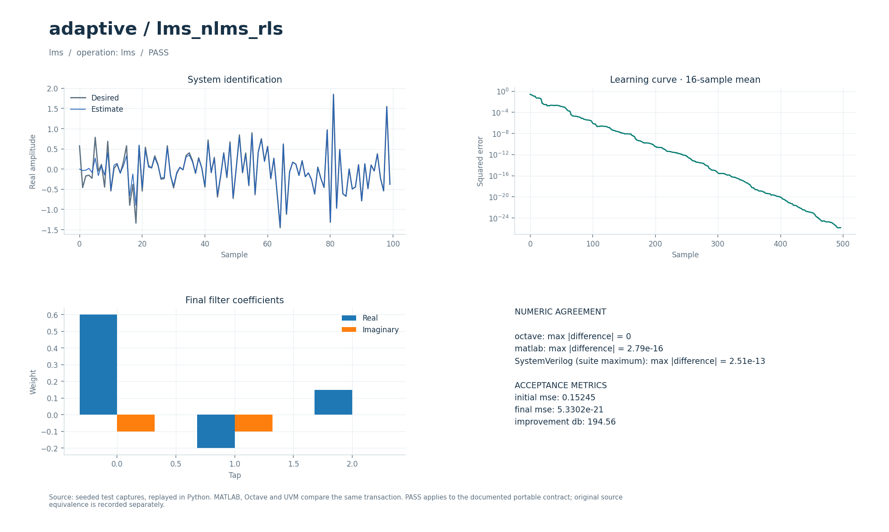

# Адаптивные фильтры LMS, NLMS и RLS

Комплексные адаптивные фильтры для идентификации линейной системы по входному и желаемому сигналам. Выход содержит предсказания, ошибки и итоговые коэффициенты.

## Что это

Операции `lms`, `nlms`, `rls` задают переносимый числовой контракт. Исторический прототип — MATLAB-функции `myLMS`, `myNLMS`, `myRLS` и демонстрации адаптивной фильтрации, подавления шума и эха из коллекции DSP от 2026-09-30. Проверяются сходимость и восстановление коэффициентов. Отдельное сохранённое сравнение с оригинальными MATLAB-функциями учитывает порядок весов и начальную ковариацию; все исторические демонстрации этим сравнением не охвачены.

Доступны Python, Octave/MATLAB и поведенческий SystemVerilog с UVM sequence, driver, monitor и scoreboard. Локальные файлы — обёртки общих ядер. [Снимок проверки от 2026-10-01](../../../docs/typed_verification_results.json) сохраняет PASS для своей версии исходников; после изменений нужна повторная регрессия.

Историческая модель в публичный репозиторий не входит. Происхождение файлов, размер каждого в байтах и SHA-256 записаны в [model.json](model.json). Обычные переносимые сценарии работают без исторических материалов.

### Историческое демо

Это алгоритмы обработки сигналов, без модуляции и созвездия. Первый опыт: сумма синусоид 723 и 456 Гц → аддитивный белый шум → адаптивный FIR, обучаемый по известному чистому сигналу. Второй: синусоида 20 Гц с шумом → вычитание оценки шума, построенной по отдельному опорному входу. В ANC полезным выходом является остаток `e=d-y`, а в первом опыте — оценка `y`.

`run_demo` вызывает оригинальные `myLMS`, `myNLMS`, `myRLS`. Частота дискретизации 8000 Гц, 20 коэффициентов, дисперсия белого шума 0,01. Сравнение использует `mu_LMS=0.001`, `mu_NLMS=0.01`, регуляризацию NLMS `a=0.01`, `lambda_RLS=0.9999`. Отдельно показаны четыре набора шага/забывания из `demo3.m`. ANC использует нелинейный опорный сигнал `sin(1/(1+exp(-noise)))` из `demo2.m`, шаги 0,1 и 0,8, λ=0,9999.

Опорный сигнал известен из генератора: это учебный сценарий, а не готовый слепой шумоподавитель. Символьной/фазовой синхронизации и АРУ здесь нет; параметры «отсчётов на символ» неприменимы.

## Как работает

1. В `signal` поступает комплексный вход `x`, в `auxiliary` — желаемый выход `d` той же длины.
2. История `u = [x[k], x[k−1], …]` начинается с нулей. Предсказание `z = wᴴu`, ошибка `e = d−z`; начальные веса нулевые.
3. LMS обновляет `w ← w + μu·conj(e)`. NLMS использует шаг `μ/(ε + uᴴu)`.
4. RLS начинает с `P = I/ε`, вычисляет `g = Pu/(λ + uᴴPu)`, затем `w ← w + g·conj(e)` и `P ← (P−guᴴP)/λ`.
5. Выход — плоский массив из `N` предсказаний, `N` ошибок и `T` итоговых весов. Для сравнения с коэффициентами обычной свёртки веса нужно сопрячь: предсказание использует `wᴴu`.

| Параметр | Смысл | Значение в регрессии |
| --- | --- | --- |
| `parameters[0]` | Число отводов `T` | `3` |
| `parameters[1]` | Шаг LMS/NLMS или забывание RLS | `0.05` / `0.6` / `0.995` |
| `parameters[2]` | `ε > 0`: регуляризация NLMS, масштаб начальной `P` RLS | `0.01` |
| `N` | Длина входа и желаемого сигнала | `512` |
| Истинная система | Коэффициенты свёртки | `[0.6+0.1j, −0.2+0.1j, 0.15]` |
| Длина результата | `2N+T` | `1027` |

Параметры регрессии взяты из [проверочных сценариев](../../../tools/research_cases.py), ограничения входов — из [валидатора](../../../common/python/research_validate.py). Значения сценариев передаются явно. Python API — `run(operation, parameters, signal, auxiliary)`, M-вход — `run_model` с теми же аргументами (четвёртый можно опустить у операций, не использующих `auxiliary`). Массивы плоские, матрицы передаются по строкам, индексы начинаются с нуля. Полный [числовой контракт](../../../docs/TYPED_MODELS.md) задаёт порядок элементов и единицы. Комментарии локальных обёрток написаны на русском; диагностика и подписи готовых графиков — на английском.

Поведенческий SV обрабатывает целый блок с арифметикой `real`. Общий `research_if` передаёт `operation`, `parameters`, `signal_in`, `auxiliary`, `valid`, `done`, `result`; ожидаемый ответ не поступает в DUT. Это симуляционная реализация, не синтезируемый fixed-point RTL.

Отдельные [lms_filter.sv](../../../rtl/common/lms_filter.sv) и [rls_filter.sv](../../../rtl/common/rls_filter.sv) принимают пары `(x,d)` через `s_valid/s_ready/s_last`. На `m_*` выдаются предсказание и ошибка, на независимом `w_valid/w_ready/w_last` — итоговые веса. Вход, выход и выгружаемые веса — signed18 Q15; внутренние веса — signed34 Q30, ковариация RLS — signed44 Q28. Каждая транзакция начинает адаптацию заново. LMS/NLMS имеют интервал приёма 8 тактов внутри кадра; для RLS измерены 91/97/112 тактов при `T=1/3/8`. Выгрузка весов и остановки выходов увеличивают время кадра. Настройка — в [DSP_RTL.md](../../../docs/DSP_RTL.md), актуальные такты и взаимодействие двух выходов — в [RTL_SYNC_ADAPTIVE_RATES.md](../../../docs/RTL_SYNC_ADAPTIVE_RATES.md), промежуточные ширины LMS — в [RTL_LMS_WIDTHS.md](../../../docs/RTL_LMS_WIDTHS.md).

В обозначении Q число после Q — количество дробных бит; например, signed18 Q15 представляет целый код, делённый на `32768`. Потоковые RTL-интерфейсы используют плоские порты; передача происходит на фронте при `valid && ready`.

## Структура каталога

| Файл/подкаталог | Назначение |
| --- | --- |
| [model.json](model.json) | Операции, имена сценариев, ограничения и манифест исторических файлов |
| [python/model.py](python/model.py) | Python-вход в общее ядро |
| [octave/run_model.m](octave/run_model.m), [matlab/run_model.m](matlab/run_model.m) | M-обёртки без дополнительных toolbox |
| [sv/model.sv](sv/model.sv) | Обёртка поведенческого DUT |
| [tb/testbench.sv](tb/testbench.sv), [tb/run.sh](tb/run.sh) | Подключение общего UVM-стенда и запуск выбранного workspace |
| [tests/test_model.py](tests/test_model.py) | Локальный unittest, запускающий Python-сценарии этого модуля |
| [research_core.py](../../../common/python/research_core.py), [research_core.m](../../../common/octave/research_core.m) | Общая реализация алгоритмов |
| [research_cases.py](../../../tools/research_cases.py), [research_tb.sv](../../../common/sv/research_tb.sv) | Проверочные сигналы, независимые критерии и UVM-окружение |

[run_demo.m](run_demo.m) запускает выбранные исходные скрипты и функции из локального `original/`. Этот подкаталог исключён из публичной поставки; его содержимое описывает [model.json](model.json).

## Как запустить

Команды выполняются из корня проекта. Python-ядру нужен NumPy, проверочному runner также SciPy; они перечислены в [requirements-visual.txt](../../../requirements-visual.txt) вместе с Matplotlib для графиков. Для `octave` нужен `octave-cli`, для `matlab` — MATLAB; переносимые M-файлы не требуют дополнительных пакетов или toolbox. [MATLAB launcher](../../../tools/matlab.sh) поддерживает `MATLAB_ROOT`; R2020b на проверявшемся хосте нужно запускать из терминала. Для `hdl` нужна Questa с UVM 1.2, при нестандартной установке задаются `QUESTA_HOME` и `UVM_HOME`.

```bash
python3 tools/run_research.py --suite python --workspace adaptive/lms_nlms_rls
python3 tools/run_research.py --suite octave --workspace adaptive/lms_nlms_rls
python3 tools/run_research.py --suite matlab --workspace adaptive/lms_nlms_rls
python3 tools/run_research.py --suite hdl --workspace adaptive/lms_nlms_rls
```

Первая команда выполняет числовые проверки Python, вторая и третья сравнивают M-ядро с Python, четвёртая выполняет UVM и отрицательный контроль. Все варианты сначала рассчитывают Python-эталон. `--suite all` объединяет Python, Octave и HDL; MATLAB запускается отдельно. Не используйте `python -O`: проверки требуют включённых `assert`. Локальный `tb/run.sh` вызывает тот же runner с `--suite hdl` и передаёт дополнительные аргументы.

Для отдельной fixed-point RTL-проверки нужны также Verilator для lint и зависимости [requirements-rtl.txt](../../../requirements-rtl.txt) вместе с указанными выше:

```bash
python3 tools/run_lms.py --suite all
python3 tools/run_rls.py --suite all
```

Эти команды проверяют целочисленные модели, lint и симуляцию RTL; вендорный синтез в них не запускается.

Сравнение исторических функций требует полного локального набора исходников, в том числе материалов других модулей:

```bash
python3 tools/run_matlab_evidence.py --suite references
python3 tools/check_research_references.py
```

Вторая команда читает MATLAB-захваты первой; без исторических исходников этот маршрут недоступен. Оригинальная RLS-проверка использует `ε=100` для согласования начальной `P`, тогда как переносимый сценарий использует `0.01`.

### Исторические скрипты: run_demo

В MATLAB/Octave перейдите в `algorithms/adaptive/lms_nlms_rls` и выполните:

```matlab
run_demo
```

`run_demo(N)` вызывает исходные `myLMS`, `myNLMS`, `myRLS` в синтетических сценариях `demo3.m` и ANC из `demo2.m`. По умолчанию N=16000, допустимо целое N≥1000; `r = run_demo(8000)` возвращает MSE и веса. Нужен базовый MATLAB или Octave; `wgn` заменён на `randn`, WAV и аудиоустройство не используются.

`run_demo` требует исходников в `original/`, которых нет в публичной копии: см. [THIRD_PARTY.md](../../../THIRD_PARTY.md). Переносимые `tools/run_research.py`, `python/model.py` и `octave/run_model.m` работают и в публичной копии при наличии указанных выше зависимостей.

## Что смотреть

Артефакты выбранного workspace находятся в `build/typed/adaptive__lms_nlms_rls/`: `cases.json` содержит сценарии и метрики, `case_*.npz` — массивы `parameters/x/a/y`, `vectors.txt` — векторы UVM, `<suite>_results.json` — итог. `octave_cases.json` и `matlab_cases.json` сохраняют максимальные ошибки по случаям; журналы UVM — в `questa/`.

Сценарии `lms`, `nlms`, `rls` требуют, чтобы MSE последних 128 ошибок была меньше `0.02` от MSE первых 32, а сопряжённые итоговые веса совпадали с истинными с абсолютным допуском `0.002`. Метрики `initial_mse`, `final_mse`, `improvement_db = 10·log10(initial_mse/final_mse)` показывают уменьшение ошибки на данном сигнале.

Успешный runner завершается кодом 0, сообщает `PASS` и записывает итоговый `status: PASS` после завершения проверок. UVM выполняет каждый сценарий дважды со сбросом между последовательностями, сверяет метаданные, длину и все значения с допуском `1e-8·(1+|expected|)`. В основном `questa/simulation.log` требуются `UVM_ERROR: 0` и `UVM_FATAL: 0`. Отдельный `questa/negative_control.log` должен содержать обнаруженное намеренное числовое несовпадение; такой отказ является успешным отрицательным контролем. Незавершённый `RUNNING` или ненулевой код runner не означают PASS. Артефакты отдельного RTL-прогона: `build/rtl/lms/` и `build/rtl/rls/`.

[Визуальный отчёт](../../../docs/typed_visual/index.html#adaptive/lms_nlms_rls) · [Контракт и проверка](../../../docs/TYPED_MODELS.md) · [Python-вход](python/model.py) · [Octave-вход](octave/run_model.m) · [UVM launcher](tb/run.sh)



### Графики run_demo

Пять окон: три сравнения шага/забывания LMS/NLMS/RLS (последний коэффициент и ошибка с усреднением по 200 отсчётам), `Adaptive filters: demo3 comparison` (чистый, шумный, восстановленный сигналы и MSE), `ANC: synthetic scenario from demo2` (полезный сигнал и остаток e=d−y). В первой задаче полезный выход — y, в ANC — e. Порядок хранения весов LMS/NLMS и RLS различается, последние коэффициенты не обязаны совпадать.

## Ограничения

Проверяется короткая стационарная система; аудиодемонстрации и все варианты подавления эха не перенесены. Положительные шаг и `ε` проверяются на входе, но сами по себе не гарантируют сходимость для произвольного сигнала. Длина желаемого сигнала должна совпадать с длиной входа. Исторические сравнения доступны только при наличии исключённых из публичной поставки исходников.

Совпадение Python/M/SV проверяет заявленный переносимый контракт. Fixed-point RTL сравнивается с отдельными целочисленными эталонами, а его расхождение с плавающей моделью оценивается отдельно. Вендорный синтез этих потоковых блоков в документации отложен; новые ресурсы и физическая частота FPGA не приняты.

`run_demo` проверяет отдельный исторический сценарий; его параметры и зависимости отличаются от переносимого контракта выше. Наличие обёртки не означает совместимость всей исходной коллекции с текущими MATLAB/Octave.
