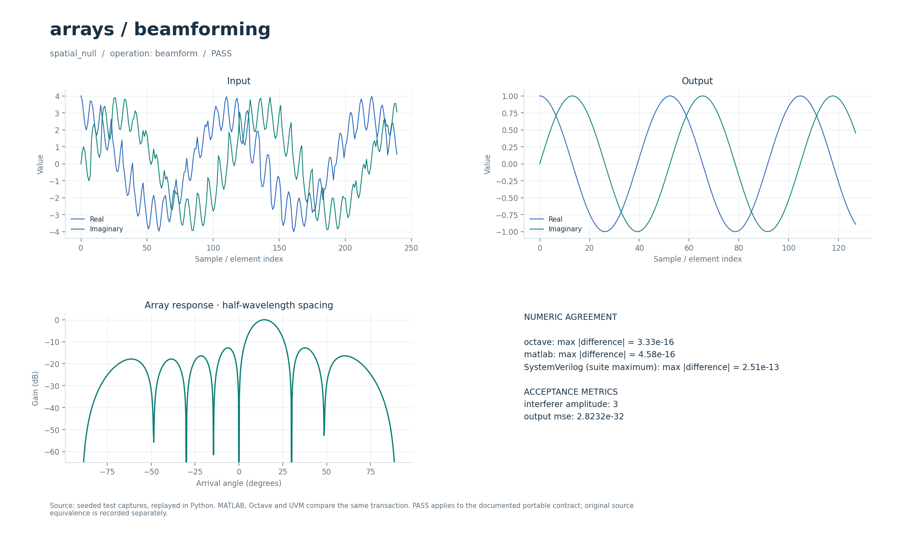

# Формирование луча антенной решётки

Нормированное комплексное суммирование каналов по заданному вектору направления. Аналитический тест показывает выделение полезного сигнала и пространственный нуль на помеху.

## Что это

Операция `beamform` реализует узкополосный delay-and-sum через комплексные фазовые веса. Историческая основа — собрание MATLAB-рисунков и вспомогательных функций по обработке антенных решёток: 188 программных файлов объединены в одну группу. Их индивидуальные главы и рисунки этой операцией не воспроизведены. Проверяется один аналитический сценарий пространственного подавления; эквивалентность всем историческим функциям не заявляется.

Доступны Python, Octave/MATLAB и поведенческий SystemVerilog с UVM sequence, driver, monitor и scoreboard. Локальные файлы — обёртки общих ядер. [Снимок проверки от 2026-10-01](../../../docs/typed_verification_results.json) сохраняет PASS для своей версии исходников; после изменений нужна повторная регрессия.

Историческая модель в публичный репозиторий не входит. Происхождение файлов, размер каждого в байтах и SHA-256 записаны в [model.json](model.json). Обычные переносимые сценарии работают без исторических материалов.

### Историческое демо

Учебные рисунки из комплекта Fundamentals of Signal Enhancement and Array Signal Processing. Цепочка: плоская звуковая волна → линейная решётка → фазовые сдвиги каналов и суммирование → пространственная характеристика. Модуляции, созвездия, символьной/фазовой синхронизации, АРУ и эквалайзера нет; число отсчётов на символ неприменимо.

Для диаграмм используется исходный `Fig7_4.m`: восемь микрофонов, шаг 3 см, скорость звука 340 м/с, направление 90°, частоты 1, 2, 4 и 8 кГц. Веса `h=d/M` соответствуют delay-and-sum. Углы наблюдения от −180° до 180° с шагом 1°, модуль отклика нормирован по максимуму. `Fig7_2.m` показывает теоретическое усиление по пространственно белому шуму `10*log10(M)` для 2, 4, 6 и 8 датчиков.

## Как работает

1. `signal` содержит снимки решётки: сначала все `M` каналов одного момента, затем следующего. `auxiliary` содержит комплексный вектор направления `a` длины `M`.
2. Для каждого снимка вычисляется `y[t] = Σ_m x[t,m]·conj(a[m]) / Σ_m |a[m]|²`.
3. При `x[t,m] = s[t]·a[m]` полезный сигнал проходит с единичным усилением. Компонента с ортогональным вектором направления подавляется.
4. Результат — по одному комплексному значению на снимок; решения по символам не принимаются.

| Параметр | Значение в регрессии | Смысл |
| --- | --- | --- |
| `parameters[0] = M` | `8` | Число каналов |
| Число снимков | `128` | Вход из `1024` значений, выход из `128` |
| `a[m]` | `exp(2j·π·m·0.125)` | Вектор полезного направления |
| Полезный сигнал | `exp(0.12j·t)` | Аналитический ожидаемый выход |
| Помеха | `3·exp(0.47j·t)` во всех каналах | Пространственно постоянный вектор |
| Допустимая энергия весов | `1e-24…1e300` | Защита нормировки |

Параметры регрессии взяты из [проверочных сценариев](../../../tools/research_cases.py), ограничения входов — из [валидатора](../../../common/python/research_validate.py). Значения сценариев передаются явно. Python API — `run(operation, parameters, signal, auxiliary)`, M-вход — `run_model` с теми же аргументами (четвёртый можно опустить у операций, не использующих `auxiliary`). Массивы плоские, матрицы передаются по строкам, индексы начинаются с нуля. Полный [числовой контракт](../../../docs/TYPED_MODELS.md) задаёт порядок элементов и единицы. Комментарии локальных обёрток написаны на русском; диагностика и подписи готовых графиков — на английском.

Поведенческий SV обрабатывает целый блок с арифметикой `real`. Общий `research_if` передаёт `operation`, `parameters`, `signal_in`, `auxiliary`, `valid`, `done`, `result`; ожидаемый ответ не поступает в DUT. Это симуляционная реализация, не синтезируемый fixed-point RTL.

Отдельный [beamform.sv](../../../rtl/common/beamform.sv) загружает веса через `cfg_valid/cfg_ready/cfg_last`, затем поднимает `configured` после расчёта нормировки. Веса, вход и выход — signed18 Q15. Снимок состоит из `M` передач `s_valid && s_ready`; `s_last` допустим на границе снимка, `m_last` отмечает последний выход транзакции. При готовом выходе принимается один отсчёт канала за такт; на снимок получается один результат. Выходная FIFO имеет 8 слов. Default `ENERGY_WIDTH=36+LOG2M`; проверены вместимости до 64 каналов. В направленных тестах время до `norm_done` после последнего коэффициента равно 67/72/73 тактам при ширинах 36/41/42. См. [DSP_RTL.md](../../../docs/DSP_RTL.md) и [проверку энергии весов](../../../docs/RTL_BEAM_ENERGY.md).

В обозначении Q число после Q — количество дробных бит; например, signed18 Q15 представляет целый код, делённый на `32768`. Потоковые RTL-интерфейсы используют плоские порты; передача происходит на фронте при `valid && ready`.

## Структура каталога

| Файл/подкаталог | Назначение |
| --- | --- |
| [model.json](model.json) | Операции, имена сценариев, ограничения и манифест исторических файлов |
| [python/model.py](python/model.py) | Python-вход в общее ядро |
| [octave/run_model.m](octave/run_model.m), [matlab/run_model.m](matlab/run_model.m) | M-обёртки без дополнительных toolbox |
| [sv/model.sv](sv/model.sv) | Обёртка поведенческого DUT |
| [tb/testbench.sv](tb/testbench.sv), [tb/run.sh](tb/run.sh) | Подключение общего UVM-стенда и запуск выбранного workspace |
| [tests/test_model.py](tests/test_model.py) | Локальный unittest, запускающий Python-сценарии этого модуля |
| [research_core.py](../../../common/python/research_core.py), [research_core.m](../../../common/octave/research_core.m) | Общая реализация алгоритмов |
| [research_cases.py](../../../tools/research_cases.py), [research_tb.sv](../../../common/sv/research_tb.sv) | Проверочные сигналы, независимые критерии и UVM-окружение |

[run_demo.m](run_demo.m) запускает выбранные исходные скрипты и функции из локального `original/`. Этот подкаталог исключён из публичной поставки; его содержимое описывает [model.json](model.json).

## Как запустить

Команды выполняются из корня проекта. Python-ядру нужен NumPy, проверочному runner также SciPy; они перечислены в [requirements-visual.txt](../../../requirements-visual.txt) вместе с Matplotlib для графиков. Для `octave` нужен `octave-cli`, для `matlab` — MATLAB; переносимые M-файлы не требуют дополнительных пакетов или toolbox. [MATLAB launcher](../../../tools/matlab.sh) поддерживает `MATLAB_ROOT`; R2020b на проверявшемся хосте нужно запускать из терминала. Для `hdl` нужна Questa с UVM 1.2, при нестандартной установке задаются `QUESTA_HOME` и `UVM_HOME`.

```bash
python3 tools/run_research.py --suite python --workspace arrays/beamforming
python3 tools/run_research.py --suite octave --workspace arrays/beamforming
python3 tools/run_research.py --suite matlab --workspace arrays/beamforming
python3 tools/run_research.py --suite hdl --workspace arrays/beamforming
```

Первая команда выполняет числовые проверки Python, вторая и третья сравнивают M-ядро с Python, четвёртая выполняет UVM и отрицательный контроль. Все варианты сначала рассчитывают Python-эталон. `--suite all` объединяет Python, Octave и HDL; MATLAB запускается отдельно. Не используйте `python -O`: проверки требуют включённых `assert`. Локальный `tb/run.sh` вызывает тот же runner с `--suite hdl` и передаёт дополнительные аргументы.

Для отдельной fixed-point RTL-проверки нужны также Verilator для lint и зависимости [requirements-rtl.txt](../../../requirements-rtl.txt) вместе с указанными выше:

```bash
python3 tools/run_beam.py --suite all
```

Эти команды проверяют целочисленные модели, lint и симуляцию RTL; вендорный синтез в них не запускается.

`run_beam.py` одновременно проверяет beamformer и Alamouti, включая дополнительные проверки энергии и ширин. Исторические файлы этим командам не нужны.

### Исторические скрипты: run_demo

В MATLAB/Octave перейдите в `algorithms/arrays/beamforming` и выполните:

```matlab
run_demo
```

Вызываются исходные `Fig7_4.m` и `Fig7_2.m` с `db_polar_m.m`. Строка очистки окон и workspace пропускается, скрипты исполняются в отдельных областях переменных. Нужен базовый MATLAB или Octave. `r = run_demo` возвращает диаграмму и усиление по шуму; файлы не записываются.

`run_demo` требует исходников в `original/`, которых нет в публичной копии: см. [THIRD_PARTY.md](../../../THIRD_PARTY.md). Переносимые `tools/run_research.py`, `python/model.py` и `octave/run_model.m` работают и в публичной копии при наличии указанных выше зависимостей.

## Что смотреть

Артефакты выбранного workspace находятся в `build/typed/arrays__beamforming/`: `cases.json` содержит сценарии и метрики, `case_*.npz` — массивы `parameters/x/a/y`, `vectors.txt` — векторы UVM, `<suite>_results.json` — итог. `octave_cases.json` и `matlab_cases.json` сохраняют максимальные ошибки по случаям; журналы UVM — в `questa/`.

Сценарий `spatial_null` сравнивает выход с аналитическим полезным сигналом: абсолютный и относительный допуски `2e-10`. `interferer_amplitude` показывает исходную амплитуду помехи, `output_mse` — среднюю мощность разности выхода и полезного сигнала. Дополнительные измерения точности общих Q15-входов описаны в [RTL_LINEAR_PRECISION.md](../../../docs/RTL_LINEAR_PRECISION.md).

Успешный runner завершается кодом 0, сообщает `PASS` и записывает итоговый `status: PASS` после завершения проверок. UVM выполняет каждый сценарий дважды со сбросом между последовательностями, сверяет метаданные, длину и все значения с допуском `1e-8·(1+|expected|)`. В основном `questa/simulation.log` требуются `UVM_ERROR: 0` и `UVM_FATAL: 0`. Отдельный `questa/negative_control.log` должен содержать обнаруженное намеренное числовое несовпадение; такой отказ является успешным отрицательным контролем. Незавершённый `RUNNING` или ненулевой код runner не означают PASS. Артефакты отдельного RTL-прогона: `build/rtl/beam/`.

[Визуальный отчёт](../../../docs/typed_visual/index.html#arrays/beamforming) · [Контракт и проверка](../../../docs/TYPED_MODELS.md) · [Python-вход](python/model.py) · [Octave-вход](octave/run_model.m) · [UVM launcher](tb/run.sh)



### Графики run_demo

Пять окон: четыре полярные диаграммы восьми микрофонов с шагом 3 см при 1/2/4/8 кГц и усиление delay-and-sum по белому шуму для M=2/4/6/8. Диаграммы нормированы по максимуму, диапазон 0…−50 дБ; усиление равно примерно 3.01/6.02/7.78/9.03 дБ. Это пространственные характеристики, без реальной аудиозаписи и BER.

## Ограничения

Весовой вектор задаётся извне; оценки направления, адаптивного поиска нулей и широкополосных временных задержек здесь нет. Тест использует специально ортогональные направления и не характеризует подавление произвольного источника или полную диаграмму реальной антенны. Проверка всех 188 исторических программ и их рисунков потребовала бы отсутствующих исходников; данный runner её не выполняет.

Совпадение Python/M/SV проверяет заявленный переносимый контракт. Fixed-point RTL сравнивается с отдельными целочисленными эталонами, а его расхождение с плавающей моделью оценивается отдельно. Вендорный синтез этих потоковых блоков в документации отложен; новые ресурсы и физическая частота FPGA не приняты.

`run_demo` проверяет отдельный исторический сценарий; его параметры и зависимости отличаются от переносимого контракта выше. Наличие обёртки не означает совместимость всей исходной коллекции с текущими MATLAB/Octave.
