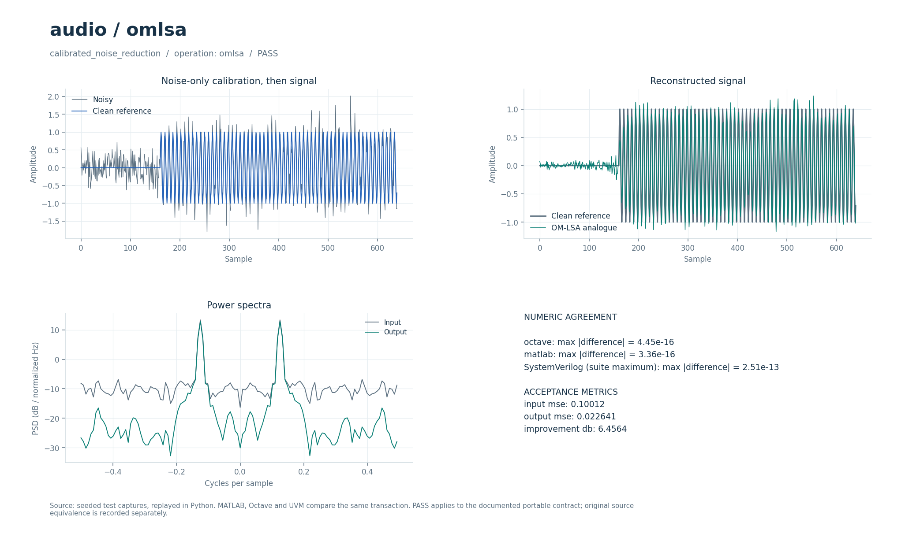

# Спектральное шумоподавление OM-LSA

Обработка сигнала в STFT-области с оценкой априорного SNR и вероятности присутствия речи. Шум калибруется по начальному участку, затем спектральное усиление применяется к каждому кадру.

## Что это

Операция `omlsa` — переносимый вариант спектрального усиления OM-LSA. Исторический прототип — MATLAB-файл `omlsa.m` с OM-LSA/IMCRA из коллекции DSP от 2026-09-30. Текущий контракт использует фиксированную оценку шума и не воспроизводит исторический IMCRA tracker. Проверяются уменьшение MSE на синтетическом сигнале и отсутствие усиленного краевого артефакта; эквивалентность полной исторической процедуре не установлена.

Доступны Python, Octave/MATLAB и поведенческий SystemVerilog с UVM sequence, driver, monitor и scoreboard. Локальные файлы — обёртки общих ядер. [Снимок проверки от 2026-10-01](../../../docs/typed_verification_results.json) сохраняет PASS для своей версии исходников; после изменений нужна повторная регрессия.

Историческая модель в публичный репозиторий не входит. Происхождение файлов, размер каждого в байтах и SHA-256 записаны в [model.json](model.json). Обычные переносимые сценарии работают без исторических материалов.

## Как работает

1. Вход дополняется отражением на `N` отсчётов с каждой стороны, чтобы обеспечить перекрытие окон на границах.
2. Вычисляется полный комплексный STFT с окном `sqrt(0.5−0.5·cos(2π(k+0.5)/N))` и шагом `H`.
3. Мощность шума — среднее первых `nnoise` кадров дополненного сигнала с нижней границей `1e-9`. Соответствующий начальный участок должен содержать только шум.
4. Для каждого бина: `γ = |S|²/noise`, `ξ = max(α·previous + (1−α)·max(γ−1,0), 1e-5)`, `v = γξ/(1+ξ)`.
5. Базовое усиление `G1 = ξ/(1+ξ)·exp(E1(v)/2)` ограничивается диапазоном `0.05…1`. Вероятность присутствия `p = 1/(1+0.25·(1+ξ)·exp(−v))` даёт итог `G = G1^p·0.05^(1−p)`. Сохраняется `previous = |G·S|²/noise`.
6. Нормированный overlap-add восстанавливает сигнал; отражённые края удаляются. Длина выхода равна длине входа. `auxiliary` не используется.

| Параметр | Значение в регрессии | Смысл |
| --- | --- | --- |
| `parameters[0] = N` | `32` | Размер FFT |
| `parameters[1] = H` | `8` | Шаг кадров, `H ≤ N` |
| `parameters[2] = nnoise` | `12` | Число кадров калибровки после дополнения |
| `parameters[3] = alpha` | `0.92` | Сглаживание, `0 ≤ α < 1` |
| Длина | `640` | Число входных и выходных отсчётов |
| Полезный сигнал | Синус `0.125` цикла/отсчёт с индекса `160` | До него — шумовой участок |
| Шум | `0.32·normal(...)` | Вещественный гауссов шум |

Параметры регрессии взяты из [проверочных сценариев](../../../tools/research_cases.py), ограничения входов — из [валидатора](../../../common/python/research_validate.py). Значения сценариев передаются явно. Python API — `run(operation, parameters, signal, auxiliary)`, M-вход — `run_model` с теми же аргументами (четвёртый можно опустить у операций, не использующих `auxiliary`). Массивы плоские, матрицы передаются по строкам, индексы начинаются с нуля. Полный [числовой контракт](../../../docs/TYPED_MODELS.md) задаёт порядок элементов и единицы. Комментарии локальных обёрток написаны на русском; диагностика и подписи готовых графиков — на английском.

Поведенческий SV обрабатывает целый блок с арифметикой `real`. Общий `research_if` передаёт `operation`, `parameters`, `signal_in`, `auxiliary`, `valid`, `done`, `result`; ожидаемый ответ не поступает в DUT. Это симуляционная реализация, не синтезируемый fixed-point RTL.

Отдельный [omlsa.sv](../../../rtl/common/omlsa.sv) содержит `reflect_pad → stft_analysis → omlsa_gain → stft_synthesis →` вырезку исходной длины. Вход и выход — signed18 Q15 через `s_valid/s_ready/s_last` и `m_valid/m_ready/m_last`. Конфигурация `cfg_nnoise` допускает `1…16`, `cfg_alpha = round(α·65536)`; поддержаны `(N,H)=(16,4),(32,8),(64,16)`. Спектры — signed24 Q19, отношения SNR и усиления используют Q16. Табличные функции и конечные ширины описаны в [DSP_RTL.md](../../../docs/DSP_RTL.md) и [RTL_OMLSA_WIDTHS.md](../../../docs/RTL_OMLSA_WIDTHS.md). Латентность зависит от калибровки и кадров; темп один входной отсчёт за такт не обеспечивается.

В обозначении Q число после Q — количество дробных бит; например, signed18 Q15 представляет целый код, делённый на `32768`. Потоковые RTL-интерфейсы используют плоские порты; передача происходит на фронте при `valid && ready`.

## Структура каталога

| Файл/подкаталог | Назначение |
| --- | --- |
| [model.json](model.json) | Операции, имена сценариев, ограничения и манифест исторических файлов |
| [python/model.py](python/model.py) | Python-вход в общее ядро |
| [octave/run_model.m](octave/run_model.m), [matlab/run_model.m](matlab/run_model.m) | M-обёртки без дополнительных toolbox |
| [sv/model.sv](sv/model.sv) | Обёртка поведенческого DUT |
| [tb/testbench.sv](tb/testbench.sv), [tb/run.sh](tb/run.sh) | Подключение общего UVM-стенда и запуск выбранного workspace |
| [tests/test_model.py](tests/test_model.py) | Локальный unittest, запускающий Python-сценарии этого модуля |
| [research_core.py](../../../common/python/research_core.py), [research_core.m](../../../common/octave/research_core.m) | Общая реализация алгоритмов |
| [research_cases.py](../../../tools/research_cases.py), [research_tb.sv](../../../common/sv/research_tb.sv) | Проверочные сигналы, независимые критерии и UVM-окружение |

[run_demo.m](run_demo.m) запускает выбранные исходные скрипты и функции из локального `original/`. Этот подкаталог исключён из публичной поставки; его содержимое описывает [model.json](model.json).

## Как запустить

Команды выполняются из корня проекта. Python-ядру нужен NumPy, проверочному runner также SciPy; они перечислены в [requirements-visual.txt](../../../requirements-visual.txt) вместе с Matplotlib для графиков. Для `octave` нужен `octave-cli`, для `matlab` — MATLAB; переносимые M-файлы не требуют дополнительных пакетов или toolbox. [MATLAB launcher](../../../tools/matlab.sh) поддерживает `MATLAB_ROOT`; R2020b на проверявшемся хосте нужно запускать из терминала. Для `hdl` нужна Questa с UVM 1.2, при нестандартной установке задаются `QUESTA_HOME` и `UVM_HOME`.

```bash
python3 tools/run_research.py --suite python --workspace audio/omlsa
python3 tools/run_research.py --suite octave --workspace audio/omlsa
python3 tools/run_research.py --suite matlab --workspace audio/omlsa
python3 tools/run_research.py --suite hdl --workspace audio/omlsa
```

Первая команда выполняет числовые проверки Python, вторая и третья сравнивают M-ядро с Python, четвёртая выполняет UVM и отрицательный контроль. Все варианты сначала рассчитывают Python-эталон. `--suite all` объединяет Python, Octave и HDL; MATLAB запускается отдельно. Не используйте `python -O`: проверки требуют включённых `assert`. Локальный `tb/run.sh` вызывает тот же runner с `--suite hdl` и передаёт дополнительные аргументы.

Для отдельной fixed-point RTL-проверки нужны также Verilator для lint и зависимости [requirements-rtl.txt](../../../requirements-rtl.txt) вместе с указанными выше:

```bash
python3 tools/run_omlsa.py --suite all
```

Эти команды проверяют целочисленные модели, lint и симуляцию RTL; вендорный синтез в них не запускается.

`run_omlsa.py` проверяет также STFT, таблицы и промежуточные ширины усиления. Исторический `omlsa.m` для этих запусков не нужен. Проверка оригинальной OM-LSA/IMCRA-процедуры возможна только при наличии исторических материалов и данным переносимым runner не выполняется.

### Исторические скрипты: run_demo

В MATLAB/Octave перейдите в `algorithms/audio/omlsa` и выполните:

```matlab
run_demo
```

Обёртка вызывает исходную `omlsa` на синтетическом тоне 440 Гц с шумом, Fs=16 кГц, длительность 1 с; первые 0.25 с содержат только шум. Временные PCM16 WAV создаются в системной временной папке и удаляются при выходе. Исходник показывает waitbar; нужны графика и функции `hamming/hanning` (Signal Processing Toolbox в MATLAB). `r = run_demo` возвращает вход и обработанные отсчёты. Это вызов исторического OM-LSA/IMCRA, а не упрощённой переносимой операции `omlsa`.

`run_demo` требует исходников в `original/`, которых нет в публичной копии: см. [THIRD_PARTY.md](../../../THIRD_PARTY.md). Переносимые `tools/run_research.py`, `python/model.py` и `octave/run_model.m` работают и в публичной копии при наличии указанных выше зависимостей.

## Что смотреть

Артефакты выбранного workspace находятся в `build/typed/audio__omlsa/`: `cases.json` содержит сценарии и метрики, `case_*.npz` — массивы `parameters/x/a/y`, `vectors.txt` — векторы UVM, `<suite>_results.json` — итог. `octave_cases.json` и `matlab_cases.json` сохраняют максимальные ошибки по случаям; журналы UVM — в `questa/`.

В `calibrated_noise_reduction` MSE измеряется с индекса `224`: `input_mse`, `output_mse`, `improvement_db = 10·log10(input_mse/output_mse)`. Требуется `output_mse < input_mse` и `max(|y|) < 1.6`. В `case_*.npz` дополнительно сохраняется чистый сигнал `truth`. Функция `E1` сверяется со `scipy.special.exp1` на 70 аргументах от `1e-5` до `100` с допуском `2e-12`.

Успешный runner завершается кодом 0, сообщает `PASS` и записывает итоговый `status: PASS` после завершения проверок. UVM выполняет каждый сценарий дважды со сбросом между последовательностями, сверяет метаданные, длину и все значения с допуском `1e-8·(1+|expected|)`. В основном `questa/simulation.log` требуются `UVM_ERROR: 0` и `UVM_FATAL: 0`. Отдельный `questa/negative_control.log` должен содержать обнаруженное намеренное числовое несовпадение; такой отказ является успешным отрицательным контролем. Незавершённый `RUNNING` или ненулевой код runner не означают PASS. Артефакты отдельного RTL-прогона: `build/rtl/omlsa/`.

[Визуальный отчёт](../../../docs/typed_visual/index.html#audio/omlsa) · [Контракт и проверка](../../../docs/TYPED_MODELS.md) · [Python-вход](python/model.py) · [Octave-вход](octave/run_model.m) · [UVM launcher](tb/run.sh)



### Графики run_demo

Окно `Original OM-LSA/IMCRA: synthetic tone in noise`: временные сигналы до/после подавления шума, а также исходный индикатор выполнения. Синтетический тон не заменяет оценку качества речи. Исторический WAV-код сохраняет старый заголовок; обёртка читает выходной PCM напрямую и не предполагает равенства длин входа и выхода.

## Ограничения

В проверке обёртки GNU Octave 8.4.0 с gnuplot обработал 16000 отсчётов и прошёл проверки результата и восстановления состояния, но при завершении процесса получил segmentation fault (код 139). Повторный отдельный запуск воспроизвёл сбой. Поэтому успешное завершение `run_demo` для OM-LSA в этой среде не подтверждено; MATLAB этой обёрткой пока не проверялся.

После калибровки оценка шума не отслеживает его изменения; IMCRA не перенесён. Полезный сигнал в калибровочном участке искажает оценку. Регрессия использует синус, а не корпус речи; разборчивость и перцептивное качество не оценены. Вход должен быть длиннее FFT, число шумовых кадров — помещаться в дополненный STFT. RTL использует приближённые табличные функции и собственный целочисленный эталон.

Совпадение Python/M/SV проверяет заявленный переносимый контракт. Fixed-point RTL сравнивается с отдельными целочисленными эталонами, а его расхождение с плавающей моделью оценивается отдельно. Вендорный синтез этих потоковых блоков в документации отложен; новые ресурсы и физическая частота FPGA не приняты.

`run_demo` проверяет отдельный исторический сценарий; его параметры и зависимости отличаются от переносимого контракта выше. Наличие обёртки не означает совместимость всей исходной коллекции с текущими MATLAB/Octave.
