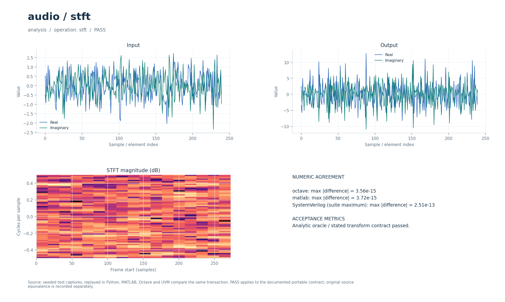

# STFT-анализ и восстановление сигнала

Кратковременное преобразование Фурье с полным комплексным спектром и восстановлением через нормированный overlap-add. Проверяется реконструкция конечного сигнала, включая первый и последний отсчёты.

## Что это

Операции `stft` и `istft` задают общий контракт анализа и синтеза. Исторический прототип — MATLAB-набор `stft.m`, `istft.m`, `biorwin.m` и функций сдвига из коллекции DSP от 2026-09-30. Переносимая версия использует явно выбранное sqrt-Hann окно; исторические соглашения о двойственном окне и частотной децимации отличаются. Межъязыковая проверка относится к новому контракту, а не к побитовому повторению оригинала.

Доступны Python, Octave/MATLAB и поведенческий SystemVerilog с UVM sequence, driver, monitor и scoreboard. Локальные файлы — обёртки общих ядер. [Снимок проверки от 2026-10-01](../../../docs/typed_verification_results.json) сохраняет PASS для своей версии исходников; после изменений нужна повторная регрессия.

Историческая модель в публичный репозиторий не входит. Происхождение файлов, размер каждого в байтах и SHA-256 записаны в [model.json](model.json). Обычные переносимые сценарии работают без исторических материалов.

## Как работает

1. `stft` берёт полные кадры длины `N` с шагом `H`. Неполный хвост не дополняется и не включается в спектры.
2. Окно `w[k] = sqrt(0.5−0.5·cos(2π(k+0.5)/N))` имеет ненулевые края. Каждый кадр умножается на окно и преобразуется прямым FFT без нормировки.
3. Выход анализа — полные комплексные спектры, сначала все `N` бинов первого кадра, затем второго. При длине входа `L` число кадров `F = 1+floor((L−N)/H)`.
4. `istft` принимает эти спектры, вычисляет IFFT с множителем `1/N`, повторно умножает на окно и складывает перекрывающиеся кадры.
5. Каждый отсчёт делится на сумму `w²` участвующих окон, с нижней границей знаменателя `1e-15`. Длина синтеза — `(F−1)H+N`. `auxiliary` не используется.

| Параметр | Значение в регрессии | Ограничение/смысл |
| --- | --- | --- |
| `parameters[0] = N` | `64` | Размер FFT, положительное целое |
| `parameters[1] = H` | `16` | Шаг кадров, `1 ≤ H ≤ N` |
| `L` | `320` | Вход анализа, комплексный гауссов сигнал |
| `F` | `17` | Полных кадров |
| Спектры | `1088` значений | `F·N`, порядок по кадрам |
| Восстановление | `320` значений | В данном тесте длина согласована с шагом |

Параметры регрессии взяты из [проверочных сценариев](../../../tools/research_cases.py), ограничения входов — из [валидатора](../../../common/python/research_validate.py). Значения сценариев передаются явно. Python API — `run(operation, parameters, signal, auxiliary)`, M-вход — `run_model` с теми же аргументами (четвёртый можно опустить у операций, не использующих `auxiliary`). Массивы плоские, матрицы передаются по строкам, индексы начинаются с нуля. Полный [числовой контракт](../../../docs/TYPED_MODELS.md) задаёт порядок элементов и единицы. Комментарии локальных обёрток написаны на русском; диагностика и подписи готовых графиков — на английском.

Поведенческий SV обрабатывает целый блок с арифметикой `real`. Общий `research_if` передаёт `operation`, `parameters`, `signal_in`, `auxiliary`, `valid`, `done`, `result`; ожидаемый ответ не поступает в DUT. Это симуляционная реализация, не синтезируемый fixed-point RTL.

Отдельные [stft_analysis.sv](../../../rtl/common/stft_analysis.sv) и [stft_synthesis.sv](../../../rtl/common/stft_synthesis.sv) используют потоковые `s_valid/s_ready/s_last` и `m_valid/m_ready/m_last`. Вход анализа и выход синтеза — signed18 Q15. Между ними спектр `X/N` в signed24 Q19: он масштабирован иначе, чем результат вещественной модели `stft`. Размеры `N=2^LOG2N`, `LOG2N=2…8`; `H=N/R`, `R∈{1,2,4}`. Анализ принимает полный сигнал, `m_last` отмечает последний бин всей транзакции. Один кадр требует `N` тактов FFT, входной темп анализа ограничен примерно `1/R` отсчёта за такт. Синтез выдаёт конечный хвост и ждёт его завершения перед следующей транзакцией. Произведения окна имеют default 41 бит, аккумуляторы — `41+LOG2N−LOG2HOP`. Архитектура, времена и точность — в [FFT_RTL.md](../../../docs/FFT_RTL.md), актуальные ширины — в [RTL_ISTFT_WIDTHS.md](../../../docs/RTL_ISTFT_WIDTHS.md).

В обозначении Q число после Q — количество дробных бит; например, signed18 Q15 представляет целый код, делённый на `32768`. Потоковые RTL-интерфейсы используют плоские порты; передача происходит на фронте при `valid && ready`.

## Структура каталога

| Файл/подкаталог | Назначение |
| --- | --- |
| [model.json](model.json) | Операции, имена сценариев, ограничения и манифест исторических файлов |
| [python/model.py](python/model.py) | Python-вход в общее ядро |
| [octave/run_model.m](octave/run_model.m), [matlab/run_model.m](matlab/run_model.m) | M-обёртки без дополнительных toolbox |
| [sv/model.sv](sv/model.sv) | Обёртка поведенческого DUT |
| [tb/testbench.sv](tb/testbench.sv), [tb/run.sh](tb/run.sh) | Подключение общего UVM-стенда и запуск выбранного workspace |
| [tests/test_model.py](tests/test_model.py) | Локальный unittest, запускающий Python-сценарии этого модуля |
| [research_core.py](../../../common/python/research_core.py), [research_core.m](../../../common/octave/research_core.m) | Общая реализация алгоритмов |
| [research_cases.py](../../../tools/research_cases.py), [research_tb.sv](../../../common/sv/research_tb.sv) | Проверочные сигналы, независимые критерии и UVM-окружение |

[run_demo.m](run_demo.m) запускает выбранные исходные скрипты и функции из локального `original/`. Этот подкаталог исключён из публичной поставки; его содержимое описывает [model.json](model.json).

## Как запустить

Команды выполняются из корня проекта. Python-ядру нужен NumPy, проверочному runner также SciPy; они перечислены в [requirements-visual.txt](../../../requirements-visual.txt) вместе с Matplotlib для графиков. Для `octave` нужен `octave-cli`, для `matlab` — MATLAB; переносимые M-файлы не требуют дополнительных пакетов или toolbox. [MATLAB launcher](../../../tools/matlab.sh) поддерживает `MATLAB_ROOT`; R2020b на проверявшемся хосте нужно запускать из терминала. Для `hdl` нужна Questa с UVM 1.2, при нестандартной установке задаются `QUESTA_HOME` и `UVM_HOME`.

```bash
python3 tools/run_research.py --suite python --workspace audio/stft
python3 tools/run_research.py --suite octave --workspace audio/stft
python3 tools/run_research.py --suite matlab --workspace audio/stft
python3 tools/run_research.py --suite hdl --workspace audio/stft
```

Первая команда выполняет числовые проверки Python, вторая и третья сравнивают M-ядро с Python, четвёртая выполняет UVM и отрицательный контроль. Все варианты сначала рассчитывают Python-эталон. `--suite all` объединяет Python, Octave и HDL; MATLAB запускается отдельно. Не используйте `python -O`: проверки требуют включённых `assert`. Локальный `tb/run.sh` вызывает тот же runner с `--suite hdl` и передаёт дополнительные аргументы.

Для отдельной fixed-point RTL-проверки нужны также Verilator для lint и зависимости [requirements-rtl.txt](../../../requirements-rtl.txt) вместе с указанными выше:

```bash
python3 tools/run_stft.py --suite all
```

Эти команды проверяют целочисленные модели, lint и симуляцию RTL; вендорный синтез в них не запускается.

`run_stft.py` сверяет анализ и синтез с целочисленным эталоном, проверяет таблицы и матрицу ширин ISTFT. Исторические M-файлы не нужны для этих команд; сравнение с их соглашениями потребовало бы исключённых исходников и отдельного адаптера.

### Исторические скрипты: run_demo

В MATLAB/Octave перейдите в `algorithms/audio/stft` и выполните:

```matlab
run_demo
```

Обёртка вызывает исходные `stft`, `istft`, `biorwin`, `shiftcir` для chirp при Fs=8 кГц, длине окна 256 и шаге 128. `r = run_demo` возвращает спектр, реконструкцию и максимальную ошибку во внутренней части записи. Нужна функция `hanning`: в MATLAB она относится к Signal Processing Toolbox, в Octave доступна в базовой поставке. Файлы не записываются.

`run_demo` требует исходников в `original/`, которых нет в публичной копии: см. [THIRD_PARTY.md](../../../THIRD_PARTY.md). Переносимые `tools/run_research.py`, `python/model.py` и `octave/run_model.m` работают и в публичной копии при наличии указанных выше зависимостей.

## Что смотреть

Артефакты выбранного workspace находятся в `build/typed/audio__stft/`: `cases.json` содержит сценарии и метрики, `case_*.npz` — массивы `parameters/x/a/y`, `vectors.txt` — векторы UVM, `<suite>_results.json` — итог. `octave_cases.json` и `matlab_cases.json` сохраняют максимальные ошибки по случаям; журналы UVM — в `questa/`.

Сценарий `analysis` создаёт спектры, `reconstruction` сравнивает восстановленный массив со всем исходным сигналом с `atol=rtol=2e-10`. Метрика `reconstruction_tolerance` фиксирует этот допуск. В fixed-point тракте отдельно важны максимальная ошибка на краях, ошибка внутри сигнала и RMS: деление на малую краевую сумму `w²` усиливает квантование. Примеры измерений приведены в [FFT_RTL.md](../../../docs/FFT_RTL.md).

Успешный runner завершается кодом 0, сообщает `PASS` и записывает итоговый `status: PASS` после завершения проверок. UVM выполняет каждый сценарий дважды со сбросом между последовательностями, сверяет метаданные, длину и все значения с допуском `1e-8·(1+|expected|)`. В основном `questa/simulation.log` требуются `UVM_ERROR: 0` и `UVM_FATAL: 0`. Отдельный `questa/negative_control.log` должен содержать обнаруженное намеренное числовое несовпадение; такой отказ является успешным отрицательным контролем. Незавершённый `RUNNING` или ненулевой код runner не означают PASS. Артефакты отдельного RTL-прогона: `build/rtl/stft/`.

[Визуальный отчёт](../../../docs/typed_visual/index.html#audio/stft) · [Контракт и проверка](../../../docs/TYPED_MODELS.md) · [Python-вход](python/model.py) · [Octave-вход](octave/run_model.m) · [UVM launcher](tb/run.sh)



### Графики run_demo

Окно `Original STFT/ISTFT: chirp and reconstruction`: спектрограмма chirp и исходная/восстановленная волны. Ошибка реконструкции проверяется во внутренней части записи (<1e−10), поскольку конечные края не имеют полного перекрытия. Этот опыт использует биортогональное окно оригинала.

## Ограничения

Синтез восстанавливает только область полных кадров; произвольный неполный хвост анализа теряется. Длина входа анализа должна быть не меньше `N`, длина спектрального массива синтеза — кратна `N`. Изменяемые окна, историческая частотная децимация и автоматическое построение двойственного окна не входят в контракт. Точная плавающая реконструкция не означает такой же точности RTL на краях. Для FFT/STFT в FFT_RTL.md сохранены исторические результаты физической сборки; они не подтверждают тайминг после последующих изменений ширин.

Совпадение Python/M/SV проверяет заявленный переносимый контракт. Fixed-point RTL сравнивается с отдельными целочисленными эталонами, а его расхождение с плавающей моделью оценивается отдельно. Физический статус FFT/STFT следует оценивать по снимку в [FFT_RTL.md](../../../docs/FFT_RTL.md); обновлённые ширины сами по себе не дают новой оценки ресурсов или Fmax.

`run_demo` проверяет отдельный исторический сценарий; его параметры и зависимости отличаются от переносимого контракта выше. Наличие обёртки не означает совместимость всей исходной коллекции с текущими MATLAB/Octave.
