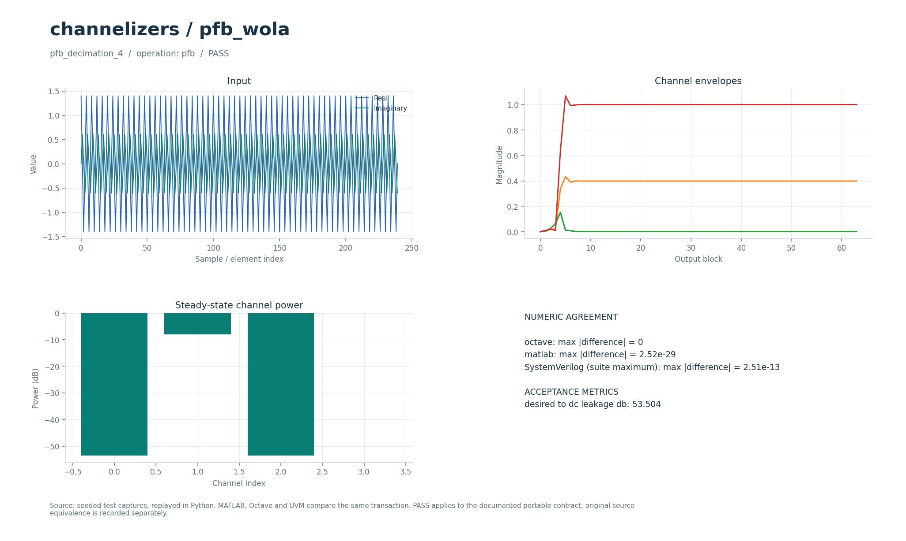
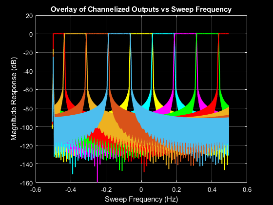

# Анализирующий банк каналов PFB/WOLA

Разделение комплексного сигнала на частотные каналы с FIR-прототипом и децимацией. Имена `pfb` и `wola` предоставляют одно явно определённое преобразование.

## Что это

Исторический прототип — MATLAB/Octave-функции `pfb_chanex` и `wola_chanex`, демонстрации и необязательный FFTW MEX из набора Explore Efficient Filterbank Channelizer Architectures. Переносимые реализации проверяются по независимой формуле смешивания и фильтрации. Отдельное сохранённое MATLAB-сравнение с историческими функциями учитывает обратный порядок частотных каналов и число выходных блоков.

Доступны Python, Octave/MATLAB и поведенческий SystemVerilog с UVM sequence, driver, monitor и scoreboard. Локальные файлы — обёртки общих ядер. [Снимок проверки от 2026-10-01](../../../docs/typed_verification_results.json) сохраняет PASS для своей версии исходников; после изменений нужна повторная регрессия.

Историческая модель в публичный репозиторий не входит. Происхождение файлов, размер каждого в байтах и SHA-256 записаны в [model.json](model.json). Обычные переносимые сценарии работают без исторических материалов.

### Историческое демо

Цепочка: комплексный сигнал с линейно меняющейся частотой (chirp) → прототипный FIR → полифазное суммирование PFB либо взвешенное перекрывающееся суммирование WOLA → коррекция фаз циклическим сдвигом → FFT → восемь каналов. Это анализирующий банк фильтров, без модуляции, созвездия и приёмных решений по символам. Коррекция фаз обеспечивает согласование блоков канализатора; это не петля восстановления несущей. АРУ, эквалайзера и символьной синхронизации нет.

`run_demo` вызывает оригинальные `pfb_channelizer_demo` и `wola_channelizer_demo` для `M=8`, `D=8` и `D=6`. Входная частота дискретизации 8000 Гц, шаг каналов 1000 Гц, параметр полосы `cbw=1000` Гц. Прототип: окно Hamming, `fc=cbw/2=500` Гц (уровень −6 дБ), `fstop=675` Гц, заданное подавление 40 дБ. WSINC подбирает 69 коэффициентов; для разложения по восьми ветвям массив дополняется нулями до 72. Частота на выходе каждого канала: 1000 Гц при D=8 и 1333,33 Гц при D=6. Порядок столбцов соответствует FFT: сначала нулевая частота, затем положительные и отрицательные каналы.

## Как работает

1. `signal` содержит комплексный сигнал `x`, `auxiliary` — отводы FIR-прототипа `h`.
2. Выходные моменты задаются явно: `n=0,D,2D,… < len(x)`. До начала сигнала отсчёты считаются нулевыми.
3. По каждой фазе накапливается `v[r] = Σ h[j]·x[n−j]`, где `j mod M = r` и `j ≤ n`.
4. Выход блока — `FFT(v)[k]·exp(2j·π·k·n/M)`. Это соответствует прямому смешиванию `x[t]·exp(2j·π·k·t/M)`, свёртке с `h` и выборке через `D`.
5. Плоский выход содержит `M` каналов для каждого момента, всего `M·ceil(len(x)/D)` значений. Полный хвост свёртки после конца входа не выдаётся.

| Параметр | Значение в регрессии | Смысл |
| --- | --- | --- |
| `parameters[0] = M` | `4` | Число каналов |
| `parameters[1] = D` | `4` и `3` | Критическая децимация и перекрывающиеся каналы |
| FIR | `scipy.signal.firwin(33, 0.20)` | `33` отвода; аргумент cutoff здесь нормирован к Найквисту |
| Вход | `256` отсчётов | `exp(2j·π·t/M)+0.4·exp(−2j·π·t/M)` |
| Выход | `256` или `344` значения | Для `D=4` или `D=3` соответственно |

Параметры регрессии взяты из [проверочных сценариев](../../../tools/research_cases.py), ограничения входов — из [валидатора](../../../common/python/research_validate.py). Значения сценариев передаются явно. Python API — `run(operation, parameters, signal, auxiliary)`, M-вход — `run_model` с теми же аргументами (четвёртый можно опустить у операций, не использующих `auxiliary`). Массивы плоские, матрицы передаются по строкам, индексы начинаются с нуля. Полный [числовой контракт](../../../docs/TYPED_MODELS.md) задаёт порядок элементов и единицы. Комментарии локальных обёрток написаны на русском; диагностика и подписи готовых графиков — на английском.

Поведенческий SV обрабатывает целый блок с арифметикой `real`. Общий `research_if` передаёт `operation`, `parameters`, `signal_in`, `auxiliary`, `valid`, `done`, `result`; ожидаемый ответ не поступает в DUT. Это симуляционная реализация, не синтезируемый fixed-point RTL.

Отдельный [pfb_analysis.sv](../../../rtl/common/pfb_analysis.sv) принимает signed18 Q15 по `s_valid/s_ready/s_last`; результат — signed24 Q19, масштаб `FFT/M`. Вещественные отводы Q17 загружаются через `cfg_tap` и `cfg_last`, `cfg_decimation` фиксируется на последнем отводе. RTL поддерживает `M=4…64` степенями двойки, `1 ≤ D ≤ M`, `T ≤ TMAX`; число MAC-полос задаётся `LANES`. По оценке архитектуры один выходной момент требует около `max(ceil(T/LANES)+5,M)` тактов, а входной темп ограничен `D/max(...)`. Латентность включает накопление истории и FFT. Default аккумулятора — `36+max(LOG2TMAX−LOG2M,0)` бит. См. [FFT_RTL.md](../../../docs/FFT_RTL.md) и [RTL_PFB_WIDTHS.md](../../../docs/RTL_PFB_WIDTHS.md).

В обозначении Q число после Q — количество дробных бит; например, signed18 Q15 представляет целый код, делённый на `32768`. Потоковые RTL-интерфейсы используют плоские порты; передача происходит на фронте при `valid && ready`.

## Структура каталога

| Файл/подкаталог | Назначение |
| --- | --- |
| [model.json](model.json) | Операции, имена сценариев, ограничения и манифест исторических файлов |
| [python/model.py](python/model.py) | Python-вход в общее ядро |
| [octave/run_model.m](octave/run_model.m), [matlab/run_model.m](matlab/run_model.m) | M-обёртки без дополнительных toolbox |
| [sv/model.sv](sv/model.sv) | Обёртка поведенческого DUT |
| [tb/testbench.sv](tb/testbench.sv), [tb/run.sh](tb/run.sh) | Подключение общего UVM-стенда и запуск выбранного workspace |
| [tests/test_model.py](tests/test_model.py) | Локальный unittest, запускающий Python-сценарии этого модуля |
| [research_core.py](../../../common/python/research_core.py), [research_core.m](../../../common/octave/research_core.m) | Общая реализация алгоритмов |
| [research_cases.py](../../../tools/research_cases.py), [research_tb.sv](../../../common/sv/research_tb.sv) | Проверочные сигналы, независимые критерии и UVM-окружение |

[run_demo.m](run_demo.m) запускает выбранные исходные скрипты и функции из локального `original/`. Этот подкаталог исключён из публичной поставки; его содержимое описывает [model.json](model.json).

## Как запустить

Команды выполняются из корня проекта. Python-ядру нужен NumPy, проверочному runner также SciPy; они перечислены в [requirements-visual.txt](../../../requirements-visual.txt) вместе с Matplotlib для графиков. Для `octave` нужен `octave-cli`, для `matlab` — MATLAB; переносимые M-файлы не требуют дополнительных пакетов или toolbox. [MATLAB launcher](../../../tools/matlab.sh) поддерживает `MATLAB_ROOT`; R2020b на проверявшемся хосте нужно запускать из терминала. Для `hdl` нужна Questa с UVM 1.2, при нестандартной установке задаются `QUESTA_HOME` и `UVM_HOME`.

```bash
python3 tools/run_research.py --suite python --workspace channelizers/pfb_wola
python3 tools/run_research.py --suite octave --workspace channelizers/pfb_wola
python3 tools/run_research.py --suite matlab --workspace channelizers/pfb_wola
python3 tools/run_research.py --suite hdl --workspace channelizers/pfb_wola
```

Первая команда выполняет числовые проверки Python, вторая и третья сравнивают M-ядро с Python, четвёртая выполняет UVM и отрицательный контроль. Все варианты сначала рассчитывают Python-эталон. `--suite all` объединяет Python, Octave и HDL; MATLAB запускается отдельно. Не используйте `python -O`: проверки требуют включённых `assert`. Локальный `tb/run.sh` вызывает тот же runner с `--suite hdl` и передаёт дополнительные аргументы.

Для отдельной fixed-point RTL-проверки нужны также Verilator для lint и зависимости [requirements-rtl.txt](../../../requirements-rtl.txt) вместе с указанными выше:

```bash
python3 tools/run_pfb.py --suite all
```

Эти команды проверяют целочисленные модели, lint и симуляцию RTL; вендорный синтез в них не запускается.

Сравнение с историческими функциями доступно только с полным локальным набором оригиналов:

```bash
python3 tools/run_matlab_evidence.py --suite references
python3 tools/check_research_references.py
```

Первая команда получает MATLAB-захваты, вторая сверяет их с Python. Это общая проверка нескольких модулей; одной папки channelizer недостаточно. Сопоставление каналов `0,3,2,1` и ограничение исходным числом блоков выполнены в проверочном коде явно.

### Исторические скрипты: run_demo

В MATLAB/Octave перейдите в `algorithms/channelizers/pfb_wola` и выполните:

```matlab
run_demo
```

Исходные `pfb_channelizer_demo` и `wola_channelizer_demo` запускаются при M=8 и D=8/6. Нужен также полный комплект `algorithms/filters/windowed_sinc/original/`: он подключается автоматически. Достаточно M-реализаций, MEX не нужен. `r = run_demo` возвращает размеры выходов и максимальное расхождение; файлы не записываются.

`run_demo` требует исходников в `original/`, которых нет в публичной копии: см. [THIRD_PARTY.md](../../../THIRD_PARTY.md). Переносимые `tools/run_research.py`, `python/model.py` и `octave/run_model.m` работают и в публичной копии при наличии указанных выше зависимостей.

## Что смотреть

Артефакты выбранного workspace находятся в `build/typed/channelizers__pfb_wola/`: `cases.json` содержит сценарии и метрики, `case_*.npz` — массивы `parameters/x/a/y`, `vectors.txt` — векторы UVM, `<suite>_results.json` — итог. `octave_cases.json` и `matlab_cases.json` сохраняют максимальные ошибки по случаям; журналы UVM — в `questa/`.

Четыре сценария — `pfb_decimation_4`, `pfb_decimation_3`, `wola_decimation_4`, `wola_decimation_3`. Выход сверяется с независимыми смешиванием и свёрткой SciPy с `atol=rtol=2e-10`. После первых 12 блоков мощность канала 3 должна превышать мощность канала 0 более чем в 20 раз. `desired_to_dc_leakage_db` — `10·log10(P3/P0)`, мера утечки в DC-канал на выбранном двухтоновом входе.

Успешный runner завершается кодом 0, сообщает `PASS` и записывает итоговый `status: PASS` после завершения проверок. UVM выполняет каждый сценарий дважды со сбросом между последовательностями, сверяет метаданные, длину и все значения с допуском `1e-8·(1+|expected|)`. В основном `questa/simulation.log` требуются `UVM_ERROR: 0` и `UVM_FATAL: 0`. Отдельный `questa/negative_control.log` должен содержать обнаруженное намеренное числовое несовпадение; такой отказ является успешным отрицательным контролем. Незавершённый `RUNNING` или ненулевой код runner не означают PASS. Артефакты отдельного RTL-прогона: `build/rtl/pfb/`.

[Визуальный отчёт](../../../docs/typed_visual/index.html#channelizers/pfb_wola) · [Контракт и проверка](../../../docs/TYPED_MODELS.md) · [Python-вход](python/model.py) · [Octave-вход](octave/run_model.m) · [UVM launcher](tb/run.sh)



### Графики run_demo

Четыре окна: PFB/WOLA для D=8 и D=6. На каждом наложены уровни восьми выходов относительно частоты входного chirp. Частоты выходов — 1000 и 1333.33 Гц. В командном окне — параметры прототипа и max |PFB−WOLA|; `assert` проверяет размеры, коэффициенты, конечность и расхождение <1e−10. Переход chirp через канал включает переходный процесс FIR и не является стационарным измерением АЧХ.

Сохранённые результаты из сопроводительных материалов автора channelizer; параметры этих рисунков могут отличаться от короткого восьмиканального `run_demo`:



Другие результаты: [пример 1b](images/example_1b.png), [пример 2](images/example_2.png). Схемы алгоритмов в публичную часть не перенесены.

## Ограничения

`pfb` и `wola` не являются двумя разными воспроизведениями исторических расписаний. Начальная индексация и порядок бинов заданы переносимым контрактом; необязательный FFTW MEX не перенесён. FIR-прототип передаётся извне, банк синтеза отсутствует. Python/M/SV принимают положительные целые `M,D`, тогда как отдельный RTL ограничивает `M` степенью двойки и `D≤M`. Результат RTL дополнительно нормирован на `M`; сравнивать массивы без учёта этого масштаба нельзя. MATLAB-проверка оригиналов требует отсутствующих в публичной версии исходников.

Совпадение Python/M/SV проверяет заявленный переносимый контракт. Fixed-point RTL сравнивается с отдельными целочисленными эталонами, а его расхождение с плавающей моделью оценивается отдельно. Вендорный синтез этих потоковых блоков в документации отложен; новые ресурсы и физическая частота FPGA не приняты.

`run_demo` проверяет отдельный исторический сценарий; его параметры и зависимости отличаются от переносимого контракта выше. Наличие обёртки не означает совместимость всей исходной коллекции с текущими MATLAB/Octave.
