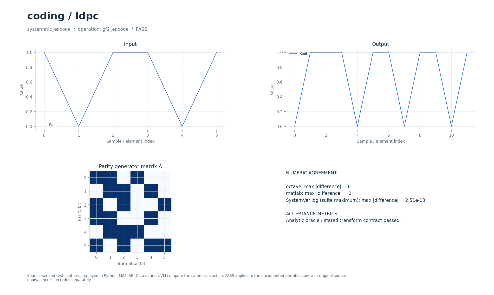

# Систематическое кодирование и декодирование LDPC

Кодер над GF(2) и четыре варианта итеративного LDPC-декодирования: SP, MS, NMS и OMS. Переносимая регрессия использует явно заданный короткий код, а исторический код длины 2016 проверялся отдельно.

## Что это

Операции `gf2_encode` и `ldpc` реализуют систематическое кодирование и flooding-декодирование по переданной матрице проверок. Исторический прототип — MATLAB-набор LDPC `(2016,1008)` с матрицей, четырьмя декодерами и BER/FER-экспериментами из коллекции DSP от 2026-09-30. Сохранённые исходные сравнения подтверждают нулевой синдром кодера и восстановление ненулевого случайного слова всеми четырьмя MATLAB- и Python-декодерами при одной слабой ошибке LLR. Полноразмерная HDL-эквивалентность этим не установлена.

Доступны Python, Octave/MATLAB и поведенческий SystemVerilog с UVM sequence, driver, monitor и scoreboard. Локальные файлы — обёртки общих ядер. [Снимок проверки от 2026-10-01](../../../docs/typed_verification_results.json) сохраняет PASS для своей версии исходников; после изменений нужна повторная регрессия.

Историческая модель в публичный репозиторий не входит. Происхождение файлов, размер каждого в байтах и SHA-256 записаны в [model.json](model.json). Обычные переносимые сценарии работают без исторических материалов.

### Историческое демо

Короткая имитация цепочки **информационные биты → LDPC-кодер → BPSK → AWGN → мягкие LLR → декодер**. Используются оригинальные `HxMatrixGen`, `Encoder2` и четыре декодера: sum-product (SP), min-sum (MS), normalized min-sum (NMS) и offset min-sum (OMS).

Код (2016,1008), скорость 1/2, блок циркулянта 56. Созвездие BPSK: `0 → +1`, `1 → −1`; один шумовой отсчёт на кодовый бит. Формирование импульса, символьная/фазовая синхронизация, АРУ и эквалайзер здесь не моделируются.

## Как работает

1. Кодер принимает `K` информационных бит в `signal`, бинарную матрицу `A` размера `M×K` в `auxiliary`, параметры `[M,K]`. Результат — `[A·bits mod 2, bits]`; соответствующая проверочная матрица `H=[I A]`.
2. Декодер принимает `N` вещественных LLR и бинарную `H` размера `M×N`, уложенную по строкам. Отрицательный LLR означает бит `1`.
3. На каждой итерации вычисляются сообщения переменных узлов без собственного старого сообщения проверки. SP использует `2·atanh(Π tanh(v/2))`; произведение ограничивается перед `atanh`.
4. MS использует произведение знаков и минимальный модуль остальных сообщений. NMS умножает этот модуль на `alpha`, OMS заменяет его на `max(0,min−beta)`.
5. Апостериорный LLR равен входному LLR плюс сумма новых сообщений. При нулевом синдроме `H·bits mod 2` выполняется ранний выход, иначе — до предела итераций.
6. Выход декодера — `N` жёстких бит, затем `N` апостериорных LLR.

| Параметр | Значение в регрессии | Смысл |
| --- | --- | --- |
| Кодер `[M,K]` | `[6,6]` | Кодовое слово из `12` бит, `H` размера `6×12` |
| Декодер `parameters[0:3]` | `[6,12,20]` | Проверки, биты, максимум итераций |
| `parameters[3]` | `0 / 1 / 2 / 3` | SP / MS / NMS / OMS |
| `parameters[4:6]` | `[0.8,0.15]` | `alpha`, `beta`; те же значения используются по умолчанию при их пропуске |
| Информационное слово | `[1,0,1,1,0,1]` | Матрица `A` явно записана в сценариях |
| LLR | Правильный знак, модуль `6`; элемент `7` умножен на `−0.12` | Одна слабая инверсия |
| Исторический код | `N=2016`, `K=1008` | Отдельная исходная проверка, не короткая UVM-регрессия |

Параметры регрессии взяты из [проверочных сценариев](../../../tools/research_cases.py), ограничения входов — из [валидатора](../../../common/python/research_validate.py). Значения сценариев передаются явно. Python API — `run(operation, parameters, signal, auxiliary)`, M-вход — `run_model` с теми же аргументами (четвёртый можно опустить у операций, не использующих `auxiliary`). Массивы плоские, матрицы передаются по строкам, индексы начинаются с нуля. Полный [числовой контракт](../../../docs/TYPED_MODELS.md) задаёт порядок элементов и единицы. Комментарии локальных обёрток написаны на русском; диагностика и подписи готовых графиков — на английском.

Поведенческий SV обрабатывает целый блок с арифметикой `real`. Общий `research_if` передаёт `operation`, `parameters`, `signal_in`, `auxiliary`, `valid`, `done`, `result`; ожидаемый ответ не поступает в DUT. Это симуляционная реализация, не синтезируемый fixed-point RTL.

Отдельные [gf2_encoder.sv](../../../rtl/common/gf2_encoder.sv) и [ldpc_decoder.sv](../../../rtl/common/ldpc_decoder.sv) загружают матрицы побитно через `cfg_valid/cfg_ready/cfg_last`. Декодер принимает `s_llr` signed16 Q8 с `s_valid/s_ready/s_last`, выдаёт `m_bit` и `m_posterior` Q8 с `m_valid/m_ready/m_last`. Default вместимость — `64×128` и `512` рёбер; это параметры реализации, а не размер исторического кода. `ALPHA=round(alpha·256)≤256`, `BETA=round(beta·256)`. SP использует таблицы φ/обратной φ. Расписание последовательное: проходы сообщений занимают `3+4` такта на ребро за итерацию, синдром — ещё 2 такта на ребро; полное время зависит от ранней остановки. См. [DSP_RTL.md](../../../docs/DSP_RTL.md), [контроль насыщений и границ](../../../docs/RTL_FSK_LDPC.md) и [точность LDPC](../../../docs/RTL_LDPC_PRECISION.md).

В обозначении Q число после Q — количество дробных бит; например, signed18 Q15 представляет целый код, делённый на `32768`. Потоковые RTL-интерфейсы используют плоские порты; передача происходит на фронте при `valid && ready`.

## Структура каталога

| Файл/подкаталог | Назначение |
| --- | --- |
| [model.json](model.json) | Операции, имена сценариев, ограничения и манифест исторических файлов |
| [python/model.py](python/model.py) | Python-вход в общее ядро |
| [octave/run_model.m](octave/run_model.m), [matlab/run_model.m](matlab/run_model.m) | M-обёртки без дополнительных toolbox |
| [sv/model.sv](sv/model.sv) | Обёртка поведенческого DUT |
| [tb/testbench.sv](tb/testbench.sv), [tb/run.sh](tb/run.sh) | Подключение общего UVM-стенда и запуск выбранного workspace |
| [tests/test_model.py](tests/test_model.py) | Локальный unittest, запускающий Python-сценарии этого модуля |
| [research_core.py](../../../common/python/research_core.py), [research_core.m](../../../common/octave/research_core.m) | Общая реализация алгоритмов |
| [research_cases.py](../../../tools/research_cases.py), [research_tb.sv](../../../common/sv/research_tb.sv) | Проверочные сигналы, независимые критерии и UVM-окружение |

[run_demo.m](run_demo.m) запускает выбранные исходные скрипты и функции из локального `original/`. Этот подкаталог исключён из публичной поставки; его содержимое описывает [model.json](model.json).

## Как запустить

Команды выполняются из корня проекта. Python-ядру нужен NumPy, проверочному runner также SciPy; они перечислены в [requirements-visual.txt](../../../requirements-visual.txt) вместе с Matplotlib для графиков. Для `octave` нужен `octave-cli`, для `matlab` — MATLAB; переносимые M-файлы не требуют дополнительных пакетов или toolbox. [MATLAB launcher](../../../tools/matlab.sh) поддерживает `MATLAB_ROOT`; R2020b на проверявшемся хосте нужно запускать из терминала. Для `hdl` нужна Questa с UVM 1.2, при нестандартной установке задаются `QUESTA_HOME` и `UVM_HOME`.

```bash
python3 tools/run_research.py --suite python --workspace coding/ldpc
python3 tools/run_research.py --suite octave --workspace coding/ldpc
python3 tools/run_research.py --suite matlab --workspace coding/ldpc
python3 tools/run_research.py --suite hdl --workspace coding/ldpc
```

Первая команда выполняет числовые проверки Python, вторая и третья сравнивают M-ядро с Python, четвёртая выполняет UVM и отрицательный контроль. Все варианты сначала рассчитывают Python-эталон. `--suite all` объединяет Python, Octave и HDL; MATLAB запускается отдельно. Не используйте `python -O`: проверки требуют включённых `assert`. Локальный `tb/run.sh` вызывает тот же runner с `--suite hdl` и передаёт дополнительные аргументы.

Для отдельной fixed-point RTL-проверки нужны также Verilator для lint и зависимости [requirements-rtl.txt](../../../requirements-rtl.txt) вместе с указанными выше:

```bash
python3 tools/run_ldpc.py --suite all
```

Эти команды проверяют целочисленные модели, lint и симуляцию RTL; вендорный синтез в них не запускается.

Историческая проверка требует полного набора исходников и матрицы оригинального кода:

```bash
python3 tools/run_matlab_evidence.py --suite references
python3 tools/check_research_references.py
```

Первая команда сохраняет MATLAB-захваты, вторая проверяет Python-декодеры на том же слове `(2016,1008)`. Это общая проверка нескольких модулей. Без исключённых исторических файлов этот маршрут недоступен; обычная короткая регрессия от них не зависит.

### Исторические скрипты: run_demo

В MATLAB/Octave перейдите в `algorithms/coding/ldpc` и выполните:

```matlab
run_demo
```

`run_demo(N)` вызывает `HxMatrixGen`, `Encoder2` и декодеры SP/MS/NMS/OMS. N — число кадров на точку, по умолчанию 2; для короткого опыта допустимо `r = run_demo(1)`. Код (2016,1008), Eb/N0=[0 3] дБ, максимум 5 итераций, alpha=0.7, beta=0.5. Матрица читается из `original/`; рабочая папка, путь и RNG восстанавливаются. XLSX и mylog.txt из полного сценария не создаются. Специализированные toolbox не нужны.

`run_demo` требует исходников в `original/`, которых нет в публичной копии: см. [THIRD_PARTY.md](../../../THIRD_PARTY.md). Переносимые `tools/run_research.py`, `python/model.py` и `octave/run_model.m` работают и в публичной копии при наличии указанных выше зависимостей.

## Что смотреть

Артефакты выбранного workspace находятся в `build/typed/coding__ldpc/`: `cases.json` содержит сценарии и метрики, `case_*.npz` — массивы `parameters/x/a/y`, `vectors.txt` — векторы UVM, `<suite>_results.json` — итог. `octave_cases.json` и `matlab_cases.json` сохраняют максимальные ошибки по случаям; журналы UVM — в `questa/`.

Сценарий `systematic_encode` требует нулевого синдрома. Сценарии `sum_product`, `min_sum`, `normalized_min_sum`, `offset_min_sum` проверяют полное совпадение с переданным словом, `decoded_errors=0`, `syndrome_weight=0` при `uncoded_errors=1`. Проверка обязана отвергать перевёрнутый выходной бит и обход декодера. Нулевой синдром означает принадлежность к коду, поэтому отдельно проверяется совпадение с исходным словом; один синдром не доказывает правильность полезных данных. Это не BER/FER-кривая статистического эксперимента.

Успешный runner завершается кодом 0, сообщает `PASS` и записывает итоговый `status: PASS` после завершения проверок. UVM выполняет каждый сценарий дважды со сбросом между последовательностями, сверяет метаданные, длину и все значения с допуском `1e-8·(1+|expected|)`. В основном `questa/simulation.log` требуются `UVM_ERROR: 0` и `UVM_FATAL: 0`. Отдельный `questa/negative_control.log` должен содержать обнаруженное намеренное числовое несовпадение; такой отказ является успешным отрицательным контролем. Незавершённый `RUNNING` или ненулевой код runner не означают PASS. Артефакты отдельного RTL-прогона: `build/rtl/ldpc/`.

[Визуальный отчёт](../../../docs/typed_visual/index.html#coding/ldpc) · [Контракт и проверка](../../../docs/TYPED_MODELS.md) · [Python-вход](python/model.py) · [Octave-вход](octave/run_model.m) · [UVM launcher](tb/run.sh)



### Графики run_demo

Одно окно `LDPC: short BPSK/AWGN experiment`: BER информационной части до/после SP/MS/NMS/OMS и FER. Для каждого кодового слова проверяется нулевой синдром. Линейная шкала показывает и нулевые ошибки; при двух кадрах FER может быть только 0/0.5/1. Такая выборка демонстрирует выполнение, но не даёт надёжных BER/FER-кривых или рейтинга методов.

## Ограничения

Переносимый код `(12,6)` выбран для ограниченной межъязыковой регрессии; полноразмерные UVM-тесты `(2016,1008)` не заявляются. Кодер обслуживает систематическую форму `H=[I A]`, а не произвольную `H` без предварительного преобразования. В каждой строке декодера должно быть не меньше двух единиц; LLR — вещественные, матрицы — двоичные. Fixed-point ограничение LLR и табличный SP могут менять пограничные решения относительно floating reference. Исторические большие BER/FER-прогоны и поиск оптимальных `alpha/beta` не воспроизведены.

Совпадение Python/M/SV проверяет заявленный переносимый контракт. Fixed-point RTL сравнивается с отдельными целочисленными эталонами, а его расхождение с плавающей моделью оценивается отдельно. Вендорный синтез этих потоковых блоков в документации отложен; новые ресурсы и физическая частота FPGA не приняты.

`run_demo` проверяет отдельный исторический сценарий; его параметры и зависимости отличаются от переносимого контракта выше. Наличие обёртки не означает совместимость всей исходной коллекции с текущими MATLAB/Octave.
