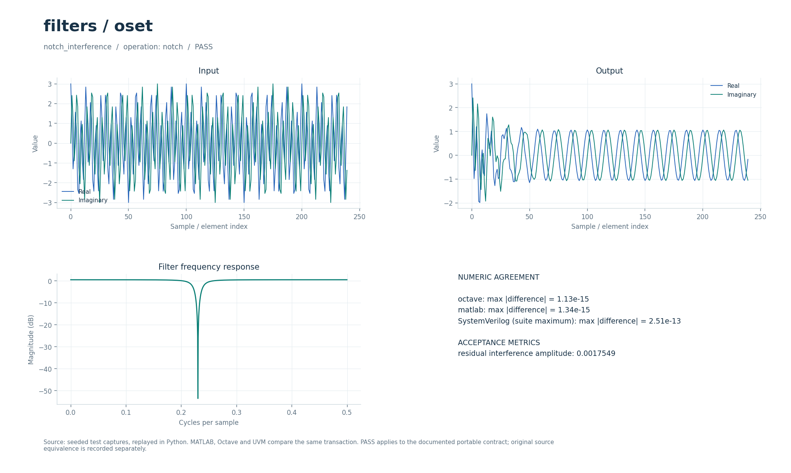

# Режекторный фильтр и скалярный фильтр Калмана

Два переносимых примера подавления помех: причинный режектор второго порядка и оценка скалярного состояния по шумным наблюдениям. Для обоих предусмотрены числовые проверки и отдельные fixed-point RTL-блоки.

## Что это

Операции `notch` и `kalman` представляют небольшой самостоятельный контракт на фоне исторической коллекции OSET. В исходной группе выбраны 13 MATLAB-функций адаптивной, спектральной и Калмановской фильтрации из коллекции DSP от 2026-09-30. Полные биомедицинские и ARMA-модели OSET не перенесены; два примера не доказывают эквивалентность всем выбранным функциям.

Доступны Python, Octave/MATLAB и поведенческий SystemVerilog с UVM sequence, driver, monitor и scoreboard. Локальные файлы — обёртки общих ядер. [Снимок проверки от 2026-10-01](../../../docs/typed_verification_results.json) сохраняет PASS для своей версии исходников; после изменений нужна повторная регрессия.

Историческая модель в публичный репозиторий не входит. Происхождение файлов, размер каждого в байтах и SHA-256 записаны в [model.json](model.json). Обычные переносимые сценарии работают без исторических материалов.

## Как работает

1. `notch` принимает сигнал, частоту провала `f0` в циклах на входной отсчёт и радиус полюсов `r`.
2. При `c=cos(2πf0)` передаточная функция равна `(1−2c·z⁻¹+z⁻²)/(1−2rc·z⁻¹+r²·z⁻²)`. Начальное состояние нулевое; вещественная и мнимая компоненты фильтруются одинаково.
3. `kalman` использует модель случайного блуждания. Начальные оценка `v=0`, дисперсия `P=P0`; на каждом отсчёте `P←P+Q`, `K=P/(P+R)`, `v←v+K·(x−v)`, `P←(1−K)P`.
4. Обе операции возвращают по одному комплексному значению на входной отсчёт. `auxiliary` не используется. Состояние между отдельными вызовами не переносится.

| Операция/параметр | Значение в регрессии | Ограничение |
| --- | --- | --- |
| `notch`: `parameters=[f0,r]` | `[0.23,0.94]` | `0≤f0≤0.5`, `0≤r<1` |
| `kalman`: `parameters=[Q,R,P0]` | `[0.0005,0.25,1]` | `Q≥0`, `R>0`, `P0≥0` |
| Длина обоих сигналов | `512` | Столько же выходных значений |
| Режектор: полезный тон | `exp(2j·π·0.07·t)` | Помеха `2·exp(2j·π·0.23·t)` |
| Калман: наблюдения | `1+0.5·normal(...)` | Оценивается постоянное состояние `1` |

Параметры регрессии взяты из [проверочных сценариев](../../../tools/research_cases.py), ограничения входов — из [валидатора](../../../common/python/research_validate.py). Значения сценариев передаются явно. Python API — `run(operation, parameters, signal, auxiliary)`, M-вход — `run_model` с теми же аргументами (четвёртый можно опустить у операций, не использующих `auxiliary`). Массивы плоские, матрицы передаются по строкам, индексы начинаются с нуля. Полный [числовой контракт](../../../docs/TYPED_MODELS.md) задаёт порядок элементов и единицы. Комментарии локальных обёрток написаны на русском; диагностика и подписи готовых графиков — на английском.

Поведенческий SV обрабатывает целый блок с арифметикой `real`. Общий `research_if` передаёт `operation`, `parameters`, `signal_in`, `auxiliary`, `valid`, `done`, `result`; ожидаемый ответ не поступает в DUT. Это симуляционная реализация, не синтезируемый fixed-point RTL.

Отдельные [notch_iir.sv](../../../rtl/common/notch_iir.sv) и [kalman_scalar.sv](../../../rtl/common/kalman_scalar.sv) имеют `cfg_valid/cfg_ready/configured` и потоки `s_valid/s_ready/s_last`, `m_valid/m_ready/m_last`. Вход и выход — signed18 Q15. Режектор получает коэффициенты signed18 Q16, хранит состояние signed25 Q20 и принимает один отсчёт за такт при готовом выходе. Калман получает `Q,R,P0` как unsigned32 Q24; усиление — Q17, внутреннее значение имеет 8 защитных дробных бит. До установления постоянного усиления темп ограничен последовательным делителем (около 70 тактов на отсчёт), затем тракт данных требует 2 такта на отсчёт. Каждая транзакция начинается заново. Арифметика — в [DSP_RTL.md](../../../docs/DSP_RTL.md), правила реконфигурации Калмана — в [RTL_OSET_GARDNER_PROTOCOL.md](../../../docs/RTL_OSET_GARDNER_PROTOCOL.md).

В обозначении Q число после Q — количество дробных бит; например, signed18 Q15 представляет целый код, делённый на `32768`. Потоковые RTL-интерфейсы используют плоские порты; передача происходит на фронте при `valid && ready`.

## Структура каталога

| Файл/подкаталог | Назначение |
| --- | --- |
| [model.json](model.json) | Операции, имена сценариев, ограничения и манифест исторических файлов |
| [python/model.py](python/model.py) | Python-вход в общее ядро |
| [octave/run_model.m](octave/run_model.m), [matlab/run_model.m](matlab/run_model.m) | M-обёртки без дополнительных toolbox |
| [sv/model.sv](sv/model.sv) | Обёртка поведенческого DUT |
| [tb/testbench.sv](tb/testbench.sv), [tb/run.sh](tb/run.sh) | Подключение общего UVM-стенда и запуск выбранного workspace |
| [tests/test_model.py](tests/test_model.py) | Локальный unittest, запускающий Python-сценарии этого модуля |
| [research_core.py](../../../common/python/research_core.py), [research_core.m](../../../common/octave/research_core.m) | Общая реализация алгоритмов |
| [research_cases.py](../../../tools/research_cases.py), [research_tb.sv](../../../common/sv/research_tb.sv) | Проверочные сигналы, независимые критерии и UVM-окружение |

[run_demo.m](run_demo.m) запускает выбранные исходные скрипты и функции из локального `original/`. Этот подкаталог исключён из публичной поставки; его содержимое описывает [model.json](model.json).

## Как запустить

Команды выполняются из корня проекта. Python-ядру нужен NumPy, проверочному runner также SciPy; они перечислены в [requirements-visual.txt](../../../requirements-visual.txt) вместе с Matplotlib для графиков. Для `octave` нужен `octave-cli`, для `matlab` — MATLAB; переносимые M-файлы не требуют дополнительных пакетов или toolbox. [MATLAB launcher](../../../tools/matlab.sh) поддерживает `MATLAB_ROOT`; R2020b на проверявшемся хосте нужно запускать из терминала. Для `hdl` нужна Questa с UVM 1.2, при нестандартной установке задаются `QUESTA_HOME` и `UVM_HOME`.

```bash
python3 tools/run_research.py --suite python --workspace filters/oset
python3 tools/run_research.py --suite octave --workspace filters/oset
python3 tools/run_research.py --suite matlab --workspace filters/oset
python3 tools/run_research.py --suite hdl --workspace filters/oset
```

Первая команда выполняет числовые проверки Python, вторая и третья сравнивают M-ядро с Python, четвёртая выполняет UVM и отрицательный контроль. Все варианты сначала рассчитывают Python-эталон. `--suite all` объединяет Python, Octave и HDL; MATLAB запускается отдельно. Не используйте `python -O`: проверки требуют включённых `assert`. Локальный `tb/run.sh` вызывает тот же runner с `--suite hdl` и передаёт дополнительные аргументы.

Для отдельной fixed-point RTL-проверки нужны также Verilator для lint и зависимости [requirements-rtl.txt](../../../requirements-rtl.txt) вместе с указанными выше:

```bash
python3 tools/run_oset.py --suite all
```

Эти команды проверяют целочисленные модели, lint и симуляцию RTL; вендорный синтез в них не запускается.

`run_oset.py` проверяет оба фильтра, включая остановки, сбросы, насыщение и конфигурационный протокол. Полная проверка исторических OSET-функций потребовала бы их исходников и дополнительных сценариев; обычные команды этот набор не исполняют.

### Исторические скрипты: run_demo

В MATLAB/Octave перейдите в `algorithms/filters/oset` и выполните:

```matlab
run_demo
```

Обёртка вызывает исходную `matlab/tools/generic/notch_filter_cls.m`: 500 отсчётов при Fs=500 Гц, полезный тон 10 Гц, помеха 50 Гц и шум, gamma=100. Достаточно базового MATLAB или Octave. `r = run_demo` возвращает вход, выход и MSE. Короткая длина выбрана из-за плотных матриц и SVD в оригинале; `KFNotch` с зависимостью `dare` автоматически не запускается.

`run_demo` требует исходников в `original/`, которых нет в публичной копии: см. [THIRD_PARTY.md](../../../THIRD_PARTY.md). Переносимые `tools/run_research.py`, `python/model.py` и `octave/run_model.m` работают и в публичной копии при наличии указанных выше зависимостей.

## Что смотреть

Артефакты выбранного workspace находятся в `build/typed/filters__oset/`: `cases.json` содержит сценарии и метрики, `case_*.npz` — массивы `parameters/x/a/y`, `vectors.txt` — векторы UVM, `<suite>_results.json` — итог. `octave_cases.json` и `matlab_cases.json` сохраняют максимальные ошибки по случаям; журналы UVM — в `questa/`.

В `notch_interference` выход сравнивается со `scipy.signal.lfilter` с `atol=rtol=2e-10`. После индекса `200` измеряется амплитуда корреляции с тоном помехи; `residual_interference_amplitude` должна быть меньше `0.03`. В `scalar_kalman` MSE относительно `1` измеряется с индекса `100`; требуется `output_mse < 0.2·input_mse`. Это показатели конкретных тестовых входов, а не универсальные гарантии подавления.

Успешный runner завершается кодом 0, сообщает `PASS` и записывает итоговый `status: PASS` после завершения проверок. UVM выполняет каждый сценарий дважды со сбросом между последовательностями, сверяет метаданные, длину и все значения с допуском `1e-8·(1+|expected|)`. В основном `questa/simulation.log` требуются `UVM_ERROR: 0` и `UVM_FATAL: 0`. Отдельный `questa/negative_control.log` должен содержать обнаруженное намеренное числовое несовпадение; такой отказ является успешным отрицательным контролем. Незавершённый `RUNNING` или ненулевой код runner не означают PASS. Артефакты отдельного RTL-прогона: `build/rtl/oset/`.

[Визуальный отчёт](../../../docs/typed_visual/index.html#filters/oset) · [Контракт и проверка](../../../docs/TYPED_MODELS.md) · [Python-вход](python/model.py) · [Octave-вход](octave/run_model.m) · [UVM launcher](tb/run.sh)



### Графики run_demo

Окно `Original OSET: constrained least squares notch`: чистый сигнал, смесь и выход; ниже — модули спектров до/после фильтрации. Сравнивайте пик 50 Гц с полезным тоном 10 Гц. MSE относительно чистого сигнала выводится в командном окне.

## Ограничения

Не реализованы полные биомедицинские, многомерные и ARMA-оцениватели OSET. Калман использует заданные дисперсии и единичную модель перехода; оценки `Q/R` по входу нет. Режектор не оценивает частоту помехи и не нормирует усиление вне провала. Проверка общего переносимого контракта не является сравнением со всеми 13 историческими функциями; такое сравнение без исходников недоступно.

Совпадение Python/M/SV проверяет заявленный переносимый контракт. Fixed-point RTL сравнивается с отдельными целочисленными эталонами, а его расхождение с плавающей моделью оценивается отдельно. Вендорный синтез этих потоковых блоков в документации отложен; новые ресурсы и физическая частота FPGA не приняты.

`run_demo` проверяет отдельный исторический сценарий; его параметры и зависимости отличаются от переносимого контракта выше. Наличие обёртки не означает совместимость всей исходной коллекции с текущими MATLAB/Octave.
