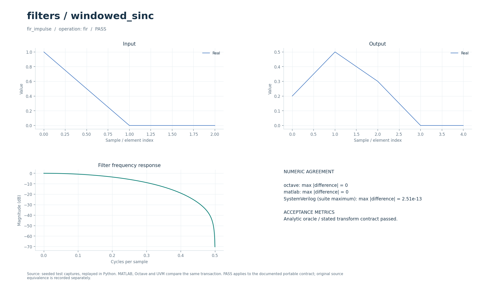
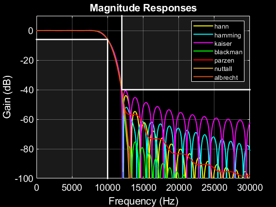
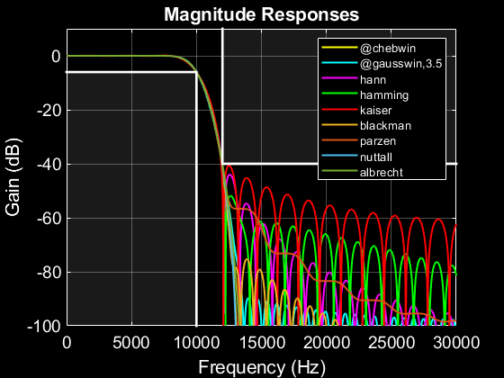

# Проектирование FIR методом оконного sinc и фильтрация

Расчёт низкочастотного FIR с окном Хэмминга и комплексная фильтрация полной свёрткой. Числовая регрессия проверяет коэффициенты, импульсный отклик и двухтоновый сигнал.

## Что это

Операция `wsinc` рассчитывает коэффициенты, `fir` применяет переданные отводы. Историческая основа — набор WSINC с проектированием фильтров и сравнением окон из коллекции DSP от 2026-09-30. Переносимый вариант охватывает только заданную длину НЧ-фильтра и окно Хэмминга; исторический автоматический поиск числа отводов и полное семейство окон не перенесены.

Доступны Python, Octave/MATLAB и поведенческий SystemVerilog с UVM sequence, driver, monitor и scoreboard. Локальные файлы — обёртки общих ядер. [Снимок проверки от 2026-10-01](../../../docs/typed_verification_results.json) сохраняет PASS для своей версии исходников; после изменений нужна повторная регрессия.

Историческая модель в публичный репозиторий не входит. Происхождение файлов, размер каждого в байтах и SHA-256 записаны в [model.json](model.json). Обычные переносимые сценарии работают без исторических материалов.

### Историческое демо

Проектирование КИХ-фильтров методом оконного sinc. Это самостоятельный блок фильтрации для тракта связи, а не модель передатчик → канал → приёмник: модуляция, созвездие, отсчёты на символ и петли синхронизации здесь не заданы.

`compare_filters` вызывает `find_ntaps` и `wsinc`, подбирая число коэффициентов для общей спецификации. Сравниваются окна Hann, Hamming, Kaiser, Blackman, Parzen, Nuttall (4 члена), Albrecht (6 членов). `run_demo` выполняет два примера исходного `test_compare.m`:

| Пример | Частота среза Fc | Начало полосы задерживания Fstop | Fs | Требуемое подавление |
| --- | --- | --- | --- | --- |
| ФНЧ | 10 кГц | 12 кГц | 64 кГц | 40 дБ |
| Антиалиасинговый ФНЧ | 3.5 кГц | 7 кГц | 256 кГц | 74 дБ |

Здесь Fc — уровень около −6 дБ, а не −3 дБ. Во втором примере Hamming пропускается исходной программой при требовании свыше 60 дБ. Исходные функции также поддерживают ФВЧ и полосовые фильтры; демо запускает только два ФНЧ.

## Как работает

1. `wsinc` получает `[T,fc]` и непустой вход-заполнитель `signal` (в тесте `[0]`); `auxiliary` не используется.
2. Для `t=k−(T−1)/2` вычисляется `h[k]=2fc·sinc(2fc·t)·(0.54−0.46·cos(2πk/(T−1)))`, где `sinc(u)=sin(πu)/(πu)`.
3. Коэффициенты делятся на свою сумму, обеспечивая единичное усиление на DC.
4. `fir` получает `parameters=[]`, сигнал в `signal` и комплексные отводы в `auxiliary`; возвращает полную свёртку длины `L+T−1`, включая хвост.

| Параметр/сценарий | Значение в регрессии | Смысл |
| --- | --- | --- |
| `wsinc`: `parameters=[T,fc]` | `[41,0.12]` | `fc` — циклы/отсчёт, `0<fc<0.5` |
| `T` | Целое `≥2`; тест использует нечётное `41` | Число отводов |
| `fir_impulse` | Вход `[1,0,0]`, отводы `[0.2,0.5,0.3]` | Выход `[0.2,0.5,0.3,0,0]` |
| `fir_complex` | `256` комплексных отсчётов, те же `3` отвода | Выход длины `258` |
| `two_tone_filter` | `512` отсчётов, тоны `0.04` и `0.35`, амплитуды `1` и `0.7` | Фильтрация рассчитанными `41` отводом |
| Контроль полосы задерживания | `freq/π>0.4`, сетка `1024` | Максимум модуля отклика `<0.005` |

Параметры регрессии взяты из [проверочных сценариев](../../../tools/research_cases.py), ограничения входов — из [валидатора](../../../common/python/research_validate.py). Значения сценариев передаются явно. Python API — `run(operation, parameters, signal, auxiliary)`, M-вход — `run_model` с теми же аргументами (четвёртый можно опустить у операций, не использующих `auxiliary`). Массивы плоские, матрицы передаются по строкам, индексы начинаются с нуля. Полный [числовой контракт](../../../docs/TYPED_MODELS.md) задаёт порядок элементов и единицы. Комментарии локальных обёрток написаны на русском; диагностика и подписи готовых графиков — на английском.

Поведенческий SV обрабатывает целый блок с арифметикой `real`. Общий `research_if` передаёт `operation`, `parameters`, `signal_in`, `auxiliary`, `valid`, `done`, `result`; ожидаемый ответ не поступает в DUT. Это симуляционная реализация, не синтезируемый fixed-point RTL.

Потоковый [fir_runtime.sv](../../../rtl/common/fir_runtime.sv) загружает `T` комплексных отводов signed18 Q17 через `cfg_re/cfg_im/cfg_valid/cfg_ready/cfg_last`; вместимость `TMAX=2^LOG2TMAX`. Вход и выход — signed18 Q15 с `s_valid/s_ready/s_last` и `m_valid/m_ready/m_last`; на `L` входов выдаётся `L+T−1` результатов. `LANES=2^LOG2LANES` задаёт параллелизм: один результат требует `ceil(T/LANES)` шагов, плюс конвейерная задержка; при `LANES≥T` возможен один выход за такт. Выходная FIFO — 8 слов. `wsinc` рассчитывается программно, затем квантованные отводы загружаются в FIR; аппаратного проектировщика окон нет. См. [DSP_RTL.md](../../../docs/DSP_RTL.md).

В обозначении Q число после Q — количество дробных бит; например, signed18 Q15 представляет целый код, делённый на `32768`. Потоковые RTL-интерфейсы используют плоские порты; передача происходит на фронте при `valid && ready`.

## Структура каталога

| Файл/подкаталог | Назначение |
| --- | --- |
| [model.json](model.json) | Операции, имена сценариев, ограничения и манифест исторических файлов |
| [python/model.py](python/model.py) | Python-вход в общее ядро |
| [octave/run_model.m](octave/run_model.m), [matlab/run_model.m](matlab/run_model.m) | M-обёртки без дополнительных toolbox |
| [sv/model.sv](sv/model.sv) | Обёртка поведенческого DUT |
| [tb/testbench.sv](tb/testbench.sv), [tb/run.sh](tb/run.sh) | Подключение общего UVM-стенда и запуск выбранного workspace |
| [tests/test_model.py](tests/test_model.py) | Локальный unittest, запускающий Python-сценарии этого модуля |
| [research_core.py](../../../common/python/research_core.py), [research_core.m](../../../common/octave/research_core.m) | Общая реализация алгоритмов |
| [research_cases.py](../../../tools/research_cases.py), [research_tb.sv](../../../common/sv/research_tb.sv) | Проверочные сигналы, независимые критерии и UVM-окружение |

[run_demo.m](run_demo.m) запускает выбранные исходные скрипты и функции из локального `original/`. Этот подкаталог исключён из публичной поставки; его содержимое описывает [model.json](model.json).

## Как запустить

Команды выполняются из корня проекта. Python-ядру нужен NumPy, проверочному runner также SciPy; они перечислены в [requirements-visual.txt](../../../requirements-visual.txt) вместе с Matplotlib для графиков. Для `octave` нужен `octave-cli`, для `matlab` — MATLAB; переносимые M-файлы не требуют дополнительных пакетов или toolbox. [MATLAB launcher](../../../tools/matlab.sh) поддерживает `MATLAB_ROOT`; R2020b на проверявшемся хосте нужно запускать из терминала. Для `hdl` нужна Questa с UVM 1.2, при нестандартной установке задаются `QUESTA_HOME` и `UVM_HOME`.

```bash
python3 tools/run_research.py --suite python --workspace filters/windowed_sinc
python3 tools/run_research.py --suite octave --workspace filters/windowed_sinc
python3 tools/run_research.py --suite matlab --workspace filters/windowed_sinc
python3 tools/run_research.py --suite hdl --workspace filters/windowed_sinc
```

Первая команда выполняет числовые проверки Python, вторая и третья сравнивают M-ядро с Python, четвёртая выполняет UVM и отрицательный контроль. Все варианты сначала рассчитывают Python-эталон. `--suite all` объединяет Python, Octave и HDL; MATLAB запускается отдельно. Не используйте `python -O`: проверки требуют включённых `assert`. Локальный `tb/run.sh` вызывает тот же runner с `--suite hdl` и передаёт дополнительные аргументы.

Для отдельной fixed-point RTL-проверки нужны также Verilator для lint и зависимости [requirements-rtl.txt](../../../requirements-rtl.txt) вместе с указанными выше:

```bash
python3 tools/run_fir.py --suite all
```

Эти команды проверяют целочисленные модели, lint и симуляцию RTL; вендорный синтез в них не запускается.

`run_fir.py` проверяет загружаемый FIR на целочисленном эталоне, lint и Questa, включая отводы этого модуля и учебного Harger. Исторический пакет WSINC для этих команд не нужен; его собственные сравнения окон потребовали бы исключённых файлов.

### Исторические скрипты: run_demo

В MATLAB/Octave перейдите в `algorithms/filters/windowed_sinc` и выполните:

```matlab
run_demo
```

Вызываются исходные `compare_filters` и `plotres` для двух активных примеров `test_compare.m`: Fc/Fstop/Fs=10/12/64 кГц, подавление 40 дБ; 3.5/7/256 кГц, 74 дБ. `r = run_demo` возвращает результаты. Достаточно базового MATLAB или Octave: при отсутствии `freqz` исходник использует `pm_freqz`. Файлы не записываются.

`run_demo` требует исходников в `original/`, которых нет в публичной копии: см. [THIRD_PARTY.md](../../../THIRD_PARTY.md). Переносимые `tools/run_research.py`, `python/model.py` и `octave/run_model.m` работают и в публичной копии при наличии указанных выше зависимостей.

## Что смотреть

Артефакты выбранного workspace находятся в `build/typed/filters__windowed_sinc/`: `cases.json` содержит сценарии и метрики, `case_*.npz` — массивы `parameters/x/a/y`, `vectors.txt` — векторы UVM, `<suite>_results.json` — итог. `octave_cases.json` и `matlab_cases.json` сохраняют максимальные ошибки по случаям; журналы UVM — в `questa/`.

`hamming_lowpass` сверяется с `scipy.signal.firwin(41,0.24,window="hamming",scale=True)`: его cutoff нормирован к Найквисту, поэтому равен удвоенному `fc` переносимой модели. Метрики — `dc_gain` и `stopband_peak_db = 20·log10(max|H|)` в указанной тестовой полосе. Остальные сценарии сверяются с аналитическим импульсом или `scipy.signal.fftconvolve`; допуски `atol=rtol=2e-10`. На графиках полезно сопоставить сохранение низкого тона и подавление высокого.

Успешный runner завершается кодом 0, сообщает `PASS` и записывает итоговый `status: PASS` после завершения проверок. UVM выполняет каждый сценарий дважды со сбросом между последовательностями, сверяет метаданные, длину и все значения с допуском `1e-8·(1+|expected|)`. В основном `questa/simulation.log` требуются `UVM_ERROR: 0` и `UVM_FATAL: 0`. Отдельный `questa/negative_control.log` должен содержать обнаруженное намеренное числовое несовпадение; такой отказ является успешным отрицательным контролем. Незавершённый `RUNNING` или ненулевой код runner не означают PASS. Артефакты отдельного RTL-прогона: `build/rtl/fir/`.

[Визуальный отчёт](../../../docs/typed_visual/index.html#filters/windowed_sinc) · [Контракт и проверка](../../../docs/TYPED_MODELS.md) · [Python-вход](python/model.py) · [Octave-вход](octave/run_model.m) · [UVM launcher](tb/run.sh)



### Графики run_demo

Два окна `Window comparison: 40 dB lowpass` и `Window comparison: 74 dB anti-aliasing`: наложенные АЧХ окон Hann/Hamming/Kaiser/Blackman/Parzen/Nuttall/Albrecht. Fc соответствует примерно −6 дБ. В командном окне — Ntaps, уровни −0.1/−1/−3 дБ и среднее подавление Psbdb; среднее подавление не равно максимальному боковому лепестку. При требовании >60 дБ Hamming исходником пропускается.

Сохранённые картинки результатов оконного проектирования (сопроводительные материалы автора WSINC; дополнительные примеры не все входят в `run_demo`):





Другие результаты: [пример 3](images/example_3.png), [пример 4](images/example_4.png), [пример 5](images/example_5.png), [пример 6](images/example_6.png).

## Ограничения

Поддержан НЧ-фильтр с окном Хэмминга, без автоматического подбора длины, высокочастотного/полосового дизайна и перебора окон. Нечётная длина используется в регрессии; валидатор фактически допускает и чётную длину `T≥2`. Вызов `fir` не хранит состояние между блоками и всегда возвращает полный хвост. Расчёт `wsinc` не является потоковой RTL-операцией. Эквивалентность всему историческому набору WSINC не установлена.

Совпадение Python/M/SV проверяет заявленный переносимый контракт. Fixed-point RTL сравнивается с отдельными целочисленными эталонами, а его расхождение с плавающей моделью оценивается отдельно. Вендорный синтез этих потоковых блоков в документации отложен; новые ресурсы и физическая частота FPGA не приняты.

`run_demo` проверяет отдельный исторический сценарий; его параметры и зависимости отличаются от переносимого контракта выше. Наличие обёртки не означает совместимость всей исходной коллекции с текущими MATLAB/Octave.
