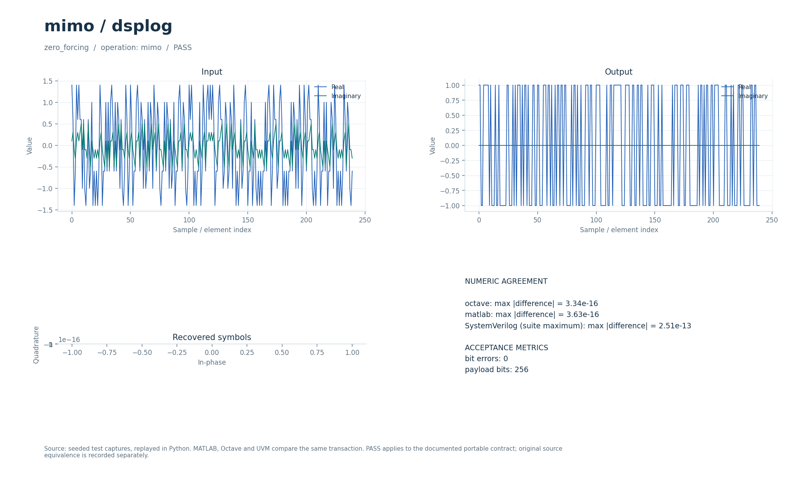

# Линейное MIMO-детектирование и объединение Alamouti

Комплексное ZF/MMSE-решение для квадратного канала и восстановление пар символов Alamouti 2-TX/1-RX. Тесты проверяют решения BPSK и аналитическое обращение пространственно-временного кода.

## Что это

Операции `mimo` и `alamouti` выделяют небольшой переносимый контракт из четырёх исторических DSPLoG MATLAB-демонстраций ZF, MMSE-SIC, Alamouti и BPSK/ISI-эквализации. Большие Monte Carlo-прогоны, порядок SIC и параметры ISI/ZF-примера не воспроизведены. В переносимой регрессии проверяется канал 2×2 и одна пара коэффициентов Alamouti; отдельные RTL-решатели расширяют диапазон размеров.

Доступны Python, Octave/MATLAB и поведенческий SystemVerilog с UVM sequence, driver, monitor и scoreboard. Локальные файлы — обёртки общих ядер. [Снимок проверки от 2026-10-01](../../../docs/typed_verification_results.json) сохраняет PASS для своей версии исходников; после изменений нужна повторная регрессия.

Историческая модель в публичный репозиторий не входит. Происхождение файлов, размер каждого в байтах и SHA-256 записаны в [model.json](model.json). Обычные переносимые сценарии работают без исторических материалов.

## Как работает

1. `mimo` принимает `[M,lambda]`, снимки наблюдений по `M` значений в `signal` и квадратную матрицу `H` по строкам в `auxiliary`.
2. Для каждого снимка решается `(HᴴH+λI)·s_hat=Hᴴr`. `λ=0` даёт ZF, положительная регуляризация — используемую здесь MMSE-форму; параметр задаётся извне.
3. Выход содержит восстановленные потоки в том же порядке снимков. Отдельного SIC-прохода нет.
4. `alamouti` принимает `parameters=[]`, пары `(r0,r1)` и два коэффициента `(h0,h1)`. Для `E=|h0|²+|h1|²` выдаются `(conj(h0)·r0+h1·conj(r1))/E` и `(conj(h1)·r0−h0·conj(r1))/E`.
5. Проверочная передача Alamouti использует `r0=h0·s0+h1·s1`, `r1=−h0·conj(s1)+h1·conj(s0)`: соглашение о сопряжении важно для совместимости.

| Параметр | Значение в регрессии | Назначение |
| --- | --- | --- |
| MIMO `M` | `2` | Квадратный канал |
| `lambda` | `0` и `0.015` | ZF и регуляризованный случай |
| `H` | `[[1+0.3j,0.4−0.2j],[−0.2+0.1j,0.8+0.2j]]` | Фиксированная комплексная матрица |
| MIMO-данные | `128` снимков по `2` BPSK-символа | `256` проверяемых бит |
| Шум MMSE-сценария | `0.02·noise(...)` | Комплексный нормированный гауссов шум |
| Alamouti `h` | `[0.4+0.3j,1−0.2j]` | Канал для `128` комплексных символов |
| Энергия Alamouti | Допустимо `1e-24…1e300` | Защита нормировки |

Параметры регрессии взяты из [проверочных сценариев](../../../tools/research_cases.py), ограничения входов — из [валидатора](../../../common/python/research_validate.py). Значения сценариев передаются явно. Python API — `run(operation, parameters, signal, auxiliary)`, M-вход — `run_model` с теми же аргументами (четвёртый можно опустить у операций, не использующих `auxiliary`). Массивы плоские, матрицы передаются по строкам, индексы начинаются с нуля. Полный [числовой контракт](../../../docs/TYPED_MODELS.md) задаёт порядок элементов и единицы. Комментарии локальных обёрток написаны на русском; диагностика и подписи готовых графиков — на английском.

Поведенческий SV обрабатывает целый блок с арифметикой `real`. Общий `research_if` передаёт `operation`, `parameters`, `signal_in`, `auxiliary`, `valid`, `done`, `result`; ожидаемый ответ не поступает в DUT. Это симуляционная реализация, не синтезируемый fixed-point RTL.

Отдельные [mmse2.sv](../../../rtl/common/mmse2.sv), [mmse3.sv](../../../rtl/common/mmse3.sv), [mmse_n.sv](../../../rtl/common/mmse_n.sv) и [alamouti_rx.sv](../../../rtl/common/alamouti_rx.sv) используют конфигурационный `cfg_*` и потоки `s_valid/s_ready/s_last`, `m_valid/m_ready/m_last`. Канал, наблюдения и выход — signed18 Q15, `lambda` — unsigned34 Q30, веса MMSE — Q24. После настройки поток принимает один отсчёт за такт при готовом выходе. Граница `s_last` должна совпадать с полной парой/группой каналов. `mmse_n` поддерживает `2≤N≤8`, использует нормализацию и исключение с округлениями; конфигурация требует от 1196 тактов при `N=2` до 22549 при `N=8` в описанной архитектуре. Неположительный пивот и непредставимый коэффициент дают ошибку вместо неверной настройки. Форматы парных блоков — в [DSP_RTL.md](../../../docs/DSP_RTL.md), общий решатель и ограничения динамического диапазона — в [RTL_MMSE_N.md](../../../docs/RTL_MMSE_N.md).

В обозначении Q число после Q — количество дробных бит; например, signed18 Q15 представляет целый код, делённый на `32768`. Потоковые RTL-интерфейсы используют плоские порты; передача происходит на фронте при `valid && ready`.

## Структура каталога

| Файл/подкаталог | Назначение |
| --- | --- |
| [model.json](model.json) | Операции, имена сценариев, ограничения и манифест исторических файлов |
| [python/model.py](python/model.py) | Python-вход в общее ядро |
| [octave/run_model.m](octave/run_model.m), [matlab/run_model.m](matlab/run_model.m) | M-обёртки без дополнительных toolbox |
| [sv/model.sv](sv/model.sv) | Обёртка поведенческого DUT |
| [tb/testbench.sv](tb/testbench.sv), [tb/run.sh](tb/run.sh) | Подключение общего UVM-стенда и запуск выбранного workspace |
| [tests/test_model.py](tests/test_model.py) | Локальный unittest, запускающий Python-сценарии этого модуля |
| [research_core.py](../../../common/python/research_core.py), [research_core.m](../../../common/octave/research_core.m) | Общая реализация алгоритмов |
| [research_cases.py](../../../tools/research_cases.py), [research_tb.sv](../../../common/sv/research_tb.sv) | Проверочные сигналы, независимые критерии и UVM-окружение |

[run_demo.m](run_demo.m) запускает выбранные исходные скрипты и функции из локального `original/`. Этот подкаталог исключён из публичной поставки; его содержимое описывает [model.json](model.json).

## Как запустить

Команды выполняются из корня проекта. Python-ядру нужен NumPy, проверочному runner также SciPy; они перечислены в [requirements-visual.txt](../../../requirements-visual.txt) вместе с Matplotlib для графиков. Для `octave` нужен `octave-cli`, для `matlab` — MATLAB; переносимые M-файлы не требуют дополнительных пакетов или toolbox. [MATLAB launcher](../../../tools/matlab.sh) поддерживает `MATLAB_ROOT`; R2020b на проверявшемся хосте нужно запускать из терминала. Для `hdl` нужна Questa с UVM 1.2, при нестандартной установке задаются `QUESTA_HOME` и `UVM_HOME`.

```bash
python3 tools/run_research.py --suite python --workspace mimo/dsplog
python3 tools/run_research.py --suite octave --workspace mimo/dsplog
python3 tools/run_research.py --suite matlab --workspace mimo/dsplog
python3 tools/run_research.py --suite hdl --workspace mimo/dsplog
```

Первая команда выполняет числовые проверки Python, вторая и третья сравнивают M-ядро с Python, четвёртая выполняет UVM и отрицательный контроль. Все варианты сначала рассчитывают Python-эталон. `--suite all` объединяет Python, Octave и HDL; MATLAB запускается отдельно. Не используйте `python -O`: проверки требуют включённых `assert`. Локальный `tb/run.sh` вызывает тот же runner с `--suite hdl` и передаёт дополнительные аргументы.

Для отдельной fixed-point RTL-проверки нужны также Verilator для lint и зависимости [requirements-rtl.txt](../../../requirements-rtl.txt) вместе с указанными выше:

```bash
python3 tools/run_mmse.py --suite all
python3 tools/run_mmse_n.py --suite all
python3 tools/run_beam.py --suite all
```

Эти команды проверяют целочисленные модели, lint и симуляцию RTL; вендорный синтез в них не запускается.

`run_mmse.py` проверяет решатель 2×2, `run_mmse_n.py` — общий N×N, `run_beam.py` — Alamouti вместе с beamformer. Все сравнивают RTL с соответствующими целочисленными моделями; исторические DSPLoG-скрипты им не нужны.

### Исторические скрипты: run_demo

В MATLAB/Octave перейдите в `algorithms/mimo/dsplog` и выполните:

```matlab
run_demo
```

Исполняется исходный `script_ber_mimo_zf_bpsk_rayleigh_channel.m`: BPSK, Rayleigh MIMO 2×2, ZF, 10^6 бит на каждую точку Eb/N0=0:25 дБ. Это полный Monte Carlo без сокращения параметров, запуск может занять несколько минут. Требуется MATLAB или Octave; специальные toolbox не используются. Скрипт изолирован от workspace обёртки и исполняется во временной папке; путь, рабочая папка и RNG восстанавливаются.

`run_demo` требует исходников в `original/`, которых нет в публичной копии: см. [THIRD_PARTY.md](../../../THIRD_PARTY.md). Переносимые `tools/run_research.py`, `python/model.py` и `octave/run_model.m` работают и в публичной копии при наличии указанных выше зависимостей.

## Что смотреть

Артефакты выбранного workspace находятся в `build/typed/mimo__dsplog/`: `cases.json` содержит сценарии и метрики, `case_*.npz` — массивы `parameters/x/a/y`, `vectors.txt` — векторы UVM, `<suite>_results.json` — итог. `octave_cases.json` и `matlab_cases.json` сохраняют максимальные ошибки по случаям; журналы UVM — в `questa/`.

`zero_forcing` и `mmse` требуют верных знаков всех восстановленных BPSK-символов: `bit_errors=0` при `payload_bits=256`. `alamouti` сравнивает комплексные символы с переданными с `atol=rtol=2e-10`. Это конечные проверки корректности, не статистическая BER-кривая. Независимые RMS/SQNR-измерения fixed/float на общих квантованных входах описаны в [RTL_LINEAR_PRECISION.md](../../../docs/RTL_LINEAR_PRECISION.md).

Успешный runner завершается кодом 0, сообщает `PASS` и записывает итоговый `status: PASS` после завершения проверок. UVM выполняет каждый сценарий дважды со сбросом между последовательностями, сверяет метаданные, длину и все значения с допуском `1e-8·(1+|expected|)`. В основном `questa/simulation.log` требуются `UVM_ERROR: 0` и `UVM_FATAL: 0`. Отдельный `questa/negative_control.log` должен содержать обнаруженное намеренное числовое несовпадение; такой отказ является успешным отрицательным контролем. Незавершённый `RUNNING` или ненулевой код runner не означают PASS. Артефакты отдельного RTL-прогона: `build/rtl/mmse/`, `build/rtl/mmse_n/` и `build/rtl/beam/`.

[Визуальный отчёт](../../../docs/typed_visual/index.html#mimo/dsplog) · [Контракт и проверка](../../../docs/TYPED_MODELS.md) · [Python-вход](python/model.py) · [Octave-вход](octave/run_model.m) · [UVM launcher](tb/run.sh)



### Графики run_demo

Исходный semilogy-график BER для BPSK в Rayleigh-канале: симуляция ZF 2×2 и теоретические ориентиры 1×1/1×2 MRC. Это статистический опыт; точные значения меняются с реализацией шума. MMSE-SIC, Alamouti и ISI-скрипты автоматически не запускаются.

## Ограничения

Канал известен и постоянен в пределах вызова; оценка канала и отслеживание замираний не реализованы. `mimo` работает только с квадратной `H`, требует `lambda≥0` и конечных нормальных уравнений; валидатор отвергает пивоты с модулем меньше `1e-12`. Исторические MMSE-SIC и ISI-эксперименты не перенесены, их проверка требует отсутствующих исходников. Общий fixed-point N×N имеет собственные ограничения обусловленности и динамического диапазона, описанные в RTL_MMSE_N.md; битоточность с его моделью не означает точного floating-решения.

Совпадение Python/M/SV проверяет заявленный переносимый контракт. Fixed-point RTL сравнивается с отдельными целочисленными эталонами, а его расхождение с плавающей моделью оценивается отдельно. Вендорный синтез этих потоковых блоков в документации отложен; новые ресурсы и физическая частота FPGA не приняты.

`run_demo` проверяет отдельный исторический сценарий; его параметры и зависимости отличаются от переносимого контракта выше. Наличие обёртки не означает совместимость всей исходной коллекции с текущими MATLAB/Octave.
