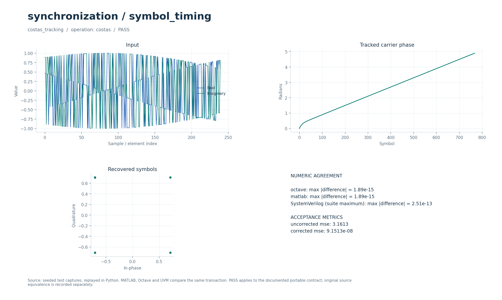

# Символьная синхронизация Гарднера и петля Костаса QPSK

Две отдельные петли: восстановление моментов выборки с кубической интерполяцией и компенсация фазы/частоты QPSK. На выходе доступны исправленные символы и история положения или фазы.

## Что это

Операции `timing` и `costas` задают ограниченный переносимый контракт. Исторический timing-прототип — MATLAB-набор Symbol Timing Recovery по материалам Michael Rice, с пятью TED и четырьмя вариантами интерполяции. Здесь реализованы Gardner PI и кубическая интерполяция, а также отдельная decision-directed QPSK Costas-петля. Проверяются уменьшение ошибки в двух заданных сценариях; все исторические режимы и MATLAB System Objects не воспроизведены.

Доступны Python, Octave/MATLAB и поведенческий SystemVerilog с UVM sequence, driver, monitor и scoreboard. Локальные файлы — обёртки общих ядер. [Снимок проверки от 2026-10-01](../../../docs/typed_verification_results.json) сохраняет PASS для своей версии исходников; после изменений нужна повторная регрессия.

Историческая модель в публичный репозиторий не входит. Происхождение файлов, размер каждого в байтах и SHA-256 записаны в [model.json](model.json). Обычные переносимые сценарии работают без исторических материалов.

### Историческое демо

Цепочка **4-QAM → передающий RRC-фильтр → задержка и AWGN → согласованный RRC-фильтр → символьный синхронизатор → созвездие**. Демо вызывает оригинальные `piLoopConstants` и `symbolTimingSync`: детектор перехода через ноль ZCTED с решающим устройством, квадратичный интерполятор Фарроу, PI-фильтр и управляющий счётчик modulo-1.

Созвездие `(±1 ± j)/sqrt(2)`, 32 отсчёта на символ; roll-off 0.2, длина каждого RRC-фильтра 10 символов (321 коэффициент), задержка канала 25 отсчётов, Es/N0 = 20 дБ, относительное расхождение частот дискретизации 0 ppm. Нормированная полоса петли `Bn*Ts = 0.01`, демпфирование 1, энергия символа 1, усиление канала 1. Фазовая синхронизация, отдельная АРУ и эквалайзер не включены.

## Как работает

1. `costas` принимает QPSK-отсчёты на символьной частоте. Начальные фаза и частота нулевые; `z=x·exp(−jφ)`.
2. Ошибка `e=sign(Re(z))·Im(z)−sign(Im(z))·Re(z)`, затем `frequency←frequency+Ki·e`, `φ←φ+frequency+Kp·e`. Выход — `N` исправленных значений и `N` использованных фаз в радианах.
3. `timing` принимает уже согласованно отфильтрованные отсчёты. Для текущей позиции `P` кубически интерполируются `early`, `mid`, `late` в `P−SPS/2`, `P`, `P+SPS/2`.
4. Gardner-ошибка `e=clip(Re((late−early)·conj(mid)),−1,1)` управляет PI: `rate←rate+Ki·e`, `P←P+SPS+rate+Kp·e`.
5. Выход `timing` — заданное число комплексных `mid`, затем столько же позиций в единицах входного отсчёта. `auxiliary` обеим операциям не нужен.

| Операция/параметр | Значение в регрессии | Смысл |
| --- | --- | --- |
| `costas`: `[Kp,Ki]` | `[0.08,0.001]` | Пропорциональное и частотное усиления |
| QPSK-вход Costas | `768` символов, фаза `0.3+0.006·t` | Поворот и линейный набег фазы |
| `timing`: `[SPS,count,P0,Kp,Ki]` | `[8,700,32,0.1,0.00005]` | Частота дискретизации, число символов, позиция и PI |
| Timing-вход | `6208` отсчётов, задержка `1.25` отсчёта | Формирование и согласованная RRC-фильтрация |
| Timing-выход | `1400` значений | `700` символов и `700` позиций |
| Подготовка сигнала | [QPSK-конфигурация](../../../modems/qpsk_script_costas/config.json) | Параметры созвездия и формирующего тракта |

Параметры регрессии взяты из [проверочных сценариев](../../../tools/research_cases.py), ограничения входов — из [валидатора](../../../common/python/research_validate.py). Значения сценариев передаются явно. Python API — `run(operation, parameters, signal, auxiliary)`, M-вход — `run_model` с теми же аргументами (четвёртый можно опустить у операций, не использующих `auxiliary`). Массивы плоские, матрицы передаются по строкам, индексы начинаются с нуля. Полный [числовой контракт](../../../docs/TYPED_MODELS.md) задаёт порядок элементов и единицы. Комментарии локальных обёрток написаны на русском; диагностика и подписи готовых графиков — на английском.

Поведенческий SV обрабатывает целый блок с арифметикой `real`. Общий `research_if` передаёт `operation`, `parameters`, `signal_in`, `auxiliary`, `valid`, `done`, `result`; ожидаемый ответ не поступает в DUT. Это симуляционная реализация, не синтезируемый fixed-point RTL.

Отдельные [costas_loop.sv](../../../rtl/common/costas_loop.sv) и [gardner_timing.sv](../../../rtl/common/gardner_timing.sv) имеют `cfg_valid/cfg_ready/configured` и потоки `s_valid/s_ready/s_last`, `m_valid/m_ready/m_last`. Комплексные данные — signed18 Q15. Фаза Costas хранится в единицах `2⁻³²` оборота, коэффициенты переводятся с учётом `2π`; текущий интервал приёма — 8 тактов. Gardner сначала сохраняет весь вход (до `16384` отсчётов), затем выдаёт символы; внутренняя позиция и скорость — Q32, выход `m_position` — Q16. В измеренных SPS4/SPS8 профилях первые выходы появляются через 364/620 тактов от начала кадра; это характеристики конкретных кадров, не универсальная задержка одного отсчёта. См. [DSP_RTL.md](../../../docs/DSP_RTL.md), актуальные [измерения тактов](../../../docs/RTL_SYNC_ADAPTIVE_RATES.md) и [протокол Gardner](../../../docs/RTL_OSET_GARDNER_PROTOCOL.md).

В обозначении Q число после Q — количество дробных бит; например, signed18 Q15 представляет целый код, делённый на `32768`. Потоковые RTL-интерфейсы используют плоские порты; передача происходит на фронте при `valid && ready`.

## Структура каталога

| Файл/подкаталог | Назначение |
| --- | --- |
| [model.json](model.json) | Операции, имена сценариев, ограничения и манифест исторических файлов |
| [python/model.py](python/model.py) | Python-вход в общее ядро |
| [octave/run_model.m](octave/run_model.m), [matlab/run_model.m](matlab/run_model.m) | M-обёртки без дополнительных toolbox |
| [sv/model.sv](sv/model.sv) | Обёртка поведенческого DUT |
| [tb/testbench.sv](tb/testbench.sv), [tb/run.sh](tb/run.sh) | Подключение общего UVM-стенда и запуск выбранного workspace |
| [tests/test_model.py](tests/test_model.py) | Локальный unittest, запускающий Python-сценарии этого модуля |
| [research_core.py](../../../common/python/research_core.py), [research_core.m](../../../common/octave/research_core.m) | Общая реализация алгоритмов |
| [research_cases.py](../../../tools/research_cases.py), [research_tb.sv](../../../common/sv/research_tb.sv) | Проверочные сигналы, независимые критерии и UVM-окружение |

[run_demo.m](run_demo.m) запускает выбранные исходные скрипты и функции из локального `original/`. Этот подкаталог исключён из публичной поставки; его содержимое описывает [model.json](model.json).

## Как запустить

Команды выполняются из корня проекта. Python-ядру нужен NumPy, проверочному runner также SciPy; они перечислены в [requirements-visual.txt](../../../requirements-visual.txt) вместе с Matplotlib для графиков. Для `octave` нужен `octave-cli`, для `matlab` — MATLAB; переносимые M-файлы не требуют дополнительных пакетов или toolbox. [MATLAB launcher](../../../tools/matlab.sh) поддерживает `MATLAB_ROOT`; R2020b на проверявшемся хосте нужно запускать из терминала. Для `hdl` нужна Questa с UVM 1.2, при нестандартной установке задаются `QUESTA_HOME` и `UVM_HOME`.

```bash
python3 tools/run_research.py --suite python --workspace synchronization/symbol_timing
python3 tools/run_research.py --suite octave --workspace synchronization/symbol_timing
python3 tools/run_research.py --suite matlab --workspace synchronization/symbol_timing
python3 tools/run_research.py --suite hdl --workspace synchronization/symbol_timing
```

Первая команда выполняет числовые проверки Python, вторая и третья сравнивают M-ядро с Python, четвёртая выполняет UVM и отрицательный контроль. Все варианты сначала рассчитывают Python-эталон. `--suite all` объединяет Python, Octave и HDL; MATLAB запускается отдельно. Не используйте `python -O`: проверки требуют включённых `assert`. Локальный `tb/run.sh` вызывает тот же runner с `--suite hdl` и передаёт дополнительные аргументы.

Для отдельной fixed-point RTL-проверки нужны также Verilator для lint и зависимости [requirements-rtl.txt](../../../requirements-rtl.txt) вместе с указанными выше:

```bash
python3 tools/run_sync.py --suite all
```

Эти команды проверяют целочисленные модели, lint и симуляцию RTL; вендорный синтез в них не запускается.

`run_sync.py` проверяет целочисленные петли, lint, RTL-данные, фазы, позиции, остановки и сбросы. Обычная переносимая проверка не требует исторического timing-набора. Отдельная общая MATLAB-проверка оригиналов содержит проверку исторической `piLoopConstants`:

```bash
python3 tools/run_matlab_evidence.py --suite references
```

Она требует полный исторический набор нескольких модулей и не является проверкой всех TED и интерполяторов. Без этих исходников в публичной версии недоступна.

### Исторические скрипты: run_demo

В MATLAB/Octave перейдите в `algorithms/synchronization/symbol_timing` и выполните:

```matlab
run_demo
```

`run_demo(N)` воспроизводит выбранный сценарий `main.m` и вызывает исходные `piLoopConstants` и `symbolTimingSync`: ZCTED, квадратичный Farrow, PI и modulo-1. N — целое число символов ≥1000, по умолчанию 4000. `r = run_demo(8000)` возвращает MER и выход петли. RRC, шум и задержка заданы явно; достаточно базового MATLAB или Octave без toolbox. Полный исходный `main.m` отдельно требует Communications, DSP System и Signal Processing Toolbox. Файлы не записываются.

`run_demo` требует исходников в `original/`, которых нет в публичной копии: см. [THIRD_PARTY.md](../../../THIRD_PARTY.md). Переносимые `tools/run_research.py`, `python/model.py` и `octave/run_model.m` работают и в публичной копии при наличии указанных выше зависимостей.

## Что смотреть

Артефакты выбранного workspace находятся в `build/typed/synchronization__symbol_timing/`: `cases.json` содержит сценарии и метрики, `case_*.npz` — массивы `parameters/x/a/y`, `vectors.txt` — векторы UVM, `<suite>_results.json` — итог. `octave_cases.json` и `matlab_cases.json` сохраняют максимальные ошибки по случаям; журналы UVM — в `questa/`.

В `costas_tracking` MSE после первых 200 символов должна уменьшиться более чем в 100 раз: `corrected_mse < 0.01·uncorrected_mse`. В `gardner_tracking` сравнивается участок символов `300…699`; требуется `corrected_mse < 0.4·uncorrected_mse`. Графики показывают исправленные символы и ход оценки. Пороговые проверки относятся к этим начальному сдвигу и частотной ошибке, а не ко всей области захвата.

Успешный runner завершается кодом 0, сообщает `PASS` и записывает итоговый `status: PASS` после завершения проверок. UVM выполняет каждый сценарий дважды со сбросом между последовательностями, сверяет метаданные, длину и все значения с допуском `1e-8·(1+|expected|)`. В основном `questa/simulation.log` требуются `UVM_ERROR: 0` и `UVM_FATAL: 0`. Отдельный `questa/negative_control.log` должен содержать обнаруженное намеренное числовое несовпадение; такой отказ является успешным отрицательным контролем. Незавершённый `RUNNING` или ненулевой код runner не означают PASS. Артефакты отдельного RTL-прогона: `build/rtl/sync/`.

[Визуальный отчёт](../../../docs/typed_visual/index.html#synchronization/symbol_timing) · [Контракт и проверка](../../../docs/TYPED_MODELS.md) · [Python-вход](python/model.py) · [Octave-вход](octave/run_model.m) · [UVM launcher](tb/run.sh)



### Графики run_demo

Четыре окна: исходная ошибка TED e(n), `PI Controller Output`, `Fractional Error` и три созвездия `4-QAM: timing recovery` (без коррекции, с известной задержкой, после ZCTED). mu — дробная позиция интерполяции, она не обязана сходиться к нулю. Первые 20% символов исключены из MER и созвездий; MER считается относительно ближайшей точки и не проверяет полное восстановление переданных данных.

## Ограничения

Costas не устраняет неоднозначность QPSK с точностью до четверти оборота и не заменяет кадровую синхронизацию. Timing ожидает согласованно отфильтрованный вход и выбранные коэффициенты петли; автоматического расчёта усилений в переносимом вызове нет. Требуются целое `SPS≥2`, положительный `count`, неотрицательные начальная позиция и усиления. Исторические пять TED, все интерполяторы и System Objects не перенесены. В RTL Gardner обрабатывает кадр после загрузки; фиксированный темп одного выходного символа за такт не обеспечивается.

Совпадение Python/M/SV проверяет заявленный переносимый контракт. Fixed-point RTL сравнивается с отдельными целочисленными эталонами, а его расхождение с плавающей моделью оценивается отдельно. Вендорный синтез этих потоковых блоков в документации отложен; новые ресурсы и физическая частота FPGA не приняты.

`run_demo` проверяет отдельный исторический сценарий; его параметры и зависимости отличаются от переносимого контракта выше. Наличие обёртки не означает совместимость всей исходной коллекции с текущими MATLAB/Octave.
