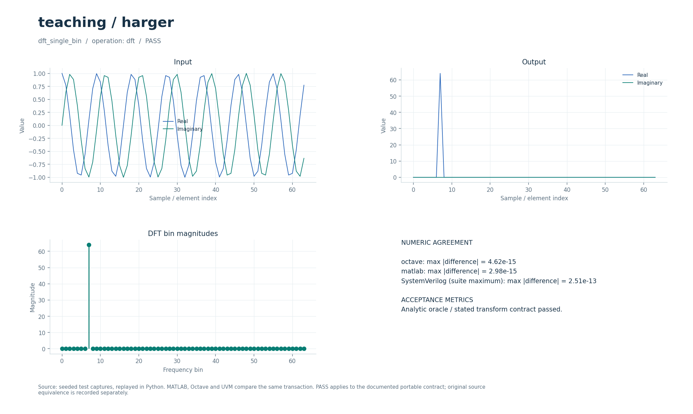

# Учебные примеры DSP: DFT и FIR

Аналитические упражнения на прямое и обратное преобразование Фурье и импульсный отклик FIR. Они служат небольшими воспроизводимыми проверками общего DSP-ядра.

## Что это

Операции `dft` и `fir` представляют ограниченный набор упражнений из исторической коллекции Harger, собранной вместе с материалами ELECTRONIX от 2026-09-30. В исторических материалах есть MATLAB-примеры, Mathcad-листы и данные; остальные упражнения не преобразованы в отдельные модели модемов. Здесь проверяются одиночный частотный бин, обратное преобразование и короткая свёртка.

Доступны Python, Octave/MATLAB и поведенческий SystemVerilog с UVM sequence, driver, monitor и scoreboard. Локальные файлы — обёртки общих ядер. [Снимок проверки от 2026-10-01](../../../docs/typed_verification_results.json) сохраняет PASS для своей версии исходников; после изменений нужна повторная регрессия.

Историческая модель в публичный репозиторий не входит. Происхождение файлов, размер каждого в байтах и SHA-256 записаны в [model.json](model.json). Обычные переносимые сценарии работают без исторических материалов.

### Историческое демо

Сборник MATLAB-упражнений, Mathcad-документов и данных по связи, ЦОС и изображениям. В `Unsorted` находятся 34 оригинальных `.m`; это не 34 готовых модема. `run_demo` запускает только три коротких упражнения, полезных для понимания тракта связи: сглаживание импульса, ДПФ тона и обнаружение тонов в шуме.

Общая схема выбранных опытов: **источник импульса/тонов → добавление шума там, где оно предусмотрено → фильтр или спектральный анализатор**. Модуляция, созвездие, число отсчётов на символ, символьная/фазовая синхронизация, АРУ и эквалайзер в этих трёх упражнениях не заданы.

## Как работает

1. `dft` принимает `[inverse]` и комплексный сигнал в `signal`; `auxiliary` не используется.
2. При `inverse=0` вычисляется `X[k]=Σ_n x[n]·exp(−2j·π·kn/N)` без нормировки.
3. При `inverse=1` используется IFFT с множителем `1/N`. Длина результата равна длине входа.
4. `fir` принимает `parameters=[]`, сигнал и отводы в `auxiliary`; вычисляет полную свёртку с нулевым дополнением вне входа и длиной `L+T−1`.
5. Сценарии сопоставляют результаты с аналитическими массивами, а не только с другой программной реализацией.

| Параметр/сценарий | Значение в регрессии | Ожидаемый результат |
| --- | --- | --- |
| DFT `parameters[0]` | `0` — прямое, `1` — обратное | Флаг допускает только `0/1` |
| `dft_single_bin` | `N=64`, `x[t]=exp(2j·π·7t/64)` | Бин `7` равен `64`, остальные нулевые |
| `inverse_dft` | Спектр предыдущего случая | Исходный комплексный тон |
| `filter_impulse` | Вход `[1,0,0]`, отводы `[0.25,0.5,0.25]` | `[0.25,0.5,0.25,0,0]` |

Параметры регрессии взяты из [проверочных сценариев](../../../tools/research_cases.py), ограничения входов — из [валидатора](../../../common/python/research_validate.py). Значения сценариев передаются явно. Python API — `run(operation, parameters, signal, auxiliary)`, M-вход — `run_model` с теми же аргументами (четвёртый можно опустить у операций, не использующих `auxiliary`). Массивы плоские, матрицы передаются по строкам, индексы начинаются с нуля. Полный [числовой контракт](../../../docs/TYPED_MODELS.md) задаёт порядок элементов и единицы. Комментарии локальных обёрток написаны на русском; диагностика и подписи готовых графиков — на английском.

Поведенческий SV обрабатывает целый блок с арифметикой `real`. Общий `research_if` передаёт `operation`, `parameters`, `signal_in`, `auxiliary`, `valid`, `done`, `result`; ожидаемый ответ не поступает в DUT. Это симуляционная реализация, не синтезируемый fixed-point RTL.

Для DFT используется общее [fft_r2sdf.sv](../../../rtl/common/fft_r2sdf.sv): radix-2 SDF с `s_valid/s_ready/s_last`, `m_valid/m_ready/m_last`, флагами `s_inverse/m_inverse`. Default вход 18 бит, выход 20 бит; `N=2^LOG2N`, `LOG2N=2…10`. Прямое аппаратное FFT выдаёт `X/N`, обратное — сумму без `1/N`, то есть масштаб отличается от `dft` переносимой модели. Кадр содержит ровно `N` отсчётов, на выходе естественный порядок бинов; ранний/поздний `s_last` даёт `error`. При непрерывных кадрах темп один отсчёт за такт, оценка задержки первого выхода — около `Lpipe+N+3`, где `Lpipe=N−1+4·LOG2N`. Подробности — в [FFT_RTL.md](../../../docs/FFT_RTL.md).

FIR реализован в [fir_runtime.sv](../../../rtl/common/fir_runtime.sv): комплексные отводы signed18 Q17, вход/выход signed18 Q15, полная свёртка, темп зависит от `ceil(T/LANES)`. Настройка, интерфейсы и конвейер — в [DSP_RTL.md](../../../docs/DSP_RTL.md).

В обозначении Q число после Q — количество дробных бит; например, signed18 Q15 представляет целый код, делённый на `32768`. Потоковые RTL-интерфейсы используют плоские порты; передача происходит на фронте при `valid && ready`.

## Структура каталога

| Файл/подкаталог | Назначение |
| --- | --- |
| [model.json](model.json) | Операции, имена сценариев, ограничения и манифест исторических файлов |
| [python/model.py](python/model.py) | Python-вход в общее ядро |
| [octave/run_model.m](octave/run_model.m), [matlab/run_model.m](matlab/run_model.m) | M-обёртки без дополнительных toolbox |
| [sv/model.sv](sv/model.sv) | Обёртка поведенческого DUT |
| [tb/testbench.sv](tb/testbench.sv), [tb/run.sh](tb/run.sh) | Подключение общего UVM-стенда и запуск выбранного workspace |
| [tests/test_model.py](tests/test_model.py) | Локальный unittest, запускающий Python-сценарии этого модуля |
| [research_core.py](../../../common/python/research_core.py), [research_core.m](../../../common/octave/research_core.m) | Общая реализация алгоритмов |
| [research_cases.py](../../../tools/research_cases.py), [research_tb.sv](../../../common/sv/research_tb.sv) | Проверочные сигналы, независимые критерии и UVM-окружение |

[run_demo.m](run_demo.m) запускает выбранные исходные скрипты и функции из локального `original/`. Этот подкаталог исключён из публичной поставки; его содержимое описывает [model.json](model.json).

## Как запустить

Команды выполняются из корня проекта. Python-ядру нужен NumPy, проверочному runner также SciPy; они перечислены в [requirements-visual.txt](../../../requirements-visual.txt) вместе с Matplotlib для графиков. Для `octave` нужен `octave-cli`, для `matlab` — MATLAB; переносимые M-файлы не требуют дополнительных пакетов или toolbox. [MATLAB launcher](../../../tools/matlab.sh) поддерживает `MATLAB_ROOT`; R2020b на проверявшемся хосте нужно запускать из терминала. Для `hdl` нужна Questa с UVM 1.2, при нестандартной установке задаются `QUESTA_HOME` и `UVM_HOME`.

```bash
python3 tools/run_research.py --suite python --workspace teaching/harger
python3 tools/run_research.py --suite octave --workspace teaching/harger
python3 tools/run_research.py --suite matlab --workspace teaching/harger
python3 tools/run_research.py --suite hdl --workspace teaching/harger
```

Первая команда выполняет числовые проверки Python, вторая и третья сравнивают M-ядро с Python, четвёртая выполняет UVM и отрицательный контроль. Все варианты сначала рассчитывают Python-эталон. `--suite all` объединяет Python, Octave и HDL; MATLAB запускается отдельно. Не используйте `python -O`: проверки требуют включённых `assert`. Локальный `tb/run.sh` вызывает тот же runner с `--suite hdl` и передаёт дополнительные аргументы.

Для отдельной fixed-point RTL-проверки нужны также Verilator для lint и зависимости [requirements-rtl.txt](../../../requirements-rtl.txt) вместе с указанными выше:

```bash
python3 tools/run_fft.py --suite all
python3 tools/run_fir.py --suite all
```

Эти команды проверяют целочисленные модели, lint и симуляцию RTL; вендорный синтез в них не запускается.

`run_fft.py` проверяет общий FFT, включая аналитические случаи этого модуля; `run_fir.py` — загружаемый FIR. Исторические Mathcad/MATLAB-материалы для этих команд не нужны. Их собственное исполнение потребовало бы отсутствующих исходников и соответствующей среды.

### Исторические скрипты: run_demo

В MATLAB/Octave перейдите в `algorithms/teaching/harger` и выполните:

```matlab
run_demo
```

Запускаются исходные `Unsorted/ex2_3.m`, `ex3_1.m`, `ex3_5.m` в отдельных областях переменных. Требуется базовый MATLAB или Octave. `Unsorted/` целиком в path не добавляется: старые `freqz/freqs/zplane` не должны подменять установленные функции. На время опыта отключается `pause`, затем восстанавливаются pause, path и RNG. Остальные упражнения и Mathcad-листы не запускаются.

`run_demo` требует исходников в `original/`, которых нет в публичной копии: см. [THIRD_PARTY.md](../../../THIRD_PARTY.md). Переносимые `tools/run_research.py`, `python/model.py` и `octave/run_model.m` работают и в публичной копии при наличии указанных выше зависимостей.

## Что смотреть

Артефакты выбранного workspace находятся в `build/typed/teaching__harger/`: `cases.json` содержит сценарии и метрики, `case_*.npz` — массивы `parameters/x/a/y`, `vectors.txt` — векторы UVM, `<suite>_results.json` — итог. `octave_cases.json` и `matlab_cases.json` сохраняют максимальные ошибки по случаям; журналы UVM — в `questa/`.

Все три сценария сравниваются с аналитическими ожидаемыми массивами с `atol=rtol=2e-10`. В `dft_single_bin` полезно проверить позицию и амплитуду ненулевого бина; в `inverse_dft` — форму комплексного тона, в `filter_impulse` — коэффициенты и нулевой хвост. BER/SER для этих упражнений не определяются.

Успешный runner завершается кодом 0, сообщает `PASS` и записывает итоговый `status: PASS` после завершения проверок. UVM выполняет каждый сценарий дважды со сбросом между последовательностями, сверяет метаданные, длину и все значения с допуском `1e-8·(1+|expected|)`. В основном `questa/simulation.log` требуются `UVM_ERROR: 0` и `UVM_FATAL: 0`. Отдельный `questa/negative_control.log` должен содержать обнаруженное намеренное числовое несовпадение; такой отказ является успешным отрицательным контролем. Незавершённый `RUNNING` или ненулевой код runner не означают PASS. Артефакты отдельного RTL-прогона: `build/rtl/fft/` и `build/rtl/fir/`.

[Визуальный отчёт](../../../docs/typed_visual/index.html#teaching/harger) · [Контракт и проверка](../../../docs/TYPED_MODELS.md) · [Python-вход](python/model.py) · [Octave-вход](octave/run_model.m) · [UVM launcher](tb/run.sh)



### Графики run_demo

Три окна: сглаживание импульса длиной 12 средним по 8 отсчётам; прямая ДПФ косинуса (пики в бинах 5 и 27 из 32); FFT двух тонов в шуме (бины 20/50 и зеркальные 492/462 из 512). `hit any key` остаётся в выводе, но пауза отключена. Старые условия с `&` могут вызывать предупреждения Octave.

## Ограничения

Проверены три упражнения, а не вся историческая коллекция Harger. Mathcad-листы, изображения, аудио и прочие упражнения отдельно не портированы. Свёртка не сохраняет состояние между вызовами. Вещественное ядро допускает произвольную длину DFT, тогда как аппаратный FFT ограничен степенями двойки и собственной нормировкой. Исторические физические результаты FFT относятся к описанному в FFT_RTL.md снимку; последующие изменения требуют отдельной проверки тайминга.

Совпадение Python/M/SV проверяет заявленный переносимый контракт. Fixed-point RTL сравнивается с отдельными целочисленными эталонами, а его расхождение с плавающей моделью оценивается отдельно. Исторические результаты физической сборки FFT сохранены в [FFT_RTL.md](../../../docs/FFT_RTL.md); они не распространяются автоматически на последующие изменения. Вендорный синтез загружаемого FIR отложен.

`run_demo` проверяет отдельный исторический сценарий; его параметры и зависимости отличаются от переносимого контракта выше. Наличие обёртки не означает совместимость всей исходной коллекции с текущими MATLAB/Octave.
