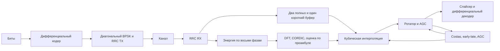

# Потоковый BPSK-пилот

Код TX/RX находится в `rtl/modems/bpsk_costas_2008_08_25/`. Действующий эталон захвата RX — `common/python/psk_fixed.acquire`; `bpsk_fixed.py` сохраняет общую арифметику и блочные модели. Физическая приёмка снимка TX/RX на 100 МГц выполнена в Vivado и Quartus 2026-10-02; она не распространяется на последующие изменения буферов и захвата.

## Структура



BPSK использует точки ±0.5±0.5j и дифференциальный XOR. RRC: 33 отвода, sps=8, rolloff=1. TX выдаёт восемь отсчётов на бит и 32 отсчёта хвоста. RX начинает захват после 1344 записанных отсчётов, до окончания стандартного кадра.

Захват знает только 192 метки преамбулы. Первая гармоника энергии по восьми фазам даёт дробную задержку; проверяются три смещения на целый символ. Фаза разворачивается и аппроксимируется прямой на символах 32…159; выбирается минимальная сумма квадратов остатков. Затем оцениваются фаза, частота и усиление. Это целочисленный алгоритм, заменяющий вещественный поиск по сетке. `confidence` означает достаточную оценённую амплитуду; он не является проверкой CRC или гарантией синхронизации.

## Захват: ускорение acq1 (2026-10-29)

`A` — число тактов от фронта принятия `start` до фронта, на котором родитель наблюдает `done`. Для BPSK оно уменьшено **1341 → 677**. Сигнал `done` устанавливается после фронта 676 и наблюдается родителем на 677. Арифметика и разрядности не менялись; каждый результат `acquisition_delay/frequency/phase/gain/score/confidence` и каждый принятый выход сравнивается с `psk_fixed.acquire` и трассой `psk_fixed.receive`.

| Группа профилей | Исходный A | Этап 1: делитель | Этап 2: FIT/DIV/SCORE | Этап 3: амплитуды |
| --- | ---: | ---: | ---: | ---: |
| `bpsk`, `psk8_ff`, `psk8_fb`, `psk8_rotated_fb`, `pi4` | 1341 | 1213 | 821 | **677** |
| `qpsk`, `qpsk_half_diff`, `qpsk_axis_diff_ff`, `qpsk_axis`, `qpsk_diff` (SIMO) | 984 | 856 | 690 | **669** |
| `qam16`, `qam64` | 1413 | 1253 | 859 | **714** |
| `qam16_eq`, `qam16_dfe` | 1056 | 896 | 728 | **707** |

Этапы 1 и 2 отдельно прошли побитную Verilator-проверку всех 14 профилей, включая остановки выхода и отрицательные численные контроли. Этап 3 достигает цели BPSK `A ≤ 686`, дальнейшее ускорение не выполнялось. Разница с расчётным расписанием исследования (около 665) вызвана управляющими тактами между SCORE-потоками. Значения A постоянны для соответствующей RTL-конфигурации: перед завершением дренируются амплитуды всех трёх кандидатов, включая проигравшие.

`bpsk_divide.STEPS_PER_CYCLE=2` по умолчанию выполняет два последовательных исходных restoring-шага за такт. Режим `1` оставлен для контроля; прочие значения отклоняются. Итераций 32 вместо 64; `done` устанавливается через **34 вместо 66** тактов после принятия старта (родитель наблюдает через 35/67). Зарегистрированный запуск и наблюдение в автомате давали `DIV_WAIT=68`, теперь 36. Сравнение остатка, nearest-even, знак и все 64 бита результата прежние. Проверяются оба режима на 3089 операндах, включая отрицательные половины, чётные/нечётные ничьи, `-2^63` и предельные знаменатели. Общий делитель используется также OQPSK: его монитор прогресса и критерий runner обновлены с 64 до 32 итерационных тактов.

FIT отправляет три последовательных потока по 128 запросов через единственный прежний интерполятор и CORDIC. Тег кандидата занимает `[17:16]` в sample-теге и `[12:11]` в CORDIC-теге; метка обучения и индекс символа сохранены. Отдельные контексты хранят суммы, задержки и коэффициенты. DIV и SCORE имеют независимые автоматы, поэтому деление следующего кандидата перекрывает SCORE предыдущего. Фазовая память расширена до трёх областей по 128×40 бит. Выбор выполняется последовательно 0→1→2 с прежним строгим `<`; clamp крайних задержек сохранён.

Во время FIT также сохраняются ровно 18-битные Re/Im после интерполяции, без повторного округления. Независимый повтор этих отсчётов через существующий gain-ротатор вычисляет три амплитуды параллельно SCORE. Коэффициенты фазы и тег выровнены регистрами, включая границу кандидатов. Для QAM отдельно накапливается энергия обучающих уровней. После выбора используется только амплитуда победителя, затем прежние деление/знак/ограничение gain. Все valid дренируются до `done`, поэтому разрешён немедленный следующий `start`.

Оценка дополнительных ресурсов относительно исходного захвата: **ΔDSP=0**; фазы +10 240 бит, отсчёты +13 824 бит, вместе **24 064 бита (2.94 КиБ)**, плюс примерно 0.7–1.2 кбит контекстов/тегов/управления. Ориентир — +0.5–1.5 тыс. LUT, +1–2 BRAM36-тайла Artix-7 либо +3–6 M10K Cyclone V с учётом упаковки. Вместе с третьим кадровым буфером это ориентировочно 48–49/50 BRAM-тайлов Artix и 202–205/397 M10K Cyclone. Для `BLOCK_FIT` полезных фаз всего 3×8, оптимизация памяти зависит от синтезатора. Два последовательных 33-битных вычитания делителя требуют физической проверки 100 МГц. Синтез и размещение acq1 не запускались, эти числа не являются отчётом инструментов.

Локальная проверка использует **Verilator 5.050**, `--binary --timing --assert` с копией macro-only scoreboard, где только `uvm_fatal` заменён на `$fatal`, а `import uvm_pkg` удалён. Это численная RTL-симуляция, полная UVM-приёмка остаётся за Questa. Воспроизводимый runner: `python3 tools/bpsk_acquisition_check.py --output <local-tmp>`. Прямой scoreboard подаёт 13 наборов произвольных отсчётов после FIR: нули с равными scores, константы обоих знаков, предельное насыщение и восемь случайных наборов. Каждый набор запускается дважды, в том числе сразу после `done`; сброс прерывает занятый захват. Обе полярности, все 14 профилей; сквозные прогоны дополнительно покрывают SIMO, backpressure, reset и коллизии конфигурации 0/191.

Локальный итог acq1: **81 pytest-тест и 341 подтест PASS**, **108 lint-конфигураций без предупреждений** (`run_bpsk --suite lint` — 96, `run_rtl --suite lint` — 12). Итоговый Verilator runner: 140 сквозных численных прогонов / 547 232 выходных символа, дополнительно 56 коллизий конфигурации, 28 отрицательных контролей и 728 прямых результатов захвата. Делитель в двух режимах проверен на 3067 операндах при каждой полярности, блочные scoreboard прошли. Артефакты с хешами текущих исходников: `<local-tmp>`, `<local-tmp>`, `<local-tmp>`; таблица этапов — `<local-tmp>`. Rate на окончательном снимке: `<local-tmp>`, десять строк PASS, включая d=0.

Дополнительный OQPSK stream/stalled/mid-reset с активным высоким сбросом прошёл численно и с монитором делителя (9 запросов / 288 итераций в stream). Сборка полного OQPSK-тестбенча для активного низкого сброса завершилась **внутренней ошибкой Verilator**, также при диагностическом отключении SVA в временной копии; локальный PASS этого дополнительного набора не заявляется. Логи: `<local-tmp>`. Сам делитель и все 14 PSK/QAM-профилей проверены при обеих полярностях. Поэтому в командах куратора отдельно оставлен `run_oqpsk.py --suite all` для общего изменённого делителя.

## Интерфейс и состояние

TX: `s_valid/s_ready`, `s_bit`, `s_last` → `m_valid/m_ready`, `m_re/m_im`, `m_last`. Следующий кадр допустим без сброса: история FIR логически очищается по первому отсчёту. Выход TX идёт через буфер на два отсчёта: разрешение FIR зависит от счётчика буфера, а не от `m_ready`. Без остановок выхода TX выдаёт один отсчёт за такт.

RX: сначала передать 192 исходных бита через `cfg_valid/cfg_ready`, последний с `cfg_last`; `cfg_count` задаёт 192…2048 символов. Кодирование преамбулы выполняется внутри. Неполная новая конфигурация блокирует приём. Менять конфигурацию можно только при пустом конвейере и свободных буферах.

`cfg_count` фиксируется на принятом `cfg_last`, до первого отсчёта, и действует для всех последующих кадров до переконфигурации. Точная длина волнового кадра ещё неизвестна, но её верхняя граница известна: `8N+64`. Короткий буфер используется только если `8N+64+32 ≤ SHORT_SAMPLES`; последние 32 слова нужны для хвоста RX FIR. При `SHORT_SAMPLES=2048` подходят `N=192…244`, назначение идёт по кольцу 0→1→2→0. Для остальных длин остаётся кольцо 0→1→0. Обработка и выдача идут по тому же кольцу, строго в порядке приёма. При новой полной конфигурации оба указателя возвращаются в 0; занятость любого из трёх буферов запрещает конфигурацию.

`m_index` — однобитный индекс точки BPSK, `m_bit` — дифференциально декодированная метка. `m_phase` содержит фазу после шага частоты текущего символа; `m_frequency`, `m_gain` и `m_correction` относятся к применённому состоянию этого символа.

Комплексный вход RX: `s_valid/s_ready`, `s_re/s_im`, `s_last`. Длина кадра — 8N…8N+64 отсчётов. После последнего входа RX дополняет FIR 32 нулями, в эти такты `s_ready=0`. Неверная конфигурация, слишком короткий или длинный кадр устанавливают `error`; сброс очищает ошибку и требует загрузить конфигурацию заново. Неверный кадр не выдаётся как корректный результат.

Если на отсчёте `8N+64` нет `s_last`, RX принудительно заканчивает захват, устанавливает sticky `error` и `invalid` кадра, дописывает ровно 32 нуля и запрещает дальнейшие входные передачи до сброса. Поздний `s_last` уже не принимается. Это прежняя протокольная ошибка; она защищает также короткий буфер. Уже выданный префикс ошибочного кадра не отзывается: захват/декодирование могут начаться до обнаружения ошибки. Неверный кадр нельзя считать успешно завершённым. В RAM короткого буфера дополнительно запрещена запись при индексе вне ёмкости.

Выход содержит метку, индекс точки созвездия, I/Q после усиления, состояния петель и `m_last`. Передача только при valid && ready. Остановка выхода удерживает данные и конвейер петель; вход может продолжать заполнять следующий свободный буфер кольца. При его занятости вход останавливается. Синхронный сброс отменяет незавершённый приём/декодирование всех трёх буферов. `RESET_ACTIVE` выбирает полярность. RAM и данные физически не очищаются, доступность задают счётчики и valid.

## Разрядности и конвейер

| Узел | Формат |
| --- | --- |
| I/Q | знаковые 18/15, диапазон −4…4−2⁻¹⁵ |
| RRC | коэффициенты 18/17, пары 19 бит, накопитель 42 бита |
| Интерполятор | четыре таблицы по 256 коэффициентов 18/16, сумма 38 бит; дробная позиция округляется вниз до 1/256 отсчёта |
| Ротатор | cosine LUT 4096×18/17, 12 старших бит фазы |
| Фаза/частота | 32 бита, один оборот = 2³²; намеренное циклическое переполнение |
| Позиция | знаковая 32/16 в петлях, 24/8 на входе интерполятора |
| Усиление | беззнаковые 25/20, ограничение 1…16·2²⁰ в целых кодах |
| CORDIC | 20 итераций, вход 49 бит, фаза 32 бита |
| Делитель | знаковый числитель 64 бита, положительный знаменатель 32 бита |

Округление к ближайшему чётному предшествует насыщению. RRC, интерполяция и вращение насыщаются до 18 бит; ошибки петель ограничены явно. Таблицы генерирует `tools/bpsk_tables.py`, режим `--check` проверяет их соответствие; `.mem` входят в снимок исходников.

Латентность RRC — 8 разрешённых тактов, интерполятора — 7, ротатора — 7; все три имеют II=1. Первая ступень интерполятора регистрирует запрос (позицию, кадр, длину, метку), поэтому адрес RAM не зависит от логики захвата и сопровождения. Выборка/перестановка банков отделена регистром от умножителей, округление AGC — от насыщения. Фазовая и временная обратная связь задержаны на 4 символа, AGC — на 8. Приращение AGC использует усиление исходного символа. Эти задержки отражены в Python; остановки тактов не меняют численные результаты.

Контроллер запрашивает early/mid/late за четыре такта на символ, с ожиданием доступности отсчётов и обратной связи. Два полноразмерных кадровых буфера сохраняют четыре банка: основная память 8192×36 и хвост 128×36 на банк; адрес включает младший бит номера кадра. Третий буфер — четыре отдельных `sync_ram` по `(SHORT_SAMPLES/4)×36`, по умолчанию 512×36 на банк. `SHORT_SAMPLES` — степень двойки от 8 до 16384; недопустимое значение даёт ошибку при старте симуляции. Каждая память — отдельный экземпляр `sync_ram`: два массива в одном процессе Quartus молча разворачивал в регистры. Хвост поддерживает максимальный кадр без округления всей основной глубины до 16384. Арифметика и латентность интерполятора сохранены.

## Пропускная способность и ограничения

Проверены последовательности из 12 кадров по 768 символов и трёх по 2048: один комплексный отсчёт за такт, кроме 32 тактов очистки FIR между кадрами. Без остановок выхода входное ожидание составляет соответственно 352 и 64 такта. Поэтому 100 Мвыб/с относится к отсчётам внутри кадра; хвост уменьшает среднюю скорость.

При `N=192`, BPSK, `m_ready=1` ускоренный захват обслуживает бесконечный поток разрешённых кадров `8N+d`, `d=0…64`, с обязательными 32 тактами FIR между ними: период обработки `A+882=1559`, минимальный входной период 1568. Дополнительных блокировок нет; проверены серии 16 кадров со штатными длинами и с `d=0`, обе полярности, `other_blocked=0`, `min_gap=max_gap=32`. Рекуррентное обоснование и измерения — в [RTL_BPSK_RX_CONTINUOUS_RATE.md](RTL_BPSK_RX_CONTINUOUS_RATE.md). Для других профилей требуется учитывать собственный TRACKING: например, при T(192)=973 бюджет для d≥36 равен A≤628, а не 722. Общей гарантии бесконечного потока для всех 14 профилей здесь нет. Синтез новой версии на паузе.

TX и RX синтезируются отдельно в физической IO-обвязке. Это не проверка совместного размещения трансивера или тайминга платы. Аппаратного запуска и полной эквивалентности историческому Simulink-приёмнику пока нет. Ядра не содержат `real`, вендорных примитивов или IP.

## Проверки и команды

Questa/UVM проверяет обе полярности сброса, отдельные блоки и полный RX, случайные паузы, сброс внутри кадра, повторные кадры, ошибки протокола, второй seed, длины 192/768/2048 и настоящий RTL TX → RX. Сравниваются каждый I/Q, метка, индекс, TLAST, состояния петель и параметры захвата. Испорченные ожидания обязаны вызвать численный UVM_FATAL. Строгий Verilator lint проверяет 11 модулей.

В шести номинальных случаях (два seed, чистый канал и два канала с шумом, ослаблением, CFO и дробной задержкой) фиксированный и независимый вещественный приёмники дают 0/576 ошибок полезных символов. При −8 дБ фиксированный приёмник даёт 161 и 91 ошибку: отрицательная проверка исключает подстановку истинных данных.

`precision_results.json` содержит SQNR для RRC TX/RX, интерполяции, вращения и усиления. Последние три сравниваются при одинаковых позициях/фазах/усилениях, чтобы отделить квантование узла от различий захвата. `rail_values` считает значения на границах насыщения, не реальные переполнения; в номинальных сценариях их нет.

```bash
python3 tools/run_bpsk.py --suite all
python3 tools/run_rtl_synth.py --block bpsk_tx --vendor both
python3 tools/run_rtl_synth.py --block bpsk_rx --vendor xilinx
python3 tools/run_rtl_synth.py --block bpsk_rx --vendor altera --quartus-phase map
python3 tools/run_rtl_synth.py --block bpsk_rx --vendor altera --quartus-phase fit
python3 tools/run_rtl_synth.py --block bpsk_rx --vendor altera --quartus-phase finish
```

Quartus допустимо запускать целиком без `--quartus-phase`. Поэтапный вариант сохраняет проект в ASCII-каталоге `/tmp` и проверяет исходный снимок и подготовленные файлы перед продолжением. Map/fit — промежуточные результаты; только STA и проверка предупреждений/ресурсов дают физический PASS.

Доказательства: `build/rtl/bpsk/all_results.json`, `build/rtl/bpsk/precision_results.json`, `build/rtl/synth/bpsk_tx/{xilinx,altera}.json`, `build/rtl/synth/bpsk_rx/{xilinx,altera}.json`. `regression_evidence.require_pass` проверяет статус и хэши исходников/артефактов. `tools/run_tests.py --suite rtl` включает библиотеку, BPSK и все физические сборки. Старые отчёты относятся к прежним снимкам; обновление документации не обновляет доказательства.

## QPSK (ORDER=4)

Те же модули с `ORDER=4` реализуют девять QPSK-моделей. Целочисленные эталоны — профили `common/python/psk_fixed.py`; профиль `BPSK` того же модуля побитово совпадает с `bpsk_fixed.py`.

| Профиль | Параметры RTL | Модели |
| --- | --- | --- |
| `QPSK` | `ORDER=4` | `qpsk_8_sps_fb_sync_2020_11_25`, `qpsk_script_basic`, `qpsk_script_costas` |
| `QPSK_HALF_DIFF` | `AMPLITUDE=16384`, `DIFFERENTIAL=1` | `qpsk_fb_symbol_sync_fb_phase_sync_agc_2008_05_15` |
| `QPSK_AXIS_DIFF_FF` | `TX_AXIS=1`, `DIFFERENTIAL=1`, `FEEDFORWARD=1`, `TIMING_LOOP=0` | `dqpsk_ff_symbol_farrow_sync_fast_agc_2008_05_12`, `qpsk_fast_symbol_sync_fast_phase_sync_fast_agc_2007_03_06`, `qpsk_ff_symbol_farrow_sync_ff_phase_sync_fast_agc_2007_05_20`, `qpsk_phase_noise_phase_sync_2009_04_12` |
| `QPSK_AXIS` | `TX_AXIS=1` (приёмник — `QPSK`) | `qpsk_demod_with_phase_noise` |

Точки на осях отдельного приёмника не требуют: подгонка фазы по преамбуле поглощает сдвиг 45°, после поворота точки диагональны с T = |точка|/√2 = 23170. Различается только маппер TX. `DIFFERENTIAL=1` у QPSK — фазовое кодирование Грея: индекс растёт на gray(метка) mod 4, приёмник выдаёт gray⁻¹(разность индексов). `FEEDFORWARD=1` — только фаза (0.03 рад на единицу ошибки, коэффициент 626), частота остаётся от захвата. `TIMING_LOOP=0` убирает early-late детектор, `m_correction=0`.

| Что меняется | BPSK (`ORDER=2`) | QPSK (`ORDER=4`) |
| --- | --- | --- |
| Метка `s_bit`/`cfg_bit`/`m_bit`/`m_index` | 1 бит, дифференциальный XOR | 2 бита, без кодирования; бит 1 — знак Q, бит 0 ⊕ бит 1 — знак I |
| Точки, Q15 на ось | ±16384 | ±23170 (0.7071) |
| FIR TX | вещественный, `m_im=m_re` | комплексный |
| Фаза в захвате | `z·conj(s(1+j))` | `z·conj(a+jb)` по знакам обучающей точки |
| Числитель усиления | 2³⁵ | 46340·2²⁰ |
| Фазовая ошибка | по решению, `s(v₁−v₀)` | по цели (преамбула/решение), `(a·v₁−b·v₀)·23171 >> 15`, конвейер из трёх ступеней |
| Ошибки усиления и тайминга | сдвиг 15 и 27 | сдвиг 16 и 28 (квадрат модуля цели 2T² ≈ 2³⁰) |

Нормировки QPSK по 2T² отличаются от степени двойки на 4·10⁻⁵, фазовая ошибка масштабируется умножением на 1/√2. Петля ждёт флага готовности обратной связи, поэтому лишние ступени фазовой ошибки не меняют числа; такты ожидания на входе те же, что у BPSK (352/64/0).

Проверки для каждого из четырёх профилей: те же UVM-сценарии, что для BPSK (поток 12 кадров, остановки выхода, сброс посреди кадра, RTL TX → RX, 192 и 2048 символов, отрицательный контроль; протокол — для `QPSK`) в обеих полярностях сброса; lint всех конфигураций. В Python: 0 ошибок полезных символов на сценариях `modem_checks.py` (чистый канал, два канала с шумом, задержкой и сдвигом частоты, 35 дБ, фазовый шум 0.0003), как и у вещественного приёмника; при −8 дБ 145…280 ошибок. Фазовый шум 0.005 отслеживается без ошибок, без слежения за несущей ошибки есть. Около порога (−2…+2 дБ по отсчётам) SER фиксированной и вещественной моделей совпадает в пределах статистики.

Ограничение: около порога захват `QPSK` по развёртке фазы преамбулы срывается чаще вещественного перебора задержек — при −4 дБ 1 кадр из 30 против 0; при −2 дБ и выше срывов нет ни у одного приёмника.

## 8-PSK (ORDER=8)

`ORDER=8` реализует три модели 8-PSK с единичными точками и фазовым кодированием Грея (индекс растёт на gray(метка) mod 8, приёмник выдаёт gray⁻¹ разности индексов):

| Профиль | Параметры RTL | Модель |
| --- | --- | --- |
| `PSK8_FF` | `TX_AXIS=1`, `DIFFERENTIAL=1`, `FEEDFORWARD=1`, `TIMING_LOOP=0` | `psk8_fast_ff_nda_symbol_sync_fast_ff_nda_phase_sync_2006_11_15` |
| `PSK8_FB` | `TX_AXIS=1`, `DIFFERENTIAL=1` | `psk8_fb_symbol_sync_fb_phase_sync_agc_2009_08_19` |
| `PSK8_ROTATED_FB` | `DIFFERENTIAL=1`, `TIMING_LOOP=0` | `dqpsk_19_09_2006` (точки 22.5° + k·45°) |

Приёмник работает с таблицей 22.5° + k·45° для всех трёх моделей: сдвиг передатчика (0° или 22.5°) поглощает захват. Решение — октант: квадрант по знакам I/Q и сравнение |I| > |Q|. Фазовая ошибка — `(v₁·t₀ − v₀·t₁) >> 15` с целевыми компонентами cos/sin 22.5° (30274, 12540): регистр входов, два произведения, разность с округлением; запись в обратную связь — на той же ступени, что у QPSK с T=23170. При захвате фаза символа — угол z минус угол цели (2k+1)·2²⁸, амплитуда — вещественная часть после поворота на тот же угол; числитель усиления 2³⁵. Нормировки усиления и тайминга — как у QPSK с T=23170 (|цель|² = 2³⁰). Метки — 3 бита, преамбула занимает 576 бит.

В Python все три профиля дают 0 ошибок на сценариях `modem_checks.py`, как вещественный приёмник; при −8 дБ 409…423 ошибки; при 2…8 дБ SER совпадает с вещественной моделью, срывов захвата нет. RTL побитово совпадает в тех же UVM-сценариях, что QPSK.

## pi/4-QPSK

`PI4=1` при `ORDER=8` реализует две модели π/4-QPSK (`pi4_qpsk_8_sps_ff_sync_2021_05_27`, `pi4_qpsk_feedforward_4_power_phase_sync_2010_07_15`; конфигурации одинаковые, RTL один). Параметры: `TX_AXIS=1`, `FEEDFORWARD=1`, `TIMING_LOOP=0` — как у `PSK8_FF`; профиль `PI4` в `psk_fixed.py`.

| Что меняется | 8-PSK (`PSK8_FF`) | π/4-QPSK (`PI4`) |
| --- | --- | --- |
| Метки `s_bit`/`cfg_bit`/`m_bit` | 3 бита | 2 бита; `m_index` остаётся 3-битным |
| Кодирование | индекс += gray(метка) mod 8 | индекс += 2·gray(метка)+1 mod 8 (нечётный шаг) |
| Декодирование | gray⁻¹((индекс−предыдущий) mod 8) | gray⁻¹(((индекс−предыдущий−1) mod 8)/2) |

Захват, решение по октантам среди всех 8 точек, петли и форматы не меняются: вещественный приёмник тоже выбирает argmin по всей 8-точечной таблице, не ограничиваясь четырьмя точками текущей чётности. Детектор 4-й степени оригинала `..._4_power_phase_sync_2010_07_15` в переносимую модель не вошёл; RTL следует переносимой модели.

В Python 0 ошибок на сценариях `modem_checks.py` у обеих моделей; при 2/4/6/8 дБ (6 кадров по 1536 символов) 454/115/17/0 ошибок против 430/111/15/0 у вещественного приёмника, срывов захвата нет. RTL побитово совпадает в тех же UVM-сценариях, что QPSK и 8-PSK.

## QAM16 (ORDER=16)

`ORDER=16`, `AMPLITUDE=16384`, `DIFFERENTIAL=1` реализует две модели QAM16 без эквалайзера: `qam_fb_gardner_symbol_farrow_sync_fb_phase_sync_agc_2007_06_18` и `qam_fb_symbol_sync_fb_phase_sync_agc_var_ch_delay_2007_07_10` (конфигурации совпадают, у второй требование по дрейфу тактов). Профиль `QAM16` в `psk_fixed.py`.

| Узел | QAM16 |
| --- | --- |
| Точки | уровни (a, b) ∈ {±1, ±3} × T, T = 16384 (±0.5/±1.5, Es = 2.5); таблица `q16_levels` в `bpsk_math.svh` в порядке `config.json` |
| Метки | 4 бита; квадрант `label[3:2]` растёт на свой код Грея (quadrant-дифф), `label[1:0]` передаётся как есть |
| Решение | по осям: код c = clamp(⌊v/2T⌋, −2, 1), уровень 2c+1, индекс из таблицы `q16_index`; для квадратной решётки это argmin вещественной модели (кроме точек ровно на пороге) |
| Фазовая ошибка | (a·v₁ − b·v₀)·R(n) >> 15, R(n) = round(2¹⁶/n), n = a²+b² ∈ {2, 10, 18} → 32768/6554/3641; при n = 2 совпадает с QPSK при T = 2¹⁴ |
| Ошибка усиления | Σ(t−v)·v·R(n) >> 29 — на одну ступень длиннее, чем у PSK |
| Тайминг | `inverse_square` = gain²·round(2¹⁷/10) >> 44: множитель 2/Es в шаге инициализации кадра |
| Захват | фаза — angle(z·conj(a+jb)); амплитуда — divide(2·Σ(a·re+b·im), Σ(a²+b²)) тем же делителем (для ±1 равно прежнему Σ/128) |

Умножения на уровень ±1/±3 сделаны сдвигом и сложением. Ради тайминга у QAM16 добавлены регистры, не меняющие чисел: вход CORDIC в подгонке фазы (масштабирование уровнями и сумма иначе цеплялись к первой ступени, Artix-7 −0.97 нс), слагаемые амплитуды и энергии перед накоплением (метка выходит из сдвигового регистра, который Quartus кладёт в M10K), а множитель 2/Es считается за три шага инициализации кадра — два узких произведения 25×15, их сумма, затем разделённое округление (частное/половина/«липкий» бит и инкремент). Петли ждут флагов готовности обратной связи, захват — последнего слагаемого, поэтому лишние ступени не меняют чисел.

Общее для всех порядков: обучающая последовательность в `bpsk_rx` теперь сдвиговый регистр — каждая метка вдвигается сверху, после 192 записей метка k стоит на `[k·BITS +: BITS]`. Раньше запись шла по адресу `config_index·BITS` через дешифратор 576/768 бит; этот путь стал худшим в Cyclone V у `psk8_rotated_fb_rx` (+0.991 нс при требуемом 1 нс). Неполная конфигурация, как и прежде, оставляет приёмник ненастроенным. Суммы поворотника `bpsk_rotate` перенесены в логику (`use_dsp="no"`): каскад DSP `PCOUT→PCIN` дал отрицательный hold в Artix-7 у `psk8_ff_rx`, как раньше в RRC. Обвязка синтеза приёмников теперь регистрирует и вход отсчётов с выводов `seed` (путь вывод → RRC был худшим в Cyclone V у `pi4_rx`). Выводы `seed` подмешиваются в выходной регистр обвязки тоже через регистр: путь вывод → выходной регистр с компенсирующей hold задержкой на входе был худшим у `simo_rx` в Artix-7 и давал запрещённую оценку трассировщика `Route 35-328`. Поток Vivado (`tools/rtl_synth_vivado.tcl`): починка hold и трассировка идут с дополнительной неопределённостью hold +0.05 нс и `route_design -directive Explore`, а перед итоговыми отчётами восстанавливается контрактная неопределённость 0.2 нс из XDC. Иначе трассировщик доводил hold ровно до 0.000 нс (у `qpsk_half_diff_rx`), а приёмка требует строго положительного запаса. Захват получает только метки символов 32…159 и выбирает их по `send_index` из таблицы на 128 записей — без сложения с 32 и умножения на ширину метки перед мультиплексором (этот путь был худшим в Cyclone V у `psk8_ff_rx`).

В политику предупреждений Vivado добавлено поглощение `gain_scaled` каскадом DSP (как `product_q` в `fxp_mrc2`). Промежуточная оценка трассировщика `Route 35-328` по-прежнему запрещена защитным тестом.

В Python 0 ошибок на сценариях `modem_checks.py` и при дрейфе ±6·10⁻⁴ (без петли тактирования при дрейфе 3·10⁻⁴ и больше — сотни ошибок); при 2/4/6/8/10 дБ (6 кадров по 1536 символов) 2352/871/242/27/2 ошибки против 2302/873/231/28/0 у вещественного приёмника, срывов захвата нет. RTL побитово совпадает в тех же UVM-сценариях, что QPSK и 8-PSK; в векторы QAM добавлен кадр с дрейфом 6·10⁻⁴.

## QAM16 equalizers

`EQUALIZER=1` (линейный NLMS, 7 отводов) и `EQUALIZER=2` (DFE, 7 прямых и 3 обратных отвода) при `ORDER=16`, `AMPLITUDE=16384`, `DIFFERENTIAL=1` реализуют модели `qam_fb_symbol_sync_fb_phase_sync_agc_var_ch_delay_eq_2007_07_21` и `qam_fb_symbol_sync_fb_phase_sync_agc_dfe_2007_07_26`. Профили `QAM16_EQ` и `QAM16_DFE` в `psk_fixed.py` (класс `Equalizer`). Эквалайзер `bpsk_equalizer.sv` стоит в `bpsk_track` между ротатором (с АРУ) и слайсером, как в `modem_core.symbol_receiver`. Петли несущей, усиления и тактирования видят выход эквалайзера.

| Узел | Формат |
| --- | --- |
| Отводы | Q2.22, 25 бит, насыщение; прямой отвод 0 стартует с 1.0. В произведениях 25×18 участвуют без округления; выход — сумма, округлённая на 22 бита, насыщение до 18 бит |
| Обратные отводы (DFE) | те же 25 бит; умножаются на решённые (на преамбуле — обучающие) уровни ±1/±3 сдвигом и сложением |
| Ошибка | цель − выход, насыщение до 18 бит |
| Шаг | 0.3 на преамбуле, 0.02 на данных (Q15: 9830/655) |
| Нормировка | 1/P, P = Σ\|x\|² по окну отводов (+ Σ\|цель\|² обратных отводов у DFE) + 1. s — длина P в битах, мантисса m — 10 старших бит (512…1023). ПЗУ 1024×24 хранит step·round(2¹⁹/m) по адресу {обучение, m−512}. Коэффициент c = sat18(round(e·step·r, s−16)) — один переменный сдвиг на символ |
| Обновление | w += round(c·conj(x), 18); у DFE — round(c·conj(уровень), 4). Произведение c·conj(x) — три умножения (по Гауссу) |
| Задержка обновления | 4 символа (delayed LMS): выход символа k использует обновления символов ≤ k−5 |

Конвейер: входной FIFO на 8 символов, один символ за ≥ 4 такта, выход через 15 тактов после выдачи. На символ k приходятся:
- t1…t5 — обновление пары прямых отводов (2p, 2p+1) коэффициентом символа k−5 (индексы выборки истории считаются на такт раньше);
- t6…t12 — произведения уже обновлённой пары и накопление;
- t1…t5 — |x|² на одном умножителе (re², затем im²) и мощность окна;
- t7…t12 — обратные отводы: выборка, произведения на уровни, округление, запись, два старых члена, член последнего решения;
- t13 — сумма, t14 — округление;
- t15 — целевые уровни, t16 — ошибка;
- t17…t20 — коэффициент: одно произведение на re и im по очереди, сдвиг, округление.

Петля решения (выход → уровень → член F0·уровень → сумма → округление) замыкается за 4 такта. Слайсер эквалайзер дублирует у себя (по своему регистровому выходу и метке обучения из тега), поэтому обратного комбинационного пути из `bpsk_track` нет. Уровни хранятся кодами {есть, ca, cb}: пустая история даёт уровень 0, как нулевые `past` в Python.

От разрешения тактов `ce` зависят только приём входа и выдача выхода. Конвейер работает без остановок, а выходной FIFO на 8 символов держит результаты, пока `ce` снят. Без этого `ce` расходился по тысячам регистров эквалайзера, и путь `m_ready` → история в Cyclone V давал +0.98 нс. В `bpsk_track` при эквалайзере фазовая ошибка сначала регистрируется. В `pending_pe` на 8 слотов она пишется на ступени `PE_STAGE` вместе с флагом готовности, а не через выбор из 8 сразу после округлителя.

DSP: 8 произведений 25×18 свёртки, 6 произведений обновления по Гауссу (операнды cr+ci, −(xr+xi), xr−xi собираются в ступени выборки, иначе Vivado раскладывал «18 × сумму трёх» на два DSP), 1 — коэффициент, 1 — квадраты. Итого 16 сверх `qam16_rx`. Суммы помечены `use_dsp="no"`: без этого Vivado брал DSP под сумматоры и выходил за 90. Массивы контекста — регистры (`ramstyle="logic"`): Quartus иначе выводил RAM с логикой «чтение во время записи».

С задержкой эквалайзера путь от старта символа до фазовой ошибки — около 32 тактов. При задержке петель в 4 символа приёмник шёл бы со скоростью входа (8 тактов на символ) и не догонял поток после захвата: тестбенч ловил остановку входа больше 32 тактов. Поэтому у профилей с эквалайзером обратная связь несущей и тактирования ждёт 8 символов (`LOOP_DELAY` в `bpsk_track`, `loop_delay` в профиле). Около порога и при дрейфе ±6·10⁻⁴ задержка 8 не хуже задержки 4.

Захват (`BLOCK_FIT`): при эхе 0.45 через один символ посимвольные фазы z·conj(a+jb) срываются при развёртке. Целочисленный приёмник с тремя кандидатами задержки получал частоту −8.5·10⁻⁴ вместо 0, а вещественный спасал перебор 65 задержек. Поэтому слагаемые подгонки суммируются по 8 блокам из 16 символов, и в CORDIC идут только суммы блоков. Развёртка, взвешенные суммы, делитель и невязка работают по 8 фазам блоков (`psk_fixed.fit_blocks`); невязка считается на удвоенном масштабе, потому что центр блока 2·(32+16j)+15 нечётный. Диапазон частоты — 1/32 оборота на символ (4·10⁻³ на отсчёт), в 8 раз больше контрактного.

Python, 4 кадра по 1536 символов на модель, эхо 0.45 при 8 дБ:

| Модель | Целочисленный | Вещественный |
| --- | --- | --- |
| NLMS | 36/36/35/42 (149) | 45/33/43/38 (159) |
| DFE | 26/13/24/19 (82) | 24/18/34/17 (93) |

На сценариях эха при 35 дБ и с несущей (усиление 0.65/0.2, частота ±1.5…5·10⁻⁴) ошибок 0, а без эквалайзера при той же блочной подгонке их больше 300. Дрейф ±6·10⁻⁴ без эха — 0 ошибок. В векторы RTL добавлены два кадра с эхом, RTL совпадает с Python побитово.

## QAM64 (ORDER=64)

`ORDER=64`, `AMPLITUDE=8192`, `DIFFERENTIAL=1` реализует `QAM64_2008_11_21`: уровни ±1…±7 по осям (Es = 42), quadrant-дифф по коду Грея квадранта (метки 6 бит), feedback-несущая, AGC, early-late тайминг. Профиль `QAM64` в `psk_fixed.py`; передатчик — `qam64_tx`, приёмник — `qam64_rx`.

| Узел | QAM64 |
| --- | --- |
| Передатчик | на вход RRC идёт уровень·2¹⁴ (±7 → 114 688, в пределах 18 бит), FIR округляет на 16 бит вместо 17: выход — точный сигнал Q15, пик 3.64 по оси |
| Вход приёмника | Q3.15; после согласованного RRC уровни доходят до ±7.3, поэтому RRC приёмника округляет на 19 бит (масштаб 1/4). Энергия для захвата тогда того же порядка, что у QAM16 (Es/16 ≈ 2.6 против 2.5) |
| Уровень после АРУ | T = 2¹³: ±7·T = 57 344 с запасом в 18 битах |
| Решение | по осям: c = clamp(⌊v/2T⌋, −4, 3), уровень 2c+1 = {c,1}; индекс из `q64_index`; равно argmin таблицы (тест на 4000 точках) |
| Цель | на преамбуле — уровни метки (`q64_levels` по регистру тега), иначе {c,1} прямо из решения, без круга «индекс → таблица» |
| Ошибки | фаза: (a·v₁ − b·v₀)·R(n) >> (log₂T + 1) = 14; усиление: Σ(t−v)·v·R(n) >> (2·log₂T + 1) = 27; R(n) = round(2¹⁶/n) для девяти n = a²+b² ∈ {2, …, 98} из 16-входовой таблицы по модулям кодов |
| Тайминг | 2/Es = round(2¹⁷/42) = 3121 в шаге инициализации, `TE_SHIFT` = 25 |
| Захват | как у QAM16: фаза angle(z·conj(a+jb)), амплитуда divide(2·Σ(a·re+b·im), Σ(a²+b²)); a²+b² до 98, сумма энергии 14 бит |

Умножение на уровень — сдвигом и сложением (`qam_scale`: 3x = 2x+x, 5x = 4x+x, 7x = 8x−x). Метка в захвате переводится в уровни модулем `qam_label_levels`. Общие правки ядра, не меняющие чисел:
- у всех QAM фазовая ошибка сначала регистрируется, а в `pending_pe` пишется на ступени `PE_STAGE` — путь «округление → запись в слот» был худшим в Cyclone V (+0.86 нс);
- `q_tag` сопровождения сужен до 14 значащих бит, нули добавляет `bpsk_rx` (Vivado сообщал о константном порте).

**Ограничение уровня входа** (согласовано 2026-10-05): вход Q3.15 насыщается выше 4. Пик сигнала при единичном усилении канала — 3.64, при 30 дБ ошибок нет до усиления 1.2; при 1.3 вход насыщается и появляются ошибки.

Python, 4 кадра по 1536 символов: при 8/10/12 дБ — 1651/670/185 ошибок против 1804/718/184 у вещественного приёмника. Сценарии `modem_checks.py` (усиление 0.65 и 0.2, частота до 5·10⁻⁴, задержка до 7.25) и дрейф ±6·10⁻⁴ — без ошибок. RTL совпадает с Python побитово в тех же UVM-сценариях, что QAM16.

## SIMO MRC

`simo_rx` (`rtl/modems/simo_maximal_ratio_combining_2010_08_27/`) реализует `simo_maximal_ratio_combining_2010_08_27`: объединитель двух ветвей `fxp_mrc2` (`rtl/common/`) перед ядром пилота с `ORDER=4`, `DIFFERENTIAL=1` (профиль `QPSK_DIFF`: диагональная единичная QPSK, фазовое кодирование Грея, петля несущей с обратной связью, early-late тайминг). Передатчик — `bpsk_tx` с теми же параметрами (`qpsk_diff_tx`). Эталоны — `common/python/mrc_fixed.py` и профиль `QPSK_DIFF` в `psk_fixed.py`.

Контракт тот же, что у переносимой модели (`docs/PORTING_CONTRACT.md`): комплексные усиления ветвей и дисперсии шума — известная конфигурация, обе ветви на одном такте и с одной задержкой. Оценки канала и выравнивания задержек в RTL нет, как нет их и в эталоне.

| Узел | Формат |
| --- | --- |
| Отсчёты ветвей, выход объединителя | Q3.15, 18 бит (вход приёмника) |
| Усиления `gain_a/b` | Q3.15, 18 бит |
| Дисперсии `variance_a/b` | целые 1…65535 в общем масштабе (важно только отношение) |
| Веса | Q4.14, 18 бит, \|w\| < 8 |

Для двух ветвей деление на дисперсии сокращается: `w_a = conj(g_a)·v_b/D`, `w_b = conj(g_b)·v_a/D`, `D = |g_a|²v_b + |g_b|²v_a`. После `gain_valid` один общий умножитель 37×18 за 40 тактов считает `|g|²`, `D` (до 52 бит) и числители, затем последовательный делитель `fxp_divide_seq` (64/52 бит, точное округление к чётному) выполняет четыре деления по 66 тактов, всего около 310 тактов. Нулевая дисперсия, `D = 0` или вес вне Q4.14 дают `gain_error`; при равных дисперсиях последнее означает √(\|g_a\|²+\|g_b\|²) < 1/8. Объединение — восемь произведений и сумма с округлением к ближайшему чётному и насыщением, 5 ступеней. Выходное FIFO на 8 слов сдвиговое, вход получает кредиты по свободным местам, поэтому `m_ready` не управляет разрешением DSP. Полная латентность 6 тактов; при `m_ready=1` поток не останавливается. Флаг `saturated` залипает до следующей конфигурации.

Проверки: в Python (`tests/test_mrc_fixed.py`) веса совпадают с вещественными в пределах 2⁻¹⁴ на 300 случайных конфигурациях, проверены округление, границы и отказы; на трёх каналах и трёх отношениях дисперсий (1:1, 1:4, 9:1) 0 ошибок полезных символов, как у вещественного приёмника; при σ = 0.3 на ветвь (10 кадров по 1536 символов) SER фиксированной модели совпадает с вещественной (195 против 201 ошибки) и ниже, чем у одной лучшей ветви (309). В RTL блочный тест `rtl/tb/mrc_blocks_tb.sv` побитово сравнивает 310 частных делителя и 23 конфигурации объединителя (веса или ошибка, 2580 выходов, насыщение, сброс во время расчёта весов, случайные паузы входа и остановки выхода, отсутствие остановок без противодавления); `simo_rx` проходит те же UVM-сценарии, что профили QPSK (поток 12 кадров, остановки, сброс посреди кадра, RTL TX → обе ветви → RX, 192 и 2048 символов, отрицательный контроль), в обеих полярностях сброса.

Ограничение: около порога (σ ≥ 0.4 на ветвь) целочисленный захват срывается чаще вещественного перебора задержек — 1 кадр из 10 при σ = 0.4 и 5 из 10 при σ = 0.5. Это та же особенность развёртки фазы преамбулы, что и у `QPSK`.

## Состояние на 2026-10-06

После эквалайзеров QAM16, QAM64 и MSK/GMSK (общее ядро изменилось: `LOOP_DELAY`, `BLOCK_FIT`, `EQUALIZER`, `ORDER=64`, сдвиг FIR, регистрируемая фазовая ошибка QAM) все блоки пересобраны на одном снимке (коммит `ca2d45c`). Свежие PASS (`regression_evidence.require_pass`):
- 72 отчёта синтеза (36 блоков × 2 вендора);
- `build/rtl/bpsk/all_results.json`, `build/rtl/cpm/all_results.json`, `build/rtl/all_results.json`, `build/python_results.json`.

Блоки MSK/GMSK описаны в [CPM_RTL.md](CPM_RTL.md).

| Блок | Artix-7 setup/hold, нс | Cyclone V setup/hold, нс (худший угол) | Ресурсы Artix-7 |
| --- | --- | --- | --- |
| complex_mul | +0.769 / +0.157 | +1.488 / +0.097 | 174 LUT, 120 FF, 4 DSP |
| complex_add | +1.324 / +0.101 | +1.472 / +0.176 | 139 LUT, 155 FF, 0 DSP |
| resize | +1.324 / +0.074 | +1.446 / +0.171 | 165 LUT, 117 FF, 0 DSP |
| ram | +1.324 / +0.201 | +1.446 / +0.172 | 44 LUT, 78 FF, 0 DSP, 1 BRAM |
| rom | +1.324 / +0.114 | +1.446 / +0.175 | 44 LUT, 78 FF, 0 DSP, 1 BRAM |
| bit_sync | +1.223 / +0.133 | +1.486 / +0.176 | 44 LUT, 79 FF, 0 DSP |
| reset_sync | +0.633 / +0.134 | +1.483 / +0.175 | 43 LUT, 79 FF, 0 DSP |
| bpsk_tx | +1.324 / +0.059 | +1.450 / +0.156 | 945 LUT, 868 FF, 10 DSP |
| bpsk_rx | +0.397 / +0.055 | +1.145 / +0.106 | 12857 LUT, 11322 FF, 68 DSP, 49 BRAM |
| qpsk_tx | +0.444 / +0.059 | +1.446 / +0.107 | 2820 LUT, 1895 FF, 20 DSP |
| qpsk_rx | +0.471 / +0.062 | +1.375 / +0.071 | 13086 LUT, 11524 FF, 69 DSP, 49 BRAM |
| qpsk_half_diff_tx | +1.324 / +0.055 | +1.476 / +0.155 | 1733 LUT, 1559 FF, 20 DSP |
| qpsk_axis_diff_tx | +1.324 / +0.065 | +1.484 / +0.129 | 1666 LUT, 1537 FF, 20 DSP |
| qpsk_axis_tx | +1.324 / +0.054 | +1.442 / +0.150 | 1658 LUT, 1535 FF, 20 DSP |
| qpsk_half_diff_rx | +0.146 / +0.053 | +1.202 / +0.065 | 12390 LUT, 11499 FF, 68 DSP, 49 BRAM |
| qpsk_axis_diff_ff_rx | +0.371 / +0.060 | +1.200 / +0.089 | 11625 LUT, 10975 FF, 61 DSP, 49 BRAM |
| psk8_axis_tx | +0.303 / +0.066 | +1.475 / +0.075 | 2834 LUT, 2030 FF, 20 DSP |
| psk8_rotated_tx | +0.293 / +0.072 | +1.446 / +0.052 | 2882 LUT, 2106 FF, 20 DSP |
| psk8_ff_rx | +0.413 / +0.056 | +1.230 / +0.068 | 11665 LUT, 11076 FF, 59 DSP, 49 BRAM |
| psk8_fb_rx | +0.037 / +0.069 | +1.491 / +0.069 | 12349 LUT, 11589 FF, 67 DSP, 49 BRAM |
| psk8_rotated_fb_rx | +0.363 / +0.100 | +1.393 / +0.079 | 11789 LUT, 11064 FF, 59 DSP, 49 BRAM |
| qpsk_diff_tx | +0.735 / +0.056 | +1.449 / +0.165 | 2831 LUT, 1897 FF, 20 DSP |
| simo_rx | +0.047 / +0.100 | +1.426 / +0.078 | 13928 LUT, 12730 FF, 79 DSP, 49 BRAM |
| mrc2 (`fxp_mrc2`) | +0.783 / +0.061 | +1.351 / +0.116 | 1585 LUT, 1303 FF, 10 DSP |
| pi4_tx | +0.235 / +0.055 | +1.488 / +0.133 | 2832 LUT, 2030 FF, 20 DSP |
| pi4_rx | +0.439 / +0.057 | +1.446 / +0.078 | 12390 LUT, 11088 FF, 59 DSP, 49 BRAM |
| qam16_tx | +0.937 / +0.057 | +1.453 / +0.151 | 1778 LUT, 1625 FF, 20 DSP |
| qam16_rx | +0.075 / +0.056 | +1.308 / +0.060 | 13956 LUT, 12241 FF, 71 DSP, 49 BRAM |
| qam16_eq_rx | +0.034 / +0.085 | +1.393 / +0.050 | 17573 LUT, 16891 FF, 87 DSP, 50 BRAM |
| qam16_dfe_rx | +0.133 / +0.081 | +1.199 / +0.052 | 20334 LUT, 17821 FF, 87 DSP, 50 BRAM |
| qam64_tx | +1.207 / +0.062 | +1.472 / +0.112 | 1771 LUT, 1693 FF, 20 DSP |
| qam64_rx | +0.131 / +0.087 | +1.261 / +0.074 | 13834 LUT, 12576 FF, 71 DSP, 49 BRAM |
| msk_tx | +1.324 / +0.067 | +1.441 / +0.171 | 156 LUT, 226 FF, 0 DSP, 2 BRAM |
| msk_rx | +0.387 / +0.061 | +1.147 / +0.097 | 11251 LUT, 8340 FF, 46 DSP, 46 BRAM |
| gmsk_tx | +1.324 / +0.057 | +1.442 / +0.118 | 442 LUT, 472 FF, 0 DSP, 2 BRAM |
| gmsk_rx | +0.377 / +0.055 | +1.274 / +0.078 | 12156 LUT, 8998 FF, 46 DSP, 46 BRAM |

Самые тонкие места в Artix-7 по setup — `qam16_eq_rx` +0.034, `psk8_fb_rx` +0.037 и `simo_rx` +0.047 нс (общее ядро сдвигает их разводку, числа не менялись). Hold в Artix-7 не меньше +0.053 нс. У эквалайзеров занято 87 из 90 DSP Artix-7 и 84 из 87 DSP-блоков Cyclone V. По отчёту утилизации Slice LUTs у `qam16_dfe_rx` — 88 % (столбец «LUT» — число ячеек LUT* из `metrics.tsv`: две ячейки LUT5 делят один физический LUT6, поэтому оно больше). Cyclone V держит не меньше +1.145 нс (`bpsk_rx`) во всех четырёх углах.

## Состояние на 2026-10-05

Пилот прошёл физическую приёмку в обоих вендорах. После добавления QAM16 и правок тайминга (ниже, в разделе QAM16) все сборки повторены на одном снимке исходников (коммит с QAM16):

| Блок | Artix-7 setup/hold, нс | Cyclone V setup/hold, нс (худший угол) | Ресурсы Artix-7 |
| --- | --- | --- | --- |
| bpsk_rx | +0.355 / +0.055 | +1.285 / +0.085 | 12867 LUT, 11404 FF, 68 DSP, 49 BRAM |
| qpsk_rx | +0.199 / +0.054 | +1.108 / +0.076 | 13117 LUT, 11571 FF, 69 DSP, 49 BRAM |
| qpsk_half_diff_rx | +0.390 / +0.076 | +1.183 / +0.078 | 12408 LUT, 11502 FF, 68 DSP, 49 BRAM |
| qpsk_axis_diff_ff_rx | +0.412 / +0.060 | +1.290 / +0.073 | 11614 LUT, 10978 FF, 61 DSP, 49 BRAM |
| psk8_ff_rx | +0.250 / +0.092 | +1.482 / +0.090 | 11653 LUT, 11057 FF, 59 DSP, 49 BRAM |
| psk8_fb_rx | +0.217 / +0.056 | +1.340 / +0.074 | 12322 LUT, 11632 FF, 67 DSP, 49 BRAM |
| psk8_rotated_fb_rx | +0.376 / +0.095 | +1.427 / +0.065 | 11747 LUT, 11057 FF, 59 DSP, 49 BRAM |
| pi4_rx | +0.392 / +0.056 | +1.116 / +0.076 | 12364 LUT, 11092 FF, 59 DSP, 49 BRAM |
| qam16_rx | +0.016 / +0.061 | +1.295 / +0.086 | 14004 LUT, 12222 FF, 71 DSP, 49 BRAM |
| simo_rx | +0.314 / +0.099 | +1.217 / +0.064 | 13943 LUT, 12733 FF, 79 DSP, 49 BRAM |
| bpsk_tx | +1.324 / +0.059 | +1.450 / +0.156 | 945 LUT, 868 FF, 10 DSP |
| qpsk_tx | +0.444 / +0.059 | +1.446 / +0.107 | 2820 LUT, 1895 FF, 20 DSP |
| qpsk_half_diff_tx | +1.324 / +0.055 | +1.476 / +0.155 | 1733 LUT, 1559 FF, 20 DSP |
| qpsk_axis_diff_tx | +1.324 / +0.065 | +1.484 / +0.129 | 1666 LUT, 1537 FF, 20 DSP |
| qpsk_axis_tx | +1.324 / +0.054 | +1.442 / +0.150 | 1658 LUT, 1535 FF, 20 DSP |
| psk8_axis_tx | +0.303 / +0.066 | +1.475 / +0.075 | 2834 LUT, 2030 FF, 20 DSP |
| psk8_rotated_tx | +0.293 / +0.072 | +1.446 / +0.052 | 2882 LUT, 2106 FF, 20 DSP |
| pi4_tx | +0.235 / +0.055 | +1.488 / +0.133 | 2832 LUT, 2030 FF, 20 DSP |
| qam16_tx | +0.690 / +0.053 | +1.446 / +0.144 | 1772 LUT, 1625 FF, 20 DSP |
| qpsk_diff_tx | +0.735 / +0.056 | +1.449 / +0.165 | 2831 LUT, 1897 FF, 20 DSP |
| mrc2 (`fxp_mrc2`) | +0.783 / +0.061 | +1.351 / +0.116 | 1585 LUT, 1303 FF, 10 DSP |

Все семь примитивов библиотеки пересобраны в обоих инструментах на этом снимке (Artix-7 setup ≥ +0.633 нс, Cyclone V ≥ +1.446 нс). Hold в Artix-7 теперь не меньше +0.052 нс у всех блоков (раньше — единицы пикосекунд): трассировка идёт с запасом hold +0.05 нс, отчёты — по контрактной неопределённости. Самое тонкое место — setup `qam16_rx` в Artix-7, +0.016 нс: порог пройден, запаса нет; у `simo_rx` занято 79 из 90 DSP. Cyclone V держит не меньше +1.108 нс (`qpsk_rx`) во всех четырёх углах. Свежие PASS проверены через `regression_evidence.require_pass` для всех `build/rtl/synth/*/{xilinx,altera}.json`, `build/rtl/bpsk/all_results.json`, `build/rtl/all_results.json` и `build/python_results.json`.

Что исправлено при добавлении QPSK-вариантов (числа не изменились, такты ожидания на входе прежние):

1. Выход TX — буфер на два отсчёта: `m_ready` больше не управляет разрешением FIR.
2. Обучающая метка и признак преамбулы выбираются до ротатора и идут в его теге; на выходе остаётся мультиплексор «метка или решение».
3. В RRC последние ступени — трёхвходовая сумма, округление, насыщение (латентность прежняя, 8).
4. Сумматоры RRC и интерполятора остаются в логике (`use_dsp="no"`): каскады DSP `PCOUT→PCIN` давали отрицательный hold в Artix-7.
5. Новое ограниченное усиление и его готовность регистрируются на такт раньше старта символа.
6. Обвязка синтеза регистрирует сброс и конфигурационные входы RX, как это сделал бы синхронизатор сброса.
7. Quartus Standard не разбирает приведение вида `-18'(x)`; используются typedef-приведения.

Пилот, исправления 2026-10-02 (до QPSK):

1. Кадровые буферы `bpsk_samples` переписаны на экземпляры `sync_ram`. Прежний код (два массива в одном `always_ff` через if/else) Vivado выводил в BRAM, а Quartus без предупреждения развернул в 1,2 млн регистров, и fit отказал (65946 LAB при 3207).
2. Вход `bpsk_samples` регистрируется: адрес RAM больше не зависит от комбинационной логики позиции в захвате и сопровождении. Латентность интерполятора 6 → 7 тактов.
3. В захвате (`bpsk_acquire`) `slope·191` считается узким точным 41-битным произведением в такте `DIV_WAIT`, округление и вычитание — в `INTERCEPT`; число тактов не изменилось. Прежнее 64×64-умножение давало −1.06 нс.
4. Невязка оценки разделена на две ступени (вычитание, затем округление), конвейер оценки — 4 ступени.

Численные результаты не изменились: UVM-сравнение побитовое, такты ожидания на входе прежние (352/64/96/0). Общая длительность выросла на 1 такт, для одиночного кадра 192 символа — на 40 тактов захвата. В `rtl/warnings.json` добавлены `phase_mean_reg` и `score_offset_reg` к уже принятому усечению 64→48 бит (Synth 8-3936).

Свежий PASS: `build/rtl/bpsk/all_results.json`, `build/rtl/all_results.json`, все `build/rtl/synth/*/{xilinx,altera}.json`, общая Python-регрессия. Агрегат `tools/run_tests.py --suite rtl` (`build/rtl/rtl_results.json`) не перезапускался: он повторяет те же сборки одним заходом.

Ограничения прежние: запас Artix-7 RX по hold минимален; непрерывный поток коротких кадров 192 символа не подтверждён; аппаратного запуска нет.

SQNR номинальных случаев: TX RRC 85.73…85.80 дБ, RX RRC 76.79…88.93 дБ, интерполяция 75.68…79.81 дБ, вращение 61.02…63.37 дБ, усиление 94.30…95.29 дБ. Это измерения на проверенных сигналах, не универсальная оценка для любых входов.

## Повторное ревью RX: арбитраж конфигурации и восстановление короткого банка

Исправлен давний конфликт: у уже настроенного пустого RX первый отсчёт мог приниматься одновременно с началом новой конфигурации. Приёмник оставался с `configured=0` и занятым capture, поэтому оба входа блокировались до reset. Теперь только **принятая** передача `cfg_valid && cfg_ready` имеет приоритет и снимает `s_ready` в этом такте. Ожидающая конфигурация при `cfg_ready=0` не блокирует открытый кадр. `valid` от `ready` не зависит. Такое же исправление внесено в `oqpsk_rx`, `cpm_rx` (MSK/GMSK) и порт конфигурации весов `fxp_mrc2`.

Проверены все 14 профилей общего `bpsk_rx`, включая PSK, QAM и SIMO. В `simo_rx` конфигурация преамбулы дополнительно ждёт опустошения входного регистра, арифметического конвейера и FIFO combiner. Добавлен один регистр входного слова (четыре 18-битных компоненты и TLAST) и четырёхбитный счётчик принятых, но ещё не переданных в RX слов; максимум девять слов. Он позволяет подавлять внешний handshake при принятии конфигурации, сохраняя зарегистрированный `valid` перед combiner. Конфигурация весов также учитывает входной регистр. У `bpsk_rx` и `fxp_mrc2` добавлен последний необязательный вход `cfg_enable=1`: SIMO задаёт им доступность конфигурации через `ready`, а `cfg_valid` передаёт напрямую и удерживает независимо от обратного давления. Прежние позиционные экземпляры используют значение по умолчанию. Латентность SIMO увеличена на один такт, арифметика прежняя; физический тайминг этой версии не измерен.

Новые проверки включены в `tools/run_bpsk.py --suite hdl/all`, обе полярности сброса:

- `bpsk_rx_buffers_tb` доводит отсутствующий/поздний и ранний TLAST короткого банка до `RETIRE`. Обязательны маркеры `BPSK RX invalid short RETIRE written=2048` и `written=132`, снятый `occupied[2]`, следующий `process_frame=0`, сохранённый sticky error и запрещённый вход.
- `bpsk_rx_tb +CFG_COLLISION=0/191`: сначала два численно проверяемых кадра освобождают очередь с указателями на банке 2. Затем первый отсчёт нового кадра предлагается вместе с меткой конфигурации 0 или 191, удерживается до handshake и проходит далее без потери/повтора. Обязательны 192 принятых метки, 192/1 заблокированных такта данных соответственно, 732 побитно совпавших выходных символа и три захвата. Сценарии запускаются для BPSK и всех 13 остальных профилей, включая `simo_rx`.
- `bpsk_rx_tb +SHORT_RECOVERY`: семь эпох `244,244,244,245,244,245,244`, по три кадра; между первыми эпохами RAM короткого банка повторно загрязняется, затем reset прерывает capture на сотом отсчёте либо внутренний FIR-хвост третьего кадра. После каждого reset выполняется новая конфигурация. Все 5130 выходных символов и 21 захват полных эпох сравниваются с Python fixed-моделью; seeds и преамбулы эпох различаются. Проверяются все выходные поля, метки, TLAST, параметры захвата и фактическое резервирование банка 2: один раз на эпоху N=244, ни разу при N=245. RAM между эпохами не инициализируется.
- `rx_cfg_priority_tb`: аналогичные коллизии для MSK, GMSK и OQPSK, затем непрерывные данные при ожидающем `cfg_valid` занятого RX. Это проверка протокола; численные scoreboard этих модемов остаются в отдельных полных регрессиях.
- Каждый сценарий коллизии имеет численный отрицательный контроль `+INJECT_MISMATCH`. В recovery-контроле искажение вводится в третьей эпохе, после обоих reset. Принимается **только код завершения 13**, фактический `UVM_FATAL [NUMERIC]` с ненулевым счётчиком и отсутствие итогового положительного PASS. Другие ненулевые коды, включая SIGSYS, не считаются успешным контролем. Python-тесты проверяют это правило, полноту/порядок эпох и отказ перезаписывать существующий `--output`.

Строгий RTL lint `-Wall` охватывает все профили, обе полярности общего RX и SIMO, combiner, MSK/GMSK и OQPSK с `LOOP_DELAY=1/8/10/16`, без отключения предупреждений. Локальная проверка в sandbox использует Verilator 5.050 и pytest. Для исполнения существующего численного SV scoreboard под Verilator используется временная подстановка только `uvm_fatal` в `$fatal`; это не UVM-приёмка. Код 13 относится к Questa/Tcl: Verilator завершает `$fatal` своим кодом. Questa в sandbox не запускалась (SIGSYS), синтез не запускался. Новые Questa-свидетельства создаёт куратор командами ниже.

Из корня репозитория, **все пять каталогов должны отсутствовать**:

```sh
python3 tools/run_bpsk.py --suite all --output build/bpsk_rx_short3_all_20261029_review2
python3 tools/bpsk_rx_continuous_rate.py --output build/bpsk_rx_short3_rate_20261029_review2
python3 tools/run_bpsk_uvm.py --suite all --pilot rx --profile all --output build/bpsk_rx_short3_uvm_rx_20261029_review2
python3 tools/run_cpm.py --suite all --output build/cpm_rx_cfg_20261029_review2
python3 tools/run_oqpsk.py --suite all --output build/oqpsk_rx_cfg_20261029_review2
```

Ожидаются итоговые `status=PASS` в `all_results.json` (для rate — `results.json`, для UVM RX — `rx_all_results.json`), обе полярности, все профили и прежние численные проверки. В BPSK `records.reset_0/1.rx_review` должны присутствовать 28 коллизий, recovery на 7 эпох и четыре guard-прогона; соответствующие отрицательные контроли — `returncode=13`. Recovery печатает `PASS BPSK RX short recovery: 7 epochs, 21 frames, 5130 symbols, 21 acquisitions`; buffer guards печатают оба `RETIRE` и `PASS BPSK RX buffer guards`. Rate сохраняет прежние критерии: пачки 4×192/768/2048 без дополнительных пауз, серия 16×192 с исчерпанием очереди, точное совпадение с моделью. UVM RX, CPM и OQPSK должны сохранить все прежние scoreboard и отрицательные контроли.

После первой команды можно отдельно повторить направленный Questa-сценарий в уже **новом** каталоге, используя относительное имя Tcl-файла:

```sh
cd build/bpsk_rx_short3_all_20261029_review2/reset_1
vsim -64 -c -quiet work.bpsk_rx_tb -gRESET_ACTIVE=1 -gSYMBOLS=244 -gTABLE_DIR="$PWD/../../../rtl/modems/bpsk_costas_2008_08_25/tables" +VECTORS="$PWD/../vectors/review/bpsk" +CFG_COLLISION=0 -do 'onerror {quit -code 1}; run -all; quit -code 0'
vsim -64 -c -quiet work.bpsk_rx_tb -gRESET_ACTIVE=1 -gSYMBOLS=244 -gTABLE_DIR="$PWD/../../../rtl/modems/bpsk_costas_2008_08_25/tables" +VECTORS="$PWD/../vectors/review/bpsk" +CFG_COLLISION=191 +INJECT_MISMATCH -do numeric_negative.do
```

Первая команда симуляции обязана завершиться кодом 0 с `PASS BPSK RX cfg arbitration index=0 symbols=732 acquisitions=3`; вторая — кодом 13 с `[NUMERIC]`, без итогового положительного PASS. Для низкого сброса используются соседний `reset_0` и `-gRESET_ACTIVE=0`. Основные runner-команды уже выполняют все эти комбинации. `CURRENT_STATUS`/`DIARY` и старые свидетельства не обновлялись.

Локальный итог повторного ревью: pytest — **67 тестов и 176 подтестов PASS**; Verilator `-Wall` — **96 RTL-конфигураций без предупреждений**; 36 сборок SV-тестбенчей охватывают все 14 профилей и обе полярности, 56 положительных коллизий и 56 численных отрицательных контролей, recovery и guard-сценарии. Отдельно прошли обычные SIMO stream/stalled. Временные варианты со старым арбитражем и утечкой `occupied[2]` отвергнуты с `[CONFIG_ARB]` и `[RETIRE]`. Локальные логи: `<local-tmp>`, снимок строгого lint: `<local-tmp>`, сводка с хэшами: `<local-tmp>`. Это результаты Verilator/pytest; код 13 и полная Questa/UVM-приёмка ожидаются от куратора.

Результат Questa 2024.1 (2026-10-29, выполнен куратором вне sandbox):

| Прогон | Каталог | Итог |
| --- | --- | --- |
| `run_bpsk.py --suite all` | `build/bpsk_rx_short3_all_20261029_review3` | **PASS**, 1035 с |
| `bpsk_rx_continuous_rate.py` | `build/bpsk_rx_short3_rate_20261029_review3` | **PASS** |
| `run_bpsk_uvm.py --suite all --pilot rx --profile all` | `build/bpsk_rx_short3_uvm_rx_20261029_review2` | **PASS** |
| `run_cpm.py --suite all` | `build/cpm_rx_cfg_20261029_review2` | **PASS** |
| `run_oqpsk.py --suite all` | `build/oqpsk_rx_cfg_20261029_review2` | **PASS** |
| `run_oqpsk_uvm.py`, `run_cpm_uvm.py`, `run_packet_rx_uvm.py` (`--suite all`) | штатные `build/rtl/*_uvm` | **PASS** |

В `rx_review` обеих полярностей: 28 коллизий конфигурации (14 профилей × метки 0/191) с отрицательными контролями, `short_recovery` — 7 эпох, 5130 символов и 21 захват побитно, `bpsk_rx_buffers_tb` с освобождением короткого банка (`written=2048/132`) и `rx_cfg_priority_tb` для трёх семейств. Темп: 4×192/768/2048 — `other_blocked=0`, промежутки ровно 32 такта; 16×192 — 6147 тактов блокировки, данные верны.

Каталоги `_review2` для `run_bpsk.py` и rate содержат **FAIL компиляции** и сохранены: `bpsk_rx_tb.sv` использовал `review_*` до объявления (Verilator это допускает, `vlog-2730` — нет). Объявления перенесены выше, RTL не менялся. Кроме того, куратор убрал значения по умолчанию у входного порта `cfg_enable` в `bpsk_rx` и `fxp_mrc2` (SV-2009, переносимость в Quartus Standard не гарантирована, раздел 0.1 RTL_TODO) и подключил `.cfg_enable(1'b1)` явно во всех экземплярах, включая `rtl_synth_top.sv`. Синтез не запускался.

## Покрытие ускоренного захвата: acq3

`bpsk_acquire_tb` и `tools/run_bpsk.py --suite hdl/all` теперь проверяют все 14 профилей и обе полярности reset в шести отдельных сценариях: `baseline`, `reset_fit`, `reset_div`, `reset_score`, `reset_replay`, `busy_start`. Момент воздействия выбирается по иерархическим `dut.state`, `divide_state`, `score_state`, активности replay и заполнению конвейера; фиксированный номер такта не используется. Числовые коды enum локально повторены в tb из-за внутренней ошибки Verilator 5.050 на иерархических ссылках на элементы enum. После каждого прерывания выдерживаются 80 тактов без работы/done и выполняется новый захват. Все шесть полей результата побитно сравниваются с `psk_fixed.acquire` на 13 векторах, затем захват немедленно повторяется. Для лишнего `start` во время DIV дополнительно сравнивается латентность с чистым захватом; после пары результатов 2100 тактов проверяется отсутствие дополнительной работы/done.

Раннер требует последовательные `ACQUIRE TARGET` для всех 13 случаев, 26 точных результатов и ненулевой счётчик assertion знаменателя; для `busy_start` — также 13 совпавших сравнений латентности. Каждый сценарий имеет отдельный `+INJECT_MISMATCH` после достижения нужного состояния и восстановления. В Questa принимается только код **13**, `UVM_FATAL [NUMERIC]` с ненулевым счётчиком и отсутствие итогового положительного PASS. Это проверяется теми же Python gates, что используются локальным Verilator-раннером.

Допустимый знаменатель `bpsk_divide` — **1…0xffffffff**; **0 недопустим**, вызывающий код захвата его не формирует. В прямом tb assertion проверяет каждый фактический `divider_start` на ненулевой известный знаменатель. Векторы делителя расширены до **3089** строк, включая оба знака, signed64 extrema и округление у границ: знаменатель 1 — 14 строк, `0xffffffff` — 11. `bpsk_divide_modes_tb` проверяет оба `STEPS_PER_CYCLE=1/2`, латентности 66/34 и отдельные сценарии `one`/`max`; отрицательные контроли выполняются для каждого знаменателя и каждого режима. Строгий RTL lint явно охватывает оба режима и обе полярности.

Локальная проверка (Verilator 5.050, без Questa/UVM-приёмки):

```sh
python3 tools/bpsk_acquisition_check.py --direct-only --profiles all --jobs 2 --output <local-tmp>
python3 tools/run_bpsk.py --suite lint --output <local-tmp>
python3 -m pytest -q tests/test_bpsk_acquisition_check.py tests/test_bpsk_rx_review.py tests/test_bpsk_ser_evidence.py tests/test_bpsk_fixed.py tests/test_psk_fixed.py tests/test_mrc_fixed.py tests/test_rtl_tools.py
```

Точная команда для куратора с Questa, из корня репозитория; каталог должен отсутствовать:

```sh
python3 tools/run_bpsk.py --suite all --output build/bpsk_all_20261029_acq3
```

Критерии PASS: `all_results.json` содержит `status=PASS`; в каждом `records.reset_0/1.acquisition_review` — **84** записи (14 профилей × 6 сценариев), по 26 точных результатов, у каждого направленного сценария `reached=13`; в `divider_review` — `all`, `one`, `max` с точными счётчиками 3089/14/11 и обоими режимами. В `negative_controls` на полярность дополнительно присутствуют 84 `acquire/*` и четыре `divider/{one,max}/{1,2}` с `returncode=13`; сохранены все прежние проверки. Verilator ожидает собственный код `$fatal`, не 13; SIGSYS и посторонние отказы отрицательным контролем не считаются. Новые результаты пишутся только в новый каталог, прежние `build/` не обновляются.

Локальный итог acq3: **58 pytest-тестов и 182 подтеста PASS**, **100 RTL lint-конфигураций без предупреждений**, **168 сценариев захвата / 4368 побитно точных результатов / 176 отрицательных контролей PASS**. Делитель: 3089 операндов × два режима × обе полярности, плюс направленные endpoint-прогоны; прежний блочный tb с расширенными векторами также PASS для обеих полярностей. Логи и хэши: `<local-tmp>`, `<local-tmp>`; сводка — `<local-tmp>`. Хэши 105 защищённых файлов совпали с начальным снимком. Questa в sandbox не запускалась.

### DPI-компилятор Questa

В Questa 2024.1 встроенный GCC 10.3 использует линкер, который не читает секцию `.relr.dyn` системной glibc 2.39. Вызовы `vsim` в `run_bpsk.py`, `bpsk_rx_continuous_rate.py` и `run_oqpsk.py` теперь явно передают `-dpicpppath /usr/bin/gcc`, включая отдельные прогоны захвата, делителя и buffer/configuration guards. `run_bpsk_uvm.py` уже передавал этот параметр. Другой компилятор задаётся переменной `DPI_CC`. Проверка всех 3089 операндов делителя в обоих режимах с системным GCC 13.3 прошла; предупреждение Questa `vsim-7032` о glibc RPM при этом остаётся, но линковка и симуляция выполняются.

## Приёмка Questa acq3 — PASS (2026-10-29)

| Прогон | Новый каталог | Итог |
| --- | --- | --- |
| BPSK Python/lint/Questa | `build/bpsk_all_20261029_acq3_gcc` | PASS |
| Непрерывное предъявление кадров, Questa | `build/bpsk_rate_20261029_acq3_gcc` | PASS |
| UVM RX, все 14 профилей | `build/bpsk_uvm_rx_20261029_acq3_gcc` | PASS |
| OQPSK Python/lint/Questa | `build/oqpsk_all_20261029_acq3_gcc` | PASS |
| Общий RTL lint, 12 верхних уровней | `build/rtl_lint_20261029_acq3_gcc` | PASS |

Ускоренный захват BPSK acq1/acq3 принят в Questa 2024.1. Прежний отказ DPI-линковки устранён явным `-dpicpppath /usr/bin/gcc` во всех вызовах трёх затронутых runner'ов; в новых отдельных сценариях захвата/делителя этого параметра не было. Настройка `DPI_CC` сохранена.

Полные `run_bpsk.py --suite all`, `run_bpsk_uvm.py --suite all --pilot rx --profile all`, `run_oqpsk.py --suite all`, проверка темпа с `--backend questa` и общий RTL lint — **PASS**. Прямой захват: 14 профилей × 6 сценариев × 2 полярности, **4368** точных результатов; делитель — **3089** операндов, оба режима и обе полярности; в общем BPSK-наборе **266** численных отрицательных контролей с кодом 13. UVM RX: **112** положительных сценариев и **250** отрицательных с кодом 13, включая SIMO/QAM. Полный `python3 -m pytest -q tests`: **636 тестов и 3382 подтеста PASS**.

Темп: все десять сценариев (4×192/768/2048 и две серии 16×192, включая `d=0`) при обеих полярностях дали **A=677**, **0 дополнительных блокировок**, межкадровый промежуток ровно **32 такта**. Побитно проверены 88 захватов и 36 352 выходных символа. Период обработки при очереди — 1559 тактов при минимальном интервале поступления 1568; обобщение на произвольный порядок длин остаётся аналитическим при готовом выходе.

Итоговое [свидетельство](rtl_bpsk_acquisition_20261029_results.json) и `build/acceptance_20261029_bpsk_acq3_gcc/results.json` прошли `require_pass`: **1473 исходника, 2276 артефактов**. Каталоги новых прогонов имеют суффикс `_20261029_acq3_gcc`; прежние незавершённые отчёты не переименовывались в PASS. Синтез и физический тайминг остаются на паузе; полная HDL-регрессия всего проекта не выполнялась. Коммит не создавался.

В каждой полярности общего BPSK-набора присутствуют 84 записи `acquisition_review`, по 26 точных результатов; у каждого направленного сценария `reached=13`. Все 168 отрицательных контролей захвата и восемь endpoint/mode-контролей делителя имеют код 13. Также сохранены 56 конфигурационных коллизий, по 5130 символов recovery и четыре buffer/configuration guard-сценария на полярность. В OQPSK 34 набора счётчиков подтверждают ровно 32 итерации на каждый из 572 завершённых запросов делителя. Текстовое поле дочернего отчёта `nested_scope` сохранило прежнюю фразу `64iteration`; для числа итераций следует использовать измеренные `nested.*.divider` и итоговую сводку, где эта оговорка зафиксирована.
