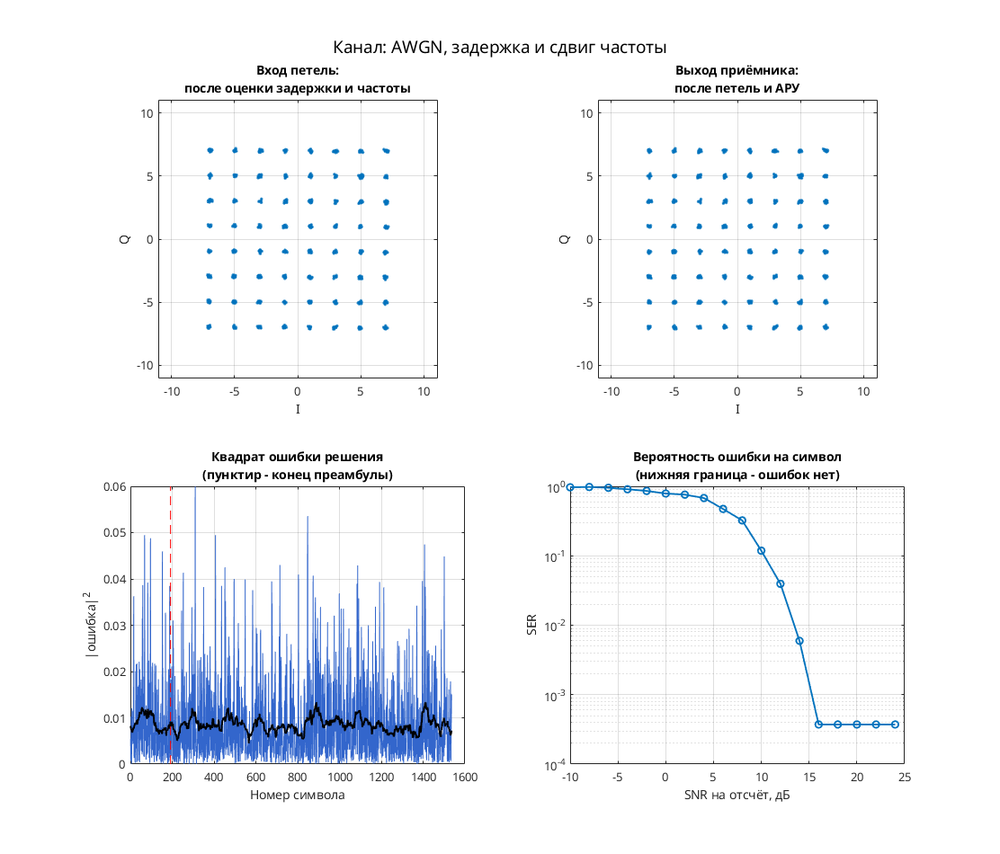

# 64-QAM: квадратное созвездие и тактовая синхронизация Gardner

Модель демонстрирует формирование 64-QAM и восстановление момента символьной выборки. Полного тракта декодирования данных в схеме нет.

Цепочка: скремблер и собственный квадрантный `Coder` → раздельные таблицы `Data Mapper RE/IM` → комплексный сигнал и RRC4 → фиксированная дробная задержка Фарроу, фазовый/частотный сдвиг и AWGN → Upsample ×2 и RRC8 → управляемый Farrow → детектор Gardner, PI-фильтр и тактовый NCO → символьные отсчёты созвездия.

Параметры: 64 точки с уровнями каждой координаты `±1, ±3, ±5, ±7`; передатчик — 4 отсчёта на символ, после Upsample ×2 в приёмнике — 8. Канал: `Es/No = 90 дБ`; фиксированная дробная задержка `Farrow1` задаётся константой `-0.5`. Отдельные петли фазового восстановления, АРУ и эквалайзер в этой `.mdl` не обнаружены.

## Запуск

В MATLAB перейдите в папку этой модели, где находятся `.mdl` и `run_demo.m`:

```matlab
run_demo          % длительность по умолчанию из run_demo.m
run_demo(2048)    % явная длительность в единицах модельного времени
```

Функция принимает `run_demo(N)`, где `N` — конечное модельное время, а не число символов. Вызов без аргумента использует длительность, заданную в `run_demo.m`.

Проверено в MATLAB R2020b: симуляция до модельного времени 2048 и точное повторение записанных сигналов после перезапуска — `PASS` по `matlab/verification.json` исходного проекта. Полная эквивалентность исторической версии и функциональная корректность всего приёмника не установлены.

Нужны MATLAB и следующие продукты:

- Simulink — схема и её выполнение.
- Communications Toolbox — Data Mapper, Scrambler, AWGN, фазовый/частотный сдвиг и диаграмма рассеяния.
- DSP System Toolbox — Digital Filter Design, Upsample/Downsample и Integer Delay.
- Signal Processing Toolbox — обязательная зависимость DSP System Toolbox и Communications Toolbox в [R2020b по требованиям MathWorks](https://www.mathworks.com/content/dam/mathworks/mathworks-dot-com/support/sysreq/files/2020b-product-availability.pdf).

## Что смотреть

Автоматически открывается `Discrete-Time Scatter Plot Scope1`, подключённый к символьному выходу `outdat` через Downsample. По квадратной сетке из 64 положений оценивают выбор момента отсчёта; это комплексные отсчёты, а не декодированные целые символы.

Вручную доступны верхний `Scope3` с дробной задержкой `mu`, `NCO/Scope3` с внутренним состоянием NCO и `Enabled Subsystem/modul/pif/integrator` с состоянием интегратора PI-фильтра. Нулевой BER и фазовый захват эта модель не проверяет.

## Изменения относительно оригинала

По `matlab/migration.json` исходного проекта выполнены замены библиотечных ссылок для R2020b:

- `commchan2/` → `commchan3/`: 1 ссылка.

Числовые параметры сохранены; дополнительных изменений при выполнении (`runtime_changes`) не зафиксировано. Замены библиотек сами по себе не доказывают совпадение поведения со старым MATLAB.


## Собственная реализация (run_own)

Помимо оригинальной схемы, в папке есть **наша собственная реализация этого модема на MATLAB**. Это не перевод схемы блок за блоком: передатчик, канал и приёмник с теми же параметрами написаны заново кодом, без тулбоксов. Общий код лежит в [common/](../../common/), параметры модема — в [config.json](config.json).

```matlab
run_own                              % демонстрация с графиками
run_own(struct('snr_db', 12))        % свой SNR на отсчёт, дБ
r = run_own(struct('plot', false))   % только числа, без графиков
```

| Узел | Реализация |
| --- | --- |
| Модуляция | QAM, 64 позиций |
| Отсчётов на символ | 8 |
| Формирующий фильтр | корень из приподнятого косинуса, порядок 32, скругление 1 |
| Кодирование | дифференциальное по квадрантам |
| Символьная синхронизация | петля Гарднера с кубическим интерполятором Фарроу |
| Фазовая синхронизация | ФАПЧ второго порядка (фаза и частота), плюс АРУ |
| Эквалайзер | нет |

Модель канала: ослабление 0,65, фазовый сдвиг 0,38 рад, сдвиг частоты 1,5·10⁻⁴ от частоты дискретизации, дробная задержка 2,25 отсчёта и белый шум. Сценарий для этого модема: **AWGN, задержка и сдвиг частоты**. Первые 192 символа кадра служат известной преамбулой. По ней оцениваются задержка, частота и начальная фаза, обучается эквалайзер. Дальше приёмник работает в режиме решений.

Результат в MATLAB R2020b: при SNR 28 дБ — 0 ошибок на 1344 символах, оценка задержки 2.25 отсчёта, частоты 1.50e-04. Ошибок нет начиная с SNR 16 дБ на отсчёт. Время работы около 4 с.



Отличия от оригинальной схемы. В оригинале синхронизация слепая, а у нас приёмник опирается на преамбулу. Скремблер, точные коэффициенты петель оригинала и фиксированная точка не воспроизводятся. Поэтому цифры выше относятся к нашей реализации, а не к схеме автора. Тот же алгоритм у нас есть ещё на Python и SystemVerilog. Версии на Python и MATLAB/Octave совпадают между собой с точностью до 10⁻⁷ (перекрёстный тест), поведенческая модель на SystemVerilog проверена UVM-тестами.

## Автор и источник

Автор оригинала в самой `.mdl` не указан и достоверно не установлен. Архив входит в подборку `petrov_modems_electronix`, но одно имя подборки не подтверждает авторство.

Оригинал — `QAM64_2008_11_21.rar`; его происхождение и дубликаты зафиксированы в `archive_inventory.json` исходного проекта. Точный URL публикации не установлен.

Лицензия автором не указана; модель публикуется с указанием авторства в учебных целях; по просьбе автора будет удалена.
