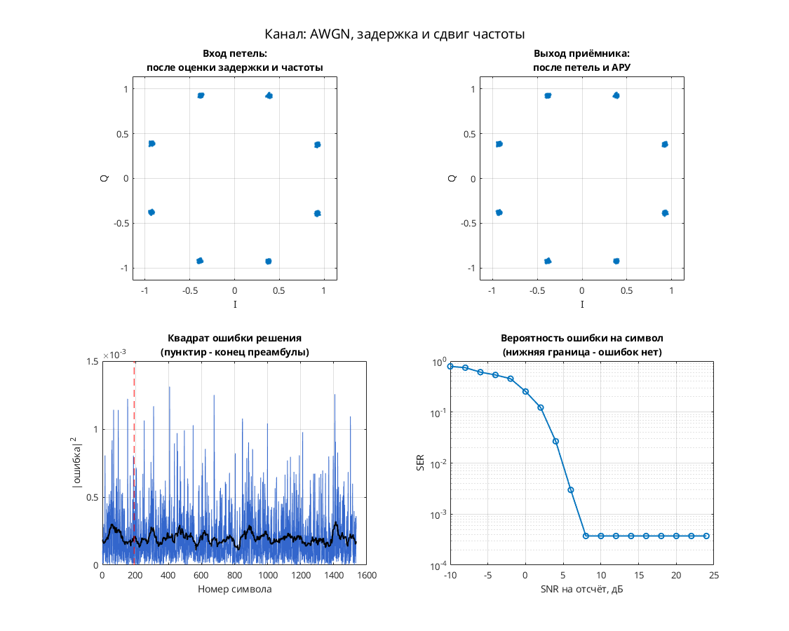

# Дифференциальная 8-PSK: выделение символьного такта и декодирование

Несмотря на имя папки `dqpsk`, в модели установлены `M = 8` и `Ph = pi/8`: это дифференциальная 8-PSK, а не четырёхпозиционная DQPSK.

Цепочка: `Data_Source1` со скремблированием и дифференциальным кодированием → M-PSK и RRC-фильтр → фазовый/частотный сдвиг и AWGN → согласованный RRC-фильтр → выделение такта по модулю сигнала (`symbol_sync`, FIR/CIC и Hit Crossing) → фазовые решения, разностное декодирование, таблицы Gray и дескремблеры. Отдельной петли абсолютной фазовой синхронизации и АРУ в этой схеме нет.

Параметры: 8 отсчётов на символ; 8 равномерных фазовых позиций со сдвигом `pi/8`; RRC-фильтры порядка 32, скругление 1. Канал работает в режиме `Es/No = 40 дБ`.

## Запуск

В MATLAB перейдите в папку этой модели, где находятся `.mdl` и `run_demo.m`:

```matlab
run_demo          % длительность по умолчанию из run_demo.m
run_demo(2048)    % явная длительность в единицах модельного времени
```

Функция принимает `run_demo(N)`, где `N` — конечное модельное время, а не число символов. Вызов без аргумента использует длительность, заданную в `run_demo.m`.

Проверено в MATLAB R2020b: симуляция до модельного времени 2048 и точное повторение записанных сигналов после перезапуска — `PASS` по `matlab/verification.json` исходного проекта. Полная эквивалентность исторической версии и функциональная корректность всего приёмника не установлены.

Нужны MATLAB и следующие продукты:

- Simulink — схема и её выполнение.
- Communications Toolbox — M-PSK модулятор/демодулятор, AWGN, скремблеры/дескремблеры и диаграмма рассеяния.
- DSP System Toolbox — RRC-фильтры, Buffer, Upsample/Downsample и задержки.
- Signal Processing Toolbox — обязательная зависимость DSP System Toolbox и Communications Toolbox в [R2020b по требованиям MathWorks](https://www.mathworks.com/content/dam/mathworks/mathworks-dot-com/support/sysreq/files/2020b-product-availability.pdf).

## Что смотреть

Автоматически открывается `Discrete-Time Scatter Plot Scope1` с выходом `scatter` символьной обработки. По угловому расположению отсчётов оценивают восемь фазовых позиций; отдельной компенсации абсолютной фазы здесь нет.

Вручную можно открыть `Scope2` со стробом `symbol_sync`, `Scope4` с I/Q, `Scope3` и `Scope5` с выходами двух ветвей дескремблирования. Внутренний `symbol_sync/Scope4` показывает сигнал выделения такта и импульсы Hit Crossing. У `one_sps_clock_domain/Scope3` сохранён признак открытия, но вход не подключён: полезной трассы там нет.

## Изменения относительно оригинала

По `matlab/migration.json` исходного проекта выполнены замены библиотечных ссылок для R2020b:

- `commchan2/` → `commchan3/`: 1 ссылка.
- `commdigbbndpm2/` → `commdigbbndpm3/`: 2 ссылки.

Числовые параметры сохранены; дополнительных изменений при выполнении (`runtime_changes`) не зафиксировано. Замены библиотек сами по себе не доказывают совпадение поведения со старым MATLAB.


## Собственная реализация (run_own)

Помимо оригинальной схемы, в папке есть **наша собственная реализация этого модема на MATLAB/Octave и Python**. Это не перевод схемы блок за блоком: передатчик, канал и приёмник с теми же параметрами написаны заново кодом, без тулбоксов. Общий код лежит в [common/](../../common/) (Python — в [common/python/](../../common/python/)), параметры модема — в [config.json](config.json).

MATLAB или GNU Octave (один и тот же код):

```matlab
run_own                              % демонстрация с графиками
run_own(struct('snr_db', 12))        % свой SNR на отсчёт, дБ
r = run_own(struct('plot', false))   % только числа, без графиков
```

Python (нужны NumPy и Matplotlib):

```bash
python run_own.py                    # демонстрация с графиками
python run_own.py --snr 12           # свой SNR на отсчёт, дБ
python run_own.py --no-plot --json   # только числа
```

| Узел | Реализация |
| --- | --- |
| Модуляция | PSK, 8 позиций |
| Отсчётов на символ | 8 |
| Формирующий фильтр | корень из приподнятого косинуса, порядок 32, скругление 1 |
| Кодирование | дифференциальное фазовое |
| Символьная синхронизация | по преамбуле, без петли |
| Фазовая синхронизация | ФАПЧ второго порядка (фаза и частота), плюс АРУ |
| Эквалайзер | нет |

Модель канала: ослабление 0,65, фазовый сдвиг 0,38 рад, сдвиг частоты 1,5·10⁻⁴ от частоты дискретизации, дробная задержка 2,25 отсчёта и белый шум. Сценарий для этого модема: **AWGN, задержка и сдвиг частоты**. Первые 192 символа кадра служат известной преамбулой. По ней оцениваются задержка, частота и начальная фаза, обучается эквалайзер. Дальше приёмник работает в режиме решений.

Результат в MATLAB R2020b: при SNR 28 дБ — 0 ошибок на 1344 символах, оценка задержки 2.25 отсчёта, частоты 1.50e-04. Ошибок нет начиная с SNR 8 дБ на отсчёт. Время работы около 0 с.



Отличия от оригинальной схемы. В оригинале синхронизация слепая, а у нас приёмник опирается на преамбулу. Скремблер, точные коэффициенты петель оригинала и фиксированная точка не воспроизводятся. Поэтому цифры выше относятся к нашей реализации, а не к схеме автора. Версии на MATLAB/Octave и Python реализуют один и тот же алгоритм. На одном и том же входном сигнале они дают одинаковые символы с точностью около 10⁻¹⁴ (перекрёстный тест `cross_check`, см. корневой README). Графики выше построены в MATLAB. Python строит такие же, но шум генерируется по-другому, поэтому число ошибок в отдельных точках может немного отличаться.

## Автор и источник

Александр Петров; в `Description` модели — `Petrov Sasha`, дата 19.09.2006.

Оригинал — архив `dqpsk_19_09_2006.rar` из подборок `Modems` и `petrov_modems_electronix` по `archive_inventory.json` исходного проекта. Точная ссылка на публикацию этой модели не установлена.

Лицензия автором не указана; модель публикуется с указанием авторства в учебных целях; по просьбе автора будет удалена.
