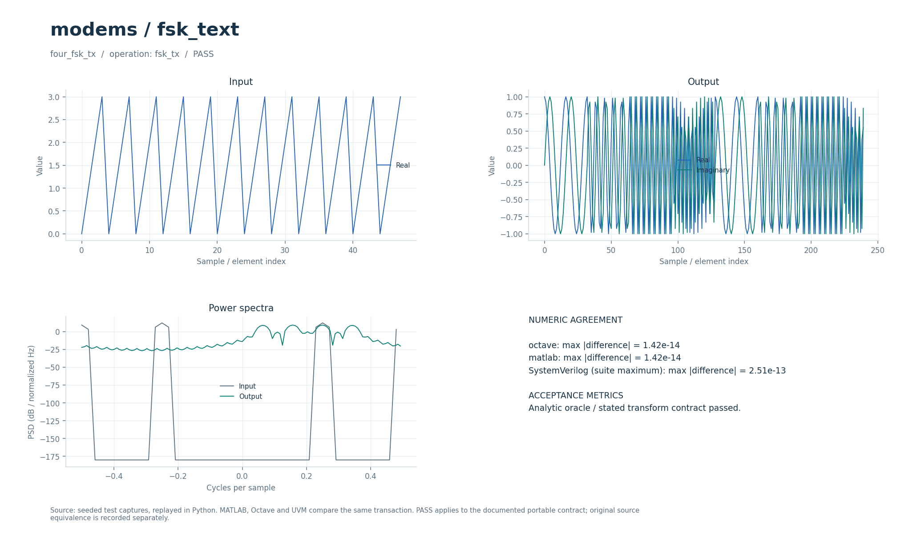

# Частотная передача целочисленных меток (4-FSK)

Модель ортогональной четырёхпозиционной FSK в комплексной основной полосе с некогерентным корреляционным приёмом. Есть Python, Octave/MATLAB, поведенческий SystemVerilog/UVM и отдельные потоковые fixed-point TX/RX.

## Что это

Операции `fsk_tx` и `fsk_rx` передают целочисленные метки с помощью одного из нескольких тонов. Название `fsk_text` связано с историческими MATLAB-упражнениями по частотному кодированию текста, анализу Фурье и моделированию связи. Текущий контракт принимает числа, а не строки; исходные текстовый алфавит, амплитудное кодирование и учебные графические упражнения не воспроизведены как эквивалентные алгоритмы.

Исторические материалы в публичный репозиторий не входят. Их происхождение, размеры и SHA-256 перечислены в [model.json](model.json): манифест содержит шесть M-файлов и две сопроводительные записи. Переносимые тесты используют собственные сигналы и не требуют этих материалов. Для воспроизведения самих исторических упражнений нужны отдельно полученные исходники; `--suite matlab` ниже проверяет текущую M-модель.

[Сценарии](../../tools/research_cases.py) содержат `four_fsk_tx` и `four_fsk_rx`: передача последовательности `[0,1,2,3]`, повторённой 12 раз, и приём с шумом. [Fixed-point-тесты](../../tests/test_fsk_fixed.py) дополнительно проверяют генератор, приём и неверный ввод. Согласие реализаций подтверждает явный контракт FSK, а не полный исходный текстовый модем.

### Историческое демо

Учебная цепочка: текст → пятибитные коды символов → синусоидальные посылки → аддитивный гауссов шум → FFT каждой посылки → ближайшая частота → текст. Используются оригинальные `freq_coding.m` и `freq_decoding.m` из задания по Signals and Systems.

Алфавит: `a`–`z`, пробел, точка, запятая, `!`, `;`, `"` — 32 знака. Частота дискретизации 100 Гц, длительность посылки 1 с, **100 отсчётов на символ FSK**. Для `bit_rate` бит в посылке число частот равно `2^bit_rate`; частоты заданы как `round(linspace(5,49,2^bit_rate))` Гц. Демо сравнивает 2-FSK (1 бит/с) и 32-FSK (5 бит/с) на слове `signal`. Здесь созвездие — набор частот, а не точки I/Q.

Границы посылок известны приёмнику. Петель символьной и фазовой синхронизации, АРУ и эквалайзера нет. Оригинальный код обрезает незавершённую группу бит; в выбранных режимах 30 бит слова делятся без остатка. Неподдерживаемые знаки и произвольный русский текст этим алфавитом не передаются.

## Как работает

1. TX принимает метки `m=0…M−1`. На каждую метку формируется n комплексных отсчётов единичной амплитуды.
2. Тон задаётся формулой `sₘ[t]=exp(j·2π·(f0+m·df)·t/n)`, `t=0…n−1`. Значения `f0` и `df` измеряются в частотных бинах на интервале символа; нормированная частота равна `(f0+m·df)/n` циклов на отсчёт.
3. Фаза каждого символа начинается с нуля; отдельного условия непрерывности фазы между символами нет. В проверочном канале добавляется комплексный гауссов шум.
4. RX разбивает сигнал на известные интервалы по n отсчётов и рассчитывает `Cₘ=Σ x[t]·conj(sₘ[t])` для всех тонов.
5. Решение — индекс первого максимума `|Cₘ|`. Фаза несущей при таком решении не оценивается; при равенстве корреляций выбирается первая метка.

Python-интерфейс: `run(operation, parameters, signal, auxiliary=())`; `parameters=[n, f0, df, M]`, `auxiliary` не используется. TX-вход — целочисленные метки, представленные числовым массивом; выход — плоский комплексный сигнал. RX-вход должен содержать целое число символов, его длина делится на n; выход — массив меток. M-интерфейс `run_model(operation, parameters, signal, auxiliary)` следует тому же [типизированному контракту](../../docs/TYPED_MODELS.md).

| Параметр проверочного сценария | Значение |
| --- | --- |
| `n` | 32 отсчёта на символ |
| `f0`, `df`, `M` | 2, 3, 4 |
| Тоны в бинах | 2, 5, 8, 11 |
| Нормированные частоты | 2/32, 5/32, 8/32, 11/32 циклов на отсчёт |
| Метки | 0…3, 2 бита на метку |
| Последовательность | `[0,1,2,3]` × 12, всего 48 символов |
| Длина TX-сигнала | 1536 отсчётов |
| Шум RX | `0.1·noise`, комплексный `noise` имеет среднюю мощность 1 |
| Ожидаемые ошибки RX | 0 из 48 |

Целочисленные биновые частоты делают тоны данного сценария ортогональными на интервале 32 отсчётов. Общая функция допускает другие частоты, но их ортогональность автоматически не проверяет.

Синтезируемые [fsk_tx.sv](../../rtl/common/fsk_tx.sv) и [fsk_rx.sv](../../rtl/common/fsk_rx.sv) используют эталон [fsk_fixed.py](../../common/python/fsk_fixed.py). Число тонов ограничено `2^LOG2M`, длина символа — `2^LOG2NMAX`; по умолчанию `LOG2M=2`, `LOG2NMAX=5`. Ширина метки не меньше одного бита.

| Интерфейс или формат RTL | Назначение |
| --- | --- |
| `cfg_valid/cfg_ready/cfg_last` | Загрузка таблицы шагов фаз между транзакциями |
| `cfg_step` | 32-битный шаг `round(((f0+m·df)/n mod 1)·2³²)` для очередного тона |
| `cfg_n`, `configured` | Длина символа, фиксируемая с `cfg_last`, и признак готовой конфигурации |
| TX: `s_label` → `m_re/m_im` | Метки → комплексные отсчёты Q3.15, 18 бит |
| RX: `s_re/s_im` → `m_label` | Комплексные отсчёты Q3.15 → метки |
| `s_valid/s_ready`, `m_valid/m_ready` | Передача только при `valid && ready`, поддержка противодавления |
| `s_last/m_last` | Последняя метка/последний отсчёт транзакции в соответствующем направлении |
| `error`, `RESET_ACTIVE` | Залипающая ошибка конфигурации/ввода; параметр полярности синхронного сброса |

Фаза `t·STEP mod 2³²` адресует 4096-элементную таблицу cos/sin по старшим 12 битам. Таблица Q17 округляется до Q15. TX может выдавать один отсчёт за такт и принимать следующую метку вместе с последним отсчётом предыдущего символа. RX считает M корреляторов параллельно, затем сравнивает квадраты модулей; FIFO на восемь меток учитывает также символы в конвейере и при необходимости останавливает вход.

В [измерениях контактов RTL](../../docs/RTL_DSP_PIN_RATES.md) для выбранных конфигураций отмечена задержка TX 3 такта и RX 6…69 тактов. Это результаты конкретных проб; задержка RX включает накопление символа и зависит от n, а паузы выхода меняют время выдачи. Алгоритм, форматы и тестовая матрица описаны в [DSP_RTL.md](../../docs/DSP_RTL.md).

## Структура каталога

| Файл или каталог | Назначение |
| --- | --- |
| [model.json](model.json) | Операции, имена случаев, ограничения и манифест исторических материалов. |
| [python/model.py](python/model.py) | Экспорт `research_core.run`; самостоятельной CLI-демонстрации нет. |
| [octave/run_model.m](octave/run_model.m), [matlab/run_model.m](matlab/run_model.m) | Обёртки общей M-реализации без дополнительных toolbox. |
| [sv/model.sv](sv/model.sv) | Поведенческий `dsp_variant` над общим `research_model`, арифметика `real`. |
| [tb/testbench.sv](tb/testbench.sv), [tb/run.sh](tb/run.sh) | Общий UVM-тестбенч и локальная обёртка запуска. |
| [tests/test_model.py](tests/test_model.py) | Запуск Python-сценариев этого workspace. |
| [research_core.py](../../common/python/research_core.py), [research_cases.py](../../tools/research_cases.py) | Формирование/приём тонов, параметры и условия численной проверки. |
| [fsk_fixed.py](../../common/python/fsk_fixed.py) | Побитный эталон потокового RTL. |

[run_demo.m](run_demo.m) — запуск выбранного исторического сценария из локального `original/`. Сам `original/` в публичную копию не входит.

## Как запустить

Все команды выполняются из корня проекта. Нужны Python 3, NumPy и SciPy: общие сценарии импортируют SciPy даже при фильтрации по одному workspace. Для M-реализации нужен `octave-cli` или MATLAB, дополнительные пакеты Octave/toolbox не нужны. Для поведенческого SV нужны Questa и UVM 1.2. Полный RTL-прогон дополнительно использует Verilator для lint.

Численная Python-проверка и сравнения переносимых реализаций:

```bash
python3 tools/run_research.py --suite python --workspace modems/fsk_text
python3 tools/run_research.py --suite octave --workspace modems/fsk_text
python3 tools/run_research.py --suite matlab --workspace modems/fsk_text
python3 tools/run_research.py --suite hdl --workspace modems/fsk_text
```

Каждый режим использует два случая из `model.json`; `--suite matlab` запускает текущую M-реализацию, а не исходные упражнения. На хосте с MATLAB R2020b команда MATLAB должна наследовать терминал; установку выбирает `tools/matlab.sh`. [tb/run.sh](tb/run.sh) запускает тот же поведенческий UVM из любого каталога, а `tests/test_model.py` оборачивает Python-проверку.

Прогон целочисленного эталона, строгого lint и потоковых TX/RX:

```bash
python3 tools/run_fsk.py --suite all
```

Он проверяет шесть конфигураций с разными длинами символа и числом тонов, включая основной `(n,f0,df,M)=(32,2,3,4)`, обе полярности сброса, паузы и отрицательные контроли.

### Исторические скрипты: run_demo

В MATLAB/Octave перейдите в `modems/fsk_text` и выполните:

```matlab
run_demo
```

`run_demo` вызывает исходные `freq_coding.m` и `freq_decoding.m` из `original/Fourier Analysis & Frequency-Based Communication/code/`, повторяя опыты p2.m без saveas и очистки workspace. Достаточно базового MATLAB или Octave; `r = run_demo` возвращает результаты двух режимов. Файлы не сохраняются, RNG и path восстанавливаются.

`run_demo` требует исходников, которых нет в публичной копии; см. [THIRD_PARTY.md](../../THIRD_PARTY.md). Переносимые `tools/run_research.py`, `python/model.py` и `octave/run_model.m` работают и в публичной копии с зависимостями, указанными выше.

## Что смотреть

Переносимые команды сохраняют данные в `build/typed/modems__fsk_text/`:

| Артефакт | Назначение |
| --- | --- |
| `python_results.json`, `octave_results.json`, `matlab_results.json`, `hdl_results.json` | `status=PASS`, число случаев, результаты соответствующей реализации. |
| `cases.json`, `case_000.npz`, `case_001.npz` | Параметры, TX/RX-массивы, эталонные метки и метрики. |
| `vectors.txt` | Общие плоские численные векторы для межъязыковой сверки. |
| `octave.log`, `matlab.log` | Диагностика M-проверок. |
| `questa/simulation.log`, `questa/negative_control.log` | UVM-сравнение и обнаружение специально внесённого несовпадения. |

В `four_fsk_rx` ожидается `symbol_errors=0`, `payload_symbols=48`; SER — доля неверных меток среди этих 48 символов. BER не является отдельной заявленной метрикой этого численного интерфейса. Ноль ошибок на коротком наборе не гарантирует работу при любом шуме или частотном рассогласовании.

Успех UVM требует четырёх транзакций (два случая с повтором), `UVM_ERROR : 0`, `UVM_FATAL : 0` и успешного обнаружения искажённого эталона. Пассивный монитор сравнивает реальные выходы с Python-векторами. Отрицательный контроль считается успешным именно при обнаружении ошибки. Диагностика и подписи графиков — на английском, комментарии реализации — на русском.

RTL-прогон пишет `build/rtl/fsk/all_results.json`, векторы и логи по конфигурациям. TX/RX сравниваются с `fsk_fixed` побитно. В сравнении с `research_core` расхождение формы TX до 0.002 связано с дискретностью фазовой таблицы; это не предел ошибки на произвольном сигнале. Проверки пауз, сброса и протокола описаны также в [RTL_DSP_UVM.md](../../docs/RTL_DSP_UVM.md).

Откройте [визуальный отчёт](../../docs/typed_visual/index.html#modems/fsk_text): он показывает сохранённые численные сценарии. Ищите разные частоты символов, соответствие меток и отсутствие ошибок в шумовом случае; единицы и раскладка массивов определены в [TYPED_MODELS.md](../../docs/TYPED_MODELS.md).



### Графики run_demo

Два окна: `FSK: text, waveform and detected frequencies` — шумные посылки и обнаруженные частоты для 2-FSK и 32-FSK; `FSK: noise experiment` — число ошибочных букв из шести при дисперсии шума 0…5. `assert` проверяет восстановление `signal` при дисперсии 0.0001. На каждую точку приходится одна реализация шума: это не BER-кривая, и монотонность не гарантируется.

## Ограничения

Нет преобразования текста в метки и обратно, исходного алфавита, амплитудного кодирования и исторических учебных построений графиков. Общий приёмник предполагает известные границы символов, длину n и частоты тонов; синхронизация кадра, восстановление тактов, оценка частотного смещения, эквализация и помехоустойчивое кодирование отсутствуют.

FSK здесь не является непрерывно-фазовой MSK/GMSK. Ортогональность обеспечена параметрами основного случая, но не гарантируется для любой переданной таблицы частот. Необходимо избегать совпадающих тонов и неоднозначности после дискретизации; RTL ограничен числом загруженных шагов фаз, длиной символа и диапазоном Q3.15.

`sv/model.sv` использует `real` и блочные транзакции, а синтезируемые fixed-point TX/RX расположены в `rtl/common/`. Межъязыковое согласие не доказывает полную эквивалентность историческим M-файлам. Для повторения исторических упражнений нужны отдельно полученные материалы; сохранённые отчёты относятся к их версиям исходников, а не автоматически к любому последующему изменению проекта.

Исторический `run_demo` и переносимая модель имеют разные параметры и область проверки; их полная эквивалентность не заявляется.
