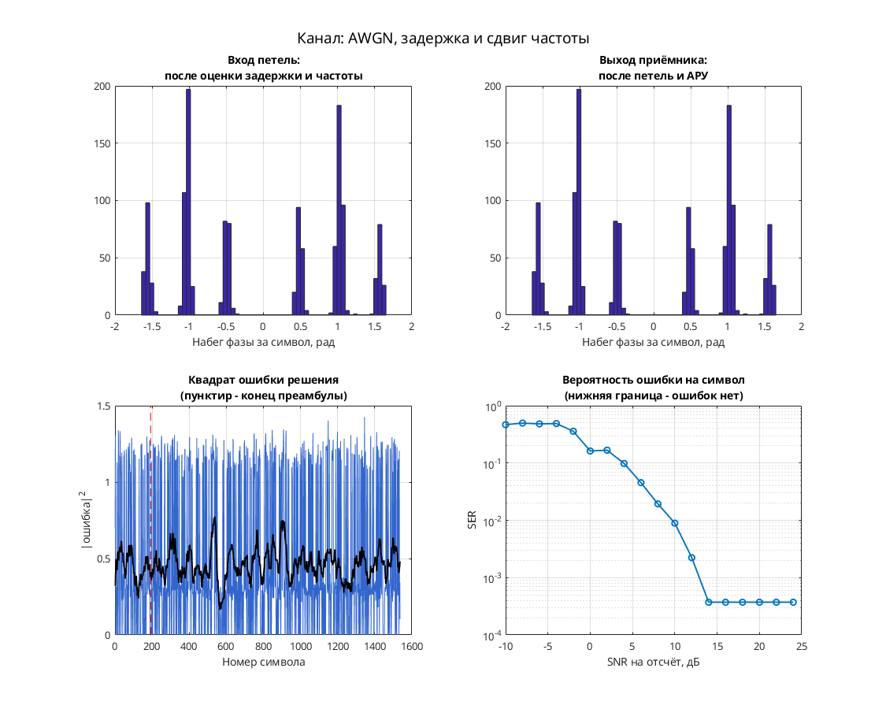

# GMSK: когерентный приём с тактовым детектором Mengali и петлёй Костаса

Модель содержит передатчик GMSK и когерентный приёмник с восстановлением такта, фазы и усиления.

Цепочка: скремблер → двоичные уровни, CIC и гауссов фильтр → накопление фазы и комплексная экспонента → фазовый/частотный сдвиг, дробная задержка и AWGN → регулировка усиления, FIR/LPF и линейный интерполятор Фарроу → детектор тактовой ошибки Mengali, фазовый детектор Костаса и АРУ → решения и декодирование. Дробная задержка канала реализована отдельным кубическим интерполятором.

Параметры: 8 отсчётов на символ в передатчике, гауссов фильтр `BT = 0.3`, `N = 8`, `D = 2`; приёмник содержит области `4_sps_clock_domain` и `1_sps_clock_domain`. Канал: `Eb/No = 10 дБ`. Передаваемый сигнал имеет непрерывную фазу и единичную огибающую; обычная таблица точек PSK не описывает всю его траекторию.

## Запуск

В MATLAB перейдите в папку этой модели, где находятся `.mdl` и `run_demo.m`:

```matlab
run_demo          % длительность по умолчанию из run_demo.m
run_demo(2048)    % явная длительность в единицах модельного времени
```

Функция принимает `run_demo(N)`, где `N` — конечное модельное время, а не число символов. Вызов без аргумента использует длительность, заданную в `run_demo.m`.

Проверено в MATLAB R2020b: симуляция до модельного времени 2048 и точное повторение записанных сигналов после перезапуска — `PASS` по `matlab/verification.json` исходного проекта. Полная эквивалентность исторической версии и функциональная корректность всего приёмника не установлены.

Нужны MATLAB и следующие продукты:

- Simulink — схема и её выполнение.
- Communications Toolbox — Gaussian Filter, AWGN, фазовый/частотный сдвиг, Scatter Plot и Signal Trajectory Scope.
- DSP System Toolbox — Digital Filter Design, Spectrum Scope, Buffer, Upsample/Downsample и селекторы.
- Signal Processing Toolbox — обязательная зависимость DSP System Toolbox и Communications Toolbox в [R2020b по требованиям MathWorks](https://www.mathworks.com/content/dam/mathworks/mathworks-dot-com/support/sysreq/files/2020b-product-availability.pdf).

## Что смотреть

Автоматически открываются `Discrete-Time Scatter Plot Scope` с отсчётами когерентного приёмника, `Discrete-Time Signal Trajectory Scope` с траекторией передатчика и `Spectrum Scope` со спектром выхода AWGN. Траектория показывает непрерывное изменение фазы GMSK; по выходным отсчётам оценивают работу приёмника.

Вручную доступны `Scope` со стробами и `mu` тактового NCO, `Scope1` с I/Q и `Scope3` с восстановленными данными. В исходной проверке подтверждена постоянная огибающая передатчика, но функциональная корректность всего приёмника не установлена.

## Изменения относительно оригинала

По `matlab/migration.json` изменений модели нет: SHA-256 подготовленной копии совпадает с оригиналом. В `matlab/verification.json` список `runtime_changes` также пуст.

Замена когерентного приёмника на частотный дискриминатор, упомянутая в `config.json` исходного проекта, относится к переносимой реализации Python/Octave и к этой `.mdl` не применяется.


## Собственная реализация (run_own)

Помимо оригинальной схемы, в папке есть **наша собственная реализация этого модема на MATLAB**. Это не перевод схемы блок за блоком: передатчик, канал и приёмник с теми же параметрами написаны заново кодом, без тулбоксов. Общий код лежит в [common/](../../common/), параметры модема — в [config.json](config.json).

```matlab
run_own                              % демонстрация с графиками
run_own(struct('snr_db', 12))        % свой SNR на отсчёт, дБ
r = run_own(struct('plot', false))   % только числа, без графиков
```

| Узел | Реализация |
| --- | --- |
| Модуляция | GMSK, 2 позиций |
| Отсчётов на символ | 8 |
| Демодуляция | частотный дискриминатор: набег фазы за символ, гауссов фильтр BT=0.3 |

Модель канала: ослабление 0,65, фазовый сдвиг 0,38 рад, сдвиг частоты 1,5·10⁻⁴ от частоты дискретизации, дробная задержка 2,25 отсчёта и белый шум. Сценарий для этого модема: **AWGN, задержка и сдвиг частоты**. Первые 192 символа кадра служат известной преамбулой. По ней оцениваются задержка, частота и начальная фаза, обучается эквалайзер. Дальше приёмник работает в режиме решений.

Результат в MATLAB R2020b: при SNR 28 дБ — 0 ошибок на 1344 символах, оценка задержки 2.25 отсчёта, частоты 1.50e-04. Ошибок нет начиная с SNR 14 дБ на отсчёт. Время работы около 1 с.



Отличия от оригинальной схемы. В оригинале синхронизация слепая, а у нас приёмник опирается на преамбулу. Скремблер, точные коэффициенты петель оригинала и фиксированная точка не воспроизводятся. Поэтому цифры выше относятся к нашей реализации, а не к схеме автора. Тот же алгоритм у нас есть ещё на Python и SystemVerilog. Версии на Python и MATLAB/Octave совпадают между собой с точностью до 10⁻⁷ (перекрёстный тест), поведенческая модель на SystemVerilog проверена UVM-тестами.

## Автор и источник

Александр Петров; в `Description` — `Petrov Sasha`, дата 2010.10.03.

[Сообщение автора на ELECTRONIX](https://electronix.ru/forum/topic/23652-model-8psk-modema/page/10/#comment-818746).

Лицензия автором не указана; модель публикуется с указанием авторства в учебных целях; по просьбе автора будет удалена.
