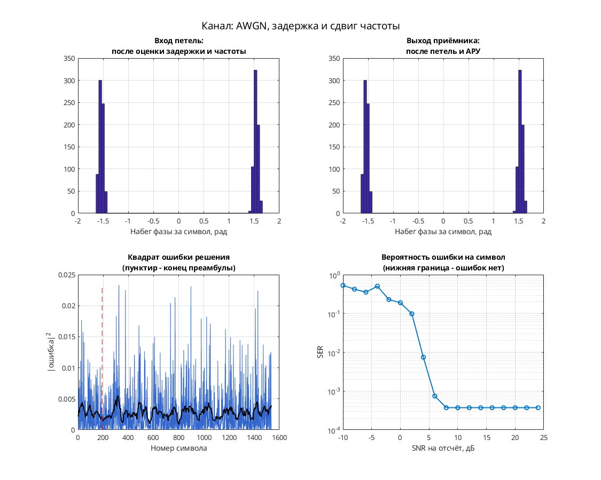

# MSK: формирование сигнала с непрерывной фазой и постоянной огибающей

Это модель только передатчика MSK. Цепочка: источник → двоичный скремблер → перевод битов в уровни → Upsample и CIC → накопитель фазы по модулю `2*pi` → комплексная экспонента → графики. Канала и приёмника в `.mdl` нет.

Параметры: 32 отсчёта на символ (`Upsample/N = 32`), масштаб фазового приращения `pi/2`. Выход движется по единичной окружности с непрерывной фазой; это не независимый выбор точек из таблицы PSK. Петель синхронизации, АРУ и эквалайзера в схеме нет.

## Запуск

В MATLAB перейдите в папку этой модели, где находятся `.mdl` и `run_demo.m`:

```matlab
run_demo          % длительность по умолчанию из run_demo.m
run_demo(512)    % явная длительность в единицах модельного времени
```

Функция принимает `run_demo(N)`, где `N` — конечное модельное время, а не число символов. Вызов без аргумента использует длительность, заданную в `run_demo.m`.

Проверено в MATLAB R2020b: симуляция до модельного времени 512 и точное повторение записанных сигналов после перезапуска — `PASS` по `matlab/verification.json` исходного проекта. Проверена единичная огибающая; полная эквивалентность всей исторической модели не установлена.

Нужны MATLAB и следующие продукты:

- Simulink — схема и её выполнение.
- Communications Toolbox — двоичный Scrambler.
- DSP System Toolbox — Upsample и Integer Delay.
- Signal Processing Toolbox — обязательная зависимость DSP System Toolbox и Communications Toolbox в [R2020b по требованиям MathWorks](https://www.mathworks.com/content/dam/mathworks/mathworks-dot-com/support/sysreq/files/2020b-product-availability.pdf).

## Что смотреть

`Scope4` сохранён открытым и показывает пять сигналов: выход Upsample, выход CIC, накопленную фазу и компоненты I/Q выходной экспоненты. Видны формирование фазового приращения, непрерывный ход фазы с переходами по модулю `2*pi` и соответствующие I/Q.

`XY Graph` строит траекторию комплексного выхода — единичную окружность; окно можно открыть двойным щелчком. Постоянство огибающей подтверждено исходной проверкой. Восстановленных данных и графиков сходимости приёмника здесь нет.

## Изменения относительно оригинала

По `matlab/migration.json` изменений модели нет: SHA-256 подготовленной копии совпадает с оригиналом. В `matlab/verification.json` список `runtime_changes` также пуст.

Добавленный дискриминаторный приёмник и значение `sps = 8` в переносимом `config.json` исходного проекта не относятся к этой модели: здесь сохранён только передатчик с 32 отсчётами на символ.


## Собственная реализация (run_own)

Помимо оригинальной схемы, в папке есть **наша собственная реализация этого модема на MATLAB**. Это не перевод схемы блок за блоком: передатчик, канал и приёмник с теми же параметрами написаны заново кодом, без тулбоксов. Общий код лежит в [common/](../../common/), параметры модема — в [config.json](config.json).

```matlab
run_own                              % демонстрация с графиками
run_own(struct('snr_db', 12))        % свой SNR на отсчёт, дБ
r = run_own(struct('plot', false))   % только числа, без графиков
```

| Узел | Реализация |
| --- | --- |
| Модуляция | MSK, 2 позиций |
| Отсчётов на символ | 8 |
| Демодуляция | частотный дискриминатор: набег фазы за символ |

Модель канала: ослабление 0,65, фазовый сдвиг 0,38 рад, сдвиг частоты 1,5·10⁻⁴ от частоты дискретизации, дробная задержка 2,25 отсчёта и белый шум. Сценарий для этого модема: **AWGN, задержка и сдвиг частоты**. Первые 192 символа кадра служат известной преамбулой. По ней оцениваются задержка, частота и начальная фаза, обучается эквалайзер. Дальше приёмник работает в режиме решений.

Результат в MATLAB R2020b: при SNR 28 дБ — 0 ошибок на 1344 символах, оценка задержки 2.25 отсчёта, частоты 1.50e-04. Ошибок нет начиная с SNR 8 дБ на отсчёт. Время работы около 1 с.



Отличия от оригинальной схемы. В оригинале синхронизация слепая, а у нас приёмник опирается на преамбулу. Скремблер, точные коэффициенты петель оригинала и фиксированная точка не воспроизводятся. Поэтому цифры выше относятся к нашей реализации, а не к схеме автора. Тот же алгоритм у нас есть ещё на Python и SystemVerilog. Версии на Python и MATLAB/Octave совпадают между собой с точностью до 10⁻⁷ (перекрёстный тест), поведенческая модель на SystemVerilog проверена UVM-тестами.

## Автор и источник

Александр Петров; в `Description` — `Petrov Sasha`, дата 2008.06.22.

[Сообщение автора на ELECTRONIX](https://electronix.ru/forum/topic/23652-model-8psk-modema/#comment-429138).

Лицензия автором не указана; модель публикуется с указанием авторства в учебных целях; по просьбе автора будет удалена.
