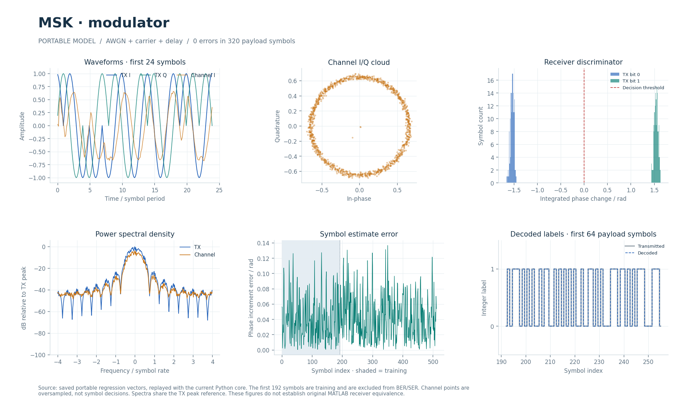
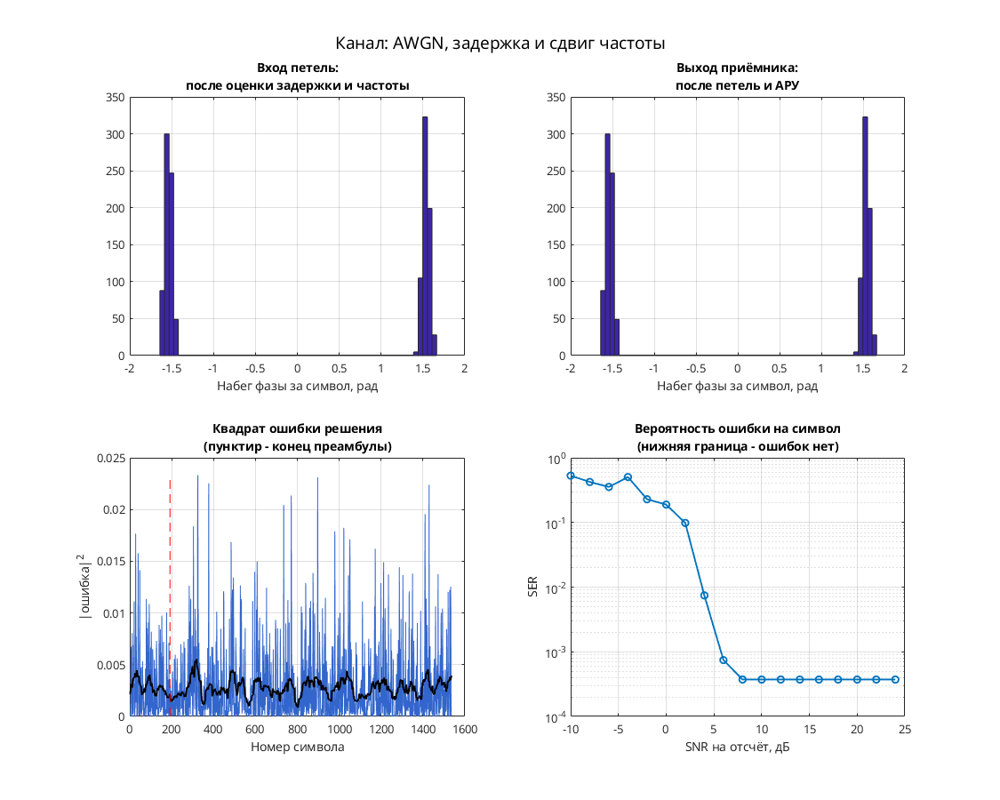

# MSK-модулятор и приёмник для проверки передачи (2008-06-22)

MSK-модулятор с непрерывной фазой и добавленным дискриминаторным приёмником для проверки передачи.

## Что это

Исторический прототип — Simulink-модель `msk_modulator_2008_06_22.mdl`. Переносимые реализации есть на Python, Octave/MATLAB и поведенческом SystemVerilog с UVM. Отдельно существует потоковый fixed-point RTL. Общие Python-тесты проверяют кодер, передачу без шума, канал с шумом/задержкой/несущей, повторяемость, неверный ввод и отрицательный контроль при −8 дБ; специальные проверки зависят от конфигурации. Сохранённые результаты межъязыковых прогонов описаны в [VERIFICATION.md](../../docs/VERIFICATION.md). Совпадение переносимых реализаций не устанавливает полную эквивалентность историческому приёмнику.

Историческая модель в публичный репозиторий не входит. В [source_parameters.json](source_parameters.json) сохранены извлечённые поля блоков и номера строк `source_line`; происхождение и SHA-256 исходного файла записаны в полях `source` и `source_sha256` файла [config.json](config.json). Размер исходника — 28352 байт по [архивному манифесту](../../docs/archive_inventory.json), который также содержит его SHA-256. В `source_parameters.json` записаны параметры блоков, а не полный манифест файла; `model.json` в этом модуле отсутствует.

## Как работает

1. Биты 0/1 преобразуются в уровни −1/+1 и повторяются по 8 отсчётов на символ. Индекс модуляции `h=1/2`.
2. Для MSK частота остаётся прямоугольной. TX накапливает фазу: `φ[n]=φ[n−1]+π·f[n]/(2·sps)`, выход `exp(jφ[n])` имеет единичную огибающую и начальную фазу ноль.
3. Канал добавляет AWGN, усиление, фазовый и частотный сдвиги и дробную задержку.
4. Переносимый RX сопоставляет отсчёты с сигналом известной преамбулы: задержка ищется на сетке 0…16 с шагом 0.25, линейная подгонка фазы даёт частоту и комплексное усиление.
5. После коррекции вычисляется дискриминатор `angle(x[n]·conj(x[n−1]))`.  Сумма приращений за символ сравнивается с нулём; неотрицательная сумма означает бит 1.

`receive(CONFIG, waveform, preamble, count)` получает только известную преамбулу и длину кадра; полезные метки ему не передаются. Минимум преамбулы — 32 символа, в демонстрациях используется 192 из 768 (полезная часть 576). Начало кадра грубо известно вызывающей стороне; это не детектор произвольных пакетов.

| Параметр | Значение |
| --- | --- |
| `family` / `order` | `msk` / 2 |
| Входные метки | 0…1; 1 бит на метку |
| `differential` | `none` |
| `sps` | 8 |
| Гауссов FIR | `gaussian_bt=0.3`, 33 коэффициента, только для GMSK |
| `timing` / `carrier` | `gardner` / `feedback` |
| `equalizer` | `none` |
| `diversity_branches` | 1 |
| `variable_delay` / `phase_noise` | `false` / `false` |

Поля `timing=gardner`, `carrier=feedback`, `rrc_order` и `rolloff` присутствуют в общей конфигурации, но переносимая ветвь `receive_cpm` использует описанный выше дискриминаторный алгоритм, без RRC и петли Gardner.

Потоковые [cpm_tx/cpm_rx](../../rtl/modems/msk_modulator_2008_06_22/) общие для MSK и GMSK, здесь `GMSK=0`. `cpm_modulator` накапливает 32-битную фазу с шагом `f·2¹¹`, затем использует 4096-элементную таблицу cos/sin пилота. Для MSK `f=±2¹⁶`, длина TX `8N` отсчётов, выход Q15. Эталон fixed-point — [cpm_fixed.py](../../common/python/cpm_fixed.py).

Интерфейс TX: `s_valid/s_ready/s_bit/s_last` → `m_valid/m_ready/m_re/m_im/m_last`. Латентность модулятора 8 тактов, II=1. Вход RX — Q3.15 (18 бит), кадр `8N…8N+96` отсчётов с `s_last`, `N=192…2048`; конфигурация содержит 192 бита преамбулы и N. Два кадровых буфера имеют по восемь банков. Данные обрабатываются по два отсчёта за такт, символ занимает четыре такта. Оценки задержки и частоты сопровождаются импульсом `acquisition_valid`; задержка имеет 16 дробных бит, частота измеряется в оборотах·2³² на отсчёт.

Захват коррелирует дискриминатор с опорной частотой на 18 сдвигах, уточняет пик и оценивает частоту по фазам 8 блоков корреляции с преамбулой. В документации приведено время около 2200 тактов для этой схемы захвата. MSK демодулируется дискриминатором с компенсацией частоты и суммированием приращений по символу; позиции смещены на пол-отсчёта после оценки задержки. `m_value` — 36-битная сумма приращений, `m_bit` — её знак. [Интерфейсы и ограничения CPM](../../docs/CPM_RTL.md).

### Историческая схема

Это модель только передатчика MSK. Цепочка: источник → двоичный скремблер → перевод битов в уровни → Upsample и CIC → накопитель фазы по модулю `2*pi` → комплексная экспонента → графики. Канала и приёмника в `.mdl` нет.

Параметры: 32 отсчёта на символ (`Upsample/N = 32`), масштаб фазового приращения `pi/2`. Выход движется по единичной окружности с непрерывной фазой; это не независимый выбор точек из таблицы PSK. Петель синхронизации, АРУ и эквалайзера в схеме нет.

### Собственная реализация (run_own)

Автономная реализация на MATLAB/Octave и Python читает существующий [config.json](config.json) и работает без тулбоксов и исторических файлов, в том числе в публичной копии. Общий код — [common/own/](../../common/own/) и [common/own/python/](../../common/own/python/). Передатчик, канал и приёмник написаны кодом; параметры переносимого профиля могут отличаться от исторической схемы.

| Узел | Реализация |
| --- | --- |
| Модуляция | MSK, 2 позиций |
| Отсчётов на символ | 8 |
| Демодуляция | частотный дискриминатор: набег фазы за символ |

Модель канала: ослабление 0,65, фазовый сдвиг 0,38 рад, сдвиг частоты 1,5·10⁻⁴ от частоты дискретизации, дробная задержка 2,25 отсчёта и белый шум. Сценарий для этого модема: **AWGN, задержка и сдвиг частоты**. Первые 192 символа кадра служат известной преамбулой. По ней оцениваются задержка, частота и начальная фаза, обучается эквалайзер, если он предусмотрен конфигурацией. Дальше приёмник работает в режиме решений.

## Структура каталога

| Файл или каталог | Назначение |
| --- | --- |
| [config.json](config.json) | Параметры переносимой модели и SHA-256 исторического исходника. |
| [source_parameters.json](source_parameters.json) | Извлечённые поля прототипа. |
| [python/modem.py](python/modem.py) | Экспорт `CONFIG`, `transmit`, `receive`; запуск демонстрации. |
| [tests/test_modem.py](tests/test_modem.py) | Общий контракт из `modem_checks.ModemContract` для этой конфигурации. |
| [octave/run_modem.m](octave/run_modem.m), [octave/test_modem.m](octave/test_modem.m) | Демонстрация и проверка M-реализации; те же функции работают в MATLAB. |
| [sv/modem.sv](sv/modem.sv) | Обёртка общего поведенческого `modem_model`, арифметика `real`. |
| [tb/testbench.sv](tb/testbench.sv), [tb/run.sh](tb/run.sh) | UVM-тестбенч и локальная обёртка запуска из любого каталога. |
| [common/](../../common/) | Общие ядра Python, Octave и SystemVerilog; изменения влияют на все модели. |
| [matlab/test_original.m](matlab/test_original.m), [migration.json](matlab/migration.json), [verification.json](matlab/verification.json) | Проверка исторической схемы и сохранённые сведения об адаптациях и результатах. |

| Файл / подкаталог | Назначение |
| --- | --- |
| [run_demo.m](run_demo.m) | Запуск локальной исторической R2020b-модели из `matlab/` |
| [run_own.m](run_own.m), [run_own.py](run_own.py) | Автономная демонстрация MATLAB/Octave и Python через `common/own` |
| [images/](images/) | Сохранённые графики автономной реализации для README |

## Как запустить

Все команды выполняются из корня проекта. Для переносимого Python нужны Python 3 и NumPy; для M-файлов — `octave-cli` с `jsondecode` либо MATLAB. Симуляция поведенческого SV требует Questa и UVM 1.2. Полный RTL-прогон дополнительно использует Verilator для lint; пути Questa/UVM выбираются общими средствами проекта.

Демонстрация печатает JSON с числом ошибок и оценками синхронизации; тест запускает семь проверок общего контракта:

```bash
python3 modems/msk_modulator_2008_06_22/python/modem.py
python3 modems/msk_modulator_2008_06_22/tests/test_modem.py
```

Проверка M-реализации и её демонстрация:

```bash
octave-cli --quiet --eval "addpath('modems/msk_modulator_2008_06_22/octave'); test_modem; run_modem;"
```

Сравнение Python и Octave на общих векторах, затем отдельный поведенческий UVM-прогон:

```bash
python3 tools/run_tests.py --suite cross --modem msk_modulator_2008_06_22
./tools/run_questa.sh --modem msk_modulator_2008_06_22
```

Общая проверка fixed-point-моделей, lint и RTL-симуляции (охватывает всю группу, а не только этот каталог):

```bash
python3 tools/run_cpm.py --suite all
```

Проверка исторического прототипа доступна только при наличии его исходников и требуемых библиотек MATLAB/Simulink. Она запускает симуляцию и повторный расчёт для проверки точной повторяемости:

```bash
./tools/matlab.sh -nodisplay -batch "addpath('modems/msk_modulator_2008_06_22/matlab'); test_original;"
```

Логи и захваты исторической проверки сохраняются в `build/matlab_originals/compatible/msk_modulator_2008_06_22/`, в том числе `signals.mat`. Для сохранённых результатов использовался MATLAB R2020b. Сведения об адаптациях следует читать отдельно от статуса исходной схемы; `test_original` не проверяет BER всего исторического приёмника. Условия описаны в [MATLAB_MODEM_VERIFICATION.md](../../docs/MATLAB_MODEM_VERIFICATION.md).

### Быстрый старт в MATLAB

Перейдите в папку этого модема. [run_demo.m](run_demo.m) открывает подготовленную R2020b-копию `matlab/msk_modulator_2008_06_22.mdl`:

```matlab
run_demo          % историческая схема и её осциллографы
run_demo(4096)  % явное время окончания
```

По умолчанию время окончания — `4096` в единицах модельного времени, не число символов. Нужны MATLAB R2020b, Simulink, Communications Toolbox и DSP System Toolbox (с их зависимостью Signal Processing Toolbox). Историческая модель не входит в публичный репозиторий, см. [THIRD_PARTY.md](../../THIRD_PARTY.md); без локальной копии `run_demo` выдаёт понятную ошибку. Автономный `run_own` работает и без неё.

MATLAB или GNU Octave (один и тот же код):

```matlab
run_own                              % демонстрация с графиками
run_own(struct('snr_db', 12))        % свой SNR на отсчёт, дБ
r = run_own(struct('plot', false))   % только числа, без графиков
```

Python (зависимости: [requirements.txt](../../requirements.txt) и, для графиков, [requirements-visual.txt](../../requirements-visual.txt)):

```bash
python3 run_own.py                    # демонстрация с графиками
python3 run_own.py --snr 12           # свой SNR на отсчёт, дБ
python3 run_own.py --no-plot --json   # только числа
```

Можно сохранить графики без окна: `python3 run_own.py --no-plot --save images/generated`. Для короткой проверки кривой задайте `--sweep -10 10 24`; без этой опции сохраняется исходная сетка SNR.

## Что смотреть

В демонстрации `symbol_errors` — число неверных меток после преамбулы, `ser` — их доля в 576 полезных символах. Для штатного примера ожидается ноль ошибок. `estimated_delay` измеряется в отсчётах, `estimated_frequency` — в циклах на отсчёт. SNR задаётся на отсчёт по средней мощности сигнала и не равен Eb/N0. Нулевой SER на коротком кадре не определяет долговременную BER.

Python-тесты заканчиваются `OK`, Octave печатает `PASS <имя> Octave codec and waveform loopback`. В проверенном окружении Octave при завершении также печатает `ignoring const execution_exception`; учитывайте код выхода и результат утверждений теста. Проверка канала при 30 дБ использует усиления 0.65/0.2, фазы 0.38/−1.1 рад, частоты 0.00015/−0.0005 циклов на отсчёт и задержки 2.25/7.25; требуется точное восстановление нагрузки, ошибка частоты менее 10⁻⁵ и задержки не более 0.5 отсчёта. Отрицательный контроль при −8 дБ должен дать больше 20 ошибок.

`run_tests.py --suite cross` сохраняет `build/single/msk_modulator_2008_06_22/cross_results.json`, лог `logs/cross/octave.log` внутри этого каталога и общие векторы `build/vectors/msk_modulator_2008_06_22/`. Поведенческий UVM пишет `build/questa/single/msk_modulator_2008_06_22/results.json` и `msk_modulator_2008_06_22.log` в том же каталоге. Успех требует четырёх проверенных кадров, `UVM_ERROR : 0`, `UVM_FATAL : 0` и обнаружения специально внесённого несовпадения в отрицательном контроле.

UVM передаёт чистый, шумовой и специальный сценарии, затем повторяет первый кадр после сброса. Пассивный монитор снимает реальные выходы; scoreboard сверяет TX-отсчёты, RX-символы, индексы, декодированные и полезные метки и оценки синхронизации с независимым исполнением Python. Комплексные величины сравниваются с допуском 10⁻⁷, целочисленные метки — точно. Поведенческое завершение за один цикл запроса является абстракцией кадра, не аппаратной латентностью. Комментарии общей реализации — на русском, диагностика — преимущественно на английском.

Fixed-point-прогон сохраняет `build/rtl/cpm/all_results.json` и логи подкаталогов. Его побитное совпадение с целочисленным эталоном проверяет RTL-арифметику; качество относительно вещественного приёмника оценивается отдельно в указанной RTL-документации.

В [CPM_RTL.md](../../docs/CPM_RTL.md) для четырёх кадров по 1536 символов при 3/6 дБ записано 112/4 ошибок целочисленного RX против 147/4 у вещественного поиска по сетке. Отдельная сверка MSK после исторического скремблера охватывает 16 352 MATLAB-отсчёта при 32 отсчётах на символ с фиксированной стартовой задержкой 33 отсчёта: максимум ошибки Python/Octave 4.813·10⁻¹⁴. UVM сравнивает TX с MATLAB, но RX-эталон остаётся Python; повторение этой сверки требует исходников либо ранее полученных захватов.

Сохранённые исторические захваты и три переносимых сценария доступны в [интерактивном отчёте](../../docs/visual/index.html#section=explorer&model=msk_modulator_2008_06_22), [MATLAB-графике](../../docs/visual/matlab/msk_modulator_2008_06_22.png) и [полном PDF](../../docs/visual/modem_test_report.pdf). Единицы и смысл панелей описаны в [VISUAL_TESTS.md](../../docs/VISUAL_TESTS.md). В визуальном отчёте по 320 полезных символов; BER считает различающиеся биты двоичных меток, SER — ошибочные метки, преамбула исключена.



Смотрите форму I/Q, спектр, декодированные биты и суммы приращений дискриминатора; последние показаны вместо QAM-созвездия. Облако исторического RX может содержать удерживаемые или передискретизированные отсчёты и само по себе не измеряет BER. Сохранённые изображения и JSON относятся к зафиксированным запускам.

В [verification.json](matlab/verification.json) записаны `runtime_status=PASS`, `repeat_status=PASS`, но `receiver_functional_status=NOT_ESTABLISHED` и `full_equivalence=NOT_ESTABLISHED`. Исходная схема компилировалась без библиотечных замен; отдельно подтверждена постоянная огибающая. Сведения о миграции и проверках не означают эквивалентности исторической версии MATLAB.

### Осциллографы исторической схемы

`Scope4` сохранён открытым и показывает пять сигналов: выход Upsample, выход CIC, накопленную фазу и компоненты I/Q выходной экспоненты. Видны формирование фазового приращения, непрерывный ход фазы с переходами по модулю `2*pi` и соответствующие I/Q.

`XY Graph` строит траекторию комплексного выхода — единичную окружность; окно можно открыть двойным щелчком. Постоянство огибающей подтверждено исходной проверкой. Восстановленных данных и графиков сходимости приёмника здесь нет.

### Графики run_own

Созвездия до и после петель, сходимость ошибки и SER(SNR); для MSK/GMSK — гистограмма набега фазы. При наличии сравнения второе окно показывает включённый и отключённый узел.

Сохранённый результат из MATLAB R2020b исходного проекта (не новый прогон): при SNR 28 дБ — 0 ошибок на 1344 символах, оценка задержки 2.25 отсчёта, частоты 1.50e-04. Ошибок нет начиная с SNR 8 дБ на отсчёт. Время работы около 1 с.



## Ограничения

Полная эквивалентность историческому прототипу не установлена. Переносимая модель заменяет слепой захват обучением по преамбуле и не воспроизводит скремблеры/дескремблеры, внутренние CIC, исходные коэффициенты петель, переходные процессы, точное многоскоростное расписание и округление старых блоков. Некоторые исторические варианты поэтому используют общий текущий алгоритм. [Контракт переноса](../../docs/PORTING_CONTRACT.md) описывает эти замены и проверенные сценарии.

`sv/modem.sv` использует `real` и кадровые транзакции; синтезируемый fixed-point RTL находится отдельно. Статусы из сохранённых отчётов относятся к их снимкам исходников; физический тайминг старого снимка не переносится автоматически на текущий RTL. Работа на реальной плате не подтверждена этими моделями. Тесты каналов являются регрессионными примерами, а не измерением полного диапазона захвата или гарантией BER.

Исторический прототип содержит только модулятор; дискриминаторный приёмник добавлен для проверки передачи. Сверка передатчика после скремблера не проверяет сам исторический скремблер.

### Автономная демонстрация

`run_own` использует известную преамбулу; исторические скремблеры, точные коэффициенты петель и фиксированная точка не воспроизводятся. У MSK историческая схема содержит только передатчик; автономный сценарий добавляет канал и дискриминаторный приёмник. Версии MATLAB/Octave и Python проверяются на одном входном сигнале через `own_cross_check` (см. [корневой README](../../README.md#быстрый-старт-в-matlab)). Сохранённые картинки построены в MATLAB; Python генерирует шум иначе, поэтому отдельные значения SER могут отличаться. Сохранённые результаты относятся к автономной реализации, а не к исторической схеме.
