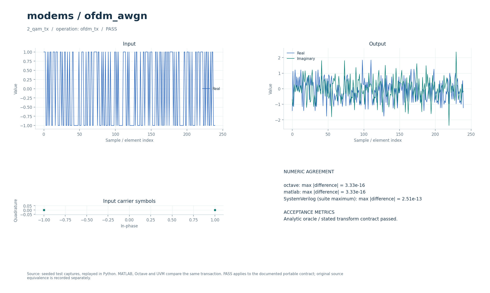

# OFDM-модем в канале с аддитивным белым гауссовым шумом

Блочная модель OFDM с явными FFT/IFFT и циклическим префиксом. Есть переносимые Python, Octave/MATLAB и поведенческая SystemVerilog/UVM-реализации, а также отдельный потоковый fixed-point RTL.

## Что это

Модуль реализует операции `ofdm_tx` и `ofdm_rx` над полными комплексными блоками. Это самостоятельный алгоритмический аналог исторического MATLAB-примера `Ofdm Awgn Sim.m`: отсутствующие вспомогательные функции заменены явным контрактом преобразования и префикса. Историческое размещение пилотов и карта 48/64 поднесущих не воспроизведены.

Исторический исходник в публичный репозиторий не входит. Его происхождение, размер 9535 байт и SHA-256 записаны в [model.json](model.json). Переносимые проверки используют собственные сигналы и исходного скрипта не требуют. Их согласие проверяет текущий контракт, но не устанавливает эквивалентность всему историческому примеру.

[Набор сценариев](../../tools/research_cases.py) содержит восемь случаев: TX/RX для алфавитов 2, 4, 16 и 64 (BPSK, QPSK, 16-QAM и 64-QAM). Проверяются восстановление меток при малом шуме и чувствительность к сильному шуму. Отдельные [fixed-point-тесты](../../tests/test_ofdm_fixed.py) сравнивают целочисленные преобразования с вещественной моделью, проверяют префикс, округление, насыщение и неверные длины.

## Как работает

1. На вход TX подаются уже отображённые в созвездие комплексные символы. Встроенного битового маппера в операции `ofdm_tx` нет. Вектор разбивается на блоки по N поднесущих в естественном порядке.
2. Для каждого блока вычисляется `x=IFFT(X)·√N`: унитарное масштабирование сохраняет энергию блока.
3. Последние CP отсчётов x копируются в его начало. На один блок TX выдаёт N+CP отсчётов.
4. В тестах к сигналу добавляется комплексный гауссов шум; добавление AWGN находится в сценарии, а не внутри `ofdm_tx`/`ofdm_rx`.
5. RX получает известные границы блоков длиной N+CP, удаляет первые CP отсчётов и вычисляет `X̂=FFT(x)/√N`. Решение по ближайшей точке созвездия выполняет проверочный код.

Общий Python-интерфейс: `run(operation, parameters, signal, auxiliary=())`. Для обеих операций `parameters=[N, CP]`, `auxiliary` не используется. Входы и выходы — плоские массивы комплексных чисел с последовательным расположением блоков. Длина TX-входа должна делиться на N, RX-входа — на N+CP; CP — целое от 0 до N. M-интерфейс `run_model(operation, parameters, signal, auxiliary)` использует тот же контракт, описанный в [TYPED_MODELS.md](../../docs/TYPED_MODELS.md).

| Параметр сценариев | Значение |
| --- | --- |
| `N`, `CP` | 32, 8 |
| Полезные символы на случай | 256, то есть 8 OFDM-блоков |
| Число TX-отсчётов | 320 |
| Алфавиты | 2, 4, 16, 64; средняя энергия точки 1 |
| Малый шум RX | `0.003·noise`, где комплексный `noise` имеет среднюю мощность 1 |
| Отрицательный контроль | `4·noise`; требуется более 30 ошибочных меток из 256 |
| Имена случаев | `2_qam_tx/rx`, `4_qam_tx/rx`, `16_qam_tx/rx`, `64_qam_tx/rx` |

Числа 0.003 и 4 задают амплитуду шума; это не значения Eb/N0 в децибелах.

Потоковый RTL находится в [rtl/modems/ofdm_awgn](../../rtl/modems/ofdm_awgn/): `ofdm_tx` и `ofdm_rx` используют общее radix-2 SDF-ядро [fft_r2sdf.sv](../../rtl/common/fft_r2sdf.sv). Целочисленный эталон — [ofdm_fixed.py](../../common/python/ofdm_fixed.py), арифметика FFT — [fft_fixed.py](../../common/python/fft_fixed.py).

| Интерфейс или формат RTL | Контракт |
| --- | --- |
| Параметры | `LOG2N=5`, `CP=8` по умолчанию; `N=2^LOG2N`, размеры FFT 4…1024 |
| Рукопожатие | `s_valid/s_ready`, `m_valid/m_ready`; границы `s_last/m_last` |
| Данные | `s_re/s_im`, `m_re/m_im`: знаковые 18 бит с 15 дробными, Q3.15 |
| Геометрия TX / RX | N → N+CP / N+CP → N |
| Конфигурация | N и CP задаются параметрами модуля, потоковых конфигурационных портов нет |
| Ошибки | Залипающий `error`, в частности при `s_last` не на требуемом отсчёте |
| Сброс | Синхронный, полярность задаёт `RESET_ACTIVE` |

TX предварительно масштабирует символы на 1/√N, затем выполняет обратное FFT без деления и насыщает результат до 18 бит. RX после FFT/N умножает на √N, округляет и насыщает. Твиддлы — 18-битные Q16; округление FFT — половина вверх, что отличается от nearest-even в других ядрах проекта. Выход FFT возвращается в естественном порядке; TX хранит префикс в двух банках памяти и поддерживает противодавление.

При `m_ready=1`, если `L=N−1+4·LOG2N`, комментарии RTL оценивают задержку до первого TX-отсчёта как `L+2N+8` тактов, до первого RX-символа от первого полезного входного отсчёта — `L+N+6`. Паузы и опустошение конвейера меняют фактическое время. Выход TX требует N+CP тактов на блок, вход — N; при CP>0 их средние темпы различаются. Подробности — в [FFT_RTL.md](../../docs/FFT_RTL.md).

## Структура каталога

| Файл или каталог | Назначение |
| --- | --- |
| [model.json](model.json) | Операции, случаи проверки, ограничения и манифест исторического исходника. |
| [python/model.py](python/model.py) | Экспорт общей функции `research_core.run`; самостоятельной CLI-демонстрации нет. |
| [octave/run_model.m](octave/run_model.m), [matlab/run_model.m](matlab/run_model.m) | Обёртки общей M-реализации без дополнительных toolbox. |
| [sv/model.sv](sv/model.sv) | `dsp_variant` над поведенческим `research_model` с арифметикой `real`. |
| [tb/testbench.sv](tb/testbench.sv), [tb/run.sh](tb/run.sh) | Общий UVM-тестбенч и его локальный запуск. |
| [tests/test_model.py](tests/test_model.py) | Запуск численных сценариев данного workspace через `run_research.py`. |
| [research_core.py](../../common/python/research_core.py), [research_cases.py](../../tools/research_cases.py) | Алгоритмы, параметры и независимые условия приёмки. |
| [RTL OFDM](../../rtl/modems/ofdm_awgn/) | Синтезируемые потоковые TX/RX, отдельные от `sv/model.sv`. |

## Как запустить

Команды выполняются из корня проекта. Нужны Python 3, NumPy и SciPy: общий набор сценариев импортирует SciPy даже при выборе одного workspace. Для M-проверки нужен `octave-cli` либо MATLAB; дополнительные пакеты Octave и MATLAB toolbox переносимому ядру не нужны. Для поведенческого HDL нужны Questa и UVM 1.2. Полный RTL-прогон дополнительно требует Verilator для lint.

Каждая команда выбирает только OFDM для соответствующей реализации:

```bash
python3 tools/run_research.py --suite python --workspace modems/ofdm_awgn
python3 tools/run_research.py --suite octave --workspace modems/ofdm_awgn
python3 tools/run_research.py --suite matlab --workspace modems/ofdm_awgn
python3 tools/run_research.py --suite hdl --workspace modems/ofdm_awgn
```

`--suite python` проверяет численные условия, остальные режимы дополнительно сравнивают выбранную реализацию с теми же Python-векторами. На хосте с MATLAB R2020b MATLAB-команду следует выполнять в терминале; выбор установки обеспечивает `tools/matlab.sh`. Здесь `--suite matlab` запускает переносимую M-модель, а не исторический скрипт.

Общий прогон целочисленного эталона, lint и потокового RTL:

```bash
python3 tools/run_ofdm.py --suite all
```

Вызов [tb/run.sh](tb/run.sh) из любого каталога эквивалентен поведенческому HDL-прогону. Обёртка `tests/test_model.py` эквивалентна Python-проверке workspace.

## Что смотреть

`run_research.py` сохраняет результаты в `build/typed/modems__ofdm_awgn/`:

| Артефакт | Что проверять |
| --- | --- |
| `python_results.json`, `octave_results.json`, `matlab_results.json`, `hdl_results.json` | Итог `status=PASS`, число случаев и результаты выбранного языка. |
| `cases.json`, `case_000.npz` и последующие | Параметры, входы/выходы и метрики каждого случая. |
| `vectors.txt` | Общие плоские численные векторы для межъязыковой сверки. |
| `octave.log`, `matlab.log` | Сообщения M-проверок. |
| `questa/simulation.log`, `questa/negative_control.log` | UVM-сравнения и обнаружение намеренно искажённого эталона. |

Для RX всех четырёх алфавитов ожидается `symbol_errors=0` на 256 символах. SER — отношение числа неверных решений к 256. В отрицательном контроле ошибки должны появляться; его успешное обнаружение не означает плохую работу проверки. Успех HDL требует `UVM_ERROR : 0`, `UVM_FATAL : 0`, полного числа 16 транзакций (восемь случаев с повтором) и обнаружения внесённого несовпадения. Не следует считать наличие старого JSON подтверждением нового запуска.

`run_ofdm.py` пишет `build/rtl/ofdm/all_results.json`, векторы, lint-логи и логи Questa. Сравнение с целочисленным эталоном побитное; в вещественном сравнении тесты допускают максимальную абсолютную ошибку до 0.002 при N≤64 и до 0.006 при N=1024. Это пределы отдельных тестов, не универсальная оценка EVM. Независимые исследования точности и насыщения: [RTL_SPECTRAL_PRECISION.md](../../docs/RTL_SPECTRAL_PRECISION.md), [RTL_EMBEDDED_FFT.md](../../docs/RTL_EMBEDDED_FFT.md).

Откройте [визуальный отчёт](../../docs/typed_visual/index.html#modems/ofdm_awgn): формы сигнала и результаты TX/RX относятся к сохранённым численным сценариям. Правила форматов и единиц — в [TYPED_MODELS.md](../../docs/TYPED_MODELS.md). Комментарии реализации — на русском; диагностика и подписи графиков — на английском.



## Ограничения

Приёмник ожидает точные границы OFDM-блоков. Операции не реализуют поиск кадра, восстановление тактирования, оценку/компенсацию несущей, пилоты, оценку частотно-селективного канала, эквализацию и кодирование битов. Используются все N комплексных поднесущих; историческая карта 48/64 не восстановлена. Циклический префикс проверяется как явная операция над массивами, а не как доказательство работоспособности в произвольном многолучевом канале.

`sv/model.sv` — блочная модель на `real`, не синтезируемый fixed-point RTL. Численное совпадение языков подтверждает только заявленный переносимый контракт. Полный повтор исторического MATLAB-примера требует отдельно полученного исходника и его отсутствующих вспомогательных функций; переносимые команды этого не делают.

В RTL возможны насыщение Q3.15 и накопление ошибки округления с ростом N; для перегруженных сигналов отсутствие ошибок меток не гарантируется. Результаты физического синтеза и симуляций в документации относятся к соответствующим снимкам, а запуск на плате этими тестами не устанавливается.
