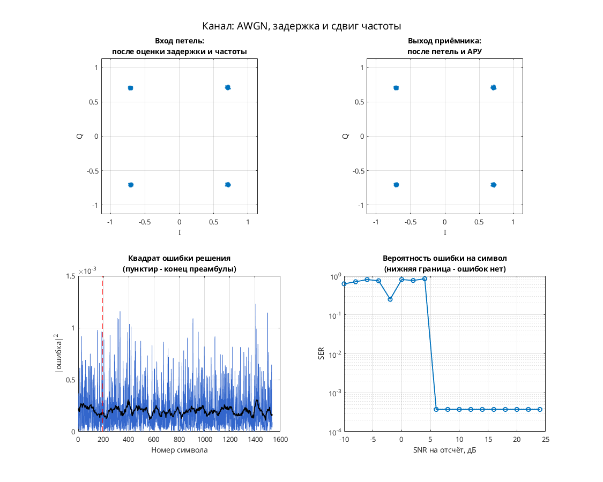

# OQPSK: совместная тактовая и фазовая синхронизация при 2 отсчётах на символ

Модель показывает приём OQPSK со сдвигом квадратурных ветвей на половину символа.

Цепочка: двоичный скремблер и кодирование → разделение I/Q, задержка Q, формирующий RRC-фильтр → дробная задержка и фазовый/частотный сдвиг → прореживание до 2 отсчётов на символ и AWGN → согласованный RRC-фильтр, комплексное ограничение и линии задержки → два интерполятора Фарроу пятого порядка → Gardner, фазовый детектор по решениям и АРУ → решения и декодирование.

Передатчик использует два последовательных Upsample с `N = 2`: формирование идёт при 4 отсчётах на символ, а вход приёмника после Downsample — при 2. Базовые уровни I/Q — `±1/sqrt(2)` до масштабирования канала. В AWGN выбран `Eb/No = 100 дБ`; это почти бесшумная исходная настройка, а не измеренная помехоустойчивость.

## Запуск

В MATLAB перейдите в папку этой модели, где находятся `.mdl` и `run_demo.m`:

```matlab
run_demo          % длительность по умолчанию из run_demo.m
run_demo(2048)    % явная длительность в единицах модельного времени
```

Функция принимает `run_demo(N)`, где `N` — конечное модельное время, а не число символов. Вызов без аргумента использует длительность, заданную в `run_demo.m`.

Версия: автор указывает MATLAB/Simulink R2016b. Модель без изменений проверена в MATLAB R2020b: `run_demo` завершает симуляцию и открывает окна наблюдения, повторный запуск даёт те же сигналы. Полная корректность приёмника при этом не доказана.

Нужны MATLAB и следующие продукты:

- Simulink — схема и её выполнение.
- Communications Toolbox — AWGN, фазовый/частотный сдвиг и Constellation Diagram.
- DSP System Toolbox — Digital Filter Design, Spectrum Analyzer, селекторы, Upsample и линии задержки.
- Signal Processing Toolbox — обязательная зависимость DSP System Toolbox и Communications Toolbox в [R2020b по требованиям MathWorks](https://www.mathworks.com/content/dam/mathworks/mathworks-dot-com/support/sysreq/files/2020b-product-availability.pdf).

## Что смотреть

В настройках сохранена видимость окон `Discrete-Time Scatter Plot Scope` (символьные отсчёты приёмника), `Discrete-Time Signal Trajectory Scope` (траектория передатчика), `Spectrum Scope` (выход AWGN), `phase_sync` и `symbol_clock`. Для `data` дополнительно включено открытие при старте симуляции.

`phase_sync` показывает комплексный сигнал фазовой коррекции, а не скалярную ошибку фазы; `symbol_clock` — строб и дробную задержку `mu`. `data` показывает декодированные данные, `Scope` — I/Q приёмных отсчётов. По диаграмме рассеяния оценивают четыре положения восстановленных символов. Фактическая сходимость этой `.mdl` результатами прогонов в исходном проекте не подтверждена.

## Изменения относительно оригинала

Текущая `.mdl` побайтно совпадает с оригиналом автора: для R2020b никаких изменений не потребовалось.


## Собственная реализация (run_own)

Помимо оригинальной схемы, в папке есть **наша собственная реализация этого модема на MATLAB**. Это не перевод схемы блок за блоком: передатчик, канал и приёмник с теми же параметрами написаны заново кодом, без тулбоксов. Общий код лежит в [common/](../../common/), параметры модема — в [config.json](config.json).

```matlab
run_own                              % демонстрация с графиками
run_own(struct('snr_db', 12))        % свой SNR на отсчёт, дБ
r = run_own(struct('plot', false))   % только числа, без графиков
```

| Узел | Реализация |
| --- | --- |
| Модуляция | OQPSK, 4 позиций |
| Отсчётов на символ | 8 |
| Формирующий фильтр | корень из приподнятого косинуса, порядок 32, скругление 1 |
| Кодирование | нет |
| Символьная синхронизация | по преамбуле, без петли |
| Фазовая синхронизация | петля Костаса, плюс АРУ |
| Эквалайзер | нет |

Модель канала: ослабление 0,65, фазовый сдвиг 0,38 рад, сдвиг частоты 1,5·10⁻⁴ от частоты дискретизации, дробная задержка 2,25 отсчёта и белый шум. Сценарий для этого модема: **AWGN, задержка и сдвиг частоты**. Первые 192 символа кадра служат известной преамбулой. По ней оцениваются задержка, частота и начальная фаза, обучается эквалайзер. Дальше приёмник работает в режиме решений.

Результат в MATLAB R2020b: при SNR 28 дБ — 0 ошибок на 1344 символах, оценка задержки 2.25 отсчёта, частоты 1.50e-04. Ошибок нет начиная с SNR 6 дБ на отсчёт. Время работы около 1 с.



Отличия от оригинальной схемы. В оригинале синхронизация слепая, а у нас приёмник опирается на преамбулу. Скремблер, точные коэффициенты петель оригинала и фиксированная точка не воспроизводятся. Поэтому цифры выше относятся к нашей реализации, а не к схеме автора. Тот же алгоритм у нас есть ещё на Python и SystemVerilog. Версии на Python и MATLAB/Octave совпадают между собой с точностью до 10⁻⁷ (перекрёстный тест), поведенческая модель на SystemVerilog проверена UVM-тестами.

## Автор и источник

Александр Петров; в `Description` — `Petrov Alexander`, дата 2019.12.05.

[Сообщение автора на ELECTRONIX](https://electronix.ru/forum/topic/23652-model-8psk-modema/page/13/#comment-1660469), [ссылка на архив из отчёта поиска](https://yadi.sk/d/fXmOuwO7eqqDXg).

Лицензия автором не указана; модель публикуется с указанием авторства в учебных целях; по просьбе автора будет удалена.
