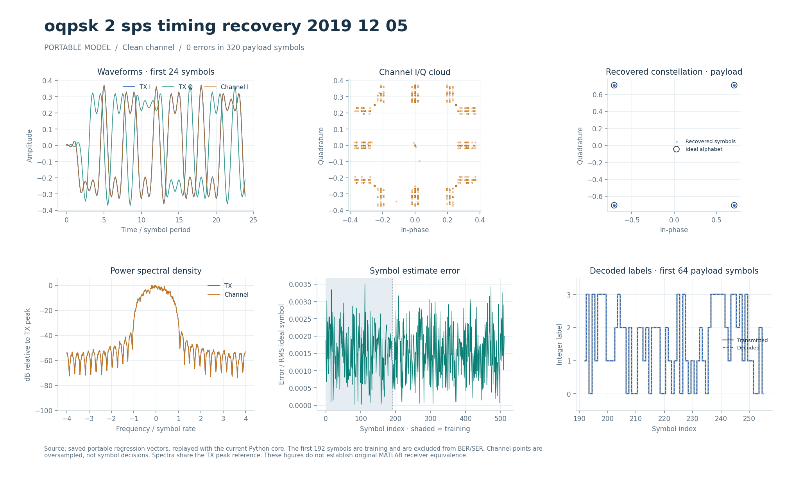
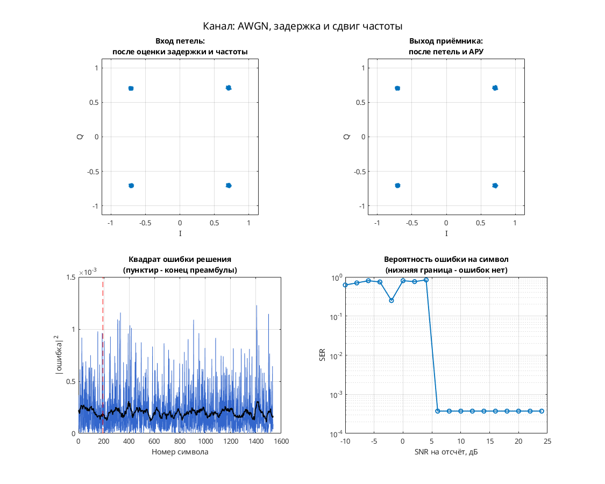

# OQPSK-модем с восстановлением тактирования (2019-12-05)

Кадровая модель OQPSK с задержкой квадратурной ветви на полсимвола и оценкой канала по известной преамбуле.

## Что это

Исторический прототип — Simulink-модель `oqpsk_2_sps_timing_recovery_2019_12_05.mdl`. Переносимые реализации есть на Python, Octave/MATLAB и поведенческом SystemVerilog с UVM. Отдельно существует потоковый fixed-point RTL. Общие Python-тесты проверяют кодер, передачу без шума, канал с шумом/задержкой/несущей, повторяемость, неверный ввод и отрицательный контроль при −8 дБ; специальные проверки зависят от конфигурации. Сохранённые результаты межъязыковых прогонов описаны в [VERIFICATION.md](../../docs/VERIFICATION.md). Совпадение переносимых реализаций не устанавливает полную эквивалентность историческому приёмнику.

Историческая модель в публичный репозиторий не входит. В [source_parameters.json](source_parameters.json) сохранены извлечённые поля блоков и номера строк `source_line`; происхождение и SHA-256 исходного файла записаны в полях `source` и `source_sha256` файла [config.json](config.json). Размер исходника эти JSON не содержат; манифест `model.json` в этом модуле отсутствует.

## Как работает

1. Метки 0…3 выбирают единичные точки QPSK: `(+,+)`, `(−,+)`, `(−,−)`, `(+,−)` с координатами ±1/√2. Дифференциального кодирования нет.
2. TX ставит импульсы I в моменты `8k`, Q — в `8k+4`, затем применяет RRC из 33 коэффициентов с `rolloff=1`. Длина сигнала для N символов — `8N+36` отсчётов.
3. Канал добавляет шум, усиление, фазовый и частотный сдвиги и дробную задержку.
4. RX сравнивает принятый сигнал с формой известной преамбулы, ищет задержку на сетке 0…16 с шагом 0.25 и оценивает частоту, фазу и усиление. После коррекции применяет согласованный RRC.
5. I и Q выбираются в разных временных точках: `32+8k` и `32+8k+4`. Восстановленная комплексная точка проходит сопровождение несущей/АРУ и решение по ближайшему элементу таблицы.

`receive(CONFIG, waveform, preamble, count)` получает только известную преамбулу и длину кадра; полезные метки ему не передаются. Минимум преамбулы — 32 символа, в демонстрациях используется 192 из 768 (полезная часть 576). Начало кадра грубо известно вызывающей стороне; это не детектор произвольных пакетов.

| Параметр | Значение |
| --- | --- |
| `family` / `order` | `oqpsk` / 4 |
| Входные метки | 0…3; 2 бита на метку |
| `differential` | `none` |
| `sps` | 8 |
| RRC | `rrc_order=32`, 33 коэффициента, `rolloff=1.0` |
| `timing` / `carrier` | `feedforward` / `costas` |
| `equalizer` | `none` |
| `diversity_branches` | 1 |
| `variable_delay` / `phase_noise` | `false` / `false` |

`2_sps` в имени относится к исторической модели: в текущей переносимой и RTL-реализациях `sps=8`, а `timing=feedforward` фиксирует оценённую по преамбуле фазу выборки.

Потоковый [RTL OQPSK](../../rtl/modems/oqpsk_2_sps_timing_recovery_2019_12_05/) содержит `oqpsk_tx`, `oqpsk_rx`, `oqpsk_costas`; целочисленный эталон — [oqpsk_fixed.py](../../common/python/oqpsk_fixed.py). TX принимает двухбитную `s_bit`, ставит уровни ±23170 Q15 в моменты `8k`/`8k+4` и выдаёт `8N+36` комплексных отсчётов Q3.15.

RX использует `s_valid/s_ready/s_re/s_im/s_last` и `m_valid/m_ready/m_re/m_im/m_label/m_last`. Длина входа — `8N…8N+96`, `N=192…2048`; перед кадрами загружаются 192 двухбитные метки преамбулы. После входного `s_last` RRC дополняется 32 нулями с остановкой входа. Захват по 18 задержкам и 8 фазам блоков выдаёт задержку, частоту и фазу с `acquisition_valid` примерно через 3000 тактов по описанию архитектуры.

Две временные позиции I/Q обрабатываются раздельной петлёй Костаса. `LOOP_DELAY=8`; измеренный путь от запроса до ошибки занимает 45 разрешённых тактов, поэтому генератор запросов ждёт готовности обратной связи. Символ занимает не менее четырёх тактов. Остановки `m_ready` останавливают тракт. Детали, форматы и границы измерения темпа — в [OQPSK_RTL.md](../../docs/OQPSK_RTL.md) и [проверке задержек](../../docs/RTL_LOOP_DELAY.md).

### Историческая схема

Модель показывает приём OQPSK со сдвигом квадратурных ветвей на половину символа.

Цепочка: двоичный скремблер и кодирование → разделение I/Q, задержка Q, формирующий RRC-фильтр → дробная задержка и фазовый/частотный сдвиг → прореживание до 2 отсчётов на символ и AWGN → согласованный RRC-фильтр, комплексное ограничение и линии задержки → два интерполятора Фарроу пятого порядка → Gardner, фазовый детектор по решениям и АРУ → решения и декодирование.

Передатчик использует два последовательных Upsample с `N = 2`: формирование идёт при 4 отсчётах на символ, а вход приёмника после Downsample — при 2. Базовые уровни I/Q — `±1/sqrt(2)` до масштабирования канала. В AWGN выбран `Eb/No = 100 дБ`; это почти бесшумная исходная настройка, а не измеренная помехоустойчивость.

### Собственная реализация (run_own)

Автономная реализация на MATLAB/Octave и Python читает существующий [config.json](config.json) и работает без тулбоксов и исторических файлов, в том числе в публичной копии. Общий код — [common/own/](../../common/own/) и [common/own/python/](../../common/own/python/). Передатчик, канал и приёмник написаны кодом; параметры переносимого профиля могут отличаться от исторической схемы.

| Узел | Реализация |
| --- | --- |
| Модуляция | OQPSK, 4 позиций |
| Отсчётов на символ | 8 |
| Формирующий фильтр | корень из приподнятого косинуса, порядок 32, скругление 1 |
| Кодирование | нет |
| Символьная синхронизация | по преамбуле, без петли |
| Фазовая синхронизация | петля Костаса, плюс АРУ |
| Эквалайзер | нет |

Модель канала: ослабление 0,65, фазовый сдвиг 0,38 рад, сдвиг частоты 1,5·10⁻⁴ от частоты дискретизации, дробная задержка 2,25 отсчёта и белый шум. Сценарий для этого модема: **AWGN, задержка и сдвиг частоты**. Первые 192 символа кадра служат известной преамбулой. По ней оцениваются задержка, частота и начальная фаза, обучается эквалайзер, если он предусмотрен конфигурацией. Дальше приёмник работает в режиме решений.

## Структура каталога

| Файл или каталог | Назначение |
| --- | --- |
| [config.json](config.json) | Параметры переносимой модели и SHA-256 исторического исходника. |
| [source_parameters.json](source_parameters.json) | Извлечённые поля прототипа. |
| [python/modem.py](python/modem.py) | Экспорт `CONFIG`, `transmit`, `receive`; запуск демонстрации. |
| [tests/test_modem.py](tests/test_modem.py) | Общий контракт из `modem_checks.ModemContract` для этой конфигурации. |
| [octave/run_modem.m](octave/run_modem.m), [octave/test_modem.m](octave/test_modem.m) | Демонстрация и проверка M-реализации; те же функции работают в MATLAB. |
| [sv/modem.sv](sv/modem.sv) | Обёртка общего поведенческого `modem_model`, арифметика `real`. |
| [tb/testbench.sv](tb/testbench.sv), [tb/run.sh](tb/run.sh) | UVM-тестбенч и локальная обёртка запуска из любого каталога. |
| [common/](../../common/) | Общие ядра Python, Octave и SystemVerilog; изменения влияют на все модели. |
| [matlab/test_original.m](matlab/test_original.m) | Отдельный запуск проверки исторической Simulink-модели. |

| Файл / подкаталог | Назначение |
| --- | --- |
| [run_demo.m](run_demo.m) | Запуск локальной исторической R2020b-модели из `matlab/` |
| [run_own.m](run_own.m), [run_own.py](run_own.py) | Автономная демонстрация MATLAB/Octave и Python через `common/own` |
| [images/](images/) | Сохранённые графики автономной реализации для README |

## Как запустить

Все команды выполняются из корня проекта. Для переносимого Python нужны Python 3 и NumPy; для M-файлов — `octave-cli` с `jsondecode` либо MATLAB. Симуляция поведенческого SV требует Questa и UVM 1.2. Полный RTL-прогон дополнительно использует Verilator для lint; пути Questa/UVM выбираются общими средствами проекта.

Демонстрация печатает JSON с числом ошибок и оценками синхронизации; тест запускает семь проверок общего контракта:

```bash
python3 modems/oqpsk_2_sps_timing_recovery_2019_12_05/python/modem.py
python3 modems/oqpsk_2_sps_timing_recovery_2019_12_05/tests/test_modem.py
```

Проверка M-реализации и её демонстрация:

```bash
octave-cli --quiet --eval "addpath('modems/oqpsk_2_sps_timing_recovery_2019_12_05/octave'); test_modem; run_modem;"
```

Сравнение Python и Octave на общих векторах, затем отдельный поведенческий UVM-прогон:

```bash
python3 tools/run_tests.py --suite cross --modem oqpsk_2_sps_timing_recovery_2019_12_05
./tools/run_questa.sh --modem oqpsk_2_sps_timing_recovery_2019_12_05
```

Общая проверка fixed-point-моделей, lint и RTL-симуляции (охватывает всю группу, а не только этот каталог):

```bash
python3 tools/run_oqpsk.py --suite all
```

Проверка исторического прототипа доступна только при наличии исходников и требуемых библиотек MATLAB/Simulink. Общий `matlab_check_research` сначала требует комплект из двух исследовательских MDL-моделей, затем выбирает этот модем: одного отдельно восстановленного файла недостаточно. Она запускает симуляцию и повторный расчёт для проверки точной повторяемости:

```bash
./tools/matlab.sh -nodisplay -batch "addpath('modems/oqpsk_2_sps_timing_recovery_2019_12_05/matlab'); test_original;"
```

### Быстрый старт в MATLAB

Перейдите в папку этого модема. [run_demo.m](run_demo.m) открывает подготовленную R2020b-копию `matlab/oqpsk_2_sps_timing_recovery_2019_12_05.mdl`:

```matlab
run_demo          % историческая схема и её осциллографы
run_demo(32768)  % явное время окончания
```

По умолчанию время окончания — `32768` в единицах модельного времени, не число символов. Нужны MATLAB R2020b, Simulink, Communications Toolbox и DSP System Toolbox (с их зависимостью Signal Processing Toolbox). Историческая модель не входит в публичный репозиторий, см. [THIRD_PARTY.md](../../THIRD_PARTY.md); без локальной копии `run_demo` выдаёт понятную ошибку. Автономный `run_own` работает и без неё.

MATLAB или GNU Octave (один и тот же код):

```matlab
run_own                              % демонстрация с графиками
run_own(struct('snr_db', 12))        % свой SNR на отсчёт, дБ
r = run_own(struct('plot', false))   % только числа, без графиков
```

Python (зависимости: [requirements.txt](../../requirements.txt) и, для графиков, [requirements-visual.txt](../../requirements-visual.txt)):

```bash
python3 run_own.py                    # демонстрация с графиками
python3 run_own.py --snr 12           # свой SNR на отсчёт, дБ
python3 run_own.py --no-plot --json   # только числа
```

Можно сохранить графики без окна: `python3 run_own.py --no-plot --save images/generated`. Для короткой проверки кривой задайте `--sweep -10 10 24`; без этой опции сохраняется исходная сетка SNR.

## Что смотреть

В демонстрации `symbol_errors` — число неверных меток после преамбулы, `ser` — их доля в 576 полезных символах. Для штатного примера ожидается ноль ошибок. `estimated_delay` измеряется в отсчётах, `estimated_frequency` — в циклах на отсчёт. SNR задаётся на отсчёт по средней мощности сигнала и не равен Eb/N0. Нулевой SER на коротком кадре не определяет долговременную BER.

Python-тесты заканчиваются `OK`, Octave печатает `PASS <имя> Octave codec and waveform loopback`. В проверенном окружении Octave при завершении также печатает `ignoring const execution_exception`; учитывайте код выхода и результат утверждений теста. Проверка канала при 30 дБ использует усиления 0.65/0.2, фазы 0.38/−1.1 рад, частоты 0.00015/−0.0005 циклов на отсчёт и задержки 2.25/7.25; требуется точное восстановление нагрузки, ошибка частоты менее 10⁻⁵ и задержки не более 0.5 отсчёта. Отрицательный контроль при −8 дБ должен дать больше 20 ошибок.

`run_tests.py --suite cross` сохраняет `build/single/oqpsk_2_sps_timing_recovery_2019_12_05/cross_results.json`, лог `logs/cross/octave.log` внутри этого каталога и общие векторы `build/vectors/oqpsk_2_sps_timing_recovery_2019_12_05/`. Поведенческий UVM пишет `build/questa/single/oqpsk_2_sps_timing_recovery_2019_12_05/results.json` и `oqpsk_2_sps_timing_recovery_2019_12_05.log` в том же каталоге. Успех требует четырёх проверенных кадров, `UVM_ERROR : 0`, `UVM_FATAL : 0` и обнаружения специально внесённого несовпадения в отрицательном контроле.

UVM передаёт чистый, шумовой и специальный сценарии, затем повторяет первый кадр после сброса. Пассивный монитор снимает реальные выходы; scoreboard сверяет TX-отсчёты, RX-символы, индексы, декодированные и полезные метки и оценки синхронизации с независимым исполнением Python. Комплексные величины сравниваются с допуском 10⁻⁷, целочисленные метки — точно. Поведенческое завершение за один цикл запроса является абстракцией кадра, не аппаратной латентностью. Комментарии общей реализации — на русском, диагностика — преимущественно на английском.

Fixed-point-прогон сохраняет `build/rtl/oqpsk/all_results.json` и логи подкаталогов. Его побитное совпадение с целочисленным эталоном проверяет RTL-арифметику; качество относительно вещественного приёмника оценивается отдельно в указанной RTL-документации.

Историческая MATLAB-проверка сохраняет `build/research_review/single/oqpsk_2_sps_timing_recovery_2019_12_05/matlab_results.json` и захваты в его подкаталоге. Статусы загрузки, компиляции, симуляции и повторяемости следует рассматривать отдельно от BER.

Сценарии и графики представлены в [типизированном визуальном отчёте](../../docs/typed_visual/index.html), правила интерфейса — в [TYPED_MODELS.md](../../docs/TYPED_MODELS.md).



### Осциллографы исторической схемы

В настройках сохранена видимость окон `Discrete-Time Scatter Plot Scope` (символьные отсчёты приёмника), `Discrete-Time Signal Trajectory Scope` (траектория передатчика), `Spectrum Scope` (выход AWGN), `phase_sync` и `symbol_clock`. Для `data` дополнительно включено открытие при старте симуляции.

`phase_sync` показывает комплексный сигнал фазовой коррекции, а не скалярную ошибку фазы; `symbol_clock` — строб и дробную задержку `mu`. `data` показывает декодированные данные, `Scope` — I/Q приёмных отсчётов. По диаграмме рассеяния оценивают четыре положения восстановленных символов. Фактическая сходимость этой `.mdl` результатами прогонов в исходном проекте не подтверждена.

### Графики run_own

Созвездия до и после петель, сходимость ошибки и SER(SNR); для MSK/GMSK — гистограмма набега фазы. При наличии сравнения второе окно показывает включённый и отключённый узел.

Сохранённый результат из MATLAB R2020b исходного проекта (не новый прогон): при SNR 28 дБ — 0 ошибок на 1344 символах, оценка задержки 2.25 отсчёта, частоты 1.50e-04. Ошибок нет начиная с SNR 6 дБ на отсчёт. Время работы около 1 с.



## Ограничения

Полная эквивалентность историческому прототипу не установлена. Переносимая модель заменяет слепой захват обучением по преамбуле и не воспроизводит скремблеры/дескремблеры, внутренние CIC, исходные коэффициенты петель, переходные процессы, точное многоскоростное расписание и округление старых блоков. Некоторые исторические варианты поэтому используют общий текущий алгоритм. [Контракт переноса](../../docs/PORTING_CONTRACT.md) описывает эти замены и проверенные сценарии.

`sv/modem.sv` использует `real` и кадровые транзакции; синтезируемый fixed-point RTL находится отдельно. Статусы из сохранённых отчётов относятся к их снимкам исходников; физический тайминг старого снимка не переносится автоматически на текущий RTL. Работа на реальной плате не подтверждена этими моделями. Тесты каналов являются регрессионными примерами, а не измерением полного диапазона захвата или гарантией BER.

Слепая синхронизация исходной схемы при двух отсчётах на символ не воспроизведена: текущая модель обучаемая и работает с `sps=8`. Изменённый `LOOP_DELAY=8` в RTL не покрывается старой таблицей физического синтеза; документация также отмечает внутреннюю ошибку Verilator в дополнительном прогоне OQPSK с активным низким сбросом после изменения общего делителя (см. [BPSK_RTL.md](../../docs/BPSK_RTL.md)).

### Автономная демонстрация

`run_own` использует известную преамбулу; исторические скремблеры, точные коэффициенты петель и фиксированная точка не воспроизводятся. Версии MATLAB/Octave и Python проверяются на одном входном сигнале через `own_cross_check` (см. [корневой README](../../README.md#быстрый-старт-в-matlab)). Сохранённые картинки построены в MATLAB; Python генерирует шум иначе, поэтому отдельные значения SER могут отличаться. Сохранённые результаты относятся к автономной реализации, а не к исторической схеме.
