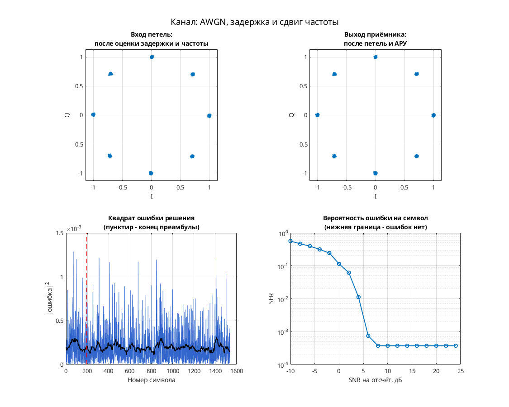

# π/4-QPSK: прямая синхронизация при 8 отсчётах на символ на смеси двух сигналов

Схема содержит два передатчика π/4-QPSK: их сигналы проходят отдельные задержки и фазовые/частотные сдвиги, суммируются и поступают в общий шумовой канал.

Цепочка: скремблирование, Gray-кодирование и накопление фазового состояния → два RRC-передатчика → раздельные канальные искажения → сумма и AWGN → согласованный RRC-фильтр и АРУ → прямой тактовый синхронизатор, параболический интерполятор Фарроу → фазовая оценка по четвёртой степени и скользящему DFT с выбором максимума → решения и декодирование.

Параметры: 8 отсчётов на символ, четырёхпозиционные данные и восемь возможных фазовых состояний `exp(i*k*pi/4)`. В канале выбран `Eb/No = 10 дБ`. Масштабы ветвей перед их задержками различны (`gain3 = 1/10^3` в первой ветви); относительную мощность следует оценивать по всей цепочке.

## Запуск

В MATLAB перейдите в папку этой модели, где находятся `.mdl` и `run_demo.m`:

```matlab
run_demo          % длительность по умолчанию из run_demo.m
run_demo(2048)    % явная длительность в единицах модельного времени
```

Функция принимает `run_demo(N)`, где `N` — конечное модельное время, а не число символов. Вызов без аргумента использует длительность, заданную в `run_demo.m`.

Проверено в MATLAB R2020b: симуляция до модельного времени 2048 и точное повторение записанных сигналов после перезапуска — `PASS` по `matlab/verification.json` исходного проекта. Полная эквивалентность исторической версии и функциональная корректность всего приёмника не установлены.

Нужны MATLAB и следующие продукты:

- Simulink — схема и её выполнение.
- Communications Toolbox — AWGN, фазовые/частотные сдвиги и Constellation Diagram.
- DSP System Toolbox — Digital Filter Design, Spectrum Analyzer, Maximum, Delay Line, селекторы и Upsample.
- Signal Processing Toolbox — обязательная зависимость DSP System Toolbox и Communications Toolbox в [R2020b по требованиям MathWorks](https://www.mathworks.com/content/dam/mathworks/mathworks-dot-com/support/sysreq/files/2020b-product-availability.pdf).

## Что смотреть

Сохранена видимость `Discrete-Time Scatter Plot Scope` с выходными отсчётами, `Discrete-Time Signal Trajectory Scope` с сигналом первого передатчика, `Spectrum Scope` со спектром суммы после AWGN, `symbol_clock` со стробом и `mu`, а также `AGC/AGC` с внутренними сигналами нормирования.

При старте дополнительно открываются `data` и `filter_number`. Первый вход `data` — декодированные данные, второй — внутренняя оценка `EVM`, а не ещё один поток данных. `filter_number` показывает индекс выбранной ветви скользящего DFT фазового синхронизатора. По изменению индекса, EVM и расположению групп точек оценивают захват; численная гарантия захвата и BER не установлена. `scope` показывает I/Q выходных отсчётов.

## Изменения относительно оригинала

По `matlab/migration.json` изменений модели нет: SHA-256 подготовленной копии совпадает с оригиналом. В `matlab/verification.json` список `runtime_changes` также пуст.


## Собственная реализация (run_own)

Помимо оригинальной схемы, в папке есть **наша собственная реализация этого модема на MATLAB**. Это не перевод схемы блок за блоком: передатчик, канал и приёмник с теми же параметрами написаны заново кодом, без тулбоксов. Общий код лежит в [common/](../../common/), параметры модема — в [config.json](config.json).

```matlab
run_own                              % демонстрация с графиками
run_own(struct('snr_db', 12))        % свой SNR на отсчёт, дБ
r = run_own(struct('plot', false))   % только числа, без графиков
```

| Узел | Реализация |
| --- | --- |
| Модуляция | π/4-QPSK, 4 позиций |
| Отсчётов на символ | 8 |
| Формирующий фильтр | корень из приподнятого косинуса, порядок 32, скругление 1 |
| Кодирование | π/4-дифференциальное |
| Символьная синхронизация | по преамбуле, без петли |
| Фазовая синхронизация | петля первого порядка (только фаза), плюс АРУ |
| Эквалайзер | нет |

Модель канала: ослабление 0,65, фазовый сдвиг 0,38 рад, сдвиг частоты 1,5·10⁻⁴ от частоты дискретизации, дробная задержка 2,25 отсчёта и белый шум. Сценарий для этого модема: **AWGN, задержка и сдвиг частоты**. Первые 192 символа кадра служат известной преамбулой. По ней оцениваются задержка, частота и начальная фаза, обучается эквалайзер. Дальше приёмник работает в режиме решений.

Результат в MATLAB R2020b: при SNR 28 дБ — 0 ошибок на 1344 символах, оценка задержки 2.25 отсчёта, частоты 1.50e-04. Ошибок нет начиная с SNR 8 дБ на отсчёт. Время работы около 0 с.



Отличия от оригинальной схемы. В оригинале синхронизация слепая, а у нас приёмник опирается на преамбулу. Скремблер, точные коэффициенты петель оригинала и фиксированная точка не воспроизводятся. Поэтому цифры выше относятся к нашей реализации, а не к схеме автора. Тот же алгоритм у нас есть ещё на Python и SystemVerilog. Версии на Python и MATLAB/Octave совпадают между собой с точностью до 10⁻⁷ (перекрёстный тест), поведенческая модель на SystemVerilog проверена UVM-тестами.

## Автор и источник

Александр Петров; в `Description` — `Petrov Alexander`, дата 2021.05.27.

[Публичная ссылка на модель](https://disk.yandex.ru/d/xktdAddyNLfHrw), зафиксированная в `research/electronix_20260930/findings.json` исходного проекта. Точное сообщение форума для этого файла не установлено.

Лицензия автором не указана; модель публикуется с указанием авторства в учебных целях; по просьбе автора будет удалена.
