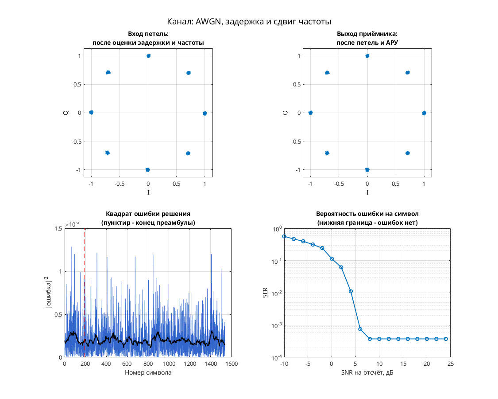

# π/4-QPSK: прямая фазовая синхронизация по четвёртой степени

Модель демонстрирует восстановление фазы π/4-QPSK по четвёртой степени сигнала вместе с тактовой петлёй Gardner и АРУ.

Цепочка: скремблер → Gray-кодирование и накопление состояния по модулю 8 → таблица фаз и RRC-фильтр → фазовый/частотный сдвиг, дробная задержка и AWGN → согласованный RRC-фильтр и кубический интерполятор Фарроу → Gardner, регулировка усиления, фазовая оценка с CIC-усреднением и развёрткой → решения и декодирование.

В этой `.mdl` — 4 отсчёта на символ (`modulator/Upsample/N = 4`), затем области обработки с 2 и 1 отсчётом на символ. Таблица: `exp(i*([0:7]*pi/4+pi/4))`, данные четырёхпозиционные. AWGN настроен на `Eb/No = 100 дБ`. Значение `sps = 8` из переносимого `config.json` к этой схеме не относится.

## Запуск

В MATLAB перейдите в папку этой модели, где находятся `.mdl` и `run_demo.m`:

```matlab
run_demo          % длительность по умолчанию из run_demo.m
run_demo(4096)    % явная длительность в единицах модельного времени
```

Функция принимает `run_demo(N)`, где `N` — конечное модельное время, а не число символов. Вызов без аргумента использует длительность, заданную в `run_demo.m`.

Проверено в MATLAB R2020b: симуляция до модельного времени 4096 и точное повторение записанных сигналов после перезапуска — `PASS` по `matlab/verification.json` исходного проекта. Полная эквивалентность исторической версии и функциональная корректность всего приёмника не установлены.

Нужны MATLAB и следующие продукты:

- Simulink — схема и её выполнение.
- Communications Toolbox — AWGN, фазовый/частотный сдвиг, Scatter Plot и Signal Trajectory Scope.
- DSP System Toolbox — Digital Filter Design, Spectrum Scope, Buffer, селекторы и Upsample/Downsample.
- Signal Processing Toolbox — обязательная зависимость DSP System Toolbox и Communications Toolbox в [R2020b по требованиям MathWorks](https://www.mathworks.com/content/dam/mathworks/mathworks-dot-com/support/sysreq/files/2020b-product-availability.pdf).

## Что смотреть

Автоматически открываются `Discrete-Time Scatter Plot Scope` с символьными отсчётами приёмника, `Discrete-Time Signal Trajectory Scope` с траекторией передатчика и `Spectrum Scope` с выходом AWGN. Траектория позволяет различить смену фазовых состояний π/4-QPSK; выходное созвездие служит для оценки фазовой коррекции.

Вручную доступны `Scope` со стробами и `mu` тактового NCO, `Scope1` с I/Q и `Scope3` с восстановленными данными. Отдельного графика скалярной фазовой ошибки на верхнем уровне нет; сходимость всего приёмника численно не подтверждена.

## Изменения относительно оригинала

По `matlab/migration.json` изменений модели нет: SHA-256 подготовленной копии совпадает с оригиналом. В `matlab/verification.json` список `runtime_changes` также пуст.


## Собственная реализация (run_own)

Помимо оригинальной схемы, в папке есть **наша собственная реализация этого модема на MATLAB/Octave и Python**. Это не перевод схемы блок за блоком: передатчик, канал и приёмник с теми же параметрами написаны заново кодом, без тулбоксов. Общий код лежит в [common/](../../common/) (Python — в [common/python/](../../common/python/)), параметры модема — в [config.json](config.json).

MATLAB или GNU Octave (один и тот же код):

```matlab
run_own                              % демонстрация с графиками
run_own(struct('snr_db', 12))        % свой SNR на отсчёт, дБ
r = run_own(struct('plot', false))   % только числа, без графиков
```

Python (нужны NumPy и Matplotlib):

```bash
python run_own.py                    # демонстрация с графиками
python run_own.py --snr 12           # свой SNR на отсчёт, дБ
python run_own.py --no-plot --json   # только числа
```

| Узел | Реализация |
| --- | --- |
| Модуляция | π/4-QPSK, 4 позиций |
| Отсчётов на символ | 8 |
| Формирующий фильтр | корень из приподнятого косинуса, порядок 32, скругление 1 |
| Кодирование | π/4-дифференциальное |
| Символьная синхронизация | по преамбуле, без петли |
| Фазовая синхронизация | петля первого порядка (только фаза), плюс АРУ |
| Эквалайзер | нет |

Модель канала: ослабление 0,65, фазовый сдвиг 0,38 рад, сдвиг частоты 1,5·10⁻⁴ от частоты дискретизации, дробная задержка 2,25 отсчёта и белый шум. Сценарий для этого модема: **AWGN, задержка и сдвиг частоты**. Первые 192 символа кадра служат известной преамбулой. По ней оцениваются задержка, частота и начальная фаза, обучается эквалайзер. Дальше приёмник работает в режиме решений.

Результат в MATLAB R2020b: при SNR 28 дБ — 0 ошибок на 1344 символах, оценка задержки 2.25 отсчёта, частоты 1.50e-04. Ошибок нет начиная с SNR 8 дБ на отсчёт. Время работы около 1 с.



Отличия от оригинальной схемы. В оригинале синхронизация слепая, а у нас приёмник опирается на преамбулу. Скремблер, точные коэффициенты петель оригинала и фиксированная точка не воспроизводятся. Поэтому цифры выше относятся к нашей реализации, а не к схеме автора. Версии на MATLAB/Octave и Python реализуют один и тот же алгоритм. На одном и том же входном сигнале они дают одинаковые символы с точностью около 10⁻¹⁴ (перекрёстный тест `cross_check`, см. корневой README). Графики выше построены в MATLAB. Python строит такие же, но шум генерируется по-другому, поэтому число ошибок в отдельных точках может немного отличаться.

## Автор и источник

Александр Петров; в `Description` — `Petrov Sasha`, дата 2010.07.15.

[Сообщение автора на ELECTRONIX](https://electronix.ru/forum/topic/23652-model-8psk-modema/page/8/#comment-785491).

Лицензия автором не указана; модель публикуется с указанием авторства в учебных целях; по просьбе автора будет удалена.
