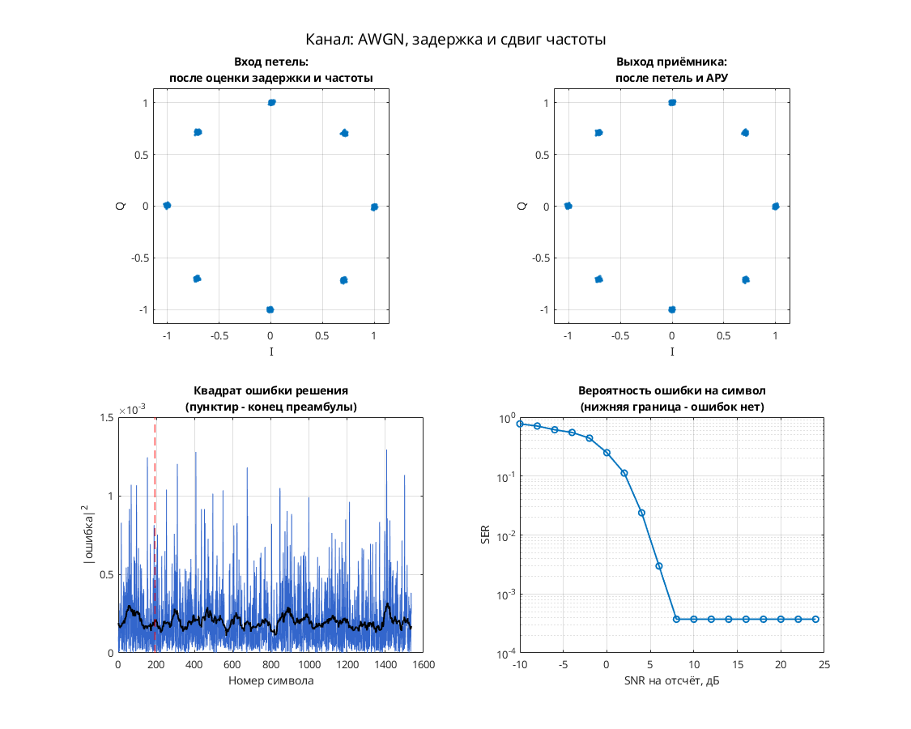

# 8-PSK: тактовая и фазовая синхронизация с обратной связью и АРУ

Модель показывает приём дифференциальной 8-PSK замкнутыми петлями синхронизации и усиления.

Цепочка: скремблирование и дифференциальное кодирование → 8-PSK и RRC-фильтр → фазовый/частотный сдвиг, дробная задержка и AWGN → АРУ, согласованный RRC-фильтр и интерполятор Фарроу → детектор Gardner и тактовый NCO, фазовый детектор по решениям → решения, дифференциальный декодер и дескремблер. Фазовая петля замыкается внутри символьной области; тактовая коррекция управляет внешним интерполятором.

Параметры: 8 отсчётов на символ; `M = 8`, `Ph = 0`; восемь равномерных фазовых позиций; RRC-фильтры порядка 32, скругление 1; `Eb/No = 12 дБ`. В отличие от прямого NDA-варианта 2006 года, здесь явно реализованы Gardner, фазовый детектор по решениям и петля АРУ.

## Запуск

В MATLAB перейдите в папку этой модели, где находятся `.mdl` и `run_demo.m`:

```matlab
run_demo          % длительность по умолчанию из run_demo.m
run_demo(2048)    % явная длительность в единицах модельного времени
```

Функция принимает `run_demo(N)`, где `N` — конечное модельное время, а не число символов. Вызов без аргумента использует длительность, заданную в `run_demo.m`.

Проверено в MATLAB R2020b: симуляция до модельного времени 2048 и точное повторение записанных сигналов после перезапуска — `PASS` по `matlab/verification.json` исходного проекта. Полная эквивалентность исторической версии и функциональная корректность всего приёмника не установлены.

Нужны MATLAB и следующие продукты:

- Simulink — схема и её выполнение.
- Communications Toolbox — M-PSK модулятор, AWGN, скремблер/дескремблер и диаграмма рассеяния.
- DSP System Toolbox — RRC-фильтры, Buffer, селекторы, Upsample/Downsample и задержки.
- Signal Processing Toolbox — обязательная зависимость DSP System Toolbox и Communications Toolbox в [R2020b по требованиям MathWorks](https://www.mathworks.com/content/dam/mathworks/mathworks-dot-com/support/sysreq/files/2020b-product-availability.pdf).

## Что смотреть

Автоматически открывается `Discrete-Time Scatter Plot Scope` с символьными отсчётами приёмника. По восьми группам точек оценивают остаточные фазовые и амплитудные ошибки.

Вручную открываются `Scope` со стробом `overflow` и дробной задержкой `mu` тактового NCO, `Scope1` с I/Q и `Scope2` с восстановленными данными. По `mu` наблюдают работу тактовой коррекции; это не непосредственный график ошибки Gardner. Время захвата и BER исходной проверкой не установлены.

## Изменения относительно оригинала

По `matlab/migration.json` исходного проекта выполнены замены библиотечных ссылок для R2020b:

- `commchan2/` → `commchan3/`: 1 ссылка.
- `commdigbbndpm2/` → `commdigbbndpm3/`: 1 ссылка.

Числовые параметры сохранены; дополнительных изменений при выполнении (`runtime_changes`) не зафиксировано. Замены библиотек сами по себе не доказывают совпадение поведения со старым MATLAB.


## Собственная реализация (run_own)

Помимо оригинальной схемы, в папке есть **наша собственная реализация этого модема на MATLAB**. Это не перевод схемы блок за блоком: передатчик, канал и приёмник с теми же параметрами написаны заново кодом, без тулбоксов. Общий код лежит в [common/](../../common/), параметры модема — в [config.json](config.json).

```matlab
run_own                              % демонстрация с графиками
run_own(struct('snr_db', 12))        % свой SNR на отсчёт, дБ
r = run_own(struct('plot', false))   % только числа, без графиков
```

| Узел | Реализация |
| --- | --- |
| Модуляция | PSK, 8 позиций |
| Отсчётов на символ | 8 |
| Формирующий фильтр | корень из приподнятого косинуса, порядок 32, скругление 1 |
| Кодирование | дифференциальное фазовое |
| Символьная синхронизация | петля Гарднера с кубическим интерполятором Фарроу |
| Фазовая синхронизация | ФАПЧ второго порядка (фаза и частота), плюс АРУ |
| Эквалайзер | нет |

Модель канала: ослабление 0,65, фазовый сдвиг 0,38 рад, сдвиг частоты 1,5·10⁻⁴ от частоты дискретизации, дробная задержка 2,25 отсчёта и белый шум. Сценарий для этого модема: **AWGN, задержка и сдвиг частоты**. Первые 192 символа кадра служат известной преамбулой. По ней оцениваются задержка, частота и начальная фаза, обучается эквалайзер. Дальше приёмник работает в режиме решений.

Результат в MATLAB R2020b: при SNR 28 дБ — 0 ошибок на 1344 символах, оценка задержки 2.25 отсчёта, частоты 1.50e-04. Ошибок нет начиная с SNR 8 дБ на отсчёт. Время работы около 1 с.



Отличия от оригинальной схемы. В оригинале синхронизация слепая, а у нас приёмник опирается на преамбулу. Скремблер, точные коэффициенты петель оригинала и фиксированная точка не воспроизводятся. Поэтому цифры выше относятся к нашей реализации, а не к схеме автора. Тот же алгоритм у нас есть ещё на Python и SystemVerilog. Версии на Python и MATLAB/Octave совпадают между собой с точностью до 10⁻⁷ (перекрёстный тест), поведенческая модель на SystemVerilog проверена UVM-тестами.

## Автор и источник

Александр Петров; в `Description` — `Petrov Sasha`, дата 2009.08.19.

[Сообщение автора на ELECTRONIX](https://electronix.ru/forum/topic/23652-model-8psk-modema/page/3/#comment-637237).

Лицензия автором не указана; модель публикуется с указанием авторства в учебных целях; по просьбе автора будет удалена.
