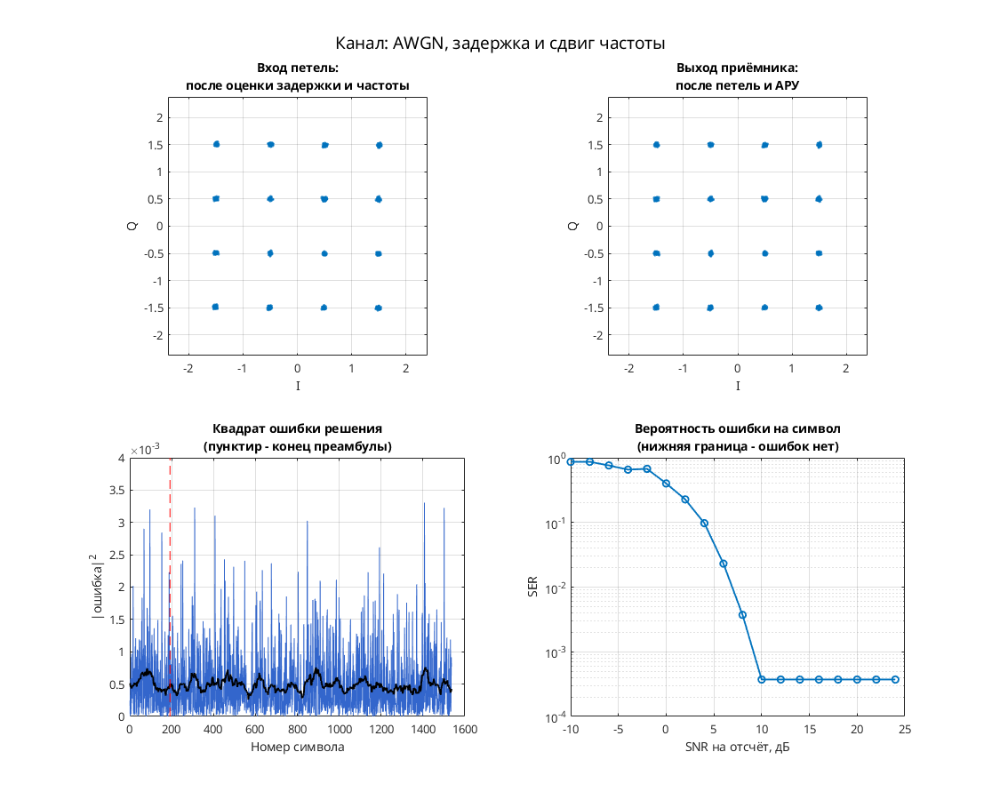

# 16-QAM: синхронизация Гарднера, интерполяция Фарроу и АРУ

Модель Simulink демонстрирует приём 16-QAM с обратной связью по времени, фазе и усилению. Передатчик: скремблер → дифференциальное кодирование квадрантов → `data_mapper` → повышение частоты в 8 раз → RRC-фильтр. Канал: дробная задержка Фарроу, фазовая/частотная расстройка и AWGN. Приёмник: RRC-фильтр → коррекция фазы и усиления → интерполятор Фарроу → детектор Гарднера и петлевые фильтры → решения и дифференциальное декодирование.

Параметры: 8 отсчётов на символ; 16 точек с координатами I, Q ∈ {−1.5, −0.5, 0.5, 1.5}. Передающий и приёмный RRC-фильтры имеют порядок 32 и коэффициент скругления 1. Эквалайзера нет.

## Запуск

В MATLAB перейдите в эту папку и выполните:

```matlab
run_demo
% Либо задайте время окончания моделирования явно:
run_demo(2048)
```

N в `run_demo(N)` — время окончания в единицах модельного времени, а не число символов. Без аргумента используется `16384`.

Проверено в MATLAB R2020b: в исходном проекте записаны успешная симуляция и точный повтор сигналов до времени 2048. Полная корректность приёмника этим не установлена.

Нужны MATLAB, Simulink, Communications Toolbox (AWGN, частотная/фазовая расстройка, скремблер, Scatter Plot), DSP System Toolbox (RRC, задержки, изменение частоты) и Signal Processing Toolbox (расчёт RRC через `firrcos` в библиотеке `dspddes3`).

## Что смотреть

- Автоматически открывается `Discrete-Time Scatter Plot Scope1`: символьные отсчёты выхода приёмника. Смотрите формирование 16 групп около точек созвездия и их разброс.
- Вручную откройте `Scope4`: I и Q того же сигнала после прореживания.
- `Scope5` показывает декодированные метки; дисплей `signal_power(Watts)` — оценку мощности. Это не измерители BER.

## Изменения относительно оригинала

По `matlab/migration.json` исходного проекта одна ссылка `commchan2/` заменена на `commchan3/` для AWGN Channel. Дополнительных изменений при запуске в `verification.json` нет. Такая замена подтверждает совместимость запуска, но не тождественность исторической версии библиотеки.


## Собственная реализация (run_own)

Помимо оригинальной схемы, в папке есть **наша собственная реализация этого модема на MATLAB**. Это не перевод схемы блок за блоком: передатчик, канал и приёмник с теми же параметрами написаны заново кодом, без тулбоксов. Общий код лежит в [common/](../../common/), параметры модема — в [config.json](config.json).

```matlab
run_own                              % демонстрация с графиками
run_own(struct('snr_db', 12))        % свой SNR на отсчёт, дБ
r = run_own(struct('plot', false))   % только числа, без графиков
```

| Узел | Реализация |
| --- | --- |
| Модуляция | QAM, 16 позиций |
| Отсчётов на символ | 8 |
| Формирующий фильтр | корень из приподнятого косинуса, порядок 32, скругление 1 |
| Кодирование | дифференциальное по квадрантам |
| Символьная синхронизация | петля Гарднера с кубическим интерполятором Фарроу |
| Фазовая синхронизация | ФАПЧ второго порядка (фаза и частота), плюс АРУ |
| Эквалайзер | нет |

Модель канала: ослабление 0,65, фазовый сдвиг 0,38 рад, сдвиг частоты 1,5·10⁻⁴ от частоты дискретизации, дробная задержка 2,25 отсчёта и белый шум. Сценарий для этого модема: **AWGN, задержка и сдвиг частоты**. Первые 192 символа кадра служат известной преамбулой. По ней оцениваются задержка, частота и начальная фаза, обучается эквалайзер. Дальше приёмник работает в режиме решений.

Результат в MATLAB R2020b: при SNR 28 дБ — 0 ошибок на 1344 символах, оценка задержки 2.25 отсчёта, частоты 1.50e-04. Ошибок нет начиная с SNR 10 дБ на отсчёт. Время работы около 1 с.



Отличия от оригинальной схемы. В оригинале синхронизация слепая, а у нас приёмник опирается на преамбулу. Скремблер, точные коэффициенты петель оригинала и фиксированная точка не воспроизводятся. Поэтому цифры выше относятся к нашей реализации, а не к схеме автора. Тот же алгоритм у нас есть ещё на Python и SystemVerilog. Версии на Python и MATLAB/Octave совпадают между собой с точностью до 10⁻⁷ (перекрёстный тест), поведенческая модель на SystemVerilog проверена UVM-тестами.

## Автор и источник

Автор оригинала: Александр Петров; в поле Description модели — `Petrov Sasha, ux@yandex.ru, 2007.06.18`.

Источник: [сообщение petrov на ELECTRONIX](https://electronix.ru/forum/topic/23652-model-8psk-modema/#comment-262954), архив `qam_fb_gardner_symbol_farrow_sync_fb_phase_sync_agc_2007_06_18.rar`. URL установлен по локальному каталогу источников.

Лицензия автором не указана; модель публикуется с указанием авторства в учебных целях; по просьбе автора будет удалена.
