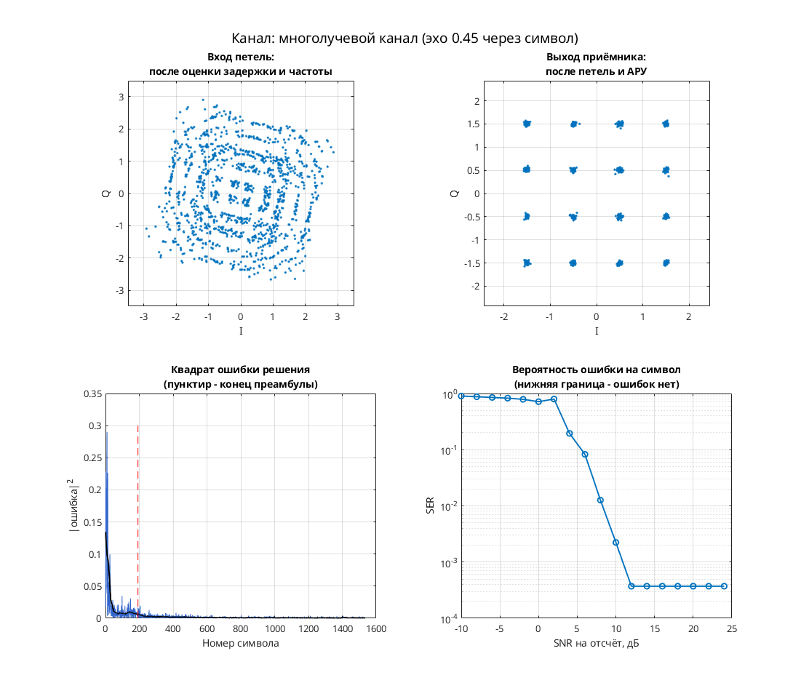
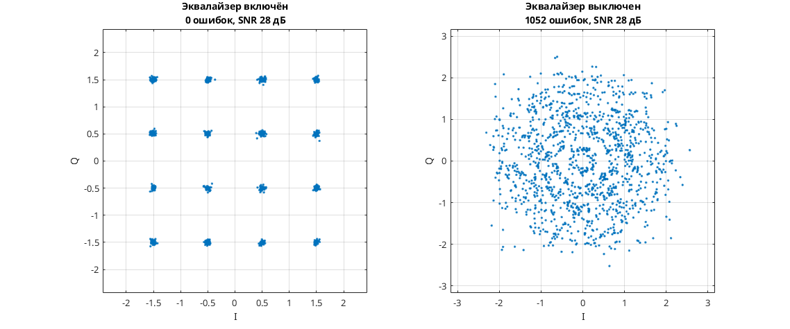

# 16-QAM: синхронизация, АРУ и эквалайзер с обратной связью по решениям

Модель Simulink демонстрирует приём 16-QAM с переменной задержкой канала и адаптивной эквализацией. Передатчик: скремблер → дифференциальное кодирование квадрантов → отображение 16-QAM → повышение частоты → RRC-фильтр. Канал: `channel_delay`, фазовая/частотная расстройка и AWGN. Приёмник: RRC-фильтр → Фарроу и тактовая петля → линейный LMS-фильтр при 2 отсчётах на символ → DFE на символьной частоте → фазовая петля, АРУ и декодирование.

В схеме есть детекторы Гарднера и Мюллера—Мюллера, слепой детектор Годара и ошибка по решениям. Это вариант с двумя адаптивными фильтрами, в отличие от модели с одним линейным эквалайзером от 21.07.2007.

Параметры: 8 отсчётов на символ в тракте; I, Q ∈ {−1.5, −0.5, 0.5, 1.5}; RRC-фильтры порядка 32, коэффициент скругления 1. Буферы линейного фильтра и DFE содержат соответственно 64 и 8 отсчётов.

## Запуск

В MATLAB перейдите в эту папку:

```matlab
run_demo
% С явным временем окончания:
run_demo(2048)
```

N в `run_demo(N)` — время окончания в единицах модельного времени, а не число символов. Без аргумента используется `16384`.

Проверено в MATLAB R2020b: исходный `verification.json` фиксирует успешную симуляцию и точный повтор до времени 2048. Полная функциональная проверка приёмника не установлена.

Нужны MATLAB, Simulink, Communications Toolbox (AWGN, расстройка, скремблер, созвездие), DSP System Toolbox (буферы, задержки, RRC и векторные осциллографы), Signal Processing Toolbox (`firrcos` при расчёте RRC в `dspddes3`).

## Что смотреть

- Автоматически открывается `Discrete-Time Scatter Plot Scope1`: выход приёмника после эквализации; смотрите 16 групп точек и остаточный разброс.
- Автоматически открываются `Filter Taps`, `Filter Taps1` — действительная и мнимая части коэффициентов линейного фильтра; `Filter Taps2`, `Filter Taps3` — коэффициентов DFE. Смотрите изменение весов по мере адаптации.
- Вручную: `Scope1` — два выхода тактового NCO; `Scope4` — I/Q выходных символов; `Scope5` — декодированные метки. Нулевая ошибка декодирования этими окнами не подтверждается.

## Изменения относительно оригинала

По `matlab/migration.json` исходного проекта одна ссылка `commchan2/` заменена на `commchan3/`. В `verification.json` дополнительных изменений во время запуска нет. Эквивалентность историческому AWGN-блоку не доказана.


## Собственная реализация (run_own)

Помимо оригинальной схемы, в папке есть **наша собственная реализация этого модема на MATLAB**. Это не перевод схемы блок за блоком: передатчик, канал и приёмник с теми же параметрами написаны заново кодом, без тулбоксов. Общий код лежит в [common/](../../common/), параметры модема — в [config.json](config.json).

```matlab
run_own                              % демонстрация с графиками
run_own(struct('snr_db', 12))        % свой SNR на отсчёт, дБ
r = run_own(struct('plot', false))   % только числа, без графиков
```

| Узел | Реализация |
| --- | --- |
| Модуляция | QAM, 16 позиций |
| Отсчётов на символ | 8 |
| Формирующий фильтр | корень из приподнятого косинуса, порядок 32, скругление 1 |
| Кодирование | дифференциальное по квадрантам |
| Символьная синхронизация | петля Гарднера с кубическим интерполятором Фарроу |
| Фазовая синхронизация | ФАПЧ второго порядка (фаза и частота), плюс АРУ |
| Эквалайзер | DFE: 7 прямых и 3 обратных отвода, NLMS |

Модель канала: ослабление 0,65, фазовый сдвиг 0,38 рад, сдвиг частоты 1,5·10⁻⁴ от частоты дискретизации, дробная задержка 2,25 отсчёта и белый шум. Сценарий для этого модема: **многолучевой канал (эхо 0.45 через символ)**. Первые 192 символа кадра служат известной преамбулой. По ней оцениваются задержка, частота и начальная фаза, обучается эквалайзер. Дальше приёмник работает в режиме решений.

Результат в MATLAB R2020b: при SNR 28 дБ — 0 ошибок на 1344 символах, оценка задержки 3.25 отсчёта, частоты 1.56e-04. Ошибок нет начиная с SNR 12 дБ на отсчёт. Время работы около 3 с.



**Сравнение** (второе окно): узел «Эквалайзер» включён — 0 ошибок, выключен — 1052 ошибок на 1344 символах.



Отличия от оригинальной схемы. В оригинале синхронизация слепая, а у нас приёмник опирается на преамбулу. Скремблер, точные коэффициенты петель оригинала и фиксированная точка не воспроизводятся. Поэтому цифры выше относятся к нашей реализации, а не к схеме автора. Тот же алгоритм у нас есть ещё на Python и SystemVerilog. Версии на Python и MATLAB/Octave совпадают между собой с точностью до 10⁻⁷ (перекрёстный тест), поведенческая модель на SystemVerilog проверена UVM-тестами.

## Автор и источник

Александр Петров; поле Description: `Petrov Sasha, ux@yandex.ru, 2007.07.26`.

Источник: [сообщение petrov на ELECTRONIX](https://electronix.ru/forum/topic/23652-model-8psk-modema/#comment-277091), архив `qam_fb_symbol_sync_fb_phase_sync_agc_dfe_2007_07_26.rar`; URL взят из локального каталога источников.

Лицензия автором не указана; модель публикуется с указанием авторства в учебных целях; по просьбе автора будет удалена.
