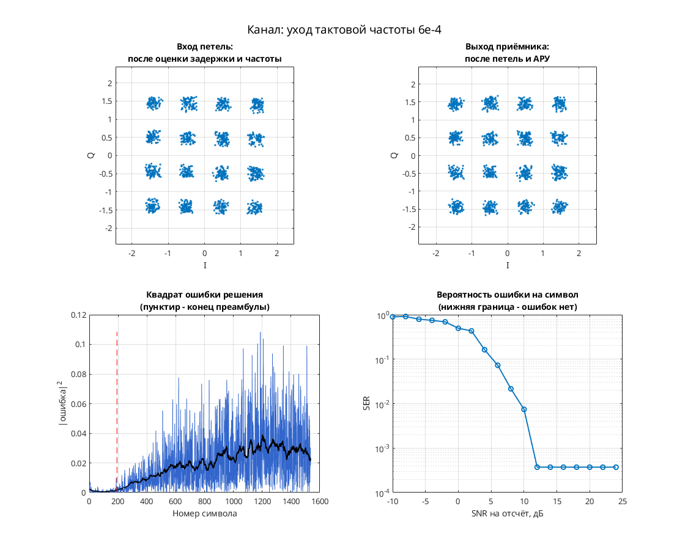
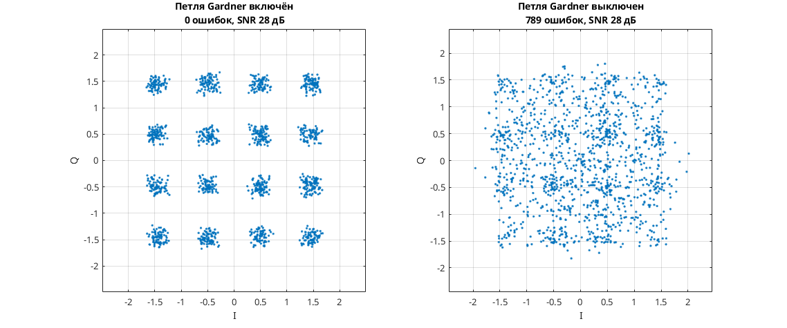

# 16-QAM: слежение за переменной задержкой канала

Модель Simulink демонстрирует тактовую и фазовую синхронизацию 16-QAM при плавно меняющейся задержке. Передатчик: скремблер → дифференциальное кодирование квадрантов → 16-QAM → повышение частоты в 8 раз → RRC. Канал: `channel_delay` с синусоидальным изменением задержки и интерполяцией Фарроу → фазовая/частотная расстройка → AWGN. Приёмник: RRC → коррекция фазы и усиления → Фарроу → тактовая петля Гарднера → решения и декодирование. Эквалайзера нет.

Параметры: 8 отсчётов на символ; I, Q ∈ {−1.5, −0.5, 0.5, 1.5}; RRC порядка 32 с коэффициентом скругления 1. Узел `two_sps_clock_domain` формирует промежуточные отсчёты для тактового детектора; решения принимаются на символьной частоте. Авторская аннотация канала указывает диапазон изменения задержки 0…32 отсчёта с дополнительной задержкой интерполятора.

## Запуск

Перейдите в эту папку из MATLAB:

```matlab
run_demo
% С явным временем окончания:
run_demo(2048)
```

N в `run_demo(N)` — время окончания в единицах модельного времени, а не число символов. Без аргумента используется `16384`.

Проверено в MATLAB R2020b: исходный отчёт подтверждает симуляцию и точный повтор до времени 2048. Полная проверка правильности приёма не выполнена.

Нужны MATLAB, Simulink, Communications Toolbox (канал, расстройка, скремблер, Scatter Plot), DSP System Toolbox (буферизация, задержки, изменение частоты, RRC), Signal Processing Toolbox (`firrcos` в RRC-библиотеке `dspddes3`).

## Что смотреть

- Автоматически открывается `Discrete-Time Scatter Plot Scope1`: 16-QAM после приёмника; смотрите расположение и разброс 16 групп при изменении задержки.
- Вручную откройте `Scope1`: выходы тактового NCO, по которым видно работу восстановления тактов.
- `Scope4` показывает I/Q выходных символов, `Scope5` — декодированные метки. Эти окна не измеряют BER.

## Изменения относительно оригинала

Согласно `matlab/migration.json` исходного проекта, одна ссылка AWGN Channel заменена с `commchan2/` на `commchan3/`. В `verification.json` дополнительных исправлений при запуске нет. Совпадение поведения со старой библиотекой не установлено.


## Собственная реализация (run_own)

Помимо оригинальной схемы, в папке есть **наша собственная реализация этого модема на MATLAB**. Это не перевод схемы блок за блоком: передатчик, канал и приёмник с теми же параметрами написаны заново кодом, без тулбоксов. Общий код лежит в [common/](../../common/), параметры модема — в [config.json](config.json).

```matlab
run_own                              % демонстрация с графиками
run_own(struct('snr_db', 12))        % свой SNR на отсчёт, дБ
r = run_own(struct('plot', false))   % только числа, без графиков
```

| Узел | Реализация |
| --- | --- |
| Модуляция | QAM, 16 позиций |
| Отсчётов на символ | 8 |
| Формирующий фильтр | корень из приподнятого косинуса, порядок 32, скругление 1 |
| Кодирование | дифференциальное по квадрантам |
| Символьная синхронизация | петля Гарднера с кубическим интерполятором Фарроу |
| Фазовая синхронизация | ФАПЧ второго порядка (фаза и частота), плюс АРУ |
| Эквалайзер | нет |

Модель канала: ослабление 0,65, фазовый сдвиг 0,38 рад, сдвиг частоты 1,5·10⁻⁴ от частоты дискретизации, дробная задержка 2,25 отсчёта и белый шум. Сценарий для этого модема: **уход тактовой частоты 6e-4**. Первые 192 символа кадра служат известной преамбулой. По ней оцениваются задержка, частота и начальная фаза, обучается эквалайзер. Дальше приёмник работает в режиме решений.

Результат в MATLAB R2020b: при SNR 28 дБ — 0 ошибок на 1344 символах, оценка задержки 2.75 отсчёта, частоты 1.51e-04. Ошибок нет начиная с SNR 12 дБ на отсчёт. Время работы около 1 с.



**Сравнение** (второе окно): узел «Петля Gardner» включён — 0 ошибок, выключен — 789 ошибок на 1344 символах.



Отличия от оригинальной схемы. В оригинале синхронизация слепая, а у нас приёмник опирается на преамбулу. Скремблер, точные коэффициенты петель оригинала и фиксированная точка не воспроизводятся. Поэтому цифры выше относятся к нашей реализации, а не к схеме автора. Тот же алгоритм у нас есть ещё на Python и SystemVerilog. Версии на Python и MATLAB/Octave совпадают между собой с точностью до 10⁻⁷ (перекрёстный тест), поведенческая модель на SystemVerilog проверена UVM-тестами.

## Автор и источник

Александр Петров; поле Description: `Petrov Sasha, ux@yandex.ru, 2007.07.10`.

Источник: [сообщение petrov на ELECTRONIX](https://electronix.ru/forum/topic/23652-model-8psk-modema/#comment-273730), архив `qam_fb_symbol_sync_fb_phase_sync_agc_var_ch_delay_2007_07_10.rar`; URL установлен по локальному каталогу источников.

Лицензия автором не указана; модель публикуется с указанием авторства в учебных целях; по просьбе автора будет удалена.
