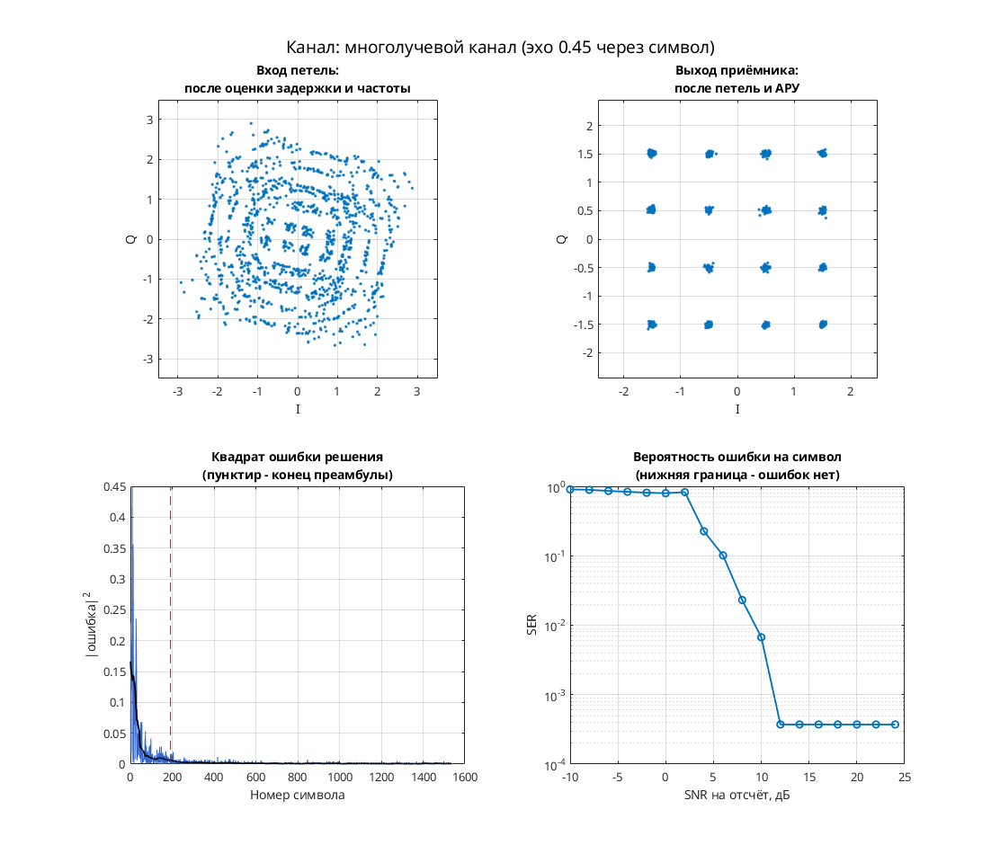
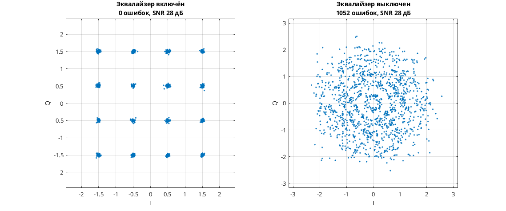

# 16-QAM: переменная задержка и адаптивный линейный эквалайзер

Модель Simulink дополняет тракт синхронизации 16-QAM адаптивным линейным эквалайзером. Передатчик: скремблер → дифференциальное кодирование квадрантов → 16-QAM → повышение частоты → RRC-фильтр. Канал: синусоидально меняющаяся задержка `channel_delay`, фазовая/частотная расстройка и AWGN. Приёмник: RRC → коррекция фазы, АРУ и Фарроу → линейный LMS-фильтр при 2 отсчётах на символ → символьные решения и декодирование.

Для тактовой петли есть детектор Гарднера; для адаптации эквалайзера — слепая ошибка Годара и ошибка по решениям с переключением. В отличие от варианта DFE от 26.07.2007, отдельного фильтра обратной связи по решениям здесь нет.

Параметры: 8 отсчётов на символ в тракте; I, Q ∈ {−1.5, −0.5, 0.5, 1.5}; RRC порядка 32, коэффициент скругления 1; буфер LMS-фильтра — 64 отсчёта.

## Запуск

В MATLAB перейдите в эту папку:

```matlab
run_demo
% С явным временем окончания:
run_demo(2048)
```

N в `run_demo(N)` — время окончания в единицах модельного времени, а не число символов. Без аргумента используется `16384`.

Проверено в MATLAB R2020b: в исходном `verification.json` симуляция и точный повтор до времени 2048 успешны. Полная функциональная корректность приёмника не установлена.

Нужны MATLAB, Simulink, Communications Toolbox (канал, расстройка, скремблер и созвездие), DSP System Toolbox (RRC, буферы, задержки и Vector Scope), Signal Processing Toolbox (расчёт RRC через `firrcos` в `dspddes3`).

## Что смотреть

- Автоматически открывается `Discrete-Time Scatter Plot Scope1`: символы после эквалайзера; смотрите формирование 16 групп.
- `Filter Taps` и `Filter Taps1` открываются автоматически и показывают действительную и мнимую части коэффициентов линейного эквалайзера.
- `Scope5` сохранён открытым: декодированные метки. Вручную откройте `Scope1` для выходов тактового NCO и `Scope4` для I/Q символов. Счётчика BER здесь нет.

## Изменения относительно оригинала

По `matlab/migration.json` исходного проекта одна ссылка `commchan2/` заменена на `commchan3/`. Дополнительных изменений при запуске в `verification.json` нет. Замена библиотеки не доказывает эквивалентность исторической версии.


## Собственная реализация (run_own)

Помимо оригинальной схемы, в папке есть **наша собственная реализация этого модема на MATLAB/Octave и Python**. Это не перевод схемы блок за блоком: передатчик, канал и приёмник с теми же параметрами написаны заново кодом, без тулбоксов. Общий код лежит в [common/](../../common/) (Python — в [common/python/](../../common/python/)), параметры модема — в [config.json](config.json).

MATLAB или GNU Octave (один и тот же код):

```matlab
run_own                              % демонстрация с графиками
run_own(struct('snr_db', 12))        % свой SNR на отсчёт, дБ
r = run_own(struct('plot', false))   % только числа, без графиков
```

Python (нужны NumPy и Matplotlib):

```bash
python run_own.py                    # демонстрация с графиками
python run_own.py --snr 12           # свой SNR на отсчёт, дБ
python run_own.py --no-plot --json   # только числа
```

| Узел | Реализация |
| --- | --- |
| Модуляция | QAM, 16 позиций |
| Отсчётов на символ | 8 |
| Формирующий фильтр | корень из приподнятого косинуса, порядок 32, скругление 1 |
| Кодирование | дифференциальное по квадрантам |
| Символьная синхронизация | петля Гарднера с кубическим интерполятором Фарроу |
| Фазовая синхронизация | ФАПЧ второго порядка (фаза и частота), плюс АРУ |
| Эквалайзер | линейный адаптивный NLMS, 7 отводов |

Модель канала: ослабление 0,65, фазовый сдвиг 0,38 рад, сдвиг частоты 1,5·10⁻⁴ от частоты дискретизации, дробная задержка 2,25 отсчёта и белый шум. Сценарий для этого модема: **многолучевой канал (эхо 0.45 через символ)**. Первые 192 символа кадра служат известной преамбулой. По ней оцениваются задержка, частота и начальная фаза, обучается эквалайзер. Дальше приёмник работает в режиме решений.

Результат в MATLAB R2020b: при SNR 28 дБ — 0 ошибок на 1344 символах, оценка задержки 3.25 отсчёта, частоты 1.56e-04. Ошибок нет начиная с SNR 12 дБ на отсчёт. Время работы около 1 с.



**Сравнение** (второе окно): узел «Эквалайзер» включён — 0 ошибок, выключен — 1052 ошибок на 1344 символах.



Отличия от оригинальной схемы. В оригинале синхронизация слепая, а у нас приёмник опирается на преамбулу. Скремблер, точные коэффициенты петель оригинала и фиксированная точка не воспроизводятся. Поэтому цифры выше относятся к нашей реализации, а не к схеме автора. Версии на MATLAB/Octave и Python реализуют один и тот же алгоритм. На одном и том же входном сигнале они дают одинаковые символы с точностью около 10⁻¹⁴ (перекрёстный тест `cross_check`, см. корневой README). Графики выше построены в MATLAB. Python строит такие же, но шум генерируется по-другому, поэтому число ошибок в отдельных точках может немного отличаться.

## Автор и источник

Александр Петров; поле Description: `Petrov Sasha, ux@yandex.ru, 2007.07.21`.

Источник: [сообщение petrov на ELECTRONIX](https://electronix.ru/forum/topic/23652-model-8psk-modema/#comment-275790), архив `qam_fb_symbol_sync_fb_phase_sync_agc_var_ch_delay_eq_2007_07_21.rar`; URL взят из локального каталога источников.

Лицензия автором не указана; модель публикуется с указанием авторства в учебных целях; по просьбе автора будет удалена.
