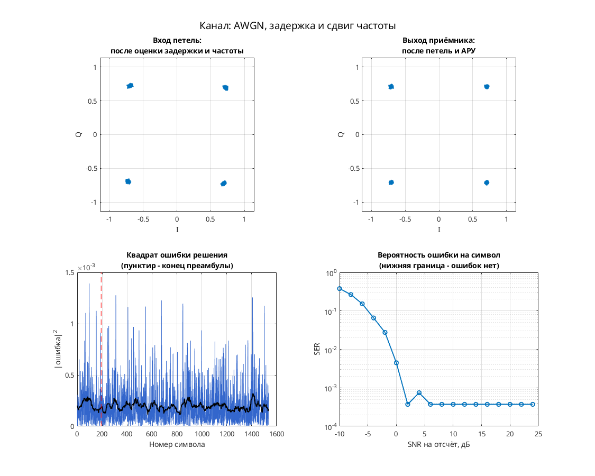

# QPSK: синхронизация с обратной связью при 8 отсчётах на символ

Модель Simulink демонстрирует восстановление тактов, фазы и усиления QPSK при меняющейся задержке. Передатчик: скремблер → код Грея и дифференциальное кодирование → QPSK → повышение частоты в 8 раз → RRC. Канал: `channel_delay` с интерполятором Фарроу пятого порядка → фазовая/частотная расстройка → AWGN. Приёмник: RRC, коррекция фазы и усиления, параболические интерполяторы Фарроу, детектор Гарднера, петлевые фильтры, решения и декодирование.

Параметры: 8 отсчётов на символ; передающее созвездие — четыре единичные точки под углами π/4 + k·π/2. Таблица передатчика содержит восемь фаз, но при `Constant2 = 0*1` и удвоении QPSK-индекса используется четырёхточечный набор. Решающее устройство приёмника использует уровни I/Q ±0.5. Эквалайзера нет.

## Запуск

В MATLAB перейдите в эту папку:

```matlab
run_demo
% С явным временем окончания:
run_demo(2048)
```

N в `run_demo(N)` — время окончания в единицах модельного времени, а не число символов. Без аргумента используется `16384`.

Проверено в MATLAB R2020b: отдельный отчёт исходного проекта `build/research_review/qpsk_8_sps_fb_sync_2020_11_25/result.json` фиксирует успешные загрузку, компиляцию, симуляцию и точный повтор до времени 2048. Полная правильность декодирования этим не установлена.

Нужны MATLAB, Simulink, Communications Toolbox (AWGN, расстройка, Constellation Diagram), DSP System Toolbox (RRC через Digital Filter Design, буферы, изменение частоты, Spectrum Analyzer), Signal Processing Toolbox (фильтровые объекты Digital Filter Design).

## Что смотреть

- `Discrete-Time Scatter Plot Scope` сохранён видимым: символьные отсчёты приёмника; смотрите четыре группы около I/Q ±0.5.
- `Discrete-Time Signal Trajectory Scope` сохранён видимым: траектория переданного сигнала после усиления.
- `Spectrum Scope` показывает спектр сигнала после AWGN.
- `symbol_clock` — два выхода тактового NCO; `phase_sync` — комплексный сигнал фазовой коррекции; `data` — декодированные метки. Эти окна сохранены видимыми; для `data` также включено открытие при старте.
- Обычный `Scope` можно открыть вручную: I/Q сигнала после AWGN.

## Изменения относительно оригинала

Файл модели побайтно совпадает с оригиналом из исследовательской подборки. Отдельных `matlab/migration.json` и `matlab/verification.json` для этой модели в исходном проекте нет; успешный запуск зафиксирован отдельным отчётом выше. Совместимость не следует выводить только из раннего `REPORT.txt`, где запуск ещё не проводился.


## Собственная реализация (run_own)

Помимо оригинальной схемы, в папке есть **наша собственная реализация этого модема на MATLAB/Octave и Python**. Это не перевод схемы блок за блоком: передатчик, канал и приёмник с теми же параметрами написаны заново кодом, без тулбоксов. Общий код лежит в [common/](../../common/) (Python — в [common/python/](../../common/python/)), параметры модема — в [config.json](config.json).

MATLAB или GNU Octave (один и тот же код):

```matlab
run_own                              % демонстрация с графиками
run_own(struct('snr_db', 12))        % свой SNR на отсчёт, дБ
r = run_own(struct('plot', false))   % только числа, без графиков
```

Python (нужны NumPy и Matplotlib):

```bash
python run_own.py                    # демонстрация с графиками
python run_own.py --snr 12           # свой SNR на отсчёт, дБ
python run_own.py --no-plot --json   # только числа
```

| Узел | Реализация |
| --- | --- |
| Модуляция | PSK, 4 позиций |
| Отсчётов на символ | 8 |
| Формирующий фильтр | корень из приподнятого косинуса, порядок 32, скругление 1 |
| Кодирование | нет |
| Символьная синхронизация | петля Гарднера с кубическим интерполятором Фарроу |
| Фазовая синхронизация | петля Костаса, плюс АРУ |
| Эквалайзер | нет |

Модель канала: ослабление 0,65, фазовый сдвиг 0,38 рад, сдвиг частоты 1,5·10⁻⁴ от частоты дискретизации, дробная задержка 2,25 отсчёта и белый шум. Сценарий для этого модема: **AWGN, задержка и сдвиг частоты**. Первые 192 символа кадра служат известной преамбулой. По ней оцениваются задержка, частота и начальная фаза, обучается эквалайзер. Дальше приёмник работает в режиме решений.

Результат в MATLAB R2020b: при SNR 28 дБ — 0 ошибок на 1344 символах, оценка задержки 2.25 отсчёта, частоты 1.51e-04. Ошибок нет начиная с SNR 6 дБ на отсчёт. Время работы около 1 с.



Отличия от оригинальной схемы. В оригинале синхронизация слепая, а у нас приёмник опирается на преамбулу. Скремблер, точные коэффициенты петель оригинала и фиксированная точка не воспроизводятся. Поэтому цифры выше относятся к нашей реализации, а не к схеме автора. Версии на MATLAB/Octave и Python реализуют один и тот же алгоритм. На одном и том же входном сигнале они дают одинаковые символы с точностью около 10⁻¹⁴ (перекрёстный тест `cross_check`, см. корневой README). Графики выше построены в MATLAB. Python строит такие же, но шум генерируется по-другому, поэтому число ошибок в отдельных точках может немного отличаться.

## Автор и источник

Александр Петров; поле Description: `Petrov Alexander, ux@yandex.ru, 2020.11.25`.

Источник: [сообщение на ELECTRONIX](https://electronix.ru/forum/topic/23652-model-8psk-modema/page/13/#comment-1723985), [авторская ссылка на архив](https://yadi.sk/d/W0pylxJZBTnvFg). Ссылки сохранены в локальном `findings.json`.

Лицензия автором не указана; модель публикуется с указанием авторства в учебных целях; по просьбе автора будет удалена.
