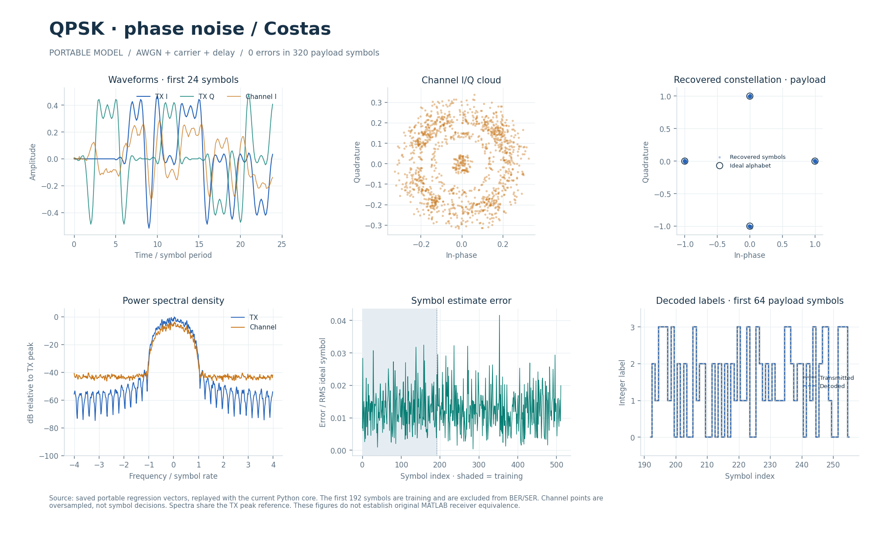
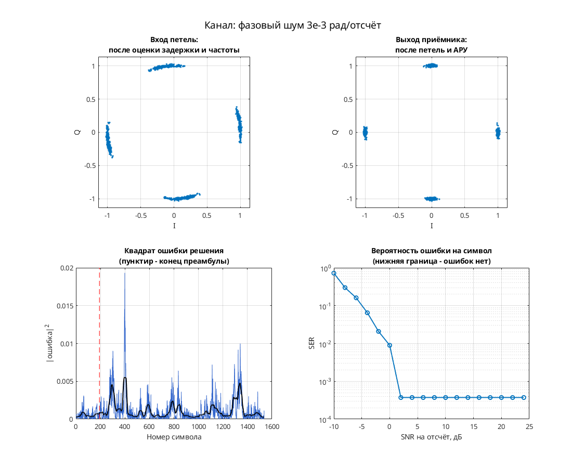

# QPSK-демодулятор с фазовым шумом и петлёй Костаса

Модель QPSK-приёмника с фазовым шумом, тактовой коррекцией и сопровождением несущей. Переносимая реализация дополнена передатчиком и каналом для воспроизводимых проверок.

## Что это

Исторический прототип — Simulink-модель `costas_loop_qpsk_complex_realization.mdl`. Текущий тракт передаёт метки QPSK без дифференциального кодирования и оценивает начальные параметры по преамбуле. Реализации Python и Octave/MATLAB выполняют обработку кадра с вещественной арифметикой; SystemVerilog предоставляет поведенческую модель и UVM-окружение. Отдельные синтезируемые TX/RX используют fixed-point-арифметику общего ядра.

При проверке этого README прошли семь тестов Python, Octave-проверка кодера и передачи без шума, а также демонстрации обоих языков с нулевым SER. Это проверки текущего переносимого тракта; полная эквивалентность историческому приёмнику не установлена.

Историческая модель `costas_loop_qpsk_complex_realization.mdl` в публичный репозиторий не входит. Её размер — **76010 байт**; размер, происхождение и SHA-256 сохранены в [инвентаризации архивов](../../docs/archive_inventory.json). Поля `source` и `source_sha256` в [config.json](config.json) идентифицируют исходник. [source_parameters.json](source_parameters.json) содержит извлечённые поля блоков и `source_line` — номера строк исторического MDL, а не полный манифест исходника; отдельного `model.json` здесь нет.

В [сохранённой MATLAB-проверке](matlab/verification.json) указаны `runtime_status=PASS` и `repeat_status=PASS`: подготовленная схема исполнилась и точно повторила записанные отсчёты. Mapper проверен на всех метках алфавита, максимальная ошибка — 0.0. `receiver_functional_status` и `full_equivalence` имеют значение `NOT_ESTABLISHED`. [Список адаптаций](matlab/migration.json) отделяет изменения совместимости от исторического исходника.

## Как работает

1. **TX:** входные целые метки `0…3` → без дифференциального кодирования → комплексное созвездие → вставка нулей до 8 отсчётов на символ → RRC-фильтр. Возвращается полный хвост FIR: для `N` символов получается `8*N+32` отсчёта.
2. **Канал:** кубическая дробная задержка, усиление, фазовый и частотный сдвиг, AWGN. В общем API также предусмотрены дрейф дискретизации и фазовый шум; сценарии выбирают параметры явно.
3. **Захват RX:** согласованный RRC → перебор задержки от 0 до 16 отсчётов с шагом 0.25 → четырёхточечная кубическая интерполяция Лагранжа. Для каждого кандидата разворачивается фаза отношения принятых и известных обучающих символов; линейная регрессия оценивает частоту, комплексная корреляция — фазу и усиление. Выбирается минимальная средняя квадратичная ошибка по преамбуле.
4. **Сопровождение:** ограниченная коррекция Gardner по ранней, средней и поздней выборкам; петля второго порядка по решениям с коррекцией фазы и частоты. АРУ корректирует усиление по ошибке относительно обучающего символа, затем относительно решения.
5. **Решение:** ближайшая точка по квадрату комплексного расстояния → выходная целая метка. Полезная нагрузка не используется для оценки истинного канала.

`s=constellation[u]`: входная метка непосредственно выбирает точку таблицы. Дополнительного фазового накопления и дифференциального декодирования нет. Для начальной оценки `angle(y[k]/s[k]) ≈ phase+slope*k`, поэтому возвращаемая частота равна `slope/(2*pi*sps)` в циклах на отсчёт.

Параметры переносимого тракта из [config.json](config.json):

| Параметр | Значение |
| --- | --- |
| `family`, `order` | `psk`, `4` |
| Входная метка | 2 бита, значения `0…3` |
| `constellation` | `1`, `j`, `-1`, `-j` |
| `differential` | `none` |
| `sps` | `8` |
| `rrc_order`, `rolloff` | `32` (33 отвода), `1.0`; энергия импульса нормирована к 1 |
| `timing`, `carrier` | `gardner`, `costas` |
| `equalizer`, `diversity_branches` | `none`, `1` |
| `variable_delay`, `phase_noise` | `false`, `true` |

`receive(cfg, waveform, preamble, count)` требует известные длину кадра и его грубую границу; минимальная преамбула — 32 метки. Демонстрация использует 768 символов, из них первые 192 — обучение, оставшиеся 576 — полезная нагрузка. Общие межъязыковые векторы содержат 512 символов, включая ту же преамбулу из 192.

Фазовый шум канала реализован как `phi[n]=phi[n-1]+Normal(0, phase_noise)`, где параметр задаёт стандартное отклонение приращения в радианах на отсчёт. Дополнительные Python-проверки используют `phase_noise=0.0003`, а на кадре 1536 символов — `0.005`; отключение слежения за несущей в последнем тесте должно привести к ошибкам. Обычный демонстрационный запуск этот шум не включает.

**Потоковый fixed-point RTL.** Используются [bpsk_tx.sv](../../rtl/modems/bpsk_costas_2008_08_25/bpsk_tx.sv) и [bpsk_rx.sv](../../rtl/modems/bpsk_costas_2008_08_25/bpsk_rx.sv). Профиль целочисленного эталона — `QPSK_AXIS` в [psk_fixed.py](../../common/python/psk_fixed.py). Параметры TX: `ORDER=4, TX_AXIS=1`; RX: `ORDER=4`. Метки двухбитные, без дифференциального кодирования; TX ставит единичные точки на оси. RX использует обычный профиль QPSK: захват поглощает поворот 45°, далее работают обратная связь несущей, АРУ и тактовая коррекция early-late.

Это поток с рукопожатием `valid && ready` и признаком конца кадра, без упаковки в стандартные порты AXI-Stream:

| Интерфейс / формат | Назначение |
| --- | --- |
| `clk`, `rst`, `RESET_ACTIVE` | Тактовый сигнал и синхронный сброс; параметр выбирает активный уровень |
| TX: `s_valid/s_ready`, `s_bit`, `s_last` | Метки входного кадра |
| TX: `m_valid/m_ready`, `m_re/m_im`, `m_last` | Комплексные отсчёты с хвостом фильтра |
| RX: `cfg_valid/cfg_ready`, `cfg_bit`, `cfg_last`, `cfg_count` | 192 обучающие метки; `cfg_count=192…2048` задаёт число символов кадра |
| RX: `cfg_enable` | Разрешение загрузки конфигурации; для самостоятельного ядра подключается к `1'b1` |
| RX: `s_valid/s_ready`, `s_re/s_im`, `s_last` | От `8*N` до `8*N+64` комплексных отсчётов |
| RX: `m_valid/m_ready`, `m_bit`, `m_index`, `m_re/m_im`, `m_last` | Декодированная метка, индекс точки, восстановленные I/Q и конец кадра |
| `m_phase`, `m_frequency`, `m_gain`, `m_correction` | Применённые состояния сопровождения |
| I/Q | Знаковые 18 бит, 15 дробных; диапазон `-4…4-2^-15` |
| RRC / интерполяция | Коэффициенты 18/17 / 18/16; позиция интерполяции 24/8. Запись означает общее число бит / число дробных бит |
| Фаза / частота | 32 бита; полный оборот равен `2^32` |
| Усиление | Беззнаковое 25/20 |
| Округление | К ближайшему чётному, затем насыщение |

Латентности RRC, интерполятора и ротатора — 8, 7 и 7 разрешённых тактов; интервал запуска каждого блока — один такт. Захват этого профиля имеет `A=669` тактов от принятого `start` до наблюдения `done` родителем. Это не полная задержка RX: она зависит от наполнения буферов, длины кадра и остановок выхода. После конца входного кадра RX выполняет 32 такта дополнения FIR нулями с `s_ready=0`. Неверная длина или конфигурация устанавливает `error`; сброс отменяет незавершённые кадры и требует загрузить преамбулу заново.

Подробнее о захвате, остановках по ready, форматах, сбросе, латентностях и физической приёмке: [описание RTL](../../docs/BPSK_RTL.md#qpsk-order4).

### Историческая схема

Модель Simulink демонстрирует фазовую синхронизацию QPSK. Передатчик внутри `source`: случайные метки 0…3 → M-PSK Modulator Baseband → корневой приподнятый косинус. Канал: AWGN и Phase Noise. Приёмник: комплексное умножение на NCO → арктангенсный фазовый детектор `atan detector` → `loop filter` с обратной связью → RRC-фильтр → прореживание → M-PSK Demodulator Baseband. Есть Find Delay и Error Rate Calculation.

Параметры: 24 отсчёта на символ; RRC с коэффициентом скругления 0.6 и параметром D = 6. В `PreLoadFcn` заданы `Fs = 30e6`, `Ts = 1/Fs`, `SNR = 75`; Ts используется генератором меток. Передатчик: M = 4, Ph = 0, точки {1, i, −1, −i}; демодулятор: Ph = π/2. Phase Noise: PhNs = −70, Fo = 100. Отдельных тактовой петли, АРУ и эквалайзера в модели нет.

### Собственная реализация (run_own)

Автономная реализация на MATLAB/Octave и Python читает существующий [config.json](config.json) и работает без тулбоксов и исторических файлов, в том числе в публичной копии. Общий код — [common/own/](../../common/own/) и [common/own/python/](../../common/own/python/). Передатчик, канал и приёмник написаны кодом; параметры переносимого профиля могут отличаться от исторической схемы.

| Узел | Реализация |
| --- | --- |
| Модуляция | PSK, 4 позиций |
| Отсчётов на символ | 8 |
| Формирующий фильтр | корень из приподнятого косинуса, порядок 32, скругление 1 |
| Кодирование | нет |
| Символьная синхронизация | петля Гарднера с кубическим интерполятором Фарроу |
| Фазовая синхронизация | петля Костаса, плюс АРУ |
| Эквалайзер | нет |

Модель канала: ослабление 0,65, фазовый сдвиг 0,38 рад, сдвиг частоты 1,5·10⁻⁴ от частоты дискретизации, дробная задержка 2,25 отсчёта и белый шум. Сценарий для этого модема: **фазовый шум 3e-3 рад/отсчёт**. Первые 192 символа кадра служат известной преамбулой. По ней оцениваются задержка, частота и начальная фаза, обучается эквалайзер, если он предусмотрен конфигурацией. Дальше приёмник работает в режиме решений.

## Структура каталога

| Файл / подкаталог | Назначение |
| --- | --- |
| [config.json](config.json) | Конфигурация переносимой модели, идентификатор и SHA-256 исходника |
| [source_parameters.json](source_parameters.json) | Извлечённые поля исторических блоков без вычисления MATLAB-выражений |
| [python/modem.py](python/modem.py) | `CONFIG`, `transmit`, `receive` и демонстрационный запуск через общий Python-код |
| [tests/test_modem.py](tests/test_modem.py) | Семь тестов общего `ModemContract` для этой конфигурации |
| [octave/run_modem.m](octave/run_modem.m), [octave/test_modem.m](octave/test_modem.m) | Демонстрация и проверка обычных M-функций в Octave/MATLAB |
| [sv/modem.sv](sv/modem.sv) | Обёртка общего поведенческого `modem_model` |
| [tb/testbench.sv](tb/testbench.sv), [tb/run.sh](tb/run.sh) | Подключение UVM-testbench и запуск из любого рабочего каталога |
| [matlab/test_original.m](matlab/test_original.m) | Отдельная проверка исторической схемы при наличии исходников |
| [matlab/migration.json](matlab/migration.json), [matlab/verification.json](matlab/verification.json) | Адаптации совместимости и сохранённые результаты MATLAB |
| [Общий код](../../common/) | DSP-ядра Python, Octave и поведенческого SV; изменения влияют на все модели |
| [Общее ядро RTL](../../rtl/modems/bpsk_costas_2008_08_25/) | Синтезируемые блоки TX/RX и таблицы fixed-point |

| Файл / подкаталог | Назначение |
| --- | --- |
| [run_demo.m](run_demo.m) | Запуск локальной исторической R2020b-модели из `matlab/` |
| [run_own.m](run_own.m), [run_own.py](run_own.py) | Автономная демонстрация MATLAB/Octave и Python через `common/own` |
| [images/](images/) | Сохранённые графики автономной реализации для README |

## Как запустить

Все команды ниже выполняются **из корня проекта**. Для Python требуется Python 3 и NumPy из [requirements.txt](../../requirements.txt). Для обычных M-функций нужен `octave-cli` либо MATLAB; запуск MDL/Simulink в Octave не поддерживается. Поведенческий UVM требует Questa с UVM 1.2 и системным C-компилятором; пути можно задать через `QUESTA_HOME`, `UVM_HOME`, компилятор — через `DPI_CC`. Для полного набора RTL также нужны Verilator и зависимости из [requirements-rtl.txt](../../requirements-rtl.txt).

Демонстрация Python и проверки переносимого контракта:

```bash
python3 modems/qpsk_demod_with_phase_noise/python/modem.py
python3 modems/qpsk_demod_with_phase_noise/tests/test_modem.py
```

Первая команда печатает JSON с SER и оценками синхронизации. Вторая проверяет кодирование всех пар меток, передачу без шума, два канала с шумом/сдвигами, повторяемость, неверный вход, отрицательный шумовой контроль и особенности конфигурации.

Независимая Octave-проверка и демонстрация:

```bash
octave-cli --quiet --eval "addpath('modems/qpsk_demod_with_phase_noise/octave'); test_modem; run_modem;"
```

Она печатает `PASS … Octave codec and waveform loopback` и JSON результата. M-функции этой реализации также совместимы с MATLAB. На машине, где проверялся README, демонстрация и семь Python-тестов вместе заняли менее 2 секунд, Octave-команда — менее секунды; это локальный ориентир.

Сравнение Octave с независимыми Python-векторами, включая канал с искажениями:

```bash
python3 tools/run_tests.py --suite cross --modem qpsk_demod_with_phase_noise
```

Поведенческая SystemVerilog-модель в настоящем UVM-окружении:

```bash
./tools/run_questa.sh --modem qpsk_demod_with_phase_noise
```

`tb/run.sh` вызывает тот же runner с именем этой модели и может запускаться из любого каталога. UVM отправляет три сценария канала и повторяет первый кадр после сброса; пассивный монитор снимает фактические выходы. Scoreboard сравнивает все TX-отсчёты, восстановленные символы, декодированные метки и оценки синхронизации с Python. Метки должны совпадать точно; допуски комплексных значений, задержки и частоты — `1e-7`, `1e-8` отсчёта и `1e-10` цикла/отсчёт. Затем runner вводит ошибку ожидания и требует численного отказа scoreboard. Комментарии к новому коду написаны по-русски, диагностические сообщения — по-английски.

Общая регрессия fixed-point-профилей, строгий lint и численные проверки RTL в Questa:

```bash
python3 tools/run_bpsk.py --suite all
```

Команда проверяет всё общее семейство, а не только этот каталог. Полный прогон включает Python-проверки и Verilator lint; он отличается от поведенческого UVM выше. Для полного UVM RX предусмотрен отдельный runner, описанный в [документации RTL](../../docs/BPSK_RTL.md#qpsk-order4).

Проверка **исторического оригинала** в MATLAB R2020b/Simulink, с необходимыми библиотеками Communications/DSP: требуются исторический MDL для обнаружения модели и подготовленная совместимая копия для исполнения. Наличие одной переносимой конфигурации или сохранённого JSON-отчёта недостаточно; в публичной поставке без этих исходников проверка недоступна. Скрипт-обёртка выбирает установку через `MATLAB_ROOT`.

```bash
./tools/matlab.sh -nodisplay -batch "addpath('modems/qpsk_demod_with_phase_noise/matlab'); test_original;"
```

Эта команда проверяет исполнение и точную повторяемость подготовленной схемы, не её полную эквивалентность переносимому приёмнику. Порядок совместимых адаптаций и пределы сравнения приведены в [MATLAB_MODEM_VERIFICATION.md](../../docs/MATLAB_MODEM_VERIFICATION.md).

### Быстрый старт в MATLAB

Перейдите в папку этого модема. [run_demo.m](run_demo.m) открывает подготовленную R2020b-копию `matlab/costas_loop_qpsk_complex_realization.mdl`:

```matlab
run_demo          % историческая схема и её осциллографы
run_demo(0.0014563555555555556)  % явное время окончания
```

По умолчанию время окончания — `0.0014563555555555556` в единицах модельного времени, не число символов. Нужны MATLAB R2020b, Simulink, Communications Toolbox и DSP System Toolbox (с их зависимостью Signal Processing Toolbox). Историческая модель не входит в публичный репозиторий, см. [THIRD_PARTY.md](../../THIRD_PARTY.md); без локальной копии `run_demo` выдаёт понятную ошибку. Автономный `run_own` работает и без неё.

MATLAB или GNU Octave (один и тот же код):

```matlab
run_own                              % демонстрация с графиками
run_own(struct('snr_db', 12))        % свой SNR на отсчёт, дБ
r = run_own(struct('plot', false))   % только числа, без графиков
```

Python (зависимости: [requirements.txt](../../requirements.txt) и, для графиков, [requirements-visual.txt](../../requirements-visual.txt)):

```bash
python3 run_own.py                    # демонстрация с графиками
python3 run_own.py --snr 12           # свой SNR на отсчёт, дБ
python3 run_own.py --no-plot --json   # только числа
```

Можно сохранить графики без окна: `python3 run_own.py --no-plot --save images/generated`. Для короткой проверки кривой задайте `--sweep -10 10 24`; без этой опции сохраняется исходная сетка SNR.

## Что смотреть

| Результат | Где находится и как читать |
| --- | --- |
| Демонстрация | JSON в stdout: `symbol_errors=0`, `ser=0` означают отсутствие ошибок на 576 полезных символах данного кадра |
| Python-тесты | Итог `Ran 7 tests` и `OK`; нарушение контракта даёт ненулевой код завершения |
| Межъязыковая проверка | `build/single/qpsk_demod_with_phase_noise/cross_results.json`, `logs/cross/octave.log` внутри этого же каталога; итог `status=PASS` |
| Общие векторы | `build/vectors/qpsk_demod_with_phase_noise/`: `config.txt`, `case_0.txt…case_2.txt`, `manifest.json` |
| Поведенческий UVM | `build/questa/single/qpsk_demod_with_phase_noise/results.json`, `qpsk_demod_with_phase_noise.log` и `qpsk_demod_with_phase_noise_negative.log` в том же каталоге |
| Fixed-point RTL | `build/rtl/bpsk/all_results.json`, `precision_results.json`, логи блоков и сценариев; ожидается `status=PASS` |
| Историческая MATLAB-проверка | `build/matlab_originals/compatible/qpsk_demod_with_phase_noise/`: `signals.mat`, `result.json`, журналы; создаются только при наличии исходников |

В положительном UVM-прогоне нужны `Checked 4 frames`, `UVM_ERROR : 0` и `UVM_FATAL : 0`. В отдельном отрицательном контроле ожидается `UVM_FATAL [NUMERIC]`; это подтверждает чувствительность проверки, а не успешную передачу испорченного кадра. В `results.json` статус хранится для каждой записи модели.

`SER = symbol_errors/payload_symbols` — доля ошибочных целых меток; BER считает различающиеся биты их двоичной записи. Обучающие 192 символа исключаются. В сохранённых визуальных сценариях полезная нагрузка равна 320 символам. `estimated_delay` измеряется в отсчётах, `estimated_frequency` — в циклах на отсчёт. SNR задаётся по средней мощности отсчётов, это не Eb/N0.

На графиках сравнивайте TX/RX I/Q, облако отсчётов канала, восстановленное созвездие и переданные/декодированные метки. Облако канала включает промежуточные отсчёты и не равно созвездию решений. Нормированная ошибка символа показывает отклонение комплексной оценки от идеальной точки, даже когда метка декодирована верно. В RTL-отчёте SQNR характеризует квантование отдельных узлов; `rail_values` считает значения на границах насыщения, а не доказанные переполнения.

Откройте [модель в интерактивном отчёте](../../docs/visual/index.html#section=explorer&model=qpsk_demod_with_phase_noise): можно переключать три переносимых сценария и запись MATLAB. Сохранены [графики MATLAB](../../docs/visual/matlab/qpsk_demod_with_phase_noise.png), [полный PDF-отчёт](../../docs/visual/modem_test_report.pdf) и [CSV метрик](../../docs/visual/summary.csv). Единицы, смысл графиков и пределы выводов описаны в [VISUAL_TESTS.md](../../docs/VISUAL_TESTS.md).



Численное исследование неоднозначности исходного QPSK-приёмника приведено в [MATLAB_MODEM_VERIFICATION.md](../../docs/MATLAB_MODEM_VERIFICATION.md). Сырой исторический счётчик и результат диагностического поворота следует читать раздельно.

Сохранённые графики можно просматривать без исторических исходников. Пересоздание MATLAB-записей требует исключённых материалов; повторная сборка полного визуального отчёта требует соответствующих захватов и свидетельств. Отчёты с хэшами относятся к своему снимку исходников: старый PASS не подтверждает автоматически изменённый код.

### Осциллографы исторической схемы

- Автоматически открываются `Receive` — созвездие после приёмного фильтра и прореживания, и `source/Ishodny signal` — контрольная диаграмма внутри источника. Смотрите положение четырёх групп и фазовое размытие.
- Вручную откройте `Error`: выход петлевого фильтра; `loop filter/Error` — внутренний контрольный сигнал фильтра. Это сигналы фазовой петли, а не графики BER.
- `Display` получает результат Find Delay; `Display1` — Error Rate Calculation. Расчёт ошибок ведётся по целочисленным символам, то есть это SER.

В исходной проверке счётчик показал 10910 ошибок из 10910 сравнений при задержке 13 символов. Обнаружен постоянный сдвиг меток на 3 по модулю 4; после отдельной коррекции на проверочной половине записи получено 0/5455 ошибок. Коррекция в эту модель не внесена: собранное созвездие не означает нулевой исходный SER.

### Графики run_own

Созвездия до и после петель, сходимость ошибки и SER(SNR); для MSK/GMSK — гистограмма набега фазы. При наличии сравнения второе окно показывает включённый и отключённый узел.

Сохранённый результат из MATLAB R2020b исходного проекта (не новый прогон): при SNR 28 дБ — 0 ошибок на 1344 символах, оценка задержки 2.25 отсчёта, частоты 1.45e-04. Ошибок нет начиная с SNR 2 дБ на отсчёт. Время работы около 1 с.



## Ограничения

- Исторические слепой захват, скремблеры, дескремблеры, внутренние CIC-ступени, исходные коэффициенты петель, многоскоростное расписание и начальные переходные процессы не воспроизведены. Общие RRC-параметры — переносимая база, а не утверждение о фильтрах всех оригиналов.
- Преамбула разрешает фазовую неоднозначность и задаёт начальную синхронизацию. Это приёмник кадра с известной грубой границей и длиной, не произвольный детектор пакетов.
- Сохранённая MATLAB-симуляция имеет неоднозначность квадранта: исходный счётчик выдаёт 10910 ошибок из 10910. Смещение меток на 3 по модулю 4 при задержке 13 символов объясняет результат; после диагностической коррекции на отложенной половине записи получено 0/5455. Коррекция не встроена в исторический приёмник, поэтому его сырой SER нельзя представлять как PASS декодирования.
- Поведенческий `sv/modem.sv` использует `real` и обрабатывает запрос кадра за один модельный такт. Он не синтезируем; его задержка не характеризует пропускную способность fixed-point RTL.
- Диапазон длины RX RTL — 192…2048 символов; обязательны хвост FIR, корректная конфигурация и соблюдение `valid/ready`. Остановка выхода может заполнить буферы и остановить вход; `acquisition_confidence` не является CRC или гарантией правильного захвата.
- Для общего ядра сохранены численные Questa-свидетельства от 2026-10-29. Физическая приёмка старых снимков на 100 МГц не распространяется на последующие изменения захвата и буферов; синтез и физический тайминг текущего варианта не подтверждены, запуска на плате нет. Статус и оговорки — в [описание RTL](../../docs/BPSK_RTL.md#qpsk-order4).
- Нулевой BER/SER на конечном наборе детерминированных кадров не задаёт границу захвата и не гарантирует долговременную помехоустойчивость. Полный контракт и проверенные диапазоны канала приведены в [PORTING_CONTRACT.md](../../docs/PORTING_CONTRACT.md).

### Автономная демонстрация

`run_own` использует известную преамбулу; исторические скремблеры, точные коэффициенты петель и фиксированная точка не воспроизводятся. Версии MATLAB/Octave и Python проверяются на одном входном сигнале через `own_cross_check` (см. [корневой README](../../README.md#быстрый-старт-в-matlab)). Сохранённые картинки построены в MATLAB; Python генерирует шум иначе, поэтому отдельные значения SER могут отличаться. Сохранённые результаты относятся к автономной реализации, а не к исторической схеме.
