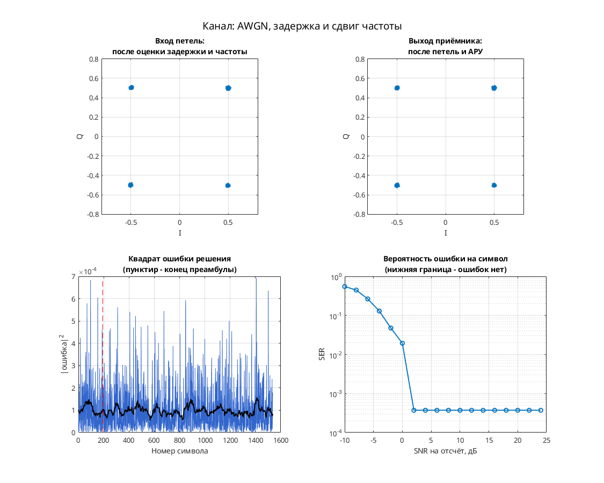

# QPSK: тактовая и фазовая синхронизация с обратной связью и АРУ

Модель Simulink демонстрирует слежение за задержкой, фазой и усилением QPSK. Передатчик: скремблер → дифференциальное кодирование → QPSK → повышение частоты в 8 раз → RRC. Канал: плавно меняющаяся задержка `channel_delay`, фазовая/частотная расстройка и AWGN. Приёмник: RRC → фазовая коррекция и АРУ → Фарроу → `two_sps_clock_domain` → детектор Гарднера, фазовый детектор по решениям и петлевые фильтры → декодирование.

Параметры: 8 отсчётов на символ; передающие точки 0.5+0.5i, −0.5+0.5i, −0.5−0.5i, 0.5−0.5i. RRC-фильтры порядка 32 с коэффициентом скругления 1. Тактовый детектор использует промежуточные отсчёты при 2 отсчётах на символ; решения — на символьной частоте. Эквалайзера нет.

## Запуск

В MATLAB перейдите в эту папку:

```matlab
run_demo
% С явным временем окончания:
run_demo(2048)
```

N в `run_demo(N)` — время окончания в единицах модельного времени, а не число символов. Без аргумента используется `16384`.

Проверено в MATLAB R2020b: исходный `verification.json` фиксирует успешную симуляцию и точный повтор до времени 2048. Полная корректность приёма не установлена.

Нужны MATLAB, Simulink, Communications Toolbox (скремблер, канал, расстройка и Scatter Plot), DSP System Toolbox (RRC, буферы, задержки и изменение частоты), Signal Processing Toolbox (`firrcos` для RRC в `dspddes3`).

## Что смотреть

- Автоматически открывается `Discrete-Time Scatter Plot Scope1`: выходные символы; смотрите четыре группы вблизи I/Q ±0.5.
- Вручную: `Scope1` — два выхода тактового NCO; `Scope4` — I/Q выходных символов; `Scope5` — декодированные метки.
- `signal_power(Watts)` показывает оценку мощности. Отдельного графика BER нет; собранное созвездие не подтверждает безошибочное декодирование.

## Изменения относительно оригинала

По `matlab/migration.json` исходного проекта одна ссылка `commchan2/` заменена на `commchan3/`. Дополнительных изменений при запуске в `verification.json` нет. Эквивалентность исторической версии AWGN-блока не установлена.


## Собственная реализация (run_own)

Помимо оригинальной схемы, в папке есть **наша собственная реализация этого модема на MATLAB/Octave и Python**. Это не перевод схемы блок за блоком: передатчик, канал и приёмник с теми же параметрами написаны заново кодом, без тулбоксов. Общий код лежит в [common/](../../common/) (Python — в [common/python/](../../common/python/)), параметры модема — в [config.json](config.json).

MATLAB или GNU Octave (один и тот же код):

```matlab
run_own                              % демонстрация с графиками
run_own(struct('snr_db', 12))        % свой SNR на отсчёт, дБ
r = run_own(struct('plot', false))   % только числа, без графиков
```

Python (нужны NumPy и Matplotlib):

```bash
python run_own.py                    # демонстрация с графиками
python run_own.py --snr 12           # свой SNR на отсчёт, дБ
python run_own.py --no-plot --json   # только числа
```

| Узел | Реализация |
| --- | --- |
| Модуляция | PSK, 4 позиций |
| Отсчётов на символ | 8 |
| Формирующий фильтр | корень из приподнятого косинуса, порядок 32, скругление 1 |
| Кодирование | дифференциальное фазовое |
| Символьная синхронизация | петля Гарднера с кубическим интерполятором Фарроу |
| Фазовая синхронизация | ФАПЧ второго порядка (фаза и частота), плюс АРУ |
| Эквалайзер | нет |

Модель канала: ослабление 0,65, фазовый сдвиг 0,38 рад, сдвиг частоты 1,5·10⁻⁴ от частоты дискретизации, дробная задержка 2,25 отсчёта и белый шум. Сценарий для этого модема: **AWGN, задержка и сдвиг частоты**. Первые 192 символа кадра служат известной преамбулой. По ней оцениваются задержка, частота и начальная фаза, обучается эквалайзер. Дальше приёмник работает в режиме решений.

Результат в MATLAB R2020b: при SNR 28 дБ — 0 ошибок на 1344 символах, оценка задержки 2.25 отсчёта, частоты 1.50e-04. Ошибок нет начиная с SNR 2 дБ на отсчёт. Время работы около 1 с.



Отличия от оригинальной схемы. В оригинале синхронизация слепая, а у нас приёмник опирается на преамбулу. Скремблер, точные коэффициенты петель оригинала и фиксированная точка не воспроизводятся. Поэтому цифры выше относятся к нашей реализации, а не к схеме автора. Версии на MATLAB/Octave и Python реализуют один и тот же алгоритм. На одном и том же входном сигнале они дают одинаковые символы с точностью около 10⁻¹⁴ (перекрёстный тест `cross_check`, см. корневой README). Графики выше построены в MATLAB. Python строит такие же, но шум генерируется по-другому, поэтому число ошибок в отдельных точках может немного отличаться.

## Автор и источник

Александр Петров; поле Description: `Petrov Sasha, ux@yandex.ru, 2008.05.15`.

Источник: [сообщение petrov на ELECTRONIX](https://electronix.ru/forum/topic/23652-model-8psk-modema/#comment-411669), архив `qpsk_fb_symbol_sync_fb_phase_sync_agc_2008_05_15.rar`; URL установлен по локальному каталогу источников.

Лицензия автором не указана; модель публикуется с указанием авторства в учебных целях; по просьбе автора будет удалена.
