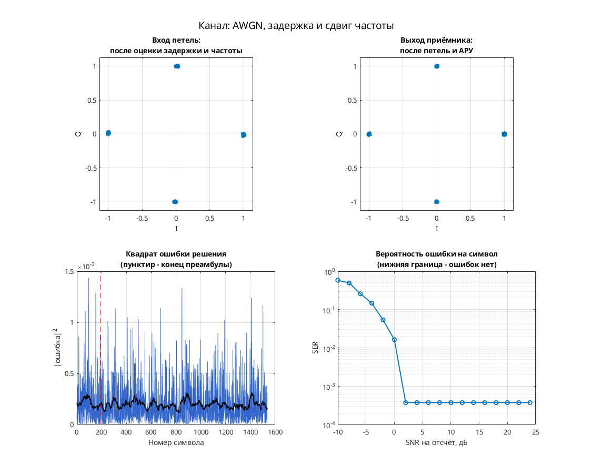

# QPSK: прямая тактовая синхронизация с интерполятором Фарроу

Модель Simulink демонстрирует QPSK с прямой оценкой тактовой фазы, фазы несущей и усиления. Передатчик: скремблер → дифференциальное кодирование → QPSK → повышение частоты в 8 раз → RRC. Канал: целая и дробная задержка, фазовая/частотная расстройка и AWGN. Приёмник: RRC → `symbol_sync` с выходами `clock` и `mu` → интерполятор Фарроу → фазовая коррекция с развёрткой фазы, `gain_control` → декодирование.

В отличие от варианта от 06.03.2007, здесь есть интерполяция Фарроу и оценка дробной тактовой фазы. Параметры: 8 отсчётов на символ; M = 4, Ph = 0, точки передатчика {1, i, −1, −i}; RRC порядка 32, коэффициент скругления 1. Адаптивного эквалайзера нет.

## Запуск

В MATLAB перейдите в эту папку:

```matlab
run_demo
% С явным временем окончания:
run_demo(2048)
```

N в `run_demo(N)` — время окончания в единицах модельного времени, а не число символов. Без аргумента используется `16384`.

Проверено в MATLAB R2020b: исходный `verification.json` подтверждает симуляцию и точный повтор до времени 2048. Полная корректность приёмника не установлена.

Нужны MATLAB, Simulink, Communications Toolbox (PSK, канал, расстройка, скремблер и Scatter Plot), DSP System Toolbox (RRC, задержки и изменение частоты), Signal Processing Toolbox (`firrcos` при расчёте RRC в `dspddes3`).

## Что смотреть

- Автоматически открывается `Discrete-Time Scatter Plot Scope1`: символьные отсчёты после коррекции; смотрите четыре группы QPSK.
- Вручную откройте `Scope2`: восстановленный тактовый сигнал `symbol_sync/clock`; `Scope1` — оценку усиления.
- `Scope4` показывает I/Q скорректированного сигнала; `Scope5` — декодированные метки; `signal_power(Watts)` — оценку мощности. Графика ошибки `mu` на верхнем уровне нет.

## Изменения относительно оригинала

Согласно `matlab/migration.json` исходного проекта, по одной ссылке заменено с `commchan2/` на `commchan3/` и с `commdigbbndpm2/` на `commdigbbndpm3/`. В `verification.json` дополнительных изменений при запуске нет. Численные параметры сохранены; эквивалентность старым библиотекам не установлена.


## Собственная реализация (run_own)

Помимо оригинальной схемы, в папке есть **наша собственная реализация этого модема на MATLAB**. Это не перевод схемы блок за блоком: передатчик, канал и приёмник с теми же параметрами написаны заново кодом, без тулбоксов. Общий код лежит в [common/](../../common/), параметры модема — в [config.json](config.json).

```matlab
run_own                              % демонстрация с графиками
run_own(struct('snr_db', 12))        % свой SNR на отсчёт, дБ
r = run_own(struct('plot', false))   % только числа, без графиков
```

| Узел | Реализация |
| --- | --- |
| Модуляция | PSK, 4 позиций |
| Отсчётов на символ | 8 |
| Формирующий фильтр | корень из приподнятого косинуса, порядок 32, скругление 1 |
| Кодирование | дифференциальное фазовое |
| Символьная синхронизация | по преамбуле, без петли |
| Фазовая синхронизация | петля первого порядка (только фаза), плюс АРУ |
| Эквалайзер | нет |

Модель канала: ослабление 0,65, фазовый сдвиг 0,38 рад, сдвиг частоты 1,5·10⁻⁴ от частоты дискретизации, дробная задержка 2,25 отсчёта и белый шум. Сценарий для этого модема: **AWGN, задержка и сдвиг частоты**. Первые 192 символа кадра служат известной преамбулой. По ней оцениваются задержка, частота и начальная фаза, обучается эквалайзер. Дальше приёмник работает в режиме решений.

Результат в MATLAB R2020b: при SNR 28 дБ — 0 ошибок на 1344 символах, оценка задержки 2.25 отсчёта, частоты 1.50e-04. Ошибок нет начиная с SNR 2 дБ на отсчёт. Время работы около 0 с.



Отличия от оригинальной схемы. В оригинале синхронизация слепая, а у нас приёмник опирается на преамбулу. Скремблер, точные коэффициенты петель оригинала и фиксированная точка не воспроизводятся. Поэтому цифры выше относятся к нашей реализации, а не к схеме автора. Тот же алгоритм у нас есть ещё на Python и SystemVerilog. Версии на Python и MATLAB/Octave совпадают между собой с точностью до 10⁻⁷ (перекрёстный тест), поведенческая модель на SystemVerilog проверена UVM-тестами.

## Автор и источник

Александр Петров; поле Description: `Petrov Sasha, ux@yandex.ru, 2007.05.20`.

Источник: [сообщение petrov на ELECTRONIX](https://electronix.ru/forum/topic/23652-model-8psk-modema/#comment-252974), архив `qpsk_ff_symbol_farrow_sync_ff_phase_sync_fast_agc_2007_05_20.rar`; URL установлен по локальному каталогу источников.

Лицензия автором не указана; модель публикуется с указанием авторства в учебных целях; по просьбе автора будет удалена.
