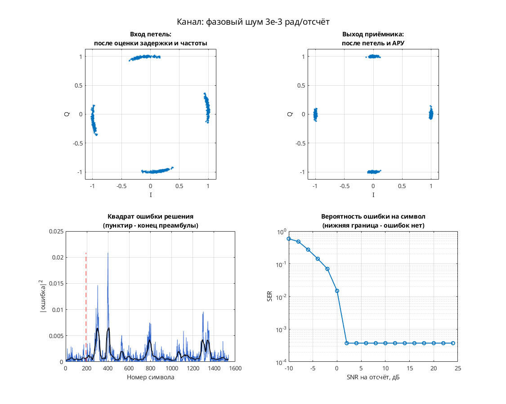

# QPSK: подавление фазового шума прямой оценкой фазы

Модель Simulink демонстрирует фазовую коррекцию QPSK на символьной частоте. Передатчик `Modulator`: скремблер → дифференциальное кодирование → QPSK. Канал: гауссов шум проходит рекурсивный формирователь, преобразуется в комплексный фазовый множитель и умножается на передаваемые символы. Приёмник `phase_sync`: выделение фазы, умножение её на 4, усреднение CIC, развёртка фазы, деление на 4 и компенсация с согласующей задержкой сигнала.

Параметры: M = 4, Ph = 0, точки {1, i, −1, −i}; один отсчёт на символ. У Gaussian Noise Generator заданы m = 0, d = 1, s = 41, Ts = 1. Повышения частоты, формирующего RRC, тактовой петли, АРУ и эквалайзера в этой схеме нет.

## Запуск

В MATLAB перейдите в эту папку:

```matlab
run_demo
% С явным временем окончания:
run_demo(16384)
```

N в `run_demo(N)` — время окончания в единицах модельного времени, а не число символов. Без аргумента используется `131072`.

Проверено в MATLAB R2020b: исходный `verification.json` фиксирует успешную симуляцию и точный повтор до времени 16384. Это не полная проверка демодулятора.

Нужны MATLAB, Simulink, Communications Toolbox (PSK, скремблер, Gaussian Noise Generator и Scatter Plot), DSP System Toolbox (Integer Delay). CIC и фазовый оцениватель собраны из подсистем модели.

## Что смотреть

Автоматически открываются два окна:

- `Discrete-Time Scatter Plot Scope1` — сигнал с фазовым шумом после `Product1`; видно угловое размытие исходных четырёх точек.
- `Discrete-Time Scatter Plot Scope2` — сигнал после `phase_sync` и `Product`; сравните угловой разброс до и после коррекции.

Дисплей `signal_power(Watts)` контролирует мощность передаваемых символов. Отдельного временного Scope ошибки петли и счётчика BER в этой модели нет.

## Изменения относительно оригинала

По `matlab/migration.json` исходного проекта одна ссылка `commdigbbndpm2/` заменена на `commdigbbndpm3/`. Дополнительных изменений при запуске в `verification.json` нет. Эквивалентность исторической версии библиотеки не установлена.


## Собственная реализация (run_own)

Помимо оригинальной схемы, в папке есть **наша собственная реализация этого модема на MATLAB**. Это не перевод схемы блок за блоком: передатчик, канал и приёмник с теми же параметрами написаны заново кодом, без тулбоксов. Общий код лежит в [common/](../../common/), параметры модема — в [config.json](config.json).

```matlab
run_own                              % демонстрация с графиками
run_own(struct('snr_db', 12))        % свой SNR на отсчёт, дБ
r = run_own(struct('plot', false))   % только числа, без графиков
```

| Узел | Реализация |
| --- | --- |
| Модуляция | PSK, 4 позиций |
| Отсчётов на символ | 8 |
| Формирующий фильтр | корень из приподнятого косинуса, порядок 32, скругление 1 |
| Кодирование | дифференциальное фазовое |
| Символьная синхронизация | по преамбуле, без петли |
| Фазовая синхронизация | петля первого порядка (только фаза), плюс АРУ |
| Эквалайзер | нет |

Модель канала: ослабление 0,65, фазовый сдвиг 0,38 рад, сдвиг частоты 1,5·10⁻⁴ от частоты дискретизации, дробная задержка 2,25 отсчёта и белый шум. Сценарий для этого модема: **фазовый шум 3e-3 рад/отсчёт**. Первые 192 символа кадра служат известной преамбулой. По ней оцениваются задержка, частота и начальная фаза, обучается эквалайзер. Дальше приёмник работает в режиме решений.

Результат в MATLAB R2020b: при SNR 28 дБ — 0 ошибок на 1344 символах, оценка задержки 2.25 отсчёта, частоты 1.45e-04. Ошибок нет начиная с SNR 2 дБ на отсчёт. Время работы около 0 с.



Отличия от оригинальной схемы. В оригинале синхронизация слепая, а у нас приёмник опирается на преамбулу. Скремблер, точные коэффициенты петель оригинала и фиксированная точка не воспроизводятся. Поэтому цифры выше относятся к нашей реализации, а не к схеме автора. Тот же алгоритм у нас есть ещё на Python и SystemVerilog. Версии на Python и MATLAB/Octave совпадают между собой с точностью до 10⁻⁷ (перекрёстный тест), поведенческая модель на SystemVerilog проверена UVM-тестами.

## Автор и источник

Александр Петров; поле Description: `Petrov Sasha, ux@yandex.ru, 2009.04.12`.

Источник: архив `qpsk_phase_noise_phase_sync_2009_04_12.rar`, зарегистрированный в `docs/archive_inventory.json` исходного проекта, в том числе в составе `petrov_modems_electronix.7z`. URL конкретной первичной публикации не установлен.

Лицензия автором не указана; модель публикуется с указанием авторства в учебных целях; по просьбе автора будет удалена.
