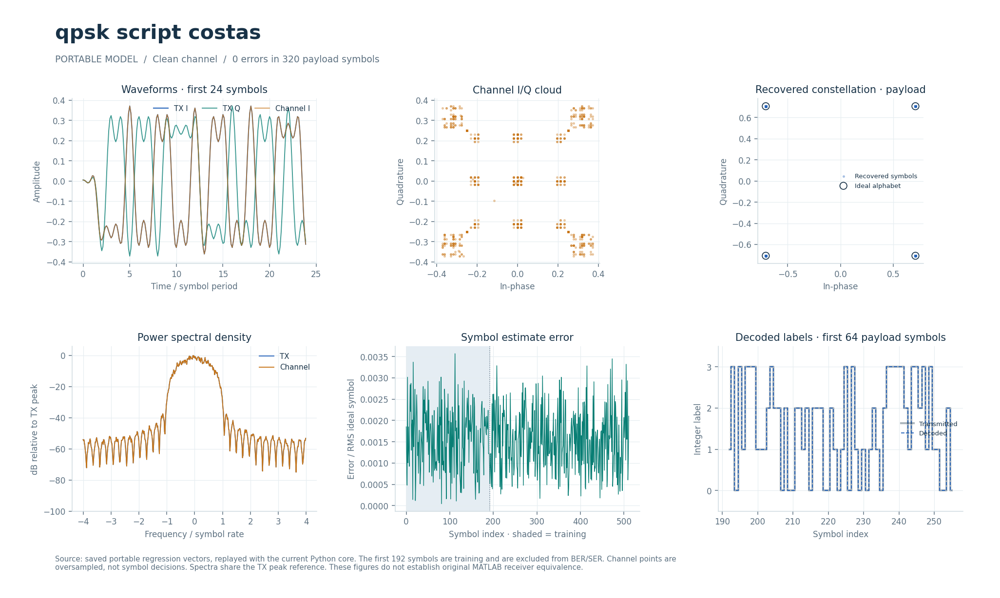

# Скриптовая модель QPSK-модема с синхронизацией несущей

Кадровая модель QPSK с формированием импульса, синхронизацией по преамбуле и сопровождением параметров канала.

## Что это

Происходит от исторического MATLAB-скрипта `qpsk_modem_costas.m`. Переносимые реализации есть на Python, Octave/MATLAB и поведенческом SystemVerilog с UVM. Отдельно существует потоковый fixed-point RTL. Общие Python-тесты проверяют кодер, передачу без шума, канал с шумом/задержкой/несущей, повторяемость, неверный ввод и отрицательный контроль при −8 дБ; специальные проверки зависят от конфигурации. Сохранённые результаты межъязыковых прогонов описаны в [VERIFICATION.md](../../docs/VERIFICATION.md). Совпадение переносимых реализаций не устанавливает полную эквивалентность историческому приёмнику.

Историческая модель в публичный репозиторий не входит. В [source_parameters.json](source_parameters.json) находится пустой массив, сведений о блоках в нём нет; происхождение и SHA-256 исходного файла записаны в полях `source` и `source_sha256` файла [config.json](config.json). Размер исходника эти JSON не содержат; манифест `model.json` в этом модуле отсутствует.

### Историческое демо

Историческая цепочка: биты → I/Q → формирующие FIR → квадратурная модуляция → AWGN → смесители → НЧ FIR → решения по знаку. Несущая 50 кГц, поток 10 кбит/с, Fs=1 МГц: 100 отсчётов на бит, 200 на QPSK-символ. До фильтрации I/Q равны ±1; формирующий FIR порядка 40, sqrt raised cosine, rolloff=0.25; приёмный FIR порядка 30, срез 16 кГц. В Costas локальная частота 50.1 кГц: расстройка +100 Гц, детектор sign(I)·Q−sign(Q)·I, C1=1/16, C2=1/128. Моменты решений известны (100:200:end); Gardner, АРУ и эквалайзера в исходном скрипте нет.

## Как работает

1. TX получает целочисленные метки, выполняет заданное конфигурацией кодирование и выбирает комплексные точки из таблицы `constellation`.
2. После вставки нулей импульсы проходят через RRC-фильтр единичной энергии: 33 коэффициента, порядок 32, `rolloff=1`. Возвращается сигнал вместе с хвостом FIR.
3. `channel` моделирует AWGN, усиление, поворот фазы, частотное смещение и дробную задержку; для специальных проверок доступны эхо и дрейф тактов.
4. RX применяет согласованный RRC и ищет задержку от 0 до 16 отсчётов с шагом 0.25. Четырёхточечная кубическая интерполяция Лагранжа задаёт дробные моменты выборки. Наклон развёрнутой фазы на преамбуле оценивает частоту, комплексная корреляция — фазу и усиление.
5. При `timing=gardner` момент выборки корректируется по ошибке `Re((late−early)·conj(mid))`. Затем работают петля несущей второго порядка, АРУ, выбранный эквалайзер и решение по минимуму `|y−c|²`; после решения выполняется декодирование меток.

`qpsk_script_basic` и `qpsk_script_costas` используют одну алгоритмическую конфигурацию: единичное диагональное созвездие, без дифференциального кодирования. Значение `carrier=costas` при `order=4` выбирает общую петлю по решениям; специальный знаковый детектор Костаса в `modem_core` применяется только при `order=2`. Различия двух исторических скриптов отдельными переносимыми алгоритмами не воспроизведены.

`receive(CONFIG, waveform, preamble, count)` получает только известную преамбулу и длину кадра; полезные метки ему не передаются. Минимум преамбулы — 32 символа, в демонстрациях используется 192 из 768 (полезная часть 576). Начало кадра грубо известно вызывающей стороне; это не детектор произвольных пакетов.

| Параметр | Значение |
| --- | --- |
| `family` / `order` | `psk` / 4 |
| Входные метки | 0…3; 2 бита на метку |
| `differential` | `none` |
| `sps` | 8 |
| RRC | `rrc_order=32`, 33 коэффициента, `rolloff=1.0` |
| `timing` / `carrier` | `gardner` / `costas` |
| `equalizer` | `none` |
| `diversity_branches` | 1 |
| `variable_delay` / `phase_noise` | `false` / `false` |

RTL — общие `bpsk_tx`/`bpsk_rx` с `ORDER=4` в [каталоге пилота](../../rtl/modems/bpsk_costas_2008_08_25/). Метки двухбитные, `DIFFERENTIAL=0`, уровни I/Q ±23170 в Q15. Профиль `QPSK` в [psk_fixed.py](../../common/python/psk_fixed.py) также используется моделью `qpsk_8_sps_fb_sync_2020_11_25`: конфигурации этих трёх модулей совпадают. [Подробности QPSK](../../docs/BPSK_RTL.md#qpsk-order4).

Потоковый тракт использует рукопожатие `s_valid/s_ready` и `m_valid/m_ready`, комплексные `s_re/s_im`, `m_re/m_im` и признаки `s_last/m_last`. Перед RX загружаются 192 метки через `cfg_valid/cfg_ready/cfg_bit/cfg_last`; `cfg_count` задаёт длину 192…2048 символов. Передача происходит только при `valid && ready`, остановка выхода удерживает данные. Комплексные отсчёты — знаковые 18 бит с 15 дробными (Q3.15, −4…4−2⁻¹⁵), фаза и частота — 32 бита, полный оборот равен 2³². Округление — к ближайшему чётному, с насыщением в соответствующих узлах.

RX принимает `8N…8N+64` входных отсчётов с признаком конца кадра, затем дополняет согласованный FIR 32 нулями; в это время вход остановлен.

Латентности общих RRC, интерполятора и ротатора — 8, 7 и 7 разрешённых тактов; каждый имеет II=1. Полная задержка RX зависит от накопления кадра, захвата и остановок. RTL использует early-late-сопровождение времени; переносимая модель использует Gardner. Форматы, правила сброса, ограничения кадров и результаты прежних проверок приведены в [описании RTL](../../docs/BPSK_RTL.md).

## Структура каталога

| Файл или каталог | Назначение |
| --- | --- |
| [config.json](config.json) | Параметры переносимой модели и SHA-256 исторического исходника. |
| [source_parameters.json](source_parameters.json) | Пустой массив; извлечённых полей нет. |
| [python/modem.py](python/modem.py) | Экспорт `CONFIG`, `transmit`, `receive`; запуск демонстрации. |
| [tests/test_modem.py](tests/test_modem.py) | Общий контракт из `modem_checks.ModemContract` для этой конфигурации. |
| [octave/run_modem.m](octave/run_modem.m), [octave/test_modem.m](octave/test_modem.m) | Демонстрация и проверка M-реализации; те же функции работают в MATLAB. |
| [sv/modem.sv](sv/modem.sv) | Обёртка общего поведенческого `modem_model`, арифметика `real`. |
| [tb/testbench.sv](tb/testbench.sv), [tb/run.sh](tb/run.sh) | UVM-тестбенч и локальная обёртка запуска из любого каталога. |
| [common/](../../common/) | Общие ядра Python, Octave и SystemVerilog; изменения влияют на все модели. |

[run_demo.m](run_demo.m) — запуск выбранного исторического сценария из локального `original/`. Сам `original/` в публичную копию не входит.

## Как запустить

Все команды выполняются из корня проекта. Для переносимого Python нужны Python 3 и NumPy; для M-файлов — `octave-cli` с `jsondecode` либо MATLAB. Симуляция поведенческого SV требует Questa и UVM 1.2. Полный RTL-прогон дополнительно использует Verilator для lint; пути Questa/UVM выбираются общими средствами проекта.

Демонстрация печатает JSON с числом ошибок и оценками синхронизации; тест запускает семь проверок общего контракта:

```bash
python3 modems/qpsk_script_costas/python/modem.py
python3 modems/qpsk_script_costas/tests/test_modem.py
```

Проверка M-реализации и её демонстрация:

```bash
octave-cli --quiet --eval "addpath('modems/qpsk_script_costas/octave'); test_modem; run_modem;"
```

Сравнение Python и Octave на общих векторах, затем отдельный поведенческий UVM-прогон:

```bash
python3 tools/run_tests.py --suite cross --modem qpsk_script_costas
./tools/run_questa.sh --modem qpsk_script_costas
```

Общая проверка fixed-point-моделей, lint и RTL-симуляции (охватывает всю группу, а не только этот каталог):

```bash
python3 tools/run_bpsk.py --suite all
```

Отдельного `matlab/test_original.m` для исторического скрипта в этом каталоге нет. Выполнение переносимой M-реализации в MATLAB и проверка исторического скрипта — разные задачи; последняя требует отдельно полученных исходников, сохраняющих авторскую кодировку и комментарии.

### Исторические скрипты: run_demo

В MATLAB перейдите в `modems/qpsk_script_costas` и выполните:

```matlab
run_demo
```

Исполняется исходный `qpsk_modem_costas.m` из `original/`; вспомогательные `rcosfilter.m` и `demo_lowpass.m` подключаются автоматически. Скрипт сохраняет собственные параметры и фиксированную арифметику: нужны MATLAB и зависимости оригинала (`awgn`, `firrcos`, `fir1`, `dfilt` и настройки fixed-point; Communications, Signal Processing и DSP System Toolbox / Fixed-Point Designer в зависимости от версии). Совместимость с базовым Octave не заявляется. TXT `dataI.txt` и `dataQ.txt` записываются во временную папку и удаляются после вызова; path, cwd и RNG восстанавливаются. Исходный `close all` закрывает прежние окна, `clc` очищает командное окно. Costas многократно фильтрует весь буфер, поэтому может работать долго.

`run_demo` требует исходников, которых нет в публичной копии; см. [THIRD_PARTY.md](../../THIRD_PARTY.md). Переносимые `python/modem.py` и `octave/run_modem.m` работают и в публичной копии с зависимостями, указанными выше; они используют кадровый контракт проекта.

## Что смотреть

В демонстрации `symbol_errors` — число неверных меток после преамбулы, `ser` — их доля в 576 полезных символах. Для штатного примера ожидается ноль ошибок. `estimated_delay` измеряется в отсчётах, `estimated_frequency` — в циклах на отсчёт. SNR задаётся на отсчёт по средней мощности сигнала и не равен Eb/N0. Нулевой SER на коротком кадре не определяет долговременную BER.

Python-тесты заканчиваются `OK`, Octave печатает `PASS <имя> Octave codec and waveform loopback`. В проверенном окружении Octave при завершении также печатает `ignoring const execution_exception`; учитывайте код выхода и результат утверждений теста. Проверка канала при 30 дБ использует усиления 0.65/0.2, фазы 0.38/−1.1 рад, частоты 0.00015/−0.0005 циклов на отсчёт и задержки 2.25/7.25; требуется точное восстановление нагрузки, ошибка частоты менее 10⁻⁵ и задержки не более 0.5 отсчёта. Отрицательный контроль при −8 дБ должен дать больше 20 ошибок.

`run_tests.py --suite cross` сохраняет `build/single/qpsk_script_costas/cross_results.json`, лог `logs/cross/octave.log` внутри этого каталога и общие векторы `build/vectors/qpsk_script_costas/`. Поведенческий UVM пишет `build/questa/single/qpsk_script_costas/results.json` и `qpsk_script_costas.log` в том же каталоге. Успех требует четырёх проверенных кадров, `UVM_ERROR : 0`, `UVM_FATAL : 0` и обнаружения специально внесённого несовпадения в отрицательном контроле.

UVM передаёт чистый, шумовой и специальный сценарии, затем повторяет первый кадр после сброса. Пассивный монитор снимает реальные выходы; scoreboard сверяет TX-отсчёты, RX-символы, индексы, декодированные и полезные метки и оценки синхронизации с независимым исполнением Python. Комплексные величины сравниваются с допуском 10⁻⁷, целочисленные метки — точно. Поведенческое завершение за один цикл запроса является абстракцией кадра, не аппаратной латентностью. Комментарии общей реализации — на русском, диагностика — преимущественно на английском.

Fixed-point-прогон сохраняет `build/rtl/bpsk/all_results.json` и логи подкаталогов. Его побитное совпадение с целочисленным эталоном проверяет RTL-арифметику; качество относительно вещественного приёмника оценивается отдельно в указанной RTL-документации.

Сценарии и графики представлены в [типизированном визуальном отчёте](../../docs/typed_visual/index.html), правила интерфейса — в [TYPED_MODELS.md](../../docs/TYPED_MODELS.md).



### Графики run_demo

Исходные окна показывают биты и I/Q, выходы формирующих FIR, полосовой сигнал до/после AWGN, смешанные и отфильтрованные I/Q, выход фазового детектора, петлевой фильтр и восстановленные биты. В Costas дополнительно показано сравнение локальной и передающей несущих. Подписи сохранены из оригинала; их отображение зависит от кодировки и шрифтов. Шум `awgn(tx,20)` использует принятую по умолчанию мощность 0 dBW: это не SNR относительно измеренной мощности tx. Переходный процесс и неоднозначность π/2 не устранены; один запуск не даёт BER-кривую.

## Ограничения

Полная эквивалентность историческому прототипу не установлена. Переносимая модель заменяет слепой захват обучением по преамбуле и не воспроизводит скремблеры/дескремблеры, внутренние CIC, исходные коэффициенты петель, переходные процессы, точное многоскоростное расписание и округление старых блоков. Некоторые исторические варианты поэтому используют общий текущий алгоритм. [Контракт переноса](../../docs/PORTING_CONTRACT.md) описывает эти замены и проверенные сценарии.

`sv/modem.sv` использует `real` и кадровые транзакции; синтезируемый fixed-point RTL находится отдельно. Статусы из сохранённых отчётов относятся к их снимкам исходников; физический тайминг старого снимка не переносится автоматически на текущий RTL. Работа на реальной плате не подтверждена этими моделями. Тесты каналов являются регрессионными примерами, а не измерением полного диапазона захвата или гарантией BER.

Исходные маппинг и скремблирование скриптов не подтверждены. Общий профиль QPSK около порога может терять захват чаще вещественного поиска: в сохранённом сравнении при −4 дБ срыв был в 1 из 30 кадров против 0 у вещественного RX; при −2 дБ и выше срывов в том наборе не было.

Исторический `run_demo` и переносимая модель имеют разные параметры и область проверки; их полная эквивалентность не заявляется.
