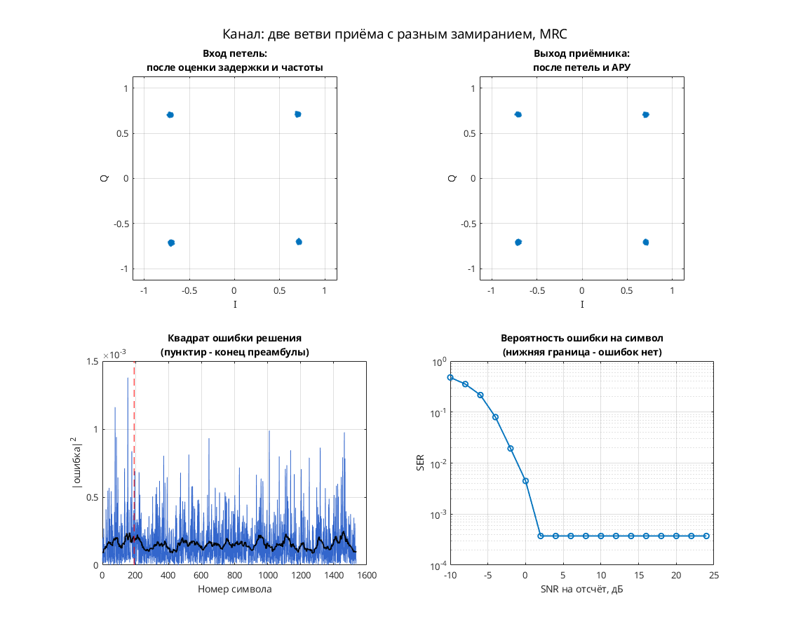
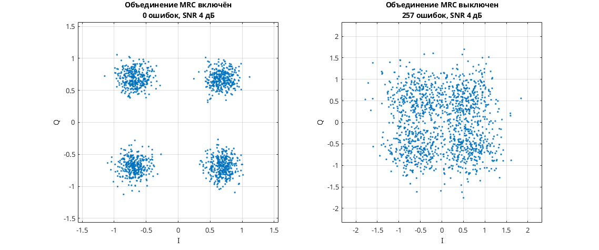

# QPSK с двумя приёмными ветвями: адаптивное объединение SIMO/MRC

Модель Simulink демонстрирует приём одного QPSK-сигнала по двум ветвям и их адаптивное объединение. Передатчик: скремблер → код Грея и дифференциальное кодирование → QPSK → повышение частоты → RRC. Канал: общая переменная задержка `channel_delay`, двухветвевой `simo_flat_fading_channel` с усилениями, задержками и фазовыми/частотными смещениями, AWGN. Приёмник: RRC → коррекция фазы и усиления → кубический Фарроу → адаптивный LMS-фильтр/объединитель в `2_sps_clock_domain` → решения и декодирование.

Есть детектор Гарднера, фазовый детектор по решениям, слепой детектор Годара, обновление коэффициентов и петлевые фильтры. Объединитель реализован адаптивным фильтром; результаты для идеального MRC с заранее известными каналами здесь не заявляются.

Параметры: две приёмные ветви; 4 отсчёта на символ в передающем тракте, промежуточная обработка при 2 отсчётах на символ. Таблица передатчика: `exp(i*([0:3]*pi/2+pi/4))`, четыре единичные точки QPSK. Это параметры исходной Simulink-модели.

## Запуск

В MATLAB перейдите в эту папку:

```matlab
run_demo
% С явным временем окончания:
run_demo(4096)
```

N в `run_demo(N)` — время окончания в единицах модельного времени, а не число символов. Без аргумента используется `32768`.

Проверено в MATLAB R2020b: исходный `verification.json` подтверждает симуляцию и точный повтор до времени 4096 с явными размерностями портов Фарроу. Полная корректность приёмника не установлена.

Нужны MATLAB, Simulink, Communications Toolbox (AWGN, расстройка и Scatter Plot), DSP System Toolbox (Digital Filter Design, буферы, изменение частоты, Vector/Spectrum Scope), Signal Processing Toolbox (фильтровые объекты Digital Filter Design).

## Что смотреть

- Автоматически открывается `Discrete-Time Scatter Plot Scope`: символы после объединения; смотрите четыре группы QPSK и остаточный разброс.
- `Filter Taps` и `Filter Taps1` открываются автоматически: действительная и мнимая части адаптивных коэффициентов. `Spectrum Scope` — спектр после AWGN.
- Вручную откройте `Scope`: три выхода тактового NCO; `Scope1` — I/Q сигнала после AWGN; `Scope3` — декодированные метки. Отдельного сравнения BER одной и двух ветвей модель не выводит.

## Изменения относительно оригинала

В `matlab/migration.json` исходного проекта список замен библиотек пуст; файл модели совпадает с оригиналом. В `verification.json` записаны исправления размерностей, необходимые при запуске в R2020b:

- `cubic_farrow_interpolator/in`: `PortDimensions = 2` — две ветви;
- `cubic_farrow_interpolator/mu`: `PortDimensions = 1` — скалярная дробная задержка.

Эти настройки уже выполняет `run_demo.m` в памяти после открытия модели.


## Собственная реализация (run_own)

Помимо оригинальной схемы, в папке есть **наша собственная реализация этого модема на MATLAB**. Это не перевод схемы блок за блоком: передатчик, канал и приёмник с теми же параметрами написаны заново кодом, без тулбоксов. Общий код лежит в [common/](../../common/), параметры модема — в [config.json](config.json).

```matlab
run_own                              % демонстрация с графиками
run_own(struct('snr_db', 12))        % свой SNR на отсчёт, дБ
r = run_own(struct('plot', false))   % только числа, без графиков
```

| Узел | Реализация |
| --- | --- |
| Модуляция | PSK, 4 позиций |
| Отсчётов на символ | 8 |
| Формирующий фильтр | корень из приподнятого косинуса, порядок 32, скругление 1 |
| Кодирование | дифференциальное фазовое |
| Символьная синхронизация | петля Гарднера с кубическим интерполятором Фарроу |
| Фазовая синхронизация | ФАПЧ второго порядка (фаза и частота), плюс АРУ |
| Эквалайзер | нет |
| Разнесённый приём | 2 ветви, объединение с максимальным отношением (MRC) |

Модель канала: ослабление 0,65, фазовый сдвиг 0,38 рад, сдвиг частоты 1,5·10⁻⁴ от частоты дискретизации, дробная задержка 2,25 отсчёта и белый шум. Сценарий для этого модема: **две ветви приёма с разным замиранием, MRC**. Первые 192 символа кадра служат известной преамбулой. По ней оцениваются задержка, частота и начальная фаза, обучается эквалайзер. Дальше приёмник работает в режиме решений.

Результат в MATLAB R2020b: при SNR 28 дБ — 0 ошибок на 1344 символах, оценка задержки 2.25 отсчёта, частоты 1.50e-04. Ошибок нет начиная с SNR 2 дБ на отсчёт. Время работы около 1 с.



**Сравнение** (второе окно): узел «Объединение MRC» включён — 0 ошибок, выключен — 257 ошибок на 1344 символах.



Отличия от оригинальной схемы. В оригинале синхронизация слепая, а у нас приёмник опирается на преамбулу. Скремблер, точные коэффициенты петель оригинала и фиксированная точка не воспроизводятся. Поэтому цифры выше относятся к нашей реализации, а не к схеме автора. Тот же алгоритм у нас есть ещё на Python и SystemVerilog. Версии на Python и MATLAB/Octave совпадают между собой с точностью до 10⁻⁷ (перекрёстный тест), поведенческая модель на SystemVerilog проверена UVM-тестами.

## Автор и источник

Александр Петров; поле Description: `Petrov Sasha, ux@yandex.ru, 2010.08.27`.

Источник: [сообщение petrov на ELECTRONIX](https://electronix.ru/forum/topic/23652-model-8psk-modema/page/9/#comment-803139), архив `simo_maximal_ratio_combining_2010_08_27.rar`; URL установлен по локальному каталогу источников.

Лицензия автором не указана; модель публикуется с указанием авторства в учебных целях; по просьбе автора будет удалена.
