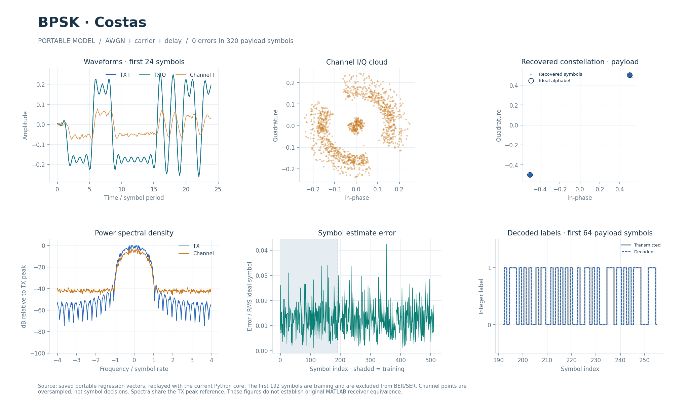

# BPSK-модем с петлёй Костаса (2008-08-25)

Потоковые передатчик и приёмник BPSK с фиксированной точкой, захватом по известной преамбуле и сопровождением несущей, времени и усиления. Этот же RTL-каталог содержит общее параметризованное ядро PSK/QAM.

## Что это

Исходный исторический прототип — Simulink-модель `bpsk_costas_2008_08_25`. Переносимая конфигурация описана в [config.json](../../../modems/bpsk_costas_2008_08_25/config.json); Python, Octave/MATLAB и поведенческий SV/UVM находятся в [каталоге модели](../../../modems/bpsk_costas_2008_08_25/). Исторические переходные процессы, слепой захват и точное расписание исходного Simulink не воспроизводятся.

Целочисленный эталон текущего RX — [psk_fixed.py](../../../common/python/psk_fixed.py), профиль BPSK; [bpsk_fixed.py](../../../common/python/bpsk_fixed.py) сохраняет общую арифметику и блочные модели. RTL поддерживает BPSK, QPSK, 8-PSK, π/4-QPSK, QAM16/QAM64, а также NLMS/DFE для QAM16. Имена профилей и их параметры задаются в `psk_fixed.PROFILES` и [bpsk_cases.py](../../../tools/bpsk_cases.py).

Документ [BPSK_RTL.md](../../../docs/BPSK_RTL.md) содержит результаты численных и физических проверок. Ускоренный захват acq1 от 2026-10-29 проверен Verilator: для BPSK `A=677` тактов от принятого `start` до наблюдаемого родителем `done`. Полная UVM-приёмка в Questa и физический тайминг этого изменения остаются отдельными проверками; прежняя физическая приёмка на 100 МГц относится к более раннему RTL.

## Как работает

1. **TX:** дифференциальный XOR → точки `(0.5,0.5)` / `(-0.5,-0.5)` → повышение частоты в 8 раз → RRC из 33 отводов. На N входных битов выдаётся `8N+32` комплексных отсчёта.
2. **Канал вне RTL:** тесты добавляют шум, фазу, частоту, усиление и дробную задержку. Сам TX/RX не создаёт канал.
3. **RX-фильтр и память:** RRC, запись отсчётов в два полных и один короткий кадровый буфер; после входного `s_last` в фильтр поступают 32 нуля. В это время `s_ready=0`.
4. **Захват:** после 1344 записанных отсчётов первая гармоника энергии восьми фаз даёт дробное время; проверяются три целосимвольных смещения. Фазы обучающих символов 32…159 разворачиваются и аппроксимируются прямой. Выбирается кандидат с минимальной суммой квадратов остатков; оцениваются частота, фаза и gain.
5. **Сопровождение:** кубическая интерполяция early/mid/late → поворот `x·exp(-jφ)` и AGC → решение BPSK → дифференциальное декодирование. Ошибка Костаса использует знак решения и квадратурную компоненту; временная петля корректирует позиции выборки. Обратная связь несущей/времени задержана на 4 символа, AGC — на 8; задержки включены в эталон.

| Параметр/узел | Значение BPSK |
| --- | --- |
| `ORDER`, `DIFFERENTIAL`, `AMPLITUDE` | 2, 1, 16384 (0.5 в Q15 на компоненту) |
| `sps`, `rrc_order`, `rolloff` из конфигурации | 8, 32 (33 отвода), 1.0 |
| Преамбула | 192 исходных метки через `cfg_bit`; кодируется внутри RX |
| `cfg_count` | N=192…2048 символов на кадр; фиксируется с принятым `cfg_last` |
| Входная длина RX | `8N…8N+64` отсчётов, `s_last` на последнем |
| I/Q | signed 18/15; −4…4−2⁻¹⁵ |
| RRC | Коэффициенты signed 18/17, накопитель 42 бита |
| Интерполяция | Кубическая, 4 таблицы по 256 коэффициентов 18/16; дробная позиция до 1/256 отсчёта |
| Фаза/частота | 32 бита, `2^32` на оборот, циклическое переполнение |
| Gain | unsigned 25/20, целый код ограничен 1…`16·2^20` |
| `SHORT_SAMPLES` | 2048 по умолчанию; третий буфер используется при `8N+64+32 <= SHORT_SAMPLES`, то есть N=192…244 |
| RRC / интерполятор / ротатор | Латентности 8 / 7 / 7 разрешённых тактов, II=1 |
| Выдача символов сопровождения | Минимальный интервал 4 такта при наличии отсчётов и готовой обратной связи |

Округление в арифметике пилота — к ближайшему чётному с последующим насыщением. CORDIC делает 20 итераций; ротатор использует 12 старших бит фазы и таблицу cos на 4096 значений. Текущий `bpsk_divide` выполняет два restoring-шага за такт (`STEPS_PER_CYCLE=2`), режим 1 оставлен для сравнения.

TX: `s_bit/s_valid/s_ready/s_last` → `m_re/m_im/m_valid/m_ready/m_last`. RX сначала принимает конфигурацию, затем I/Q через `s_*`; выдаёт декодированную метку `m_bit`, индекс точки `m_index`, I/Q, `m_phase/m_frequency/m_correction/m_gain`. Импульс `acquisition_valid` сопровождает оценки `acquisition_*`; `acquisition_confidence` означает достаточную оценённую амплитуду, а не CRC или гарантию верного захвата.

Передача происходит при `valid && ready`. Остановка выхода удерживает данные; вход RX может продолжать заполнять свободный кадровый буфер. Конфигурация разрешена только при свободном тракте; интеграционный порт `cfg_enable` разрешает её со стороны внешней обвязки. Синхронный `rst` с полярностью `RESET_ACTIVE` отменяет ожидающие данные и требует новой конфигурации RX.

## Структура каталога

| Файл/подкаталог | Назначение |
| --- | --- |
| [bpsk_tx.sv](bpsk_tx.sv), [bpsk_rx.sv](bpsk_rx.sv) | Потоковые TX/RX, mapper, конфигурация и кадровые контроллеры |
| [bpsk_fir.sv](bpsk_fir.sv), [bpsk_rrc_axis.sv](bpsk_rrc_axis.sv) | RRC и потоковая обёртка фильтра |
| [bpsk_samples.sv](bpsk_samples.sv) | Кадровые буферы и кубический интерполятор |
| [bpsk_acquire.sv](bpsk_acquire.sv) | Оценка задержки, частоты, фазы, усиления и score |
| [bpsk_track.sv](bpsk_track.sv) | Сопровождение, решения и декодирование |
| [bpsk_rotate.sv](bpsk_rotate.sv), [bpsk_cordic.sv](bpsk_cordic.sv), [bpsk_divide.sv](bpsk_divide.sv) | Поворот/AGC, оценка угла, целочисленное деление |
| [bpsk_equalizer.sv](bpsk_equalizer.sv) | QAM16: 7 прямых отводов NLMS, при DFE ещё 3 обратных |
| [qam_label_levels.sv](qam_label_levels.sv) | Преобразование QAM-меток в уровни |
| [bpsk_types.svh](bpsk_types.svh), [bpsk_math.svh](bpsk_math.svh), [bpsk_constants.svh](bpsk_constants.svh) | Типы, арифметические функции и константы |
| [tables/](tables/) | Таблицы RRC/интерполяции/вращения и других общих узлов |
| [../../../tests/test_psk_fixed.py](../../../tests/test_psk_fixed.py) | Проверки профилей, захвата, SER и эквалайзеров |
| [../../../modems/bpsk_costas_2008_08_25/source_parameters.json](../../../modems/bpsk_costas_2008_08_25/source_parameters.json) | Извлечённые поля исторических блоков с номерами строк |

## Как запустить

Из корня проекта. Нужны Python и NumPy/PyYAML по [requirements-rtl.txt](../../../requirements-rtl.txt), Verilator для lint, Questa/UVM 1.2 для HDL. Octave/MATLAB нужны только для отдельных переносимых/исторических проверок.

```bash
python3 tools/run_bpsk.py --suite python
python3 tools/run_bpsk.py --suite lint
python3 tools/run_bpsk.py --suite all
python3 tools/run_bpsk_uvm.py --suite all --pilot both --profile bpsk
```

`run_bpsk.py` проверяет таблицы, Python-модели, блочную арифметику, все RX-профили и SIMO; `--suite all` включает численные Questa-прогоны и отрицательные контроли. UVM-команда ограничена BPSK TX/RX; для всей серии RX заменить профиль на `all`, прочие PSK/QAM TX проверяет `tools/run_psk_tx_uvm.py`.

Ускоренный захват и конечные серии кадров можно проверить Verilator без Questa:

```bash
python3 tools/bpsk_acquisition_check.py --output build/bpsk_acquisition_readme
python3 tools/bpsk_rx_continuous_rate.py --backend verilator --output build/bpsk_rate_readme
```

Оба выходных каталога должны отсутствовать перед запуском. Первый runner сравнивает захват и сквозные результаты с целочисленным эталоном, второй измеряет захват, входные паузы и выдачу в сериях 192/768/2048 символов. Это численная RTL-симуляция с адаптированным scoreboard; она не заменяет полноценный UVM. Время выполнения зависит от сборки Verilator и числа профилей.

## Что смотреть

Основные результаты: `build/rtl/bpsk/<suite>_results.json`, `build/rtl/bpsk_uvm/`, журналы по профилям/полярностям и файлы векторов. Для двух Verilator-команд — `results.json` в явно заданных каталогах. PASS должен подтверждать побитное совпадение всех выходов, корректный `last`, оценки захвата и обнаружение отрицательных контролей.

В rate-отчёте `acquisition_cycles` измеряет A, `tail_blocked` относится к обязательному FIR-хвосту, `other_blocked` — к прочим блокировкам. Документированный acq1-прогон дал A=677 и `other_blocked=0` на конечных сериях, включая 16 кадров по 192 символа без входного дополнения. Это не доказательство бесконечного потока; расчёт границ и условия даны в [RTL_BPSK_RX_CONTINUOUS_RATE.md](../../../docs/RTL_BPSK_RX_CONTINUOUS_RATE.md).

В UVM SER считается по меткам после преамбулы; для BPSK один символ несёт один бит. Ненулевая SER шумного кадра допустима, если RTL совпал с эталоном; разность RTL−float сравнивает качество с независимым вещественным приёмником на том же входе. См. [RTL_BPSK_UVM.md](../../../docs/RTL_BPSK_UVM.md), [RTL_PRECISION.md](../../../docs/RTL_PRECISION.md).

[Интерактивный отчёт модели](../../../docs/visual/index.html#section=explorer&model=bpsk_costas_2008_08_25), [MATLAB-графики](../../../docs/visual/matlab/bpsk_costas_2008_08_25.png), [PDF-отчёт](../../../docs/visual/modem_test_report.pdf), [правила чтения графиков](../../../docs/VISUAL_TESTS.md). Это алгоритмические иллюстрации, а не текущий STA-отчёт.



## Ограничения

RX требует известную преамбулу и корректную длину кадра. Слишком короткий/длинный кадр или неверная конфигурация устанавливают `error`; после нарушения верхней границы вход блокируется до сброса. Уже выданный префикс ошибочного кадра не отзывается, поэтому `error` нельзя игнорировать. Насыщение входа, потери точности LUT и задержка обратной связи ограничивают качество приёма.

Историческая модель в публичный репозиторий не входит. [source_parameters.json](../../../modems/bpsk_costas_2008_08_25/source_parameters.json) содержит извлечённые параметры; происхождение и SHA-256 записаны в [config.json](../../../modems/bpsk_costas_2008_08_25/config.json), размер исходника в этих JSON не указан. Нельзя считать их полным манифестом размера/хеша.

MATLAB-проверка оригинала и повторное получение захватов требуют исторических исходников. [migration.json](../../../modems/bpsk_costas_2008_08_25/matlab/migration.json) фиксирует замену библиотеки `commchan2` на `commchan3`; [verification.json](../../../modems/bpsk_costas_2008_08_25/matlab/verification.json) различает отказ компиляции неизменённого оригинала и успешную симуляцию/повторяемость подготовленной копии. Это не доказательство эквивалентности всего приёмника; см. [MATLAB_MODEM_VERIFICATION.md](../../../docs/MATLAB_MODEM_VERIFICATION.md) и [PORTING_CONTRACT.md](../../../docs/PORTING_CONTRACT.md).
