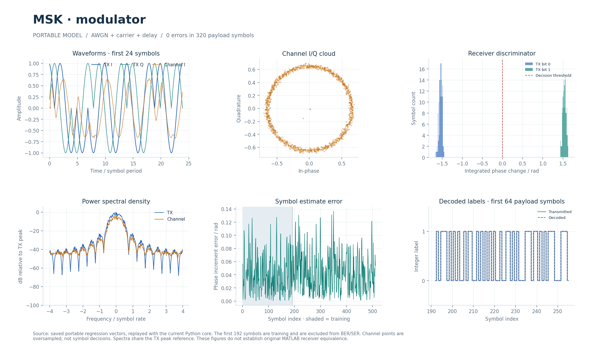

# MSK-модем и общий тракт MSK/GMSK (2008-06-22)

Потоковые TX/RX непрерывно-фазовой модуляции с фиксированной точкой. MSK принимается частотным дискриминатором, GMSK — когерентным трактом с главным импульсом Лорана.

## Что это

Исторический прототип `msk_modulator_2008_06_22` содержит только модулятор. Приёмник добавлен для сквозной проверки. Общие модули этого каталога обслуживают MSK при `GMSK=0` и модель GMSK `gmsk_coherent_demodulation_2010_10_03` при `GMSK=1`.

Переносимые Python, Octave/MATLAB и поведенческие SV/UVM находятся в [каталоге MSK-модели](../../../modems/msk_modulator_2008_06_22/). Целочисленный эталон RTL — [cpm_fixed.py](../../../common/python/cpm_fixed.py); вещественный когерентный эталон GMSK — [gmsk_coherent.py](../../../common/python/gmsk_coherent.py). В переносимом `modem_core` GMSK-приёмник остаётся дискриминаторным: его нельзя считать тем же алгоритмом, что когерентный RTL.

[CPM_RTL.md](../../../docs/CPM_RTL.md) описывает побитные проверки обеих полярностей сброса, сравнение качества и физическую приёмку снимка `ca2d45c` на 100 МГц. Аппаратного запуска на плате не было; последующие изменения общего делителя требуют проверки на актуальном снимке.

## Как работает

1. **TX MSK:** бит задаёт частоту `f=±2^16`; 32-битная фаза на каждом отсчёте увеличивается на `f·2^11`. За 8 отсчётов символа набирается ±четверть оборота, то есть индекс модуляции `h=1/2`.
2. **TX GMSK:** последовательность знаков проходит Gaussian FIR BT=0.3, затем тот же фазовый накопитель. Выход — cos/sin из общей таблицы на 4096 адресов, округлённые до Q15.
3. **Канал** формируется вне RTL. RX сохраняет вход в два восьмибанковых кадровых буфера.
4. **Захват:** при наличии 1088 отсчётов дискриминатор `angle(x[n]·conj(x[n-1]))` коррелируется с частотной опорой преамбулы на 18 задержках −1…16. Дробная задержка оценивается по треугольному пику MSK или параболе GMSK. Во втором проходе фазы восьми блоков по 128 отсчётов дают частоту по МНК: `slope=divide(6·Σ(2j−7)·p[j],64512)`.
5. **RX MSK:** интерполяция в позиции `n+delay+1/2`, компенсация `slope`, сумма восьми приращений фазы на символ; `m_bit = (m_value >= 0)`. Два отсчёта за такт дают четыре такта на символ.
6. **RX GMSK:** оценка начальной фазы → согласованный фильтр главного импульса Лорана C0 → поворот несущей → поворот на ось `(-j)^(k+1)` → фазовая петля → дифференциальное восстановление знаков. У C0 48 отводов; фазовые коэффициенты 1311/7 в Q15 соответствуют 0.04/0.0002, задержка поправки — 10 символов.

| Параметр/порт | Значение |
| --- | --- |
| `GMSK` | 0 — MSK, 1 — GMSK |
| Частота дискретизации переносимого/RTL-тракта | 8 отсчётов на бит |
| Gaussian FIR | 33 отвода Q16, сумма `2^16`, BT=0.3 |
| TX-длина | MSK `8N`; GMSK `8N+32` |
| Конфигурация RX | 192 бита преамбулы, `cfg_count` N=192…2048 |
| RX-длина | `8N…8N+96` отсчётов с `s_last` |
| I/Q | signed 18/15; −4…4−2⁻¹⁵ |
| Фаза/частота | 32-битный код, оборот `2^32` |
| Задержка | signed 32/16, в интерполяцию идут 8 дробных бит |
| `m_value` | signed 36 бит: сумма фазовых приращений MSK либо расширенное мягкое решение GMSK |
| Латентность модулятора | 8 тактов, II=1 |

TX принимает `s_bit/s_valid/s_ready/s_last` и выдаёт I/Q через `m_*`. RX получает преамбулу по `cfg_*`, отсчёты по `s_*`, выдаёт `m_bit/m_value/m_last` и оценки `acquisition_*` с `acquisition_valid`. Оценка фазы нужна когерентному GMSK. Рукопожатие — `valid && ready`; выходной буфер TX удерживает данные при противодавлении. Синхронный сброс `RESET_ACTIVE` отменяет незавершённые кадры.

## Структура каталога

| Файл/подкаталог | Назначение |
| --- | --- |
| [cpm_tx.sv](cpm_tx.sv) | Потоковый передатчик, развёртка битов в отсчёты и хвост GMSK |
| [cpm_modulator.sv](cpm_modulator.sv) | Gaussian FIR, фазовый накопитель, LUT cos/sin |
| [cpm_rx.sv](cpm_rx.sv) | Конфигурация, захват и дискриминаторный тракт |
| [cpm_samples.sv](cpm_samples.sv) | Два кадровых буфера по восьми банкам и двухполосная кубическая интерполяция |
| [cpm_coherent.sv](cpm_coherent.sv) | Когерентный GMSK RX |
| [../bpsk_costas_2008_08_25/](../bpsk_costas_2008_08_25/README.md) | Общие CORDIC, делитель, ротатор и таблицы |
| [../../../tests/test_cpm_fixed.py](../../../tests/test_cpm_fixed.py) | Python-проверки MSK/GMSK, SER и когерентного приёма |
| [../../../tools/cpm_cases.py](../../../tools/cpm_cases.py) | Векторы численного RTL-теста |
| [../../../modems/msk_modulator_2008_06_22/config.json](../../../modems/msk_modulator_2008_06_22/config.json) | Конфигурация переносимого MSK |

## Как запустить

Из корня проекта: Python с NumPy/PyYAML по [requirements-rtl.txt](../../../requirements-rtl.txt), Verilator для lint, Questa/UVM 1.2 для HDL.

```bash
python3 tools/run_cpm.py --suite python
python3 tools/run_cpm.py --suite lint
python3 tools/run_cpm.py --suite all
python3 tools/run_cpm_uvm.py --suite all --profile all
python3 tools/run_packet_rx_uvm.py --suite all --profile msk
python3 tools/run_packet_rx_uvm.py --suite all --profile gmsk
```

`run_cpm.py` проверяет оба режима, таблицы, TX/RX и захват. Отдельный TX UVM контролирует геометрию `8N`/`8N+32`, остановки и сброс удерживаемого последнего отсчёта. Пакетный RX UVM проверяет внешние контакты, захват и SER, включая независимый вещественный приёмник.

Дополнительная сверка MSK TX с сохранённым захватом оригинала:

```bash
python3 tools/check_msk_matlab_rtl.py --suite all
```

Она читает `data.txt` и `matlab_tx.txt` из `build/matlab_msk_reference/`. Их подготовка через `tools/check_matlab_msk.py` требует исходной MATLAB-модели, SciPy, Octave и актуального завершённого свидетельства MATLAB-проверки. В публичной версии без исторических материалов этот путь недоступен; обычные CPM-проверки от него отделены.

## Что смотреть

Основной прогон: `build/rtl/cpm/<suite>_results.json`, векторы, журналы MSK/GMSK и полярностей. Полные UVM-наборы: `build/rtl/cpm_uvm/` и `build/rtl/packet_rx_uvm/`. Ищите завершённый PASS с актуальными хешами, побитное совпадение TX/RX/захвата и обнаружение намеренной порчи ожидаемого результата.

`m_value` позволяет видеть мягкое решение; ошибки нагрузки считаются после 192 обучающих битов. Для MSK BER совпадает с SER. Документированный опыт на четырёх кадрах по 1536 символов дал при 3/6 дБ 112/4 ошибки целочисленного RX против 147/4 у вещественного поиска по сетке. Это результат конкретного набора, а не универсальная кривая BER.

При сверке с оригиналом 511 бит дают 4088 RTL-отсчётов MSK. Исходный захват имеет 32 отсчёта/символ; отсчёт RTL t соответствует захвату `4t+3`. Зафиксировано совпадение с целочисленным эталоном бит в бит и максимальное отличие от захвата до `2.05·10^-5`; контроль сдвигом на отсчёт должен обнаруживать ошибку.

Подробности: [CPM_RTL.md](../../../docs/CPM_RTL.md), [RTL_PACKET_RX_UVM.md](../../../docs/RTL_PACKET_RX_UVM.md), [общие UVM-тесты передатчиков](../../tb/README.md). [Интерактивный отчёт](../../../docs/visual/index.html#section=explorer&model=msk_modulator_2008_06_22), [MATLAB-график](../../../docs/visual/matlab/msk_modulator_2008_06_22.png), [PDF](../../../docs/visual/modem_test_report.pdf).



## Ограничения

MSK RX — добавленная реализация, поэтому сквозной тест не доказывает существование или эквивалентность исторического приёмника. Частотный захват отличается от вещественного перебора 65 задержек. Когерентный GMSK использует приближение главным импульсом Лорана; остаток модели около 6% по амплитуде. Симуляционный темп не подтверждает физическую частоту.

Исторический исходник в публичный репозиторий не входит. [source_parameters.json](../../../modems/msk_modulator_2008_06_22/source_parameters.json) хранит поля блоков; происхождение и SHA-256 — в [config.json](../../../modems/msk_modulator_2008_06_22/config.json). Размер исходника в этих файлах не записан. [migration.json](../../../modems/msk_modulator_2008_06_22/matlab/migration.json) не содержит изменений подготовленной модели; [verification.json](../../../modems/msk_modulator_2008_06_22/matlab/verification.json) фиксирует успешную компиляцию, выполнение и повторяемость оригинала в проверенной среде. Повторить MATLAB-проверку и получить новый захват можно только при наличии исходника и нужных MATLAB/Simulink-компонентов; см. [MATLAB_MODEM_VERIFICATION.md](../../../docs/MATLAB_MODEM_VERIFICATION.md).
