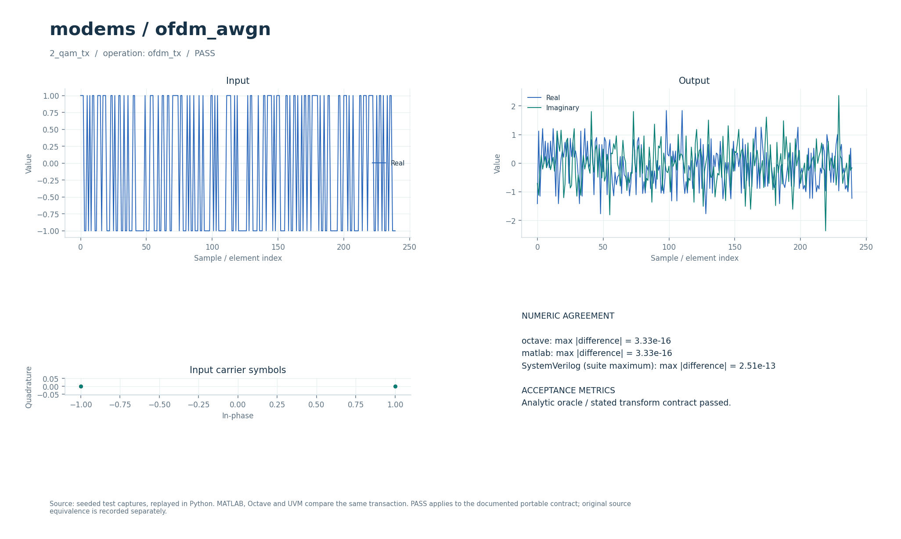

# Блочный OFDM с циклическим префиксом

Потоковые fixed-point передатчик и приёмник OFDM на общем radix-2 FFT/IFFT. Передатчик превращает N комплексных символов в N+CP отсчётов, приёмник выполняет обратное преобразование.

## Что это

Независимый алгоритмический аналог исторического примера OFDM over AWGN. Недостающие вспомогательные функции оригинала заменены явным контрактом FFT/IFFT и циклического префикса; исходная карта 48/64 несущих и размещение пилотов не воспроизводятся.

Переносимые Python, Octave/MATLAB и поведенческий SV/UVM находятся в [modems/ofdm_awgn](../../../modems/ofdm_awgn/), их контракт — в [model.json](../../../modems/ofdm_awgn/model.json) и [TYPED_MODELS.md](../../../docs/TYPED_MODELS.md). Они используют блочные операции `ofdm_tx`/`ofdm_rx`. Синтезируемый RTL этого каталога сравнивается с целочисленным [ofdm_fixed.py](../../../common/python/ofdm_fixed.py), отдельно — с вещественным [research_core.py](../../../common/python/research_core.py).

Есть численные SV-тесты, полный UVM для внешних контактов и исторические результаты физической проверки на 100 МГц. Матрица конфигураций и результаты описаны в [FFT_RTL.md](../../../docs/FFT_RTL.md); это не заявление о новой физической проверке текущего снимка.

## Как работает

1. Внешний mapper подаёт N комплексных символов `S[k]` на TX. Сам `ofdm_tx` не получает биты и не выбирает созвездие.
2. Предмасштабирование `S/√N` → обратный `fft_r2sdf` без деления на N → насыщение до 18 бит. Получается `x=ifft(S)·√N`.
3. Двухбанковый буфер выдаёт `x[N−CP…N−1]`, затем весь `x[0…N−1]`.
4. Канал AWGN создаётся тестом вне RTL.
5. RX принимает ровно N+CP отсчётов, отбрасывает первые CP, считает `FFT(x)/N`, затем умножает на `√N`. Результат — `S_hat=FFT(x)/√N` в естественном порядке несущих.

| Параметр/узел | Значение |
| --- | --- |
| `LOG2N` | По умолчанию 5; допустимо 2…10, N=4…1024 |
| `CP` | По умолчанию 8; допустимо 0…N |
| `TWIDDLE_FILE` | По умолчанию `rtl/common/mem/fft_twiddle_32.mem`; должен соответствовать N |
| Вход/выход TX и RX | I/Q signed 18/15, −4…4−2⁻¹⁵ |
| Внутренний FFT | По умолчанию 18-битный вход и 20-битный выход |
| Масштабирующая константа K | 46341 при нечётном `LOG2N`, иначе 32768 |
| TX-сдвиг | `SHIFT_TX=15+ceil(LOG2N/2)` |
| RX-сдвиг | `SHIFT_RX=15-floor(LOG2N/2)` |
| Округление | Половина вверх: `(v+2^(s−1)) >> s`, затем насыщение |
| Задержка FFT-цепочки | `L=N−1+4·LOG2N` продвижений; переупорядочивание добавляет буферизацию |

Оба интерфейса: `clk/rst`, `s_re/s_im/s_valid/s_ready/s_last` → `m_re/m_im/m_valid/m_ready/m_last`, плюс sticky `error`. Параметры N/CP задаются при elaboration; конфигурационного порта нет. Передача — на фронте `valid && ready`, остановленный выход удерживается. `RESET_ACTIVE` выбирает полярность синхронного сброса.

TX требует `s_last` на N-м символе и выдаёт `m_last` на (N+CP)-м отсчёте. RX требует `s_last` на (N+CP)-м отсчёте и выдаёт N символов. Ошибочное положение `last` поднимает `error`; фактические границы задаются счётчиком. TX хранит преобразованный кадр до выдачи префикса, поэтому это кадровая задержка, даже при потоковом интерфейсе.

Без остановок задержка первого выхода FFT около `L+N+3` тактов от первого входа. У TX дополнительно есть три ступени предмасштабирования и ожидание готового префиксного банка, у RX — приём/удаление CP и три ступени масштабирования. В установившемся режиме выход TX требует N+CP тактов на кадр, тогда как его вход содержит N слов; средний входной темп поэтому ограничен префиксом.

## Структура каталога

| Файл/подкаталог | Назначение |
| --- | --- |
| [ofdm_tx.sv](ofdm_tx.sv) | Масштаб, IFFT, двухбанковая память CP, выходная FIFO |
| [ofdm_rx.sv](ofdm_rx.sv) | Удаление CP, FFT и восстановление масштаба |
| [../../common/fft_r2sdf.sv](../../common/fft_r2sdf.sv) | Общее FFT/IFFT с естественным порядком выхода |
| [../../common/fft_delay.sv](../../common/fft_delay.sv), [../../common/mem/](../../common/mem/) | Линии задержки, память и твиддлы |
| [../../tb/ofdm_tb.sv](../../tb/ofdm_tb.sv) | Численный TX/RX scoreboard и наблюдатели |
| [../../../tools/ofdm_cases.py](../../../tools/ofdm_cases.py) | Векторы и ожидаемые события насыщения |
| [../../../tests/test_ofdm_fixed.py](../../../tests/test_ofdm_fixed.py) | Python-проверки масштаба, CP, созвездий и насыщения |
| [../../../modems/ofdm_awgn/model.json](../../../modems/ofdm_awgn/model.json) | Контракт переносимой модели и метаданные исторического источника |

## Как запустить

Из корня проекта: Python с NumPy/PyYAML по [requirements-rtl.txt](../../../requirements-rtl.txt), Verilator для lint, Questa/UVM 1.2 для HDL. Octave/MATLAB нужны только для отдельных переносимых сравнений.

```bash
python3 tools/run_ofdm.py --suite python
python3 tools/run_ofdm.py --suite lint
python3 tools/run_ofdm.py --suite all
python3 tools/run_dsp_uvm.py --suite all --case ofdm_tx_n32_cp8
python3 tools/run_dsp_uvm.py --suite all --case ofdm_rx_n32_cp8
```

Основной runner проверяет пары `(N,CP)` = (32,8), (32,0), (64,16), (4,1), (1024,64), (8,8), обе полярности, поток, паузы и сброс. Две UVM-команды выбирают TX/RX при N=32, CP=8; `--case all` запускает всю DSP-матрицу. Время полной серии зависит от симулятора и компиляции.

## Что смотреть

`build/rtl/ofdm/<suite>_results.json`, `vectors/n<N>_cp<CP>/`, журналы `stream/stalled/midreset/outreset` в каталогах полярностей; UVM — `build/rtl/dsp_uvm/`. Помимо выходов проверяются внутренние FFT, границы выражений и насыщения. В векторах `saturation.json` описывает внешние ограничители, `fft_saturation.json` — ограничители вложенного FFT; дублирование CP не считается повторным вычислением насыщения.

Завершённый PASS требует битоточного совпадения TX/RX с `ofdm_fixed`, корректной геометрии и обнаружения отрицательных контролей. Вещественные сравнения в `test_ofdm_fixed.py` допускают максимальную ошибку менее `2·10^-3` для N≤64 и `6·10^-3` для N=1024. На конкретных случаях с созвездиями 2/4/16/64 и комплексным шумом масштаба 0.003 решения совпадают; это не измерение BER для всех каналов.

[FFT_RTL.md](../../../docs/FFT_RTL.md), [RTL_DSP_UVM.md](../../../docs/RTL_DSP_UVM.md), [RTL_EMBEDDED_FFT.md](../../../docs/RTL_EMBEDDED_FFT.md), [RTL_SPECTRAL_SATURATION.md](../../../docs/RTL_SPECTRAL_SATURATION.md) описывают численные и протокольные проверки. [Визуальный отчёт модели](../../../docs/typed_visual/index.html#modems/ofdm_awgn) показывает переносимые операции.



## Ограничения

Нет поиска начала пакета, оценки CFO, пилотов, карты активных/нулевых несущих или эквализации канала. Подаются уже сформированные комплексные символы и выровненные кадры. Рост ошибки округления с N и насыщение при большой пиковой амплитуде входят в fixed-point модель.

Исторический скрипт в публичный репозиторий не входит. Его происхождение, размер 9535 байт и SHA-256 записаны в [model.json](../../../modems/ofdm_awgn/model.json). Воспроизведение исходного MATLAB-примера требует самого скрипта и его исторических вспомогательных функций; независимые переносимые и RTL-тесты проверяют явно заданный новый контракт. Совпадение языковых реализаций не доказывает эквивалентности оригинальной карты несущих.
