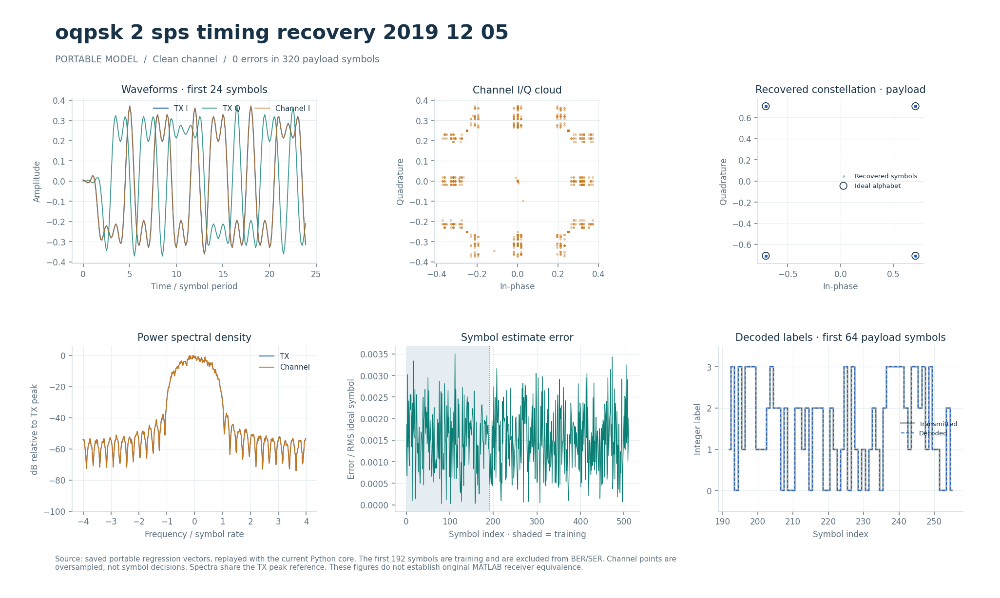

# OQPSK-модем с раздельными моментами I/Q (2019-12-05)

Потоковые fixed-point TX/RX OQPSK с захватом по преамбуле и раздельной петлёй несущей. Q-ветвь передатчика задержана на полсимвола, приёмник выбирает I и Q в разных временных позициях.

## Что это

Алгоритмический аналог исторической модели `oqpsk_2_sps_timing_recovery_2019_12_05`. Несмотря на `2_sps` в имени, переносимая конфигурация и этот RTL используют 8 отсчётов на символ. Исходные многочастотное расписание, скремблер и fixed-point арифметика фильтров не воспроизводятся.

Переносимые Python, Octave/MATLAB и поведенческий SV/UVM находятся в [каталоге модели](../../../modems/oqpsk_2_sps_timing_recovery_2019_12_05/), параметры — в [config.json](../../../modems/oqpsk_2_sps_timing_recovery_2019_12_05/config.json). Целочисленный эталон RTL — [oqpsk_fixed.py](../../../common/python/oqpsk_fixed.py). Используются RRC, ротатор, CORDIC и делитель BPSK-пилота, кадровая память CPM.

Численные и UVM-проверки описаны в [OQPSK_RTL.md](../../../docs/OQPSK_RTL.md). Исторический синтез на 100 МГц относится к снимку `cb0a484`; текущая задержка петли `LOOP_DELAY=8` физически заново не проверялась. Дополнительный локальный тест после изменения общего делителя прошёл при активном высоком сбросе; при активном низком сбросе сборка полного тестбенча завершилась внутренней ошибкой Verilator. Этот неполный результат не является PASS всей матрицы.

## Как работает

1. **TX:** метки 0…3 отображаются в квадранты `(+,+),(-,+),(-,-),(+,-)`. I-импульс стоит в `8k`, Q-импульс того же символа — в `8k+4`; обе компоненты имеют модуль 23170 в Q15. Далее RRC из 33 отводов; длина `8N+36`.
2. **RX:** согласованный RRC → два кадровых буфера с кубической интерполяцией. После `s_last` в фильтр дозагружаются 32 нуля с остановкой входа.
3. **Захват:** после 1088 записанных отсчётов на 18 целых задержках −1…16 накапливается корреляция с I/Q преамбулы по восьми блокам из 16 символов. Максимум энергии и парабола дают дробную задержку.
4. **Фаза и частота:** фазы восьми блоков считаются CORDIC и разворачиваются. МНК даёт `slope=divide(6·Σ(2b−7)·p[b],8064)` на символ, затем `frequency=divide(slope,8)` на отсчёт.
5. **Данные:** `zI` берётся в `32+8k+delay`, `zQ` — на 4 отсчёта позже. После поворотов `θI=phase+slope·k+loop_phase`, `θQ=θI+4·frequency` решение равно `{im(rQ)<0, (re(rI)<0) XOR (im(rQ)<0)}`.
6. **Петля:** усредняются ограниченные ±0.5 рад ошибки I/Q; поправка от символа `k−LOOP_DELAY` обновляет частоту и фазу. До k=188 цель известна по преамбуле, затем используется решение.

| Параметр/узел | Значение |
| --- | --- |
| Модуляция / дифференциальное кодирование | OQPSK, 4 метки, без дифференциального кодирования |
| `sps`, RRC, rolloff | 8; 33 отвода; 1.0 |
| Конфигурация RX | 192 двухбитные `cfg_label`, затем `cfg_last`; `cfg_count` N=192…2048 |
| RX-длина | `8N…8N+96` входных отсчётов с `s_last` |
| I/Q | signed 18/15 |
| Фаза/частота | 32 бита, оборот `2^32` |
| Задержка захвата | signed 32/16, интерполятор использует 8 дробных бит |
| `LOOP_DELAY` | По умолчанию 8 символов, допустимый параметр 1…16 |
| Коэффициенты петли | 1311 и 7 в Q15, соответствуют 0.04 и 0.0002 |
| Темп обработки символа | Не менее 4 тактов; ожидание ошибки/отсчётов добавляет паузы |

TX имеет двухбитный порт метки `s_bit`; RX конфигурируется через `cfg_label` и выдаёт `m_label`, `m_re=Re(rI)`, `m_im=Im(rQ)`, `m_last`. Вход RX — `s_re/s_im/s_valid/s_ready/s_last`, выход — `m_valid/m_ready`. Оценки задержки/частоты/фазы сопровождаются `acquisition_valid`. Конфигурация разрешена при свободных буферах; синхронный сброс задаётся `RESET_ACTIVE`.

Запрос следующей I/Q-пары разрешается лишь при наличии всех кубических отводов и записанной ошибки нужного возраста. При `!m_ready` тракт удерживается. Измеренный ранее путь от запроса до записи ошибки — 45 разрешённых тактов; этот факт объясняет вставку ожиданий при коротком `LOOP_DELAY`, но не задаёт частоту FPGA.

## Структура каталога

| Файл/подкаталог | Назначение |
| --- | --- |
| [oqpsk_tx.sv](oqpsk_tx.sv) | Сдвиг Q, mapper, RRC и выходная буферизация |
| [oqpsk_rx.sv](oqpsk_rx.sv) | Конфигурация, захват, память и генератор I/Q-запросов |
| [oqpsk_costas.sv](oqpsk_costas.sv) | Раздельные повороты I/Q, решения и петля фазы |
| [../bpsk_costas_2008_08_25/](../bpsk_costas_2008_08_25/README.md) | Общие FIR, CORDIC, делитель, ротатор и таблицы |
| [../msk_modulator_2008_06_22/cpm_samples.sv](../msk_modulator_2008_06_22/cpm_samples.sv) | Двухкадровая память и интерполяция |
| [../../tb/oqpsk_tb.sv](../../tb/oqpsk_tb.sv) | Численный TX/RX-тест |
| [../../../tools/oqpsk_cases.py](../../../tools/oqpsk_cases.py) | Векторы каналов и оценки петель |
| [../../../tests/test_oqpsk_fixed.py](../../../tests/test_oqpsk_fixed.py) | Python-проверки формы сигнала, каналов, фазового шума, возраста ошибки и хвостов |
| [../../../modems/oqpsk_2_sps_timing_recovery_2019_12_05/source_parameters.json](../../../modems/oqpsk_2_sps_timing_recovery_2019_12_05/source_parameters.json) | Извлечённые параметры исторических блоков |

## Как запустить

Из корня проекта; Python с NumPy/PyYAML по [requirements-rtl.txt](../../../requirements-rtl.txt), Verilator для lint, Questa/UVM 1.2 для HDL:

```bash
python3 tools/run_oqpsk.py --suite python
python3 tools/run_oqpsk.py --suite lint
python3 tools/run_oqpsk.py --suite all
python3 tools/run_oqpsk_uvm.py --suite all
python3 tools/run_packet_rx_uvm.py --suite all --profile oqpsk
```

Основной runner проверяет TX/RX и захват, loopback, минимальные/максимальные кадры, паузы, сброс и отрицательные контроли. TX UVM отдельно проверяет реальные двухбитные метки, геометрию `8N+36`, противодавление и сброс удерживаемого TLAST. Пакетный RX UVM добавляет независимое сравнение SER и проверки внешних контактов. Octave/MATLAB для этих RTL-прогонов не требуются.

## Что смотреть

`build/rtl/oqpsk/<suite>_results.json`, каталоги полярностей и векторы; TX UVM — `build/rtl/oqpsk_uvm/all_results.json`; RX UVM — `build/rtl/packet_rx_uvm/oqpsk_all_results.json`. Для положительных прогонов нужны завершённый PASS, актуальные хеши и совпадение всех отсчётов/символов/оценок захвата. Негативы должны обнаружить именно внесённое нарушение.

SER — доля ошибочных двухбитных меток после преамбулы; она не равна BER без отдельного подсчёта битовых различий. Ошибки на низком ОСШ допустимы в численной проверке, если RTL повторяет эталон. Для изменения задержки петли сравнивайте те же кадры и фазовые возмущения: [RTL_LOOP_DELAY.md](../../../docs/RTL_LOOP_DELAY.md). Протокол TX — [RTL_OQPSK_UVM.md](../../../docs/RTL_OQPSK_UVM.md), RX — [RTL_PACKET_RX_UVM.md](../../../docs/RTL_PACKET_RX_UVM.md). Внутренние проверки — [RTL_OQPSK_NESTED_BOUNDS.md](../../../docs/RTL_OQPSK_NESTED_BOUNDS.md); приведённые там 64 итерации делителя относятся к прежнему режиму, текущий runner учитывает 32 итерационных такта.

[Типизированный визуальный отчёт](../../../docs/typed_visual/index.html) показывает переносимую модель:



## Ограничения

Название исторической модели не определяет sps текущего RTL. Начальная временная оценка выполняется по преамбуле; исходное многочастотное восстановление времени не перенесено. Совпадение исторического mapper/скремблера не заявляется. Паузы, необходимые для готовности обратной связи, зависят от `LOOP_DELAY`; допустимость параметра 1…16 сама по себе не гарантирует одинакового качества и темпа.

Историческая модель в публичный репозиторий не входит. [source_parameters.json](../../../modems/oqpsk_2_sps_timing_recovery_2019_12_05/source_parameters.json) хранит поля блоков, происхождение и SHA-256 записаны в [config.json](../../../modems/oqpsk_2_sps_timing_recovery_2019_12_05/config.json). Размер исходника в этих двух файлах отсутствует; запись с размером есть в [typed_model_catalog.json](../../../docs/typed_model_catalog.json). Повторная MATLAB-проверка исторической модели требует исходника и соответствующей среды; отдельного `matlab/verification.json` у этого модуля нет. Полная эквивалентность оригиналу не установлена.
