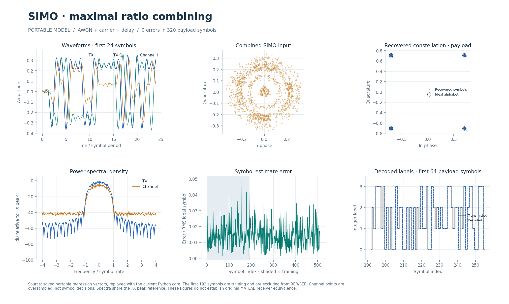

# Двухветвевой QPSK-приёмник с MRC (2010-08-27)

Потоковый SIMO-приёмник объединяет две синхронные комплексные ветви с известными параметрами канала и декодирует дифференциальную QPSK. Веса MRC рассчитываются в RTL один раз на конфигурацию.

## Что это

Алгоритмический аналог исторической Simulink-модели `simo_maximal_ratio_combining_2010_08_27`. [simo_rx.sv](simo_rx.sv) соединяет общий `fxp_mrc2` и `bpsk_rx` с `ORDER=4`, `AMPLITUDE=23170`, `DIFFERENTIAL=1`, обратной связью несущей и временной петлёй — профиль `QPSK_DIFF`.

Целочисленные эталоны — [mrc_fixed.py](../../../common/python/mrc_fixed.py) и [psk_fixed.py](../../../common/python/psk_fixed.py). Переносимые Python, Octave/MATLAB и поведенческий SV/UVM находятся в [каталоге модели](../../../modems/simo_maximal_ratio_combining_2010_08_27/); параметры — в [config.json](../../../modems/simo_maximal_ratio_combining_2010_08_27/config.json). Передатчик — общее ядро `bpsk_tx` в конфигурации QPSK_DIFF; отдельного TX-файла в этом каталоге нет.

Есть блочные проверки делителя/MRC, сквозные численные проверки и полноценный RX UVM с независимой вещественной SER. Исторические результаты физической приёмки приведены в [BPSK_RTL.md](../../../docs/BPSK_RTL.md#simo-mrc). Изменения общего PSK-захвата acq1 проверены Verilator также для SIMO, но старые STA-цифры не подтверждают текущий RX.

## Как работает

1. Общий QPSK TX выполняет фазовое дифференциальное кодирование Грея, выбирает диагональные точки единичной энергии и формирует сигнал RRC, 8 отсчётов на символ.
2. Внешний канал создаёт ветви `x_a=g_a·s+n_a`, `x_b=g_b·s+n_b`. Обе ветви имеют общий такт и одинаковую задержку.
3. Конфигурация MRC задаёт комплексные усиления `g_a/g_b` и относительные дисперсии `v_a/v_b`. Вычисляются `D=|g_a|²·v_b+|g_b|²·v_a`, `w_a=conj(g_a)·v_b/D`, `w_b=conj(g_b)·v_a/D`.
4. На каждой принятой паре отсчётов объединитель считает `y=w_a·x_a+w_b·x_b`, округляет и насыщает результат.
5. `bpsk_rx` выполняет RRC, кадровую буферизацию, захват по 192 меткам, кубическую интерполяцию, сопровождение несущей/времени/усиления, решение QPSK и дифференциальное декодирование.

| Параметр/узел | Значение |
| --- | --- |
| Число ветвей / алфавит | 2 / 4 метки QPSK |
| `sps`, RRC, rolloff | 8; 33 отвода; 1.0 |
| Отсчёты и усиления | signed 18/15, диапазон компоненты −4…4−2⁻¹⁵ |
| `variance_a`, `variance_b` | unsigned 16, 1…65535 в общем масштабе; важно отношение |
| Веса MRC | signed 18/14; проверяется представимость компонент |
| Расчёт весов | Около 310 тактов, общий умножитель и последовательный делитель |
| Тракт MRC | 5 ступеней + FIFO на 8 слов; латентность до выходной передачи 6 тактов без остановок, II=1 |
| Преамбула / `cfg_count` | 192 двухбитные метки / N=192…2048 |
| RX-длина после MRC | `8N…8N+64` отсчётов, затем 32 такта FIR-дополнения |
| TX-длина | `8N+32` комплексных отсчёта |

Усиления загружаются рукопожатием `gain_valid/gain_ready`; готовность — `gain_configured`, отказ — `gain_error`. Преамбула отдельно поступает через `cfg_valid/cfg_ready/cfg_bit/cfg_last`, готовность RX — `configured`. Вход разрешён после обеих конфигураций. Изменять настройки можно лишь при свободном тракте, включая данные в переднем регистре/объединителе.

Две ветви разделяют `s_valid/s_ready/s_last`; одна передача содержит четыре компоненты `s_a_re/s_a_im/s_b_re/s_b_im`. Выход — `m_bit/m_index` по 2 бита, I/Q, состояния петель и `m_last`; захват имеет `acquisition_*`. Передача — при `valid && ready`. FIFO и учёт слов в полёте защищают MRC при противодавлении; синхронный сброс `RESET_ACTIVE` отменяет незавершённую обработку.

Нулевая дисперсия, D=0 или непредставимый вес дают `gain_error`, объединитель остаётся ненастроенным. Округление MRC — к ближайшему чётному. `saturated` фиксирует насыщение результата до следующей конфигурации; это отдельный признак от `error` приёмника.

## Структура каталога

| Файл/подкаталог | Назначение |
| --- | --- |
| [simo_rx.sv](simo_rx.sv) | Арбитраж конфигураций, передний регистр, MRC и QPSK RX |
| [../../common/fxp_mrc2.sv](../../common/fxp_mrc2.sv) | Расчёт весов и двухветвевое объединение |
| [../../common/fxp_divide_seq.sv](../../common/fxp_divide_seq.sv) | Последовательный делитель MRC |
| [../bpsk_costas_2008_08_25/](../bpsk_costas_2008_08_25/README.md) | Общие TX/RX, память, фильтры и захват |
| [../../tb/mrc_blocks_tb.sv](../../tb/mrc_blocks_tb.sv) | Блочные проверки делителя, весов, отказов и выходов MRC |
| [../../tb/rx_cfg_priority_tb.sv](../../tb/rx_cfg_priority_tb.sv) | Приоритет конфигурации и граница свободного тракта |
| [../../../tests/test_mrc_fixed.py](../../../tests/test_mrc_fixed.py) | Вещественные сравнения весов, насыщение, каналы и выигрыш разнесения |
| [../../../modems/simo_maximal_ratio_combining_2010_08_27/source_parameters.json](../../../modems/simo_maximal_ratio_combining_2010_08_27/source_parameters.json) | Поля исторических блоков с номерами строк |

## Как запустить

Из корня проекта: Python с NumPy/PyYAML по [requirements-rtl.txt](../../../requirements-rtl.txt), Verilator для lint, Questa/UVM 1.2 для HDL.

```bash
python3 tools/run_bpsk.py --suite python
python3 tools/run_bpsk.py --suite lint
python3 tools/run_bpsk.py --suite all
python3 tools/run_bpsk_uvm.py --suite all --pilot rx --profile qpsk_diff
python3 tools/run_psk_tx_uvm.py --suite all --profile qpsk_diff
```

Основной runner включает SIMO наряду с остальными PSK/QAM-профилями и запускает MRC-блочные проверки. Отдельный RX UVM выбирает двухветвевой профиль; TX UVM проверяет его общий передатчик. Octave/MATLAB для этих команд не нужны. Время полной серии зависит от симулятора и числа профилей.

## Что смотреть

`build/rtl/bpsk/` содержит численные прогоны и MRC-блочные журналы; `build/rtl/bpsk_uvm/` — RX UVM, `build/rtl/psk_tx_uvm/` — TX UVM. Для выбранного RX-профиля ищите `qpsk_diff_rx_all_results.json`. Требуются завершённый PASS с актуальными хешами, совпадение весов/ошибок конфигурации, выходов, TLAST и захвата, а также успешные отрицательные контроли.

В тестах сравниваются веса с вещественной формулой, результаты объединения и SER по полезным QPSK-меткам. Документированный опыт при σ=0.3 на ветвь, 10 кадров по 1536 символов: 195 ошибок у fixed MRC, 201 у вещественного MRC и 309 у одной лучшей ветви. Это свидетельство выигрыша на конкретном наборе; BER здесь отдельно не выводится из SER.

[BPSK_RTL.md](../../../docs/BPSK_RTL.md#simo-mrc), [RTL_BPSK_UVM.md](../../../docs/RTL_BPSK_UVM.md), [RTL_MODEM_PIN_RATES.md](../../../docs/RTL_MODEM_PIN_RATES.md) описывают арифметику, независимый float RX и измерения контактов. [Интерактивный отчёт](../../../docs/visual/index.html#section=explorer&model=simo_maximal_ratio_combining_2010_08_27), [MATLAB-график](../../../docs/visual/matlab/simo_maximal_ratio_combining_2010_08_27.png), [PDF](../../../docs/visual/modem_test_report.pdf).



## Ограничения

Оценки усилений ветвей по преамбуле и выравнивания разных задержек нет. Усиления и дисперсии должны быть известны и представлены в допустимых форматах. Независимые тактовые домены на двух входах не поддерживаются. Насыщение MRC и входа RX влияет на качество, даже если протокол соблюдён. Захват/сопровождение наследуют ограничения общего PSK-ядра.

Историческая модель в публичный репозиторий не входит. [source_parameters.json](../../../modems/simo_maximal_ratio_combining_2010_08_27/source_parameters.json) хранит извлечённые поля; происхождение и SHA-256 — в [config.json](../../../modems/simo_maximal_ratio_combining_2010_08_27/config.json). Размер исходника в этих JSON не указан.

Повторная MATLAB-проверка и новые захваты требуют исторического исходника. [verification.json](../../../modems/simo_maximal_ratio_combining_2010_08_27/matlab/verification.json) фиксирует отказ компиляции неизменённой модели из-за неопределённых размерностей и отдельные runtime-изменения подготовленного запуска; [migration.json](../../../modems/simo_maximal_ratio_combining_2010_08_27/matlab/migration.json) хранит хеши. Успешная симуляция подготовленной копии не доказывает эквивалентности всего RX: [MATLAB_MODEM_VERIFICATION.md](../../../docs/MATLAB_MODEM_VERIFICATION.md), [PORTING_CONTRACT.md](../../../docs/PORTING_CONTRACT.md).
